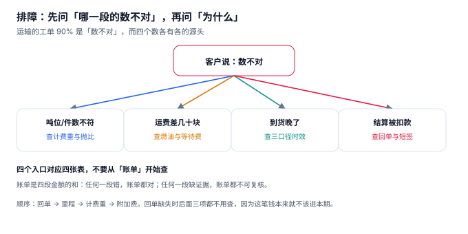

# 常见问题

运输系统的工单九成是同一句话：**「数不对」**。金额多了、里程少了、吨位不符、到货晚了。这四个字背后至少对应四张不同的表，而绝大多数排查失败的原因不是「查不出来」，是**从账单开始查**——账单是四段金额的和，任何一段错它都对，任何一段缺证据它都不可复核。

::: tip 一句话理解
排障顺序是：**回单 → 里程 → 计费重 → 附加费**。回单缺失时后面三项都不用查，因为这笔钱本来就不该进本期。
:::

## 一、排障顺序



| 现象 | 先查 | 再查 | 最后查 |
| --- | --- | --- | --- |
| 吨位/件数不符 | `shipment.actual_kg` / `volume_m3` | `ratio_kg_m3` | 抛比所属合同 |
| 运费差几十块 | `freight_line` 四段 | `mileage_log` 三个口径 | 燃油取价日 |
| 到货晚了 | `trip_stop.arrive_at` | `pod.signed_at` | 承诺时刻 vs 计划时刻 |
| 结算被扣款 | `pod.exception` | `pod.signed_qty` | 扣款单价依据 |

## 二、计费重争议：客户说「你们算贵了」

这是最高频的商务争议。三步查清：

```sql
SELECT s.shipment_no, s.actual_kg, s.volume_m3, s.ratio_kg_m3,
       s.volume_m3 * s.ratio_kg_m3 AS volume_weight,
       s.chargeable_kg,
       CASE WHEN s.actual_kg < s.volume_m3 * s.ratio_kg_m3
            THEN '泡货（按体积计费）' ELSE '重货（按实重计费）' END AS basis
FROM shipment s WHERE s.shipment_no = :no;
```

| 查出来的情况 | 结论 | 怎么回客户 |
| --- | --- | --- |
| `basis = 泡货`，`ratio = 333` | 按合同 1:3000 计费 | 拿出合同条款，说明「轻抛货按体积折算」 |
| `ratio` 与合同不一致 | 单据脏数据 | 修 `ratio_kg_m3`，重算该单，差额冲下期 |
| `volume_m3` 明显偏大 | 体积来自「车厢占用」而非外包装 | 以打托实测体积为准，重算 |
| 实重与客户过磅差 > 2% | 过磅口径不同（含托盘/不含托盘） | 明确「含托盘」还是「净重」 |

::: danger 一个必须避免的回答
**「系统就是这么算的」** —— 这句话在争议里等于承认无法举证。正确做法是永远能回答「依据哪一条、哪个字段、哪次取价」。
:::

## 三、超载与轴荷

| 问题 | 原因 | 处理 |
| --- | --- | --- |
| 装满了但超载 | 按体积装车，未校验载重 | 装车前跑一次三维校验（体积/载重/轴荷） |
| 总重合格但后轴超 | 货装得偏后 | 重货靠前、轻货靠后；必要时拆单 |
| 同一台车被派两次 | 派车是「先查后写」 | 改条件更新 + 幂等键 |
| 装载率虚高 | 用「车厢占用」算体积 | 以打托实测体积为准 |

轴荷的速算公式：`前轴 = 整备前 + 货重 × (轴距 − 重心距前轴) ÷ 轴距`。本册[配载与装载](../Loading/index.md)给了一个「总重合格、后轴超 86 kg」的完整算例。

## 四、里程差异

| 现象 | 排查方向 | 常见根因 |
| --- | --- | --- |
| GPS 里程比路码表少 | 丢点段是否直线连接 | 隧道/地库无信号 |
| 计费里程比实际少 | 合同约定是「计划 × 系数」 | 绕行率高于系数 |
| 同一条线路每天里程不同 | 停靠顺序变了 | 多点配送顺序未固定 |
| 里程突然变大 | 定位漂移 | 坐标纠偏或基站定位 |

一个经验值：**绕行率 P50 约 7.2%，P90 约 13.0%**。如果某条线路绕行率长期高于 15%，通常不是司机绕路，是「计划里程用了不合适的路网」（比如按高速算，实际只能走国道）。

## 五、回单与结算

| 现象 | 排查 | 结论 |
| --- | --- | --- |
| 货到了但没进结算 | `pod` 是否有 `VALID` 记录 | 缺回单，属「暂时不能认」 |
| 同一单两条回单 | `trg_pod_one_valid` 是否生效 | 触发器缺失或批量导入绕过 |
| 短签扣款算错 | `pieces − signed_qty` | 件数口径（含托盘？） |
| 代收金额对不上 | `exception = 'COD_UNPAID'` | 拒收但未登记 |

回单相关的三个数应该每天看：**T+1 上传率、挂账金额、重复回单数**。本机 T+1 上传率 50%（示例数据）、电子回单缺失 8.05%、挂账约 210 万元。

## 六、司机工时

| 问题 | 判定 | 后果 |
| --- | --- | --- |
| 连续驾驶超 4 小时 | 单段行驶 > 240 min | 违规，罚单与保险拒赔风险 |
| 日累计超 10 小时 | 当日累计 > 600 min | 疲劳驾驶高风险 |
| 排班「看起来」合规 | 只按趟次算，未按实际驾驶时长 | 本机 27.7% 的车次存在风险 |

插入强制休息的成本是真实的：本机每车次平均多耗 **0.87 小时**。这笔钱必须进报价模型，否则「合规」会变成「亏钱」。

## 七、二十条快问快答

| # | 问题 | 答案 |
| --- | --- | --- |
| 1 | 计费重为什么不是实重？ | 轻抛货占运力，按体积折算才公平 |
| 2 | 1:3000 与 1:6000 差多少？ | 本机 48.6%（80,785.5 吨 vs 56,962.4 吨） |
| 3 | 装载率看哪个口径？ | 三个都看，取最小 |
| 4 | 为什么按体积装满会超载？ | 重货密度高于车厢「体积/载重」比 |
| 5 | 轴荷要不要算？ | 要，总重合格不等于轴荷合格 |
| 6 | 派车为什么要有幂等键？ | 网络重试会产生两张派车单 |
| 7 | 条件更新和唯一键哪个够？ | 都不够，要一起用 |
| 8 | GPS 里程能当实际里程吗？ | 不能，丢点会单向低估约 1.2% |
| 9 | 采样频率越高里程越准吗？ | 影响很小（300 s 只低估 0.21%） |
| 10 | 回单要存哪些字段？ | 谁签、何时签、签几件、是否有效 |
| 11 | 为什么回单要独立成表？ | 一单可能多张回单（补签、作废重签） |
| 12 | 结算能不能没有回单？ | 不能，触发器直接拦 |
| 13 | 运费为什么要拆四段？ | 只有基础运费是合同价，其余每天在变 |
| 14 | 燃油联动用连续还是阶梯？ | 连续更公平，阶梯更好实现，差 1~2 个百分点 |
| 15 | 等待费为什么老漏？ | 靠人工上报，没人愿意为几十块填单 |
| 16 | 对账只看总额行不行？ | 不行，净额会掩盖双向差异 |
| 17 | 吨公里成本用哪个分母？ | 三个都算，对外比价用吨公里 |
| 18 | 空驶率越低越好吗？ | 不是，要看回程货净贡献 |
| 19 | 时效达成率有几个？ | 三个（承诺/计划/预测），本机 93.0/84.5/83.0 |
| 20 | 这套表能直接上生产吗？ | 不能，本册是教学模型，生产要加事务、分区与审计 |

## 八、判据族 `FTQ-A ~ FTQ-H`

本页判据族 `FTQ-A` ~ `FTQ-H`，共 8 条。它们描述「排障路径是否有据可依」。

| 编号 | 判据 | 怎么验 |
| --- | --- | --- |
| `FTQ-A` | 任一金额都能追溯到四段构成 | 点开金额能看到 `base/fuel/wait/deduction` |
| `FTQ-B` | 任一计费重都能追溯到抛比与体积 | 单据上有 `ratio_kg_m3` 与 `volume_m3` |
| `FTQ-C` | 任一时效结论都带口径名 | 报表列名含 `_promise` / `_plan` / `_forecast` |
| `FTQ-D` | 任一扣款都能追溯到回单或定损单 | `deduction_ref` 非空 |
| `FTQ-E` | 排障顺序在文档里写死，不靠口口相传 | 本页第一节即排障树 |
| `FTQ-F` | 关键异常有固定 SQL，不需要临时写 | 存在 FAQ 对应的查询模板 |
| `FTQ-G` | 每个「快问快答」都能指向一节正文 | 20 条均有对应章节 |
| `FTQ-H` | 教学模型与生产模型的差异被明确标注 | 第 20 条写明「不能直接上生产」 |

## 九、验证方式

```shell
# 1. 计费重可追溯（期望能看到 ratio / volume_weight / chargeable 三列）
sqlite3 :memory: "
create table s(no text, actual_kg real, volume_m3 real, ratio real default 333);
insert into s values ('SH002',1500,12,333);
select no, actual_kg, volume_m3, volume_m3*ratio as volume_weight,
       max(actual_kg, volume_m3*ratio) as chargeable,
       case when actual_kg < volume_m3*ratio then '泡货' else '重货' end as basis from s;"
# 期望输出：SH002|1500.0|12.0|3996.0|3996.0|泡货

# 2. 金额四段可拆（期望合计 = 847.96）
sqlite3 :memory: "select 820.00+27.96+45.00-40.00;"
# 期望输出：847.96

# 3. 净额掩盖双向差异（期望净额 50,049，双向 154,499）
python3 -c "m,d=102274,52225; print(f'{m-d:,} / {m+d:,}')"
# 期望输出：50,049 / 154,499
```

第 3 步是排障里最容易被忽略的一条：**对账报表如果只有净额，你会以为问题只有 5 万，实际是 15.4 万。**

## 参考资料

- GB/T 18354—2021《物流术语》：运输、回单、计费重量、装载率等术语定义。
- GB 1589—2016《汽车、挂车及汽车列车外廓尺寸、轴荷及质量限值》：超载与轴荷判定的强制依据。
- 《道路货物运输及站场管理规定》（交通运输部）：连续驾驶与休息要求。
- 与本页相邻：[总览](../Overview/index.md)、[实战](../Practice/index.md)、[运费结算](../Settlement/index.md)。
