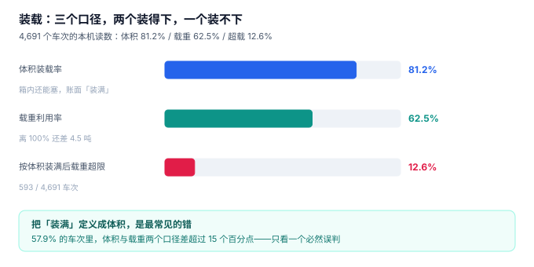

# 配载与装载

仓库月台上，三张单等着装车：12 托饮料（重 9.5 吨、占 22 方）、8 托纸巾（重 1.2 吨、占 18 方）、5 托五金（重 4.8 吨、占 6 方）。车厢 45 方、核定 12 吨。仓管先装饮料和纸巾，占了 40 方、10.7 吨，还剩 5 方——看起来「刚好装下五金」。五金装上去的那一刻，总重 15.5 吨，车还没出库就超载 29%。

**「装得下」在运输里有三个互不相等的答案：装得进车厢（体积）、扛得住载重（重量）、压不穿车轴（轴荷）。** 三者取最小值才是真正的装载上限，而日常操作按体积装车是最省事的——所以超载不是意外，是流程的必然结果。

::: tip 一句话理解
装载率不是一个百分比，是**三个百分比取最小**——体积、载重、轴荷。只看最大的那个，等于把「装满了」定义成「塞得进去」。
:::

## 一、三个口径，三种算法

| 口径 | 公式 | 谁在管 | 本机读数（4,691 车次） |
| --- | --- | --- | --- |
| 体积装载率 | `Σ volume_m3 ÷ 车厢容积` | 仓管、调度 | **81.2%** |
| 载重利用率 | `Σ actual_kg ÷ 核定载重` | 调度、安全 | **62.5%** |
| 轴荷合规 | 前轴 ≤ 6,500 kg、后轴 ≤ 11,500 kg | 路政、车管 | 按体积装满后 **12.6%** 超限 |



三个数放在一起看，问题立刻出现：**体积已经 81.2%，载重只有 62.5%，但仍有 12.6% 的车次超载**。原因不是数据矛盾，而是货物密度分布不均——轻抛货多的车次体积先满，重货车次载重先满，而「先算体积」的装车顺序会让重货车次在重量上穿线。

| 分布形态 | 体积装载率 | 载重利用率 | 谁先到顶 |
| --- | --- | --- | --- |
| 重货为主（密度 > 400 kg/m³） | 低 | 高 | 载重 |
| 轻抛货为主（密度 < 160 kg/m³） | 高 | 低 | 体积 |
| 混合（40% 重货 + 60% 轻货） | 中 | 中 | **不确定**，取决于装载顺序 |

本机 **57.9% 的车次**体积与载重两个口径差超过 15 个百分点——也就是说，超过一半的车次里，只看一个口径必然误判。

## 二、轴荷：总重没超，后轴也可能超

这是最容易被忽略的一条。GB 1589—2016 对轴荷有独立限值：二轴货车前轴 6,500 kg、后轴 11,500 kg，总质量限值 18,000 kg。**三个限值同时成立**，总重合格不代表轴荷合格。

### 一个必须自己算一遍的例子

一台 9.6 m 厢式车：整备质量 8,200 kg（前轴 3,400 / 后轴 4,800），轴距 5.6 m，核定载重 12,000 kg。

装货 9,500 kg，货物重心距前轴 4.0 m（装得偏后）：

| 项 | 计算 | 结果 |
| --- | --- | --- |
| 货重分到前轴 | 9,500 × (5.6 − 4.0) ÷ 5.6 | 2,714 kg |
| 货重分到后轴 | 9,500 − 2,714 | 6,786 kg |
| 前轴总重 | 3,400 + 2,714 | 6,114 kg（限 6,500，合格） |
| 后轴总重 | 4,800 + 6,786 | **11,586 kg（限 11,500，超 86 kg）** |
| 车辆总重 | 8,200 + 9,500 | 17,700 kg（限 18,000，合格） |

**总重合格、前轴合格、后轴超 86 公斤。** 这个误差在过磅时表现为「略微超限」，在刹车时表现为「后轮先抱死」。而绝大多数装车系统只校验总重，连轴荷这个字段都没有。

::: danger 四个装载建模错误
1. **只校验总重不校验轴荷**：上例就是标准形态。正确做法是 `trip_stop` 插入时同时算总重与前后轴分担，三个限值都要过。
2. **把「容积」当成整车一个数**：车厢容积 45 m³ 是理论值，实际可堆高受限于「不可压货」与「托盘层数」。饮料可堆 3 层、五金只能 1 层，同一车厢的有效容积差一倍。
3. **装载顺序不影响结果**——这是错的：先装重货靠前、轻货靠后，轴荷会显著不同。上例中货物重心从 4.0 m 前移到 2.6 m，前轴会变成 8,489 kg（超限 1,989 kg）。
4. **装载率用「车厢占用」估算体积**：装得越松体积越大，客户会认为你在多收钱；也会让「还能装一单」的判断失真。
:::

## 三、多点配送：顺序决定里程

一车装 5 个点，装车顺序（= 卸货逆序）直接决定总里程。本机 200 条 4~6 点路线：

| 策略 | 总里程 | 相对基准 | 说明 |
| --- | --- | --- | --- |
| 按委托顺序 | 16,593.6 km | —— | 谁先下单谁先送，最常见的默认行为 |
| 最近邻（贪心） | 12,013.1 km | **−27.6%** | 每次去最近的点，实现只要 10 行 |
| 2-opt 改良 | 11,664.3 km | **−29.7%** | 在最近邻基础上做局部反转 |

两点必须说清楚：

1. **最近邻不保证更优。** 200 条路线里有 **4 条（2.0%）** 贪心结果比按委托顺序还差——贪心只管下一步最近，不管整体闭环。所以工程上要么加 2-opt，要么保留「人工可覆盖」。
2. **优化的是里程，不是时效。** 2-opt 会让某些点的到达时间往后推（因为顺序变了），所以必须把「时窗」作为硬约束参与，而不是事后检查。

```text
装载与排序的约束顺序（不可交换）：
① 不可压货 → 决定堆叠层数 → 决定有效容积
② 卸货逆序 → 决定装车顺序 → 决定轴荷分布
③ 时窗     → 决定访问顺序 → 决定里程
④ 轴荷     → 决定是否需要拆单 → 决定车次数量
```

::: warning 一个真实的取舍
把装载率从 81.2% 提到 90%，通常意味着「多装一单小的」。这一单可能带来 20 公里绕行、末点晚到 40 分钟、以及后轴超限 200 公斤。**装载率是效率指标，不是目标函数**——用它做 KPI 的车队，最后都会在罚单和投诉上还回去。
:::

## 四、装载单的数据结构

```sql
CREATE TABLE trip_stop (
  trip_no     TEXT NOT NULL REFERENCES trip(trip_no),
  seq         INTEGER NOT NULL CHECK (seq > 0),      -- 装车顺序 = 卸货逆序
  shipment_no TEXT NOT NULL REFERENCES shipment(shipment_no),
  arrive_at   TEXT,
  wait_min    INTEGER NOT NULL DEFAULT 0 CHECK (wait_min >= 0),
  PRIMARY KEY (trip_no, seq),
  UNIQUE (trip_no, shipment_no)                       -- 同一单不能上两次车
);
```

三个细节：

- `UNIQUE (trip_no, shipment_no)`：防止同一张单被重复装车（分单错误时最容易发生）。
- `seq` 从 1 开始且非空：没有顺序的装载明细无法还原轴荷与卸货顺序。
- `wait_min` 落在停靠点而不是运单：等待发生在「这一次停靠」，同一单在改派后可能产生两次等待。

## 五、判据族 `FTL-A ~ FTL-H`

本页判据族 `FTL-A` ~ `FTL-H`，共 8 条。

| 编号 | 判据 | 怎么验 |
| --- | --- | --- |
| `FTL-A` | 插入装载明细时同时校验容积与载重 | 超容积报 `VOLUME_EXCEEDED`，超载重报 `PAYLOAD_EXCEEDED` |
| `FTL-B` | 轴荷按「货物重心位置」计算，不是按均布 | 重心前移后前轴数值变大 |
| `FTL-C` | 三个限值（前轴/后轴/总重）同时校验 | 单独超后轴即拒绝 |
| `FTL-D` | 装载率输出三个数（体积/载重/轴荷），不是一个 | 视图中三列都在 |
| `FTL-E` | 同一 `trip_no` 下同一 `shipment_no` 只能出现一次 | 重复插入违反唯一键 |
| `FTL-F` | `seq` 连续且从 1 开始 | `MAX(seq) = COUNT(*)` |
| `FTL-G` | 多点路线的里程可按「装车顺序」与「优化顺序」分别重算 | 两种顺序输出不同里程 |
| `FTL-H` | 装载后总重与轴荷写入快照，事后可复核 | `trip` 上有 `gross_kg` / `front_kg` / `rear_kg` |

## 六、验证方式

```shell
# 1. 轴荷：总重合格但后轴超限（期望 11586，限 11500）
python3 - <<'PY'
tare_f, tare_r, axle, cap = 3400, 4800, 5.6, 11500
cargo, cg = 9500, 4.0
front = tare_f + cargo * (axle - cg) / axle
rear  = tare_r + cargo * cg / axle
print(f"前轴 {front:.0f} kg / 后轴 {rear:.0f} kg / 总重 {tare_f+tare_r+cargo:.0f} kg")
print("后轴超限" if rear > cap else "合格")
PY
# 期望输出：前轴 6114 kg / 后轴 11586 kg / 总重 17700 kg，后轴超限

# 2. 装载约束：超容积必须被触发器拦住（期望 VOLUME_EXCEEDED）
sqlite3 :memory: "
create table v(volume_m3 real); insert into v values (45);
create table s(no text, volume_m3 real); insert into s values ('A',40),('B',8);
select case when sum(volume_m3) > (select volume_m3 from v) then 'VOLUME_EXCEEDED' else 'OK' end
from s;"
# 期望输出：VOLUME_EXCEEDED

# 3. 三个装载率（期望 体积 > 载重，且两者差 > 15 个百分点）
sqlite3 :memory: "
select round(100.0*40/45,1) as vol_pct, round(100.0*10.7/12,1) as wt_pct;"
# 期望输出：88.9|89.2 —— 这一车恰好两个口径接近，说明是重货混装
```

第 3 步的输出有教学价值：**88.9 与 89.2 几乎相等，说明这一车装的是密度接近 300 kg/m³ 的货**。只有当两个口径接近时，「按体积装」才等价于「按载重装」——这正是大部分车次不成立的前提。

## 参考资料

- GB 1589—2016《汽车、挂车及汽车列车外廓尺寸、轴荷及质量限值》：前轴、后轴与总质量的强制性限值，本页轴荷计算的对标依据。
- GB/T 18354—2021《物流术语》：配载、装载率、配送等术语定义。
- JTG D50—2017《公路沥青路面设计规范》：轴载换算方法（用于理解「轴荷为什么按轴算而不按总重算」）。
- 与本页相邻：[运输需求与计费重](../Demand/index.md)、[派车与调度](../Dispatch/index.md)、[实战](../Practice/index.md)。
