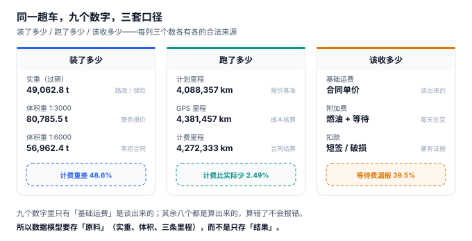

# 总览：三个「装了多少」与三个「跑了多少」

一位调度主管接手一条新线路，第一周就发现三张报表互相打架：调度系统说这条线路平均装载率 81%，财务说这条线路平均毛利 21.5%，客户投诉说「你们老是晚到」。他去现场跟了三天车，发现问题不在任何一张报表里——**报表算的是三个不同的东西**：调度算的是体积，财务算的是计费里程，客户算的是承诺到达时刻。三个数都「对」，但它们说的不是同一件事。

**运输系统的复杂度不在「把货送到」，而在于同一趟运输会被至少三套口径各描述一次，而这三套口径之间没有强制的一致性。** 电商的库存有唯一答案（能不能卖），运输没有：一趟车装了多少，取决于你用体积、载重还是轴荷去量；跑了多少，取决于你用计划、GPS 还是合同去量。

::: tip 一句话理解
运输的每一个关键量都有**三个版本**，而且三个版本各有各的合法来源。工程的难点不是「选出正确的那一个」，而是**把三个都存下来、把差异做成可归因的表**。
:::

## 一、同一趟车的九个数字



一趟车从出门到回场，会被九个数字描述：

| 问题 | 口径一 | 口径二 | 口径三 | 本机实测的差距 |
| --- | --- | --- | --- | --- |
| 装了多少 | 实重（过磅） | 体积重（抛比折算） | 轴荷（前后轴分配） | 计费重差 **48.6%** |
| 跑了多少 | 计划里程（路网最短） | GPS 里程（含绕行） | 计费里程（合同约定） | 计费比实际少 **2.49%** |
| 该收多少 | 基础运费（合同价） | 附加费（燃油/等待） | 扣款（短签/破损） | 等待费漏报 **39.5%** |

九个数字里，**只有「基础运费」是谈出来的**，其余八个都是从数据里算出来的。算错了不会报错——它会安静地变成一张看起来完全正常的账单。

### 为什么不能只留一个

很多人第一反应是「统一口径」：定一个标准，全部按它算。这在运输里做不到，因为三个口径的服务对象不同：

| 口径 | 谁在用 | 换掉它的后果 |
| --- | --- | --- |
| 实重 | 路政、保险、安全 | 超载罚单；出险时保额与实际不符 |
| 体积重 | 商务报价、客户对账 | 泡货按重货收，客户立刻比价走人 |
| 轴荷 | 车辆工程、装载安全 | 后轴压穿，刹车距离变长 |
| 计划里程 | 报价、预算 | 报价失去基准，每单都要重新谈 |
| GPS 里程 | 成本核算、油耗 | 成本失真，不知道钱花在哪 |
| 计费里程 | 合同、结算 | 结算失去依据，争议无法裁决 |

所以正确做法不是「统一」，而是**三个都存、明确谁是权威、差异单独成表**。这也是本册反复出现的模式：`shipment` 存 `actual_kg` 与 `volume_m3`（而不是只存算好的计费重），`mileage_log` 按 `source` 存三条（而不是只存一条），`freight_line` 把四段金额拆开存（而不是只存合计）。

::: danger 三个「只存结果」的建模错误
1. **只存 `chargeable_kg`，不存 `actual_kg` 与 `volume_m3`**：抛比一改，历史单据的计费重无法重算；客户来问「为什么这票按 4 吨收」，你只有 4 吨这个数，没有依据。
2. **只存一个 `km` 字段**：报价用计划、结算用计费、成本用 GPS，三者混在一个字段里，任何一次对账都要靠人工还原。
3. **只存 `total_amount`**：运费的四段构成（基础 / 燃油 / 等待 / 扣款）必须分开存。合并之后，「这个月为什么运费涨了 3.4%」这个问题只能靠猜——而它其实是油价联动导致的，与运量无关。
:::

## 二、七段链上，失败都长什么样

| 段 | 输入 | 输出 | 典型失败 | 谁能发现 |
| --- | --- | --- | --- | --- |
| 需 | 客户委托 | `shipment`（含三个重量） | 抛比按错的合同 | 客户对账时 |
| 配 | 多张委托 | `trip_stop`（装载明细） | 按体积装满导致超载 | 过磅 / 路政 |
| 派 | 车辆与司机 | `trip` | 同一台车被派两次 | 装车时 |
| 运 | 车载终端 | `mileage_log` | GPS 丢点，里程偏小 | 成本核算时 |
| 签 | 收货人 | `pod` | 短签未登记数量 | 客户索赔时 |
| 结 | 回单 + 里程 | `freight_line` | 漏等待费 | **几乎无人发现** |
| 析 | 全部 | 成本视图 | 空驶摊进成本 | **几乎无人发现** |

后两段的失败之所以「几乎无人发现」，是因为它们不影响任何一笔单据的正确性：账单自洽、明细自洽，只是**少收了钱、算错了成本**。本机读数里，等待费应收 54,209 元、实报 32,802 元，漏了 39.5%——而所有账单的金额勾稽都是通过的。

## 三、四个必失的接缝

运输系统有四道接缝，只要不专门处理，就一定会裂：

1. **重量的接缝**：`actual_kg` 与 `volume_m3 × ratio` 之间。抛比写在合同里，代码里如果硬编码一个常量，换合同就要发版。
2. **里程的接缝**：计划、GPS、计费之间。三者无强弱关系，只有「合同约定用哪个结算」。
3. **时间的接缝**：装货窗、送达窗、承诺时刻、实际到达之间有四个时间点。本机实测对客承诺达成 93.0%、调度计划达成 84.5%——同一个车队，两个数字差 8.5 个百分点，因为承诺自带 45 分钟缓冲而计划只留 18 分钟。
4. **回单的接缝**：签收动作与结算动作之间。电子回单缺失 8.05%，对应挂账 210 万元；这笔钱不是丢了，是「暂时不能认」。

::: warning 一个反直觉的结论
**装载率越高，超载风险越大。** 本机 4,691 个车次里，体积装载率均值 81.2%，其中 12.6% 的车次载重超过 100%。原因很简单：车厢按体积装满的那一刻，如果装的是密度 400 kg/m³ 的重货，重量早就穿过了核定载重。所以「提高装载率」和「不超载」这两个目标在轻抛货与重货混装时是对立的——只有把轴荷算进去，才知道「装满」到底是多少。
:::

## 四、判据族 `FTO-A ~ FTO-H`

本页判据族 `FTO-A` ~ `FTO-H`，共 8 条。它们描述「一趟运输的三个口径是否都被留存且可复核」。

| 编号 | 判据 | 怎么验 |
| --- | --- | --- |
| `FTO-A` | 委托单同时存 `actual_kg` 与 `volume_m3`，计费重是**算出来的**而不是写进去的 | 全表检索无 `chargeable_kg` 的直接赋值语句 |
| `FTO-B` | 抛比取自单据字段 `ratio_kg_m3`，不是代码常量 | 同一批货改 `ratio_kg_m3` 后计费重随之变化 |
| `FTO-C` | `mileage_log` 至少有 `PLAN` / `GPS` / `BILL` 三个 `source` | 按 `trip_no` 分组，`COUNT(DISTINCT source)` 为 3 |
| `FTO-D` | 运费行四段分列存储，合计由四段算出 | 改任一段，`total_amount` 必须同步变化 |
| `FTO-E` | 运单状态与回单状态分离，`pod` 独立成表 | `shipment` 表里没有「签收人」字段 |
| `FTO-F` | 空驶里程单独可算（不摊进总里程） | 能按日输出「重驶 / 空驶」两列 |
| `FTO-G` | 时效口径三选一必须写在视图名或字段名里 | 不存在名为 `on_time_rate` 的裸字段 |
| `FTO-H` | 同一 `trip_no` 的重复提交被唯一键挡住 | 相同 `idem_key` 第二次插入报错 |

## 五、验证方式

```shell
# 1. 三个重量是否都在（期望 3 个字段都在，且计费重是生成列）
sqlite3 :memory: "
create table shipment(actual_kg real, volume_m3 real, ratio_kg_m3 real default 333,
  chargeable_kg real generated always as (max(actual_kg, volume_m3*ratio_kg_m3)) virtual);
insert into shipment(actual_kg,volume_m3) values (1500,12);
select chargeable_kg from shipment;"
# 期望输出：3996.0

# 2. 抛比改动是否影响计费重（期望 3996 → 2004）
sqlite3 :memory: "
create table s(actual_kg real, volume_m3 real, ratio real);
insert into s values (1500,12,333),(1500,12,167);
select actual_kg, volume_m3, ratio, max(actual_kg, volume_m3*ratio) from s;"
# 期望输出：1500.0|12.0|333.0|3996.0 与 1500.0|12.0|167.0|2004.0

# 3. 三个里程口径是否齐全（期望 3）
sqlite3 :memory: "
create table mileage_log(trip_no text, source text, km real);
insert into mileage_log values ('T1','PLAN',186.4),('T1','GPS',199.8),('T1','BILL',194.8);
select count(distinct source) from mileage_log where trip_no='T1';"
# 期望输出：3
```

三步的输出就是本册的起点：**计费重必须能重算、抛比必须能改、里程必须有三个来源**。任何一步拿不到期望值，后面九章的判据都不成立。

## 参考资料

- GB/T 18354—2021《物流术语》：运输、配送、承运、托运、计费重量等术语的规范定义。
- GB 1589—2016《汽车、挂车及汽车列车外廓尺寸、轴荷及质量限值》：最大允许总质量与轴荷限值。
- ISO 8601-1:2019《日期和时间 信息交换表示法 第 1 部分：基本规则》：时窗与时间点表示。
- 与本页相邻：[运输需求与计费重](../Demand/index.md)、[在途与轨迹](../Tracking/index.md)、[实战](../Practice/index.md)。
