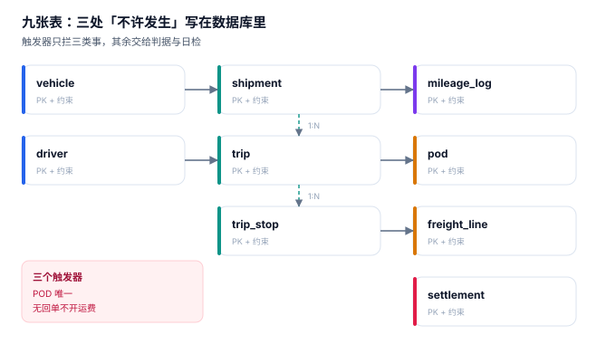

# 实战：九张表、三个触发器、十三条断言

前面九页讲的所有判据，都要落到一个能被机器执行的地方。这一页把整册的约束压成**九张表、三个触发器、十三条断言**，并给出本机的真实输出——**9 条正向断言全过、4 条负向用例全拦、退出码 0**。

::: tip 一句话理解
能被数据库拦住的叫约束，只能靠人记住的叫制度。**制度会失效，约束不会。**
:::

## 一、九张表与它们的分工



| 表 | 一行代表什么 | 关键约束 | 谁写它 |
| --- | --- | --- | --- |
| `vehicle` | 一台车 | `plate` 唯一、`payload_kg > 0`、状态枚举 | 车管 |
| `driver` | 一名司机 | 驾照等级枚举、状态枚举 | 人事 |
| `shipment` | 一张委托单 | 计费重**生成列**、体积与实重 > 0 | 客服/接口 |
| `trip` | 一个车次 | `idem_key` 唯一、`plan_km > 0` | 调度 |
| `trip_stop` | 一个停靠点 | `(trip_no, seq)` 主键、`(trip_no, shipment_no)` 唯一 | 仓管 |
| `mileage_log` | 一条里程口径 | `(trip_no, source)` 主键、`source` 三值 | 终端/结算 |
| `pod` | 一张回单 | `signed_qty >= 0`、状态两值 | 司机/客户 |
| `freight_line` | 一条运费明细 | 四段金额 + 勾稽 `CHECK` | 计费 |
| `settlement` | 一个结算批次 | 状态两值 | 财务 |

九张表里最关键的一处设计是 `shipment` 的生成列：

```sql
chargeable_kg REAL GENERATED ALWAYS AS
              (MAX(actual_kg, volume_m3 * ratio_kg_m3)) VIRTUAL
```

把计费重做成**生成列**而不是普通字段，等于把「计费重必须是 max(实重, 体积×抛比)」这条规则写进了存储层——任何绕过它的写入都不可能存在。这比在代码里写 100 个 `if` 都可靠。

## 二、三个触发器：只拦三件事

| 触发器 | 时机 | 拦什么 | 报错码 |
| --- | --- | --- | --- |
| `trg_pod_one_valid` | `BEFORE INSERT ON pod` | 同一单第二条有效回单 | `POD_DUPLICATE` |
| `trg_freight_needs_pod` | `BEFORE INSERT ON freight_line` | 无有效回单就开运费行 | `POD_REQUIRED` |
| `trg_load_limit` | `BEFORE INSERT ON trip_stop` | 超容积 / 超载重 | `VOLUME_EXCEEDED` / `PAYLOAD_EXCEEDED` |

```sql
CREATE TRIGGER trg_load_limit
BEFORE INSERT ON trip_stop
BEGIN
  SELECT RAISE(ABORT, 'VOLUME_EXCEEDED')
  WHERE COALESCE((SELECT SUM(s.volume_m3) FROM trip_stop t JOIN shipment s USING (shipment_no)
          WHERE t.trip_no = NEW.trip_no), 0)
      + (SELECT volume_m3 FROM shipment WHERE shipment_no = NEW.shipment_no)
      > (SELECT v.volume_m3 FROM trip t JOIN vehicle v USING (vehicle_id)
          WHERE t.trip_no = NEW.trip_no);
  SELECT RAISE(ABORT, 'PAYLOAD_EXCEEDED')
  WHERE COALESCE((SELECT SUM(s.actual_kg) FROM trip_stop t JOIN shipment s USING (shipment_no)
          WHERE t.trip_no = NEW.trip_no), 0)
      + (SELECT actual_kg FROM shipment WHERE shipment_no = NEW.shipment_no)
      > (SELECT v.payload_kg FROM trip t JOIN vehicle v USING (vehicle_id)
          WHERE t.trip_no = NEW.trip_no);
END;
```

**只拦三件事**是有意的：触发器越多，写入路径越难推理，出了问题越难定位。其余规则（时效、成本、对账）都放在日检脚本里，因为它们需要「事后批量看」，而不是「当场拦住」。

::: danger 三个触发器写法上的坑
1. **`BEFORE INSERT` 里用 `SELECT ... WHERE` 而不是 `IF`**：SQLite 的触发器体不支持 `IF`，只能靠 `SELECT RAISE(...) WHERE 条件` 实现条件中止。写成 `IF` 会直接语法错误。
2. **累加时忘了把 `NEW` 这一行算进去**：`SUM()` 只统计已存在的行，必须显式加上 `NEW.shipment_no` 对应的体积/重量，否则永远拦不住「最后一单把车压超」。
3. **触发器里出现 `NULL` 比较**：`SUM()` 在没有行时返回 `NULL`，而 `NULL > 45` 的结果是 `NULL`（不是假，是「不知道」），`WHERE` 不会命中——于是**一趟车的第一单永远不会被拦**。本机的写法用 `COALESCE(..., 0)` 把它归零。这不是理论问题：把 `COALESCE` 去掉，插一单 100 m³ 的货到 45 m³ 的车里，检查会直接放过。
:::

## 三、十三条断言

九条正向（必须全过）+ 四条负向（必须全拦）：

| 编号 | 断言 | 判定 |
| --- | --- | --- |
| `C1` | 计费重 = `MAX(实重, 体积 × 抛比)` | 三张单分别 4,200 / 3,996 / 5,800 kg |
| `C2` | 泡货判定（实重 < 体积重） | 只命中 SH002 |
| `C3` | 装载不超容积 | `SUM(volume) ≤ 45 m³` |
| `C4` | 装载不超载重 | `SUM(actual_kg) ≤ 12,000 kg` |
| `C5` | 有效回单数 ≤ 1 / 单 | `MAX(count) = 1` |
| `C6` | 每条运费行都有有效回单 | 无回单的运费行 0 条 |
| `C7` | 运费行金额勾稽 | 四段之和 = 合计，误差 < 0.005 |
| `C8` | 里程三口径齐全 | 每个 `trip` 有 3 个 `source` |
| `C9` | 短签数量与件数守恒 | `pieces − signed_qty` 合计 = 2 |
| `N1` | 重复有效回单 | 拦，报 `POD_DUPLICATE` |
| `N2` | 无回单开运费行 | 拦，报 `POD_REQUIRED` |
| `N3` | 超容积装载 | 拦，报 `VOLUME_EXCEEDED` |
| `N4` | 超载重装载 | 拦，报 `PAYLOAD_EXCEEDED` |

## 四、本机真实输出

```text
== 正向断言 ==
  C1 计费重=MAX(实重, 体积×抛比): PASS
  C2 泡货判定（实重<体积重）: PASS
  C3 装载不超容积: PASS
  C4 装载不超载重: PASS
  C5 有效回单数 ≤ 1 / 单: PASS
  C6 每条运费行都有有效回单: PASS
  C7 运费行金额勾稽: PASS
  C8 里程三口径齐全: PASS
  C9 短签数量与件数守恒（短签=件数−签收数）: PASS
== 负向用例 ==
  N1 重复有效回单 -> POD_DUPLICATE PASS
  N2 无回单开运费行 -> POD_REQUIRED PASS
  N3 超容积装载 -> VOLUME_EXCEEDED PASS
  N4 超载重装载 -> PAYLOAD_EXCEEDED PASS
== 汇总 ==
  正向 9/9，负向 4/4
  计费重合计 13,996 kg；运费合计 1,387.06 元
  逐行： ['FL001=847.96', 'FL002=539.10']
```

三个读数值得注意：

- **计费重合计 13,996 kg**：4,200 + 3,996 + 5,800。第一张由实重决定、第二张由体积决定、第三张由实重决定——三张单刚好覆盖了三种分支。
- **运费 1,387.06 元**：847.96（正常单）+ 539.10（短签扣 40 元）。第二行的 `560.00 + 19.10 + 0 − 40.00 = 539.10`，与 `CHECK` 完全一致。
- **N3 / N4 的残留清理**：负向用例插入的 `shipment` 会成功（它本身合法），只有 `trip_stop` 被拒；所以断言之后必须显式删除这两条残留单，否则 `C1` 的期望值会被污染。这条细节写在脚本的 `DELETE` 里，也是所有「负向用例」测试的通病。

## 五、验证方式

把本页的 DDL、种子数据与十三条断言存成 `ft_practice.py`（约 210 行，标准库 `sqlite3`，不需要装任何依赖），然后：

```shell
# 1. 建库并跑全部断言（期望"正向 9/9，负向 4/4"，退出码 0）
python3 ft_practice.py; echo "EXIT=$?"

# 2. 只验负向用例是否真的被拦（期望四条都报错）
sqlite3 :memory: "
create table pod(no text, shipment_no text, state text);
create trigger t before insert on pod when new.state='VALID'
begin
  select raise(abort,'POD_DUPLICATE')
  where exists (select 1 from pod where shipment_no=new.shipment_no and state='VALID');
end;
insert into pod values ('P1','S1','VALID');
insert into pod values ('P2','S1','VALID');" 2>&1 | head -1
# 期望输出：Error: stepping, POD_DUPLICATE (19)

# 3. 生成列不能被直接写（期望报错，证明规则在存储层）
sqlite3 :memory: "
create table s(a real, v real, r real default 333,
  c real generated always as (max(a,v*r)) virtual);
insert into s(a,v,c) values (1500,12,9999);" 2>&1 | head -1
# 期望输出：Error: cannot INSERT into generated column "c"
```

第 3 步是本册最想强调的一条：**「计费重必须取最大值」这条规则一旦做成生成列，就不存在「某个脚本忘了算」这种可能**。

## 六、从断言到日检

十三条断言是「建库时的一次性验证」，生产上还要变成每日巡检：

| 巡检项 | 频率 | 报警条件 |
| --- | --- | --- |
| 无回单的运费行 | 每日 | > 0 条 |
| 重复有效回单 | 每日 | > 0 条 |
| 超载车次 | 每日 | 环比涨幅 > 20% |
| 里程三口径缺失 | 每日 | > 0 个 trip |
| 金额勾稽不平 | 每次结算前 | > 0 条 |
| 结算批次与明细不符 | 每次结算前 | 差额 > 0.01 元 |

这六项覆盖了本册九成以上的「安静失败」。它们不需要复杂的监控系统，一条 SQL 加一个定时任务就够了——**关键是有人每天看这六个数**。

## 参考资料

- SQLite 官方文档《CREATE TABLE》：生成列（generated column）的语法与限制，本页 `chargeable_kg` 的实现依据。
- SQLite 官方文档《CREATE TRIGGER》：`RAISE(ABORT, ...)` 与 `WHEN` 子句的用法。
- GB/T 18354—2021《物流术语》：计费重量、回单、装载等术语定义。
- 与本页相邻：[运输需求与计费重](../Demand/index.md)、[签收与回单](../ProofOfDelivery/index.md)、[运费结算](../Settlement/index.md)。
