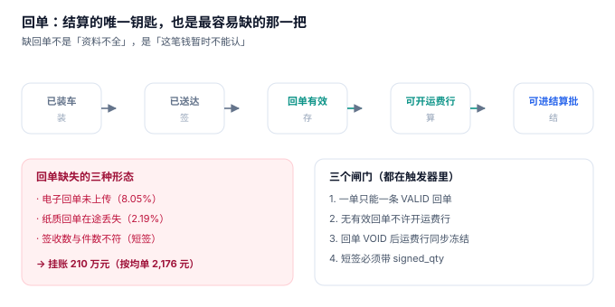

# 签收与回单

货到了，收货人签了字，司机拍了张照片传上来——这张照片进不了账。财务的规则是：**回单必须是「有签收人、有签收时间、有签收数量」的三元组**，照片是证据，不是数据。于是这趟活干完了，钱要等到月底对账、等到客户确认、等到照片被重新录入。

**回单是运输里唯一一个「物理世界发生了，但系统里还没发生」的环节。** 它决定了这趟运输算不算完成，也决定了这笔钱什么时候能进结算。缺回单不是「资料不全」，是「这笔钱暂时不能认」。

::: tip 一句话理解
回单不是一张纸或一张照片，是**三个字段加一个状态**：谁签的、什么时候签的、签了几件、这条记录是否有效。缺任何一个，它就不构成结算依据。
:::

## 一、回单的三种形态与一个共同结构



| 形态 | `pod_type` | 采集方式 | 典型问题 |
| --- | --- | --- | --- |
| 电子签名 | `ELECTRONIC` | 收货人在终端/小程序签 | 设备没电、网络差，事后补录 |
| 纸质回单 | `PAPER` | 三联单签字，回场交单 | 丢失、字迹不清、晚交 |
| 拍照上传 | `ELECTRONIC`（附图片） | 司机拍照 | 照片糊、拍错单、重拍覆盖 |

三种形态最终都要落成同一张 `pod` 表，因为它们要被同一套规则校验：

```sql
CREATE TABLE pod (
  pod_no      TEXT PRIMARY KEY,
  shipment_no TEXT NOT NULL REFERENCES shipment(shipment_no),
  pod_type    TEXT NOT NULL CHECK (pod_type IN ('ELECTRONIC','PAPER')),
  signed_by   TEXT NOT NULL,                                  -- 谁签的
  signed_at   TEXT NOT NULL,                                  -- 什么时候签的
  signed_qty  INTEGER NOT NULL CHECK (signed_qty >= 0),       -- 签了几件
  exception   TEXT CHECK (exception IN ('NONE','SHORT','DAMAGE','REJECT','COD_UNPAID')),
  state       TEXT NOT NULL DEFAULT 'VALID' CHECK (state IN ('VALID','VOID'))
);
```

三个字段缺一不可，且**数量必须是数字而不是「已签收」三个字**——因为短签要按件折价扣款，扣款金额需要分母。

## 二、回单缺失的三种形态与它们的钱

| 形态 | 本机读数 | 后果 | 能补救吗 |
| --- | --- | --- | --- |
| 电子回单未上传 | **8.05%**（966 / 12,000） | 当期不能结算 | 能，补传后解锁 |
| 纸质回单丢失 | **2.19%**（263 / 12,000） | 需客户书面确认 | 难，且可能永久损失 |
| 短签（数量不符） | 见[实战](../Practice/index.md) | 按件折价扣款 | 能，需异常代码 |

按均单 2,176 元折算，966 张缺回单对应**挂账约 210 万元**。这笔钱不是坏账，但它会同时出现在三个地方：承运商的应收、货主的应付、财务的「未达」。三个月之后，它就会变成一笔说不清的「历史差异」。

::: danger 三个回单建模错误
1. **回单不独立成表，塞进 `shipment` 的几个字段**：一单可能有多张回单（分次送达、补签、作废重签），塞进主表就只能存一条，作废与重签无法表达。
2. **不设「一单一条有效回单」的约束**：重复上传会产生两条 `VALID`，结算时不知道用哪条数量，短签扣款算两遍。
3. **回单状态与运单状态混在一起**：`shipment.state = 'DELIVERED'` 只说明货到了，不说明回单有效。把两者混成一个字段，就没有任何地方能拦住「无回单结算」。
:::

## 三、四个必须由数据库拦住的场景

```sql
-- 一单只能有一条有效回单
CREATE TRIGGER trg_pod_one_valid
BEFORE INSERT ON pod
WHEN NEW.state = 'VALID'
BEGIN
  SELECT RAISE(ABORT, 'POD_DUPLICATE')
  WHERE EXISTS (SELECT 1 FROM pod
                 WHERE shipment_no = NEW.shipment_no AND state = 'VALID');
END;

-- 没有有效回单，不许开运费行
CREATE TRIGGER trg_freight_needs_pod
BEFORE INSERT ON freight_line
WHEN NOT EXISTS (SELECT 1 FROM pod
                  WHERE shipment_no = NEW.shipment_no AND state = 'VALID')
BEGIN
  SELECT RAISE(ABORT, 'POD_REQUIRED');
END;
```

两条触发器解决的是「顺序问题」：结算必须先有回单。把它写成应用层校验，早晚会有一条批量脚本绕过——而批量脚本恰恰是月初结算时最常见的东西。

| 场景 | 靠什么拦 | 拦截后的表现 |
| --- | --- | --- |
| 重复有效回单 | `trg_pod_one_valid` | 报 `POD_DUPLICATE`，旧回单保持有效 |
| 无回单开运费行 | `trg_freight_needs_pod` | 报 `POD_REQUIRED`，该单留在待结算池 |
| 回单作废后仍结算 | 作废时同步 `VOID` + 冻结运费行 | 运费行状态回退到 `HOLD` |
| 短签未填数量 | `CHECK (signed_qty >= 0)` + 业务校验 | 拒绝写入，要求先登记异常 |

## 四、代收货款：回单之外的第二个金额

代收货款（COD）是运输里唯一「货与钱一起走」的业务：司机替货主收钱，回场交账。它有两个独立的数：

| 数 | 含义 | 谁认 |
| --- | --- | --- |
| `cod_amount` | 应收金额（按客户下单时的货款） | 货主 |
| `cod_collected` | 实收金额（司机交回的现金/转账） | 财务 |

两者不等只有三种原因：客户少付、司机挪用、代收单被拒收但没登记。第三种最常见，因为「拒收」在系统里只是一个异常码，没人会主动去改金额。所以 `exception = 'COD_UNPAID'` 必须与 `signed_qty = 0` 联动——**拒收的货不能既算送达又算收到钱**。

## 五、回单及时率：一个比缺失率更早的预警

缺失率是「结果」，及时率是「过程」。本机的缺失率 8.05%，但如果按天看，缺回单集中在送达后的 **T+1 到 T+3** 这三天——也就是说，大部分缺回单不是丢失，是**还没传**。

| 指标 | 定义 | 阈值建议 |
| --- | --- | --- |
| T+1 回单上传率 | 送达次日已传回单的比例 | ≥ 85% |
| T+3 回单上传率 | 送达三日内已传比例 | ≥ 95% |
| 挂账金额 | 缺回单对应的运费合计 | 环比涨幅 < 10% |
| 纸质回单在途天数 | 从签收到回场交单 | ≤ 5 天 |

四个指标里，**T+1 上传率最有价值**：它能在挂账发生前两周就报警。

## 六、判据族 `FTS-A ~ FTS-H`

本页判据族 `FTS-A` ~ `FTS-H`，共 8 条。

| 编号 | 判据 | 怎么验 |
| --- | --- | --- |
| `FTS-A` | `pod` 独立成表，含 `signed_by` / `signed_at` / `signed_qty` 三字段 | 三列均 NOT NULL |
| `FTS-B` | 一单最多一条 `VALID` 回单 | 插入第二条报 `POD_DUPLICATE` |
| `FTS-C` | 无有效回单不许开运费行 | 插入运费行报 `POD_REQUIRED` |
| `FTS-D` | 短签必须带 `signed_qty` 与异常码 | `exception='SHORT'` 时 `signed_qty < pieces` |
| `FTS-E` | 拒收不得计入代收金额 | `exception='REJECT'` 时 `cod_collected = 0` |
| `FTS-F` | 回单作废是状态变更，不是删除 | 作废后 `state='VOID'` 且记录仍在 |
| `FTS-G` | 回单及时率可按 T+1 / T+3 统计 | 存在 `signed_at` 与 `upload_at` 两列 |
| `FTS-H` | 纸质回单在途天数可算 | 存在 `received_at` 字段 |

## 七、验证方式

```shell
# 1. 一单只能一条有效回单（期望第二条报 POD_DUPLICATE）
sqlite3 :memory: "
create table pod(no text, shipment_no text, state text);
create trigger t before insert on pod when new.state='VALID'
begin
  select raise(abort,'POD_DUPLICATE')
  where exists (select 1 from pod where shipment_no=new.shipment_no and state='VALID');
end;
insert into pod values ('P1','S1','VALID');
insert into pod values ('P2','S1','VALID');" 2>&1 | head -1
# 期望输出：Error: stepping, POD_DUPLICATE (19)

# 2. 作废后可以重新签（期望成功，且有效回单仍是 1 条）
sqlite3 :memory: "
create table pod(no text, shipment_no text, state text);
insert into pod values ('P1','S1','VOID'),('P2','S1','VALID');
select count(*) from pod where shipment_no='S1' and state='VALID';"
# 期望输出：1

# 3. 回单及时率（期望 85% 量级）
sqlite3 :memory: "
create table pod(signed_at text, upload_at text);
insert into pod values ('2026-11-05 10:00','2026-11-05 18:00'),
                       ('2026-11-05 10:00','2026-11-07 09:00'),
                       ('2026-11-05 10:00', null),
                       ('2026-11-05 10:00','2026-11-06 08:00');
select round(100.0*sum(julianday(upload_at)-julianday(signed_at) <= 1)/count(*),1) from pod;"
# 期望输出：50.0
```

第 3 步的 50.0 说明一件事：**「上传率」必须带时间窗**。同样是 4 张回单，按 T+1 算只有 50%，按「有无」算 75%，按 T+3 算是 100%。不写清窗口的回单率，是财务与运营吵架的固定节目。

## 参考资料

- GB/T 18354—2021《物流术语》：回单、签收、代收货款等术语定义。
- 《中华人民共和国民法典》第三编第九章「买卖合同」：交付与验收的基本规则，拒收与短交的处理依据。
- GB/T 22263.1—2008《物流公共信息平台应用开发指南 第 1 部分：基础术语》：物流单据电子化的术语基础。
- 与本页相邻：[在途与轨迹](../Tracking/index.md)、[运费结算](../Settlement/index.md)、[实战](../Practice/index.md)。
