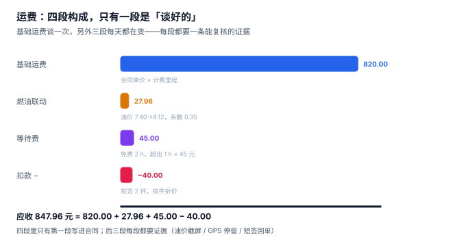
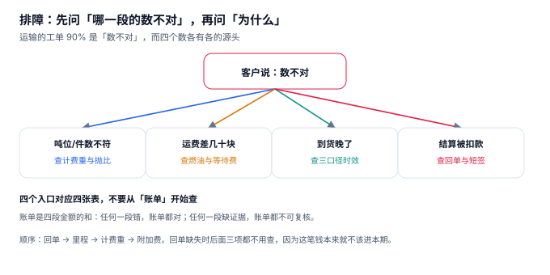

# 运费结算

月底对账，承运商发来一张 4 万行的账单，财务用脚本和系统明细一比：**总额差 183,555 元，差异行 314 条，占比 2.62%**。看起来不多，但 314 行里没有一行是「算错了」——47 行是漏开单、24 行是重复开、128 行是单价不同、115 行是附加费不同。**四类差异，四个不同的责任方，四种不同的处理方式。**

**运费结算的核心不是「算对一笔钱」，而是「把差异分成可归因的四类」。** 只看总额差，永远只能得出「差了一点」；分了形状，才知道该找谁。

::: tip 一句话理解
运费由四段构成：**基础运费（谈的）+ 燃油联动（公式）+ 等待费（证据）+ 扣款（证据）**。只有第一段是合同价，后三段每一段都要有自己的计算依据和证据链。
:::

## 一、四段构成



| 段 | 计算依据 | 变化频率 | 争议高发点 |
| --- | --- | --- | --- |
| 基础运费 | 计费里程 × 单价（或计费重 × 单价） | 合同期固定 | 计费里程用哪个口径 |
| 燃油联动 | （当期油价 − 基准油价）÷ 基准 × 系数 | 每月/每旬 | 用哪天的油价、阈值还是连续 |
| 等待费 | （实际停留 − 免费时长）× 小时费率 | 每单 | 停留时间从哪算 |
| 扣款 | 短签件数 × 件价 / 破损定损 | 每单 | 有没有证据 |

```sql
CREATE TABLE freight_line (
  line_no      TEXT PRIMARY KEY,
  shipment_no  TEXT NOT NULL REFERENCES shipment(shipment_no),
  trip_no      TEXT NOT NULL REFERENCES trip(trip_no),
  base_amount  REAL NOT NULL CHECK (base_amount >= 0),
  fuel_fee     REAL NOT NULL DEFAULT 0 CHECK (fuel_fee >= 0),
  wait_fee     REAL NOT NULL DEFAULT 0 CHECK (wait_fee >= 0),
  deduction    REAL NOT NULL DEFAULT 0 CHECK (deduction >= 0),
  total_amount REAL NOT NULL,
  CHECK (ABS(total_amount - (base_amount + fuel_fee + wait_fee - deduction)) < 0.005)
);
```

最后那条 `CHECK` 是最便宜的一道防线：**金额勾稽写进表结构，任何一段被单独改都会立刻报错。**

## 二、燃油联动：公式里藏着三个决定

以柴油从 7.40 元/升涨到 8.12 元/升为例，系数 0.35（燃油成本占运价的 35%）：

| 算法 | 表达式 | 附加比例 | 100 万运费多收 |
| --- | --- | --- | --- |
| 不带联动 | —— | 0.00% | 0 元 |
| 连续联动 | (8.12−7.40)÷7.40×0.35 | **+3.41%** | 34,054 元 |
| 阈值阶梯（每 0.5 元一档） | 向下取整到 0.5 元档 | +2.36% | 23,600 元 |

三个决定必须写进合同，否则每月都会吵：

1. **基准油价与取样口径**：取哪一天、哪个地区、哪个渠道（发改委调价 / 三地原油 / 加油卡结算价）。取错口径，同一涨跌能算出相反结论。
2. **阈值还是连续**：阈值阶梯（每 0.5 元一档）实现简单但不公平——油价涨 0.49 元不补，涨 0.51 元补一整档。本机在多档油价上实测，两种写法**最大差 2.32 个百分点**（油价停在 7.89 元时，连续联动给 2.32%、阶梯给 0）。
3. **联动基数**：是「基础运费」还是「基础运费 + 路桥」？基数不同，同样的油价波动能差 10%~20% 的绝对金额。

::: danger 三个结算建模错误
1. **四段合并成一个 `amount` 字段**：合并之后无法回答「这个月运费为什么涨了 3.4%」。而答案往往是「油价联动 +3.41%，运量没变」。
2. **燃油联动用「当月任何一天的油价」**：不同日期取价会得出不同结果，必须写死「取当月 1 日 / 取发改委最近一次调价」，并留取价记录。
3. **扣款没有证据字段**：扣款是「减钱」，最容易引起争议。每一笔扣款必须关联到一条回单或一张定损单，否则对账时无法举证。
:::

## 三、等待费：最容易被漏掉的一段

等待费的规则通常是「免费 2 小时，超出按 45 元/小时计」。听起来简单，实测却漏得最多：

| 指标 | 本机读数 |
| --- | --- |
| 超时车次 | **19.2%**（2,306 / 12,000） |
| 应收等待费 | **54,209 元** |
| 实报等待费 | **32,802 元** |
| 漏报比例 | **39.5%** |

漏报的原因不是算错，是**没人报**：司机不愿意为几十块钱填单，调度不主动核对停留时长，财务只核总额。三个环节都「正确」，钱就漏了。

可复算的做法是把等待时长从轨迹里算，而不是从人工上报里取：

```sql
-- 等待时长 = 围栏内停留 − 免费时长（按停留点算，不按整趟算）
SELECT s.shipment_no,
       st.wait_min,
       MAX(0, st.wait_min - 120) / 60.0 * 45.0 AS wait_fee
FROM trip_stop st JOIN shipment s USING (shipment_no)
WHERE st.wait_min > 120;
```

`wait_min` 落在 `trip_stop` 上而不是 `shipment` 上，因为等待发生在「这一次停靠」；同一张单改派后可能有两次等待，合并成一个字段就会丢掉一次。

## 四、对账：先分形状，再谈金额



| 形状 | 本机条数 | 金额影响 | 谁的问题 | 处理方式 |
| --- | --- | --- | --- | --- |
| 漏单（我方漏开） | 47 | 102,274 元 | 我方计费 | 补开，进入下期 |
| 重复（同一单开两次） | 24 | 52,225 元 | 我方重复推送 | 冲销，不计入本期 |
| 单价不同 | 128 | 8,356 元 | 合同版本不一致 | 以合同为准，回溯改价 |
| 附加费不同 | 115 | 20,700 元 | 油价/等待证据缺失 | 补证据或撤销 |

四类的处理方式完全不同：**漏单要补、重复要冲、单价要回溯、附加费要举证**。用一个「差异总额」把它们混在一起，结果就是每一类都被平均处理——最常见的是「全部按对方账单认了」，于是下个月继续漏。

| 对账口径 | 公式 | 用途 |
| --- | --- | --- |
| 行级差异率 | 差异行 ÷ 总行数 | 衡量流程质量（本机 2.62%） |
| 金额差异率 | 差异金额 ÷ 账单总额 | 衡量财务影响 |
| 单向差异 | 只算「对我方不利」的差异 | 风险敞口 |
| 净额 | 有利 − 不利 | **最危险的指标**，会掩盖双向差异 |

净额的危险在本机数据里很明显：漏单 +102,274 与重复 −52,225 相抵后只剩 50,049，看起来「差异不大」——但漏单是真的少收了，重复是真的多算了，两者性质完全不同。

## 五、判据族 `FTB-A ~ FTB-H`

本页判据族 `FTB-A` ~ `FTB-H`，共 8 条。

| 编号 | 判据 | 怎么验 |
| --- | --- | --- |
| `FTB-A` | 运费四段分列存储，合计由 `CHECK` 勾稽 | 改任一段不改合计，插入被拒 |
| `FTB-B` | 燃油联动参数（基准价、系数、取价日）落在结算批次上 | `settlement` 有这三个字段 |
| `FTB-C` | 等待费由 `trip_stop.wait_min` 计算，不取人工上报 | 全库无「手工等待费」入口 |
| `FTB-D` | 每笔扣款关联证据（回单号或定损单号） | `deduction_ref` 非空 |
| `FTB-E` | 对账差异按四形状分类，不只算总额 | 差异表有 `diff_type` 且取值为四类 |
| `FTB-F` | 结算批次金额 = 明细合计 | `SUM(freight_line)` = `settlement.total_amount` |
| `FTB-G` | 无有效回单的运费行不得进入批次 | 批次明细里无 `pod` 缺失的单 |
| `FTB-H` | 净额与双向差异同时输出 | 报表里三个数（净额/正差/负差）都在 |

## 六、验证方式

```shell
# 1. 金额勾稽：改一段不改合计必须被拒（期望 CHECK constraint failed）
sqlite3 :memory: "
create table f(base real, fuel real, wait real, ded real, total real,
  check (abs(total-(base+fuel+wait-ded)) < 0.005));
insert into f values (820,27.96,45,40,847.96);
insert into f values (900,27.96,45,40,847.96);" 2>&1 | head -1
# 期望输出：Runtime error near line 1: CHECK constraint failed: f

# 2. 燃油联动与阈值阶梯的差（期望约 2.3 个百分点）
python3 - <<'PY'
base, now, k = 7.40, 8.12, 0.35
cont = (now-base)/base*k
step = ((now-base)//0.5*0.5)/base*k
print(f"连续联动 {cont*100:.2f}% / 阈值阶梯 {step*100:.2f}% / 差 {(cont-step)*100:.2f} 点")
PY
# 期望输出：连续联动 3.41% / 阈值阶梯 2.36% / 差 1.04 点

# 3. 净额掩盖双向差异（期望净额 50,049，而双向合计 154,499）
python3 -c "
miss, dup = 102274, 52225
print(f'净额 {miss-dup:,} / 双向 {miss+dup:,}')"
# 期望输出：净额 50,049 / 双向 154,499
```

第 3 步是本页最重要的一课：**净额 5 万，双向 15.4 万**。任何只报净额的月度对账，都在系统性地低估自己的问题规模。

## 参考资料

- GB/T 18354—2021《物流术语》：运费、附加费、结算等术语定义。
- 《中华人民共和国民法典》第三编第二分编「典型合同」第十九章「运输合同」：运费支付与留置的基本规则。
- 国家发展改革委《石油价格管理办法》：成品油调价机制，燃油联动的取价依据。
- 与本页相邻：[签收与回单](../ProofOfDelivery/index.md)、[成本与时效](../Cost/index.md)、[实战](../Practice/index.md)。
