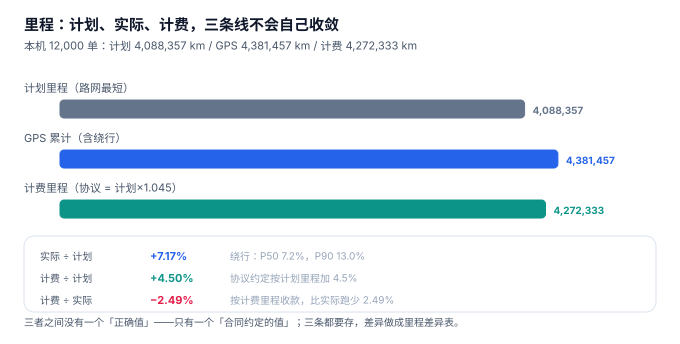
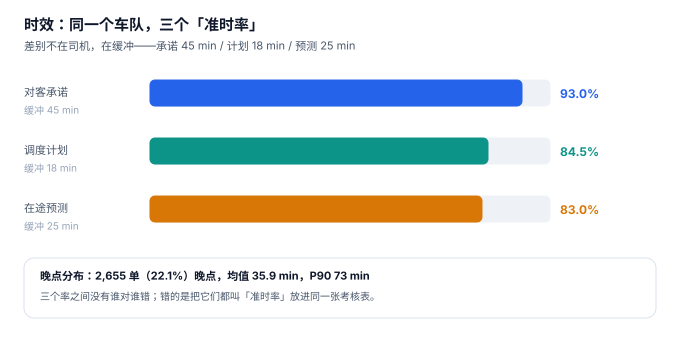

# 在途与轨迹

司机说这趟跑了 214 公里，GPS 轨迹算出来 199.8 公里，系统按合同记 194.8 公里。三个数字放在一起，财务问了一个所有人都不愿意回答的问题：**这趟到底跑了多少公里？**

正确答案是「三个都对，但它们回答的不是同一个问题」：214 是司机按路码表读的（含进出场站与绕行找门），199.8 是轨迹点连线的累计（含丢点造成的直线捷径），194.8 是合同约定的计费里程（按计划里程加 4.5%）。**里程没有真值，只有三个口径**——工程的活是把三个都存下来，并把差异做成可解释的表。

::: tip 一句话理解
GPS 里程不是「实际里程」，它是**「采样点连线的长度」**——采样间隔、丢点、坐标纠偏任何一个变了，这个数就变，而它不会报错。
:::

## 一、三个口径与它们的用途



| 口径 | 来源 | 用途 | 本机读数 |
| --- | --- | --- | --- |
| 计划里程 `PLAN` | 路网最短路径 | 报价基准、预算 | 4,088,357 km |
| GPS 里程 `GPS` | 轨迹点累计 | 成本核算、油耗 | 4,381,457 km（+7.17%） |
| 计费里程 `BILL` | 合同约定（计划 × 1.045） | 结算 | 4,272,333 km（+4.50%） |

三者关系：`BILL < GPS`，差 **2.49%**。按 5.8 元/公里的均价折算，这批单少收 **632,916 元**——而所有账单都是自洽的，因为账单和明细用的是同一个 `BILL`。

绕行率的分布同样值得记住：**P10 1.4% / P50 7.2% / P90 13.0%**。这意味着「平均绕行 7%」这个结论对一半的车次是低估的；末 10% 的车次绕行超过 13%，通常是「找不到门」「临时改点」「市区限行」这三类原因。

## 二、GPS 里程的两种失真

### 失真一：抽稀（影响很小，但要知道）

轨迹点越稀，折线越接近直线，累计长度越小。本机模型（2,400 个轨迹点、平均 47 km/h、含路口转弯）：

| 采样间隔 | 里程为真值的比例 | 低估 |
| --- | --- | --- |
| 30 s | 100.00% | 0.00% |
| 60 s | 99.97% | 0.03% |
| 150 s | 99.90% | 0.10% |
| 300 s | 99.79% | 0.21% |

结论有点反直觉：**抽稀到 5 分钟只低估 0.21%**。因为车辆轨迹本身就很接近直线，折线误差是二阶量。所以「采样间隔导致里程少算」这个说法在小车队里几乎不成立——真正的问题是下一个。

### 失真二：丢点（影响大得多）

隧道、地库、高楼间、山区，终端会连续几分钟没有定位。此时常见实现是「把丢点前后的两个点直接连起来」，于是丢点期间的绕行被当成直线：

```text
低估比例 ≈ 丢点路段占比 × (该段绕行率)
例：丢点占 8% 的路段，该段绕行 15% → 低估 ≈ 0.08 × 0.15 = 1.2%
```

1.2% 听起来不多，但它是**系统性单向偏差**（只会少算，不会多算），乘以全年里程就是一笔确定的成本漏计。正确做法只有两条：

1. **丢点期间按路网插值**（用最后已知点与下一已知点做路径规划，而不是直线连接）。
2. **把「有效轨迹点覆盖率」作为里程的可信度指标**输出：覆盖率低于 90% 的行程，里程标记为 `LOW_CONFIDENCE`。

::: danger 三个轨迹建模错误
1. **用直线连接丢点**：单向低估，且无法事后发现——因为轨迹表里看起来是连续的。
2. **里程字段只有一列 `km`**：三个口径混在一个字段里，任何一次对账都要人工还原。正确做法是 `mileage_log(trip_no, source, km)`，`PRIMARY KEY (trip_no, source)`。
3. **用「停靠点数量」判断是否装卸**：停靠识别需要「停留时长 + 速度阈值 + 围栏命中」三个条件，只用一个会把等红灯算成一次停靠。
:::

## 三、停靠识别：三个条件缺一不可

```sql
-- 停靠点：速度 < 2 km/h 连续 10 分钟以上，且落在客户围栏内
SELECT trip_no,
       MIN(ts)  AS arrive_at,
       MAX(ts)  AS leave_at,
       (julianday(MAX(ts)) - julianday(MIN(ts))) * 1440 AS dwell_min
FROM gps_point
WHERE trip_no = :trip
GROUP BY trip_no, stop_seq
HAVING dwell_min >= 10
   AND MAX(speed_kmh) < 2
   AND MAX(in_fence) = 1;
```

三个条件的顺序有讲究：先按 `stop_seq`（终端自己给的停靠序号）分组，再验时长与速度，最后验围栏。反过来先按围栏过滤，会把「在客户隔壁等位」的 20 分钟漏掉——那段时间恰恰是等待费的计算依据（见[运费结算](../Settlement/index.md)）。

| 条件 | 缺了会怎样 |
| --- | --- |
| 停留 ≥ 10 min | 等红灯、堵车被算成停靠，停靠数虚高 3~5 倍 |
| 速度 < 2 km/h | 缓慢挪车被算成停靠 |
| 围栏命中 | 在服务区休息被算成客户停靠，等待费算错人 |

## 四、ETA：三个口径差 10 个百分点



同一批 12,000 单，三种「准时」：

| 口径 | 缓冲 | 达成率 | 谁在关心 |
| --- | --- | --- | --- |
| 对客承诺 | 45 min | **93.0%** | 客户、客服 |
| 调度计划 | 18 min | **84.5%** | 调度、司机考核 |
| 在途预测 | 25 min ± 15 | **83.0%** | 客户通知、异常干预 |

晚点的分布：**2,655 单（22.1%）晚点，平均晚 35.9 分钟，P90 晚 73 分钟**。三个达成率之间没有谁对谁错——对客承诺自带 45 分钟缓冲，所以它天然最高；调度计划的缓冲只有 18 分钟，所以它最严格。

工程结论只有一条：**「准时率」这个指标必须带口径名**。叫 `on_time_rate` 的裸字段，三个月后一定有人拿它去和客户对赌，然后发现双方算的不是一个东西。

## 五、里程差异表：把三个数放在一行

```sql
CREATE VIEW v_mileage_diff AS
SELECT t.trip_no,
       MAX(CASE WHEN m.source = 'PLAN' THEN m.km END) AS plan_km,
       MAX(CASE WHEN m.source = 'GPS'  THEN m.km END) AS gps_km,
       MAX(CASE WHEN m.source = 'BILL' THEN m.km END) AS bill_km,
       ROUND(MAX(CASE WHEN m.source='GPS'  THEN m.km END)
           / MAX(CASE WHEN m.source='PLAN' THEN m.km END) - 1, 4) AS detour_rate,
       ROUND(MAX(CASE WHEN m.source='BILL' THEN m.km END)
           - MAX(CASE WHEN m.source='GPS'  THEN m.km END), 1)     AS bill_gap_km
FROM trip t JOIN mileage_log m USING (trip_no)
GROUP BY t.trip_no;
```

这张视图的价值在于：**它把「差异」变成一个可以按日聚合的字段**（`detour_rate`、`bill_gap_km`），而不是每次对账时临时写 SQL。有了它，「这个月绕行率为什么涨了 2 个点」才能按线路、按司机、按时间段拆开看。

## 六、判据族 `FTT-A ~ FTT-H`

本页判据族 `FTT-A` ~ `FTT-H`，共 8 条。

| 编号 | 判据 | 怎么验 |
| --- | --- | --- |
| `FTT-A` | 里程按 `source` 分三条存储，不允许单列 `km` | `mileage_log` 主键为 `(trip_no, source)` |
| `FTT-B` | 三个口径齐全才算「行程结束」 | `COUNT(DISTINCT source) = 3` |
| `FTT-C` | 丢点段按路网插值，不按直线连接 | 插值后的里程 ≥ 直线连接结果 |
| `FTT-D` | 轨迹覆盖率低于阈值时标记低可信 | 存在 `coverage` 字段且可筛选 |
| `FTT-E` | 停靠识别同时用时长、速度、围栏三个条件 | SQL 里三个条件都在 |
| `FTT-F` | 时效口径带后缀（`_promise` / `_plan` / `_forecast`） | 全库无裸 `on_time_rate` |
| `FTT-G` | 里程差异可独立成视图并按日聚合 | `v_mileage_diff` 存在且有 `detour_rate` |
| `FTT-H` | 计费里程来源可追溯（合同条款编号） | `bill_km` 关联 `contract_clause` |

## 七、验证方式

```shell
# 1. 抽稀误差：5 分钟采样只低估 0.21%（期望值在 0.1%~0.3% 之间）
python3 - <<'PY'
import math, random
random.seed(20261105)
def path(n=2400, step=13.0):
    x=y=0; a=random.uniform(0,6.28); p=[(x,y)]
    for i in range(n):
        a += random.gauss(0,0.05)
        if i%180==0: a += random.choice([-1,1])*random.uniform(0.6,1.4)
        x += step*math.cos(a); y += step*math.sin(a); p.append((x,y))
    return p
L=lambda q: sum(math.dist(q[i],q[i+1]) for i in range(len(q)-1))
t=s=0
for _ in range(40):
    p=path(); t+=L(p); s+=L(p[::10])
print(f"真值 {t:,.0f} m / 300s 采样 {s:,.0f} m / 低估 {(1-s/t)*100:.2f}%")
PY

# 2. 丢点用直线连接的低估量（期望约 1.2%）
python3 -c "print(f'{0.08*0.15*100:.1f}%')"
# 期望输出：1.2%

# 3. 三个口径齐全（期望 3）
sqlite3 :memory: "
create table mileage_log(trip_no text, source text, km real,
  primary key(trip_no, source));
insert into mileage_log values ('T1','PLAN',186.4),('T1','GPS',199.8),('T1','BILL',194.8);
select count(distinct source) from mileage_log where trip_no='T1';"
# 期望输出：3
```

第 1 步与第 2 步放在一起看，就是 GPS 里程的全部误差来源：**抽稀几乎不产生影响（0.21%），丢点的影响是它的 6 倍（1.2%）**——所以优化方向不是提高采样频率，而是补全丢点段。

## 参考资料

- GB/T 19056—2012《汽车行驶记录仪》：行驶记录、数据采集与里程统计的设备要求。
- GB/T 18354—2021《物流术语》：在途、配送、里程等术语定义。
- ISO 8601-1:2019《日期和时间 信息交换表示法 第 1 部分：基本规则》：轨迹点时间戳的表示。
- 与本页相邻：[派车与调度](../Dispatch/index.md)、[签收与回单](../ProofOfDelivery/index.md)、[运费结算](../Settlement/index.md)。
