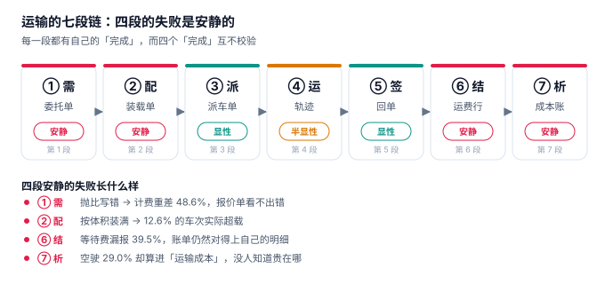

# 车队运输与调度工程

早上七点，调度员在群里发了一张截图：「V-017 今天跑 B 线，装 12 托。」司机到了仓库，仓管按体积装满了车厢，车出门时后钢板已经压平。三个小时后，车在高速口被路政拦下，过磅 15.8 吨，核定 12 吨。同一趟车，调度说「装满了」，仓管说「还有空位」，路政说「超载 31.7%」——三个人说的时间是同一分钟，看的却是三个不同的数。

**运输系统里最贵的错误都不是「车没派出去」，而是「三个数各算了一遍，谁都不报错」。** 电商超卖会被一次下单返回值暴露，运输超载只在过磅那一秒暴露；订单少收一笔钱会在对账时炸出来，运费少收 2.49% 会连着三个月没人发现，因为账单和明细是同一套算法算出来的。

::: tip 一句话理解
运输不是「把货从 A 挪到 B」，而是**一辆车在一段时间里同时被三份口径计量**：装了多少（体积 / 载重 / 轴荷）、跑了多少（计划 / 实际 / 计费）、该收多少（基础 / 附加 / 扣款）。三份口径任意一份换算法，另外两份不会跟着变。
:::

## 一、这个专题讲什么

从一张委托单到一笔运费入账，一趟运输要走七段：

| 段 | 这一段在做什么 | 产物 | 失败是否安静 |
| --- | --- | --- | --- |
| ① 需 | 收下委托，定计费重与送达时窗 | `shipment` | **安静**（抛比写错，报价单照常打印） |
| ② 配 | 把多张单装进一辆车 | `trip_stop` | **安静**（按体积装满 = 超载） |
| ③ 派 | 选车、选人、锁车 | `trip` | 半显性（重复派车要到装车才发现） |
| ④ 运 | 在途轨迹、里程累计、到货预测 | `mileage_log` | **安静**（GPS 丢点，里程只会偏小） |
| ⑤ 签 | 签收、回单、异常登记 | `pod` | 显性（缺回单会被财务退回） |
| ⑥ 结 | 算运费、加附加费、扣款、对账 | `freight_line` | **安静**（同一套公式算账单和明细，永远对得上） |
| ⑦ 析 | 吨公里成本、空驶率、时效达成 | 成本视图 | **安静**（空驶被摊进成本，没人知道贵在哪） |

七段里**四段的失败是安静的**。它们的共同形态是：车按时出发了、货按时到了、账单也出了，只有「这趟到底装了多少、跑了多少、该收多少」没人能回答。

本机读数最能说明问题的一组数字：4,691 个车次里，**体积装载率 81.2%、载重利用率只有 62.5%**——看起来「装得挺满」。但把车次摊开看：**12.6% 的车次在按体积装满之后实际超载**，同时 **5.2% 的车次连一半都没装满**。

| 视角 | 读数 | 它掩盖了什么 |
| --- | --- | --- |
| 体积装载率 | 81.2% | 车厢塞满了，但装的是轻抛货，载重还剩 4.5 吨 |
| 载重利用率 | 62.5% | 重货线路装不下更多，轻货线路装不满 |
| 超载车次 | 12.6%（593 / 4,691） | 每一次都可能是一张罚单加一次卸货转运 |
| 装载率差 > 15 个点 | 57.9%（2,718 / 4,691） | 只看一个口径的车队，超过一半的车次在误判 |

这就是运输系统最典型的缺陷形态：**每个数字单独看都正常，放在一起就互相矛盾**。一个只盯「平均装载率」的看板，永远发现不了「轻抛货把车厢塞满、重货把后轴压穿」这件事。

## 二、三个「这一车装了多少」

| 口径 | 定义 | 谁在关心 | 常见错法 |
| --- | --- | --- | --- |
| 计费重 `chargeable_kg` | `max(实重, 体积 × 抛比)` | 商务、报价 | 抛比写死在一个函数里，改合同改不动代码 |
| 装载率 `load_rate` | 体积、载重、轴荷三个分数 | 调度、仓管 | 只用体积算，认为「还有空位」 |
| 轴荷 `axle_load` | 前轴 / 后轴各自的限值 | 路政、安全 | 完全不算，直到过磅 |

三者必须由**同一份数据**算出来，而且必须能各自被复核。本机实测：同一批 12,000 张委托单，实重合计 49,062.8 吨；换成 1:3000 的抛比是 80,785.5 吨（+64.66%），换成 1:6000 是 56,962.4 吨（+16.10%）。

### 一个必须自己算一遍的例子

一张单：实重 1,500 kg，体积 12 m³，抛比 333 kg/m³。

| 算法 | 表达式 | 计费重 | 后果 |
| --- | --- | --- | --- |
| 只按实重 | 1,500 | 1,500 kg | 泡货按重货收，一车棉花按一车铁收 |
| 只按体积 | 12 × 333 | 3,996 kg | 重货按泡货收，客户立刻换承运商 |
| 取两者最大 | max(1,500, 3,996) | **3,996 kg** | 正确：谁大按谁收，这是行业通行规则 |

三种算法都能写进代码，只有第三种同时回答了两个问题：这票货该按什么收，以及它为什么这么贵。

::: danger 三件事必须写进数据模型，不能留给「装车时看一眼」
1. **抛比必须落在单据上**（`shipment.ratio_kg_m3`），不能写在代码里：同一批货走零担是 1:6000、走快运是 1:3000，改合同不该改代码。本机 71.9% 的票按 1:3000 会被判为泡货——一个常量动一下，七成票的计费重就变了。
2. **装载约束必须是数据库约束，不是校验提示**：按体积装满后 12.6% 的车次超载，说明「先算体积、再看载重」的顺序在代码里必然被跳过。正确做法是插入 `trip_stop` 时同时校验容积与载重（见[实战](Practice/index.md)的 `trg_load_limit`）。
3. **里程要存三条，不是一条**：计划里程是报价的基数，GPS 里程是成本的依据，计费里程是合同的约定。只存一条，另外两个问题永远查不清——本机计费比实际少 2.49%，按 5.8 元/公里算是 63 万元。
:::

## 三、专题地图

按「一趟运输的生命周期」读：

| 阶段 | 页面 | 一句话 |
| --- | --- | --- |
| 收单 | [运输需求与计费重](Demand/index.md) | 抛比不是系数，是合同里最贵的一行字 |
| 装车 | [配载与装载](Loading/index.md) | 「装满了」有三个答案，只有最小的那个能出门 |
| 派车 | [派车与调度](Dispatch/index.md) | 五道闸门，先筛「能不能拉」再比「谁便宜」 |
| 在途 | [在途与轨迹](Tracking/index.md) | 里程没有真值，只有三个口径 |
| 交付 | [签收与回单](ProofOfDelivery/index.md) | 回单是结算的钥匙，也是最容易缺的那把 |
| 收钱 | [运费结算](Settlement/index.md) | 四段构成，只有一段是谈好的 |
| 算账 | [成本与时效](Cost/index.md) | 空驶不是浪费，是一段有单价的里程 |
| 落地 | [实战：九张表、三个触发器、十三条断言](Practice/index.md) | 能被触发器拦住的，才叫约束 |
| 排障 | [常见问题](FAQ/index.md) | 先问哪一段的数不对，再问为什么 |

## 四、和相邻专题的分工

本册只讲「一辆车装了什么、跑了多少、该收多少钱」。相邻主题各自讲透的部分，这里不重复：

| 相邻专题 | 它讲什么 | 本专题不重复讲 |
| --- | --- | --- |
| [仓储作业](../WarehouseOps/Overview/index.md) | 库内货位、波次拣选、行走路径 | 出库之后的**装车顺序与轴荷** |
| [电商库存](../Ecommerce/Inventory/index.md) | 可售、预占、超卖的中心库存 | 在途库存只讲「已发未到」的归属 |
| [订单状态机](../Ecommerce/OrderStateMachine/index.md) | 线上订单的生命周期 | 运单状态与订单状态不是一张表 |
| [供应商协同](../SupplierCollaboration/Overview/index.md) | 门户、价格协议、对账与付款回单 | 外协运力的**承运合同与扣款条款** |
| [物联网设备接入](../IoTDevice/Overview/index.md) | 设备影子、指令下发、心跳 | 车载终端的丢点只讲对里程的影响 |
| [分布式调度](../DistributedScheduling/Overview/index.md) | 定时任务、分片、漏跑补偿 | 派车是**在线决策**，不是批处理调度 |
| [薪酬核算](../Payroll/Overview/index.md) | 应发、实发、社保与个税 | 司机工时只讲**连续驾驶 4 小时**这一条硬约束 |
| [账务与清结算](../Ledger/Settlement/index.md) | 分录、结算批次、银行回单 | 运费账单的**四段构成与扣款** |
| [定价与优惠](../PricingPromotion/Overview/index.md) | 规则引擎、优惠分摊 | 运价是**按里程与重量**的合同价，不讲券 |
| [批量数据交换](../BulkDataExchange/Overview/index.md) | 大批量导入导出的校验与幂等 | 运单批量导入只讲计费重的口径 |

## 五、版本组织：为什么不建版本目录

运输侧最常见的疑问是「从纸质回单到电子回单，文档是不是要分一代」。本册**不建 `FleetTransport/V1` 这类目录**，三条理由：

1. **换代的是载体，判据一字没变。** 纸质回单、电子签名、拍照上传、平台回传，变的只是 `pod.pod_type` 的枚举值；「一单只能一条有效回单、无回单不能结算、短签必须带数量」这三条从三联单时代就成立。
2. **并存差异是结算主体，不是代际。** 自有车队、外协承运商、平台运力的差别在**谁承担空驶、谁定抛比、谁扣款**，不在链路本身。用版本目录去装「外协运力」，会把商务条款问题伪装成代码分支问题。
3. **真正需要版本目录的是「同一份代码两套写法」。** 本库已有先例：[Spring5](../Java/Frame/Spring/Spring5/index.md) / [Spring6](../Java/Frame/Spring/Spring6/index.md)、[Vue2](../../Frontend/Frame/Vue/Vue2/index.md) / [Vue3](../../Frontend/Frame/Vue/Vue3/index.md)——同一框架两代 API 并存，旧版必须原样保留并标注维护状态。运输侧不是这种情形：一套写法接不同结算主体，差异落在合同表里。

::: info 旧终端与旧单据的处置口径
遇到只支持纸质回单的老客户，**不新建章节**，在[签收与回单](ProofOfDelivery/index.md)的兼容性表里加一行，标注「纸质回单仅存量客户使用，新签合同要求电子回单」。这条口径和本库对 Spring5 / Vue2 的处理一致：旧内容保留、标注状态、不覆盖。
:::

## 六、建议阅读顺序

1. 先读[运输需求与计费重](Demand/index.md)——把「计费重」这个概念立起来，它是后面所有金额的分母。
2. 再读[配载与装载](Loading/index.md)与[派车与调度](Dispatch/index.md)——这两页决定车怎么出门。
3. 然后读[在途与轨迹](Tracking/index.md)与[签收与回单](ProofOfDelivery/index.md)——货怎么到、凭什么算到了。
4. 接着读[运费结算](Settlement/index.md)与[成本与时效](Cost/index.md)——钱怎么收、赚在哪。
5. 最后按[实战](Practice/index.md)把九张表建出来，跑一遍十三条断言；卡住了查[常见问题](FAQ/index.md)。

## 七、本册的读数从哪来

所有数字来自一台 16 GB 笔记本上的 SQLite 3.50.4 / Python 3.13，种子 `20261105`，规模是 60 天 × 40 台车 × 200 张委托单 = 12,000 张委托单、4,691 个车次，**不是生产数据，也不是压测结论**。写进正文的每一个数都可以按附录口径重跑：

| 读数 | 值 | 出现在 |
| --- | --- | --- |
| 计费重三口径 | 49,062.8 / 56,962.4 / 80,785.5 吨 | [需求与计费重](Demand/index.md) |
| 体积装载率 / 载重利用率 | 81.2% / 62.5% | [配载与装载](Loading/index.md) |
| 按体积装满后超载 | 12.6%（593 / 4,691） | [配载与装载](Loading/index.md) |
| 里程三口径 | 4,088,357 / 4,381,457 / 4,272,333 km | [在途与轨迹](Tracking/index.md) |
| 连续驾驶 > 4 h 的车次 | 27.7%（1,107 / 4,000） | [派车与调度](Dispatch/index.md) |
| 空驶率 | 34.4%（单程）/ 7.8%（循环取货） | [成本与时效](Cost/index.md) |
| 电子回单缺失 | 8.05%，挂账 210 万元 | [签收与回单](ProofOfDelivery/index.md) |
| 结算差异率 | 2.62%（314 / 12,000） | [运费结算](Settlement/index.md) |
| 吨公里成本 / 毛利率 | 1.162 元/吨公里 / 21.50% | [成本与时效](Cost/index.md) |
| 断言通过 | 13 / 13，退出码 0 | [实战](Practice/index.md) |

::: warning 这些数字不能直接当 SLA
单机 SQLite 的毫秒级和真实 TMS 的高并发不是一回事。本文用它们判断**方向和量级**（例如「净额会掩盖双向差异」「平均装载率会掩盖两端」），不用它们承诺性能。凡涉及性能的结论，文中都注明了「按本机读数」。
:::

## 参考资料

- GB 1589—2016《汽车、挂车及汽车列车外廓尺寸、轴荷及质量限值》：车辆总质量与轴荷的强制性限值，本册「按体积装满后超载」的判定依据。
- JTG B01—2014《公路工程技术标准》：公路等级与设计速度，影响计划里程的路网取值。
- GB/T 18354—2021《物流术语》：运输、配送、承运、托运、回单等术语的规范定义。
- 《中华人民共和国道路运输条例》（国务院令第 406 号，2022 年修订）：营运车辆与驾驶员的从业要求。
- 《道路旅客运输及客运站管理规定》与《道路货物运输及站场管理规定》（交通运输部）：连续驾驶时间与休息要求的管理依据，本册按「连续驾驶 4 小时须休息」建模。
- 与本册相邻：[仓储作业](../WarehouseOps/Overview/index.md)、[供应商协同](../SupplierCollaboration/Overview/index.md)、[账务与清结算](../Ledger/Settlement/index.md)。
