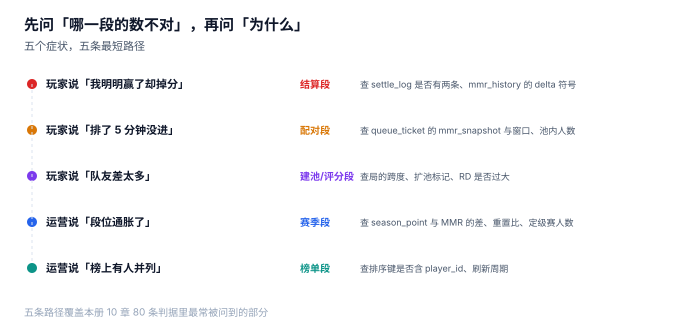

# 常见问题：先问哪一段的数不对，再问为什么

值班时最常听到的一句话是「匹配坏了」。这句话没有信息量——匹配链上有七段，能坏的地方有二十几处，从「池子里没人」到「榜单缓存没刷」都叫「坏了」。

**排障的第一步不是看日志，而是把「坏了」翻译成「哪一段的哪个数不对」。** 本页给五条最短路径。



## 一、症状到段位的分诊表

| 症状 | 先看哪一段 | 第一个要查的数 | 常见根因 |
| --- | --- | --- | --- |
| 「我赢了却掉分」 | 结算 | `settle_log.delta` 的符号 | 结算两次、符号写反、重连重算 |
| 「排了 5 分钟没进」 | 配对 | 票据状态与池内人数 | 票据卡在 `MATCHED`、窗口太窄、池空 |
| 「队友差太多」 | 建池 / 配对 | 该局的 `mmr_spread` 与 `widened` | 扩池无上限、按段位而非分数配对 |
| 「段位通胀了」 | 赛季 | `season_point` 与 `mmr` 的差 | 重置没跑、定级赛场次不足、奖励发双份 |
| 「榜上名次乱跳」 | 榜单 | 排序键与 `snapshot_at` | 只按分数排序、缓存无时间戳 |
| 「奖励没到账」 | 赛季 | `reward_grant.idem_key` | 幂等键冲突、发放任务漏跑 |

六行的顺序是「从下游往上游」：先确认分对不对，再确认局配得对不对，最后才怀疑赛季与榜单。**倒过来查，八成会白查两小时。**

## 二、六个高频问题

### 1. 「我赢了却掉分」

先看这一局有没有两条结算记录：

```sql
select match_id, player_id, count(*) c, sum(delta) total
from settle_log where player_id = :pid
group by match_id, player_id having c > 1;
```

如果 `c > 1`，是重放问题——本机无幂等键时重试 3 次，1,518 变成 1,554。如果 `c = 1` 但符号相反，是 `delta` 算错（`S` 与 `E` 搞反）。如果都对，看是不是**重连又算了一次**：重连必须复用同一个 `match_id`，不能再写一条 `settle_log`。

### 2. 「排了 5 分钟没进」

按顺序查三件事：

| 查什么 | 期望 | 不对说明 |
| --- | --- | --- |
| `queue_ticket.state` | 仍是 `WAITING` | 已变 `MATCHED` 但没进局 → 建局失败后没回滚票据 |
| ±窗口内候选人数 | ≥ 10 | 池太稀 → 该扩池或放宽窗口 |
| 该局是否 `widened` | 有标记 | 扩池没记录 → 无法解释为什么配给他 |

本机在凌晨（0.2 人/秒）的等待 P90 是 221 秒，**这不是故障，是池子太小**。区分「故障」与「容量不足」的唯一办法，是看候选人数而不是看等待时长。

### 3. 「队友差太多」

查该局的跨度：

```sql
select match_id, max(mmr) - min(mmr) as spread
from match_player join player using(player_id)
where match_id = :mid;
```

本机 ±100 窗口的跨度 P90 是 423 分，超过 500 分的局占 2.4%。**如果这一局跨度 600 分且 `widened = 1`，那是窗口放宽的预期代价；如果是 600 分且没有 `widened`，那是按段位配对的实现错误。**

### 4. 「段位通胀了」

「段位通胀」通常不是「分给多了」，而是**分母变了**：

| 现象 | 真实原因 | 怎么确认 |
| --- | --- | --- |
| 同一段位人越来越多 | 新增玩家集中在低段，段位线被稀释 | 比段位人数占比的月度变化 |
| 老玩家段位普遍上升 | 定级赛场次不足，初始分偏高 | 看新号前 10 局的 delta 分布 |
| 赛季初集体掉段 | 软重置压缩了分数 | 看 `reset_ratio` 与段位线是否同步调整 |

第三种最容易引发投诉，但它是**设计如此**：压缩比 0.5 时 71.7% 的人段位标签会变。它不是 bug，缺的是公告。

### 5. 「榜上名次乱跳」

两个原因，都不难查：

```sql
-- 排序是否稳定（期望两次结果一致）
select player_id, score from leaderboard
where season_id = :sid order by score desc, player_id limit 100;
```

如果代码里写的是 `order by score desc` 而没有 `player_id`，同分顺序由执行计划决定，两次查询就能不同。第二个原因是缓存：本机 5 万人的榜单前 100 名只占 5 种分值、最大并列 27 人——**并列越多，「名次」这个词越不精确**，页面上必须写「并列第 N」。

### 6. 「奖励没到账」

查 `reward_grant` 的幂等键：

```sql
select * from reward_grant where player_id = :pid and season_id = :sid;
```

四种情形：键冲突（发过了，只是查询没带 `season_id`）、档位判断错（`player_rank.tier` 在发奖时已变）、任务漏跑（补跑一次即可，前提是有幂等键）、账号被封（按规则不发）。

::: danger 三个「排障时最容易做错的动作」
1. **直接改库**：`update player set mmr = 1500` 会把流水断掉，之后所有断言都失效。要改就写一条 `CORRECTION`。
2. **重跑整个赛季的重算**：会覆盖当前赛季的分数。重算必须带 `season_id` 且只写历史。
3. **重启配对服务**：票据在内存里的会被清空，玩家白等。重启前先确认票据是持久化的。
:::

## 三、判据族 `MKF-A ~ MKF-H`

本页判据族 `MKF-A` ~ `MKF-H`，共 8 条。它们描述「排障路径是不是可执行」。

| 编号 | 判据 | 怎么验 |
| --- | --- | --- |
| `MKF-A` | 每个症状能落到具体一张表的一列 | 分诊表里没有「看日志」这类模糊动作 |
| `MKF-B` | 结算类问题先查 `settle_log` 条数 | 一条 SQL 能查出重复结算 |
| `MKF-C` | 配对类问题能查「候选人数量」而非只看时长 | 给定分数与窗口能算出人数 |
| `MKF-D` | 质量类问题能取到该局的 `spread` 与 `widened` | 单局可解释 |
| `MKF-E` | 赛季类问题能对比 `season_point` 与 `mmr` | 两个数都可得 |
| `MKF-F` | 榜单类问题能验证排序稳定性 | 同分两行顺序可复现 |
| `MKF-G` | 奖励类问题能按 `idem_key` 反查 | 一次查询定位是否发过 |
| `MKF-H` | 排障动作不包含「直接改库」 | 所有修复动作都留痕 |

## 四、验证方式

```shell
# 1. 能否一次查出重复结算（期望有行 = 有问题）
sqlite3 :memory: "
create table settle_log(match_id text, player_id text, delta real);
insert into settle_log values ('M1','P1',16),('M1','P1',16),('M2','P1',-18);
select match_id, player_id, count(*) c, sum(delta) total
from settle_log where player_id='P1'
group by match_id, player_id having c>1;"
# 期望输出：M1|P1|2|32.0

# 2. 单局跨度能否解释（期望能取出 spread 与 widened）
sqlite3 :memory: "
create table mp(match_id text, mmr real);
create table m(match_id text, widened int);
insert into mp values ('M1',1500),('M1',1800),('M1',1400);
insert into m values ('M1',1);
select mp.match_id, max(mmr)-min(mmr) spread, m.widened
from mp join m using(match_id) group by mp.match_id;"
# 期望输出：M1|400.0|1

# 3. 奖励是否发过（期望 1 行）
sqlite3 :memory: "
create table reward_grant(player_id text, season_id text, idem_key text unique);
insert into reward_grant values ('P1','S1','S1-DIA-P1');
select count(*) from reward_grant where player_id='P1' and season_id='S1';"
# 期望输出：1
```

三步对应分诊表的前三行。**如果这三条 SQL 你都能在 30 秒内写出来，排障时间会从小时级降到分钟级**——这也是本册把「可解释」写进判据的原因。

## 参考资料

- Microsoft Azure PlayFab《Matchmaking》与《Leaderboards》文档：队列、票据与榜单的排障入口。
- SQLite 官方文档《EXPLAIN QUERY PLAN》：确认查询是否走索引、是否产生临时 B 树。
- 与本页相邻：[总览](../Overview/index.md)、[对局结算与幂等](../Settlement/index.md)、[实战](../Practice/index.md)。
