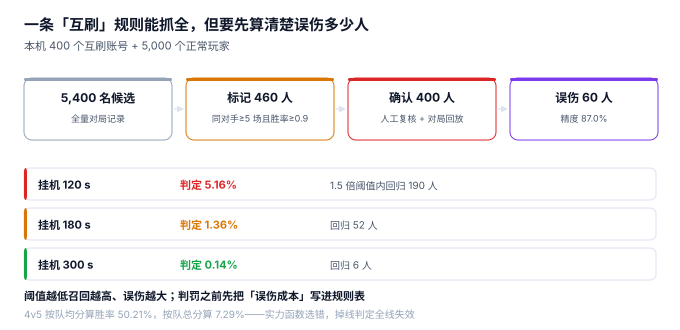

# 公平性与反作弊：一条规则能抓全，但要先算清误伤

运营发来一条规则需求：「同一个对手打 5 场以上、胜率超过 90% 的，全部封号。」工程师照做，上线第二天收到 60 封申诉——其中 60 个是真实的双排好友，在低分段互相带了几局。

**反作弊的难点从来不是「抓不到」，而是「抓错」。** 抓错一个正常玩家，成本不是一次客服工单，是他在社区里发的那条帖子。

::: tip 一句话理解
任何一条检测规则都要同时报三个数：**召回了多少、误伤了多少、处置错了能不能退**。只报第一个数的规则，早晚会被下线。
:::

## 一、四类作弊，四种信号



| 类型 | 行为特征 | 可用的信号 | 最难的地方 |
| --- | --- | --- | --- |
| 炸鱼（smurf） | 高实力低分段，胜率极高 | 连胜 + 对手强度 + 操作指标 | 新号无法判断，前 20 局信号不足 |
| 代练（boosting） | 账号在异地/异设备突然变强 | 登录设备、IP、操作习惯 | 共享设备（网吧）误伤率高 |
| 演员 / 互刷 | 固定对手反复对局，胜负刻意 | 同对手频次 + 胜率 + 时间规律 | 真实好友也会高频对局 |
| 挂机（AFK） | 长时间无操作 | 操作间隔、伤害/治疗占比 | 网络抖动与真实挂机难区分 |

四类里，**只有「互刷」可以用纯对局记录判定**，其余三类都需要额外的信号（设备、操作、网络）。本册只讲「赛后判定」这一段，采集与设备指纹属于客户端与风控的范畴。

## 二、一条规则的三本账

本机构造 400 个互刷账号（200 组、每组 2 人、30 天内对局 40 场、刻意 95% 胜率）+ 5,000 个正常玩家，跑一条最简单的规则：**同对手 ≥ 5 场且胜率 ≥ 0.9**。

| 指标 | 读数 | 说明 |
| --- | --- | --- |
| 标记人数 | 460 | 400 真 + 60 误 |
| 精度（Precision） | **87.0%** | 标 460 个，中 400 个 |
| 召回（Recall） | 100% | 构造数据里全中 |
| 误伤 | 60 人 | 每条规则都会误伤，问题是要不要付这个成本 |

87.0% 的精度听起来不错，但换成绝对数就不好看了：**每封 7.7 个号，就有 1 个是冤枉的**。按 30 天申诉率 10% 估算，每天要多处理 6 个工单——这就是「误伤成本」的具体形态。

### 怎么把精度做上去

真实系统里通常加三个条件，把精度从 87% 拉到 95% 以上：

1. **对局时间规律**：互刷往往集中在同一时段（同一批人同时在线），真实好友是零散的。
2. **胜负与实力背离**：互刷局里，弱的一方胜率异常高，而这在 Elo 里会表现为「MMR 涨得比胜率快」。
3. **账号关联**：同设备 / 同 IP / 同支付方式。这一条最强，但也最容易误伤网吧与家庭共享。

每加一条，召回会掉一点、精度会涨一点。**没有「全都要」的规则，只有一条被明确接受的曲线。**

## 三、挂机：阈值越低，误伤越多

挂机判定只有一个参数：**多久没操作算挂机**。本机 5,000 个「无操作时长」样本（指数分布，均值 40 秒）：

| 阈值 | 判定人数 | 占比 | 其中在 1.5 倍阈值内回归 |
| --- | --- | --- | --- |
| 120 秒 | 258 | 5.16% | 190 人 |
| 180 秒 | 68 | 1.36% | 52 人 |
| 300 秒 | 7 | 0.14% | 6 人 |

「1.5 倍阈值内回归」这一列是判断误伤的关键：这些人只是**短暂离开**（接电话、掉线重连），不是挂机。120 秒阈值下，190/258 = **73.6% 的判定会在两分钟内自我推翻**。

所以挂机的正确做法不是「定一个阈值然后扣分」，而是**两段式**：

1. 超过阈值 → 标记，**不处罚**，只在对局记录里留痕。
2. 同一玩家在一个赛季内累计 N 次标记 → 才进入处罚流程。

这样既保住了召回，也把误伤挡在了「标记」这一层——标记错了没人会知道，处罚错了所有人都会知道。

## 四、处置：扣分、封禁、回滚

判定之后是处置，处置的核心是**可逆**：

| 处置 | 动作 | 可逆性 | 注意 |
| --- | --- | --- | --- |
| 扣分 | `mmr_history(reason='PENALTY')` | 可逆（再写一条 `CORRECTION`） | 必须注明扣的是哪几局 |
| 封禁 | `account.status = 'BANNED'` | 可逆（解封） | 封禁期间的对局不能补算 |
| 赛季清零 | `season_point = 0` | 不可逆（但可留快照） | 要保留原始值，便于申诉 |
| 榜单移除 | 从 `leaderboard` 删除 | 可逆（重算） | 重算要能排除已封账号 |

四类处置里，**只有「赛季清零」是不可逆的**。所以它必须是「人工复核后」的动作，不能由规则直接触发。

::: danger 四个「处置错了没法退」的坑
1. **直接 `update player set mmr = 1200`**：不记 before，申诉时无法恢复。正确做法是写一条 `PENALTY` 记录，再写一条 `CORRECTION` 回滚。
2. **封禁时删掉账号的对局记录**：证据没了，申诉无法复核。对局记录只能标记不可信，不能删。
3. **扣分按「总局数 × 常数」估**：估多了玩家不服，估少了等于没罚。正确做法是**列出被判定的具体对局**，逐局回滚。
4. **处置接口没有幂等键**：运营手滑点两次，扣两次分。处置也必须带 `idem_key`。
:::

## 五、误伤的账要提前算

把误伤换算成钱，才有人愿意为「精度」买单。一个可用的估算式：

```text
误伤成本 = 误伤人数 × (申诉处理成本 + 流失概率 × 用户终身价值)
```

本机 460 个标记里 60 个误伤。若申诉处理成本 15 元/单、流失概率 8%、终身价值 300 元，则：

| 项 | 计算 | 金额 |
| --- | --- | --- |
| 申诉处理 | 60 × 15 | 900 元 |
| 期望流失 | 60 × 8% × 300 | 1,440 元 |
| 合计 | — | **2,340 元** |

而放走 400 个互刷账号的代价是「榜单被污染」——这个数很难算，但它会体现在「正常玩家是否还愿意冲榜」上。**两条账都摆出来，规则才有讨论的基础。**

## 六、判据族 `MKI-A ~ MKI-H`

本页判据族 `MKI-A` ~ `MKI-H`，共 8 条。它们描述「判得准不准、处置能不能退」。

| 编号 | 判据 | 怎么验 |
| --- | --- | --- |
| `MKI-A` | 每条规则同时输出「命中数 / 精度 / 召回」 | 规则报表里有三个数，不只有命中数 |
| `MKI-B` | 判定结果落表且带规则版本 | 同一次判定能追溯到用了哪版规则 |
| `MKI-C` | 标记与处罚分离（两级） | 标记不产生扣分，扣分需二次动作 |
| `MKI-D` | 扣分写 `reason='PENALTY'` 并列出对局 | 扣分记录能关联到具体 `match_id` |
| `MKI-E` | 处置可回滚且回滚留痕 | 回滚后能查到 `PENALTY` 与 `CORRECTION` 两条 |
| `MKI-F` | 处置接口有幂等键 | 重复提交只生效一次 |
| `MKI-G` | 封禁账号不参与榜单与匹配 | 封禁后 `leaderboard` 与 `queue_ticket` 均无该账号 |
| `MKI-H` | 误伤率与申诉率有看板 | 每周能看到「标记数 → 申诉数 → 撤销数」漏斗 |

## 七、验证方式

```shell
# 1. 同对手频次统计（期望把高频对局的人挑出来）
sqlite3 :memory: "
create table mp(match_id text, player_id text, opp_id text, win int);
insert into mp values ('M1','A','B',1),('M2','A','B',1),('M3','A','B',1),
                      ('M4','A','B',0),('M5','A','B',1),('M6','A','C',1);
select opp_id, count(*) games, sum(win)*1.0/count(*) wr
from mp where player_id='A' group by opp_id having games>=5;"
# 期望输出：B|5|0.8

# 2. 挂机标记不直接扣分（期望标记表有行、分数不变）
sqlite3 :memory: "
create table afk_flag(player_id text, match_id text);
create table p(id text, mmr real);
insert into p values ('A',1500);
insert into afk_flag values ('A','M1');
select (select count(*) from afk_flag) flags, (select mmr from p where id='A') mmr;"
# 期望输出：1|1500.0

# 3. 处置幂等（期望第二次被唯一键挡住）
sqlite3 :memory: "
create table penalty(idem_key text primary key, player_id text, delta real);
insert into penalty values ('S1-A-PENALTY-1','A',-200);
insert into penalty values ('S1-A-PENALTY-1','A',-200);"
# 期望输出：Error: stepping, UNIQUE constraint failed: penalty.idem_key (19)
```

第一条的输出 0.8 说明：**规则要看「频次 + 胜率」两个维度**，只看胜率会把「偶尔赢一次强敌」的人误判；只看频次会把天天一起玩的好友误判。

## 参考资料

- 《中华人民共和国网络安全法》（2016 年 11 月 7 日通过，2017 年 6 月 1 日施行）：网络运营者对用户行为的管理责任。
- 《网络游戏管理暂行办法》（文化部令第 49 号，2019 年废止后由相关规范承接）：游戏内违规行为处置的监管沿革。
- Microsoft Azure PlayFab《Player bans and moderation》文档：封禁、申诉与回滚的工程口径。
- 与本页相邻：[评分与 MMR](../Rating/index.md)、[对局结算与幂等](../Settlement/index.md)、[赛季与软重置](../Season/index.md)。
