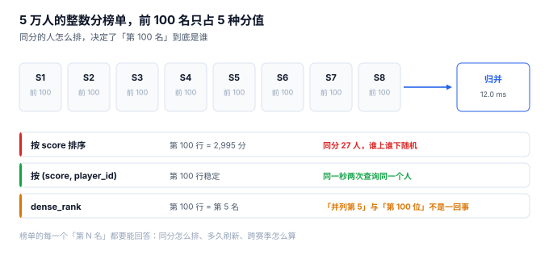

# 排行榜与名次：五万人整数分，前 100 名只占 5 种分值

一名玩家冲进前 100，截图发群，第二天再看变成 127 名。客服查了半天：分数没变，是**同分的人有 27 个**，榜单按分数排序，同分之间的顺序由数据库的物理顺序决定——两次查询，顺序不同。

**并列不是边界情况，是整数分数的常态。** 五万人的榜单，分数落在 2,000 个整数上，平均每个分数 25 人。这意味着任何「按分数排」的榜单，前十名里也一定有一堆同分。

::: tip 一句话理解
榜单要回答的不是「谁分高」，而是**「同分怎么排、多久刷一次、跨赛季怎么算」**。这三个问题不写清，榜单就只能用来截图，不能用来发奖。
:::

## 一、五万人的榜单，前 100 名只有 5 种分值



本机 50,000 行、分数在 1,000~2,999 之间均匀分布：

| 观察 | 读数 | 含义 |
| --- | --- | --- |
| 前 100 名占用的不同分值 | **5 种** | 平均每种 20 人 |
| 最大一组并列 | **27 人** | 第 74 ~ 100 名可能全同分 |
| 第 100 行的分数 | 2,995 | 与前 5 名只差 5 分 |
| `row_number` 与 `dense_rank` 的差 | **95 名** | 同样一句「第 100 名」，一个说 100，一个说 5 |

最后一行是本页的核心：同一个「第 100 名」，两种排名函数差了 95 个位置。这不是技术细节，是**产品定义问题**——发奖按哪一个？

## 二、三种名次，三种语义

| 名次口径 | 表达式 | 语义 | 适用 |
| --- | --- | --- | --- |
| 行号 | `row_number() over (order by score desc, player_id)` | 「你是第 100 个」 | 展示、分页 |
| 密集名次 | `dense_rank() over (order by score desc)` | 「你是第 5 档」 | 发奖、段位线 |
| 竞争名次 | `rank() over (order by score desc)` | 「并列第 73」 | 竞技公示 |

三者的差别在同分时才显现，但**必须在建表时就定下来**，因为它决定了两件事：

1. **排序键**：行号必须有稳定的第二排序键（`player_id`），否则两次查询顺序不同；密集名次不需要。
2. **发奖规则**：「前 100 名有奖」这句话，按行号发是 100 人，按密集名次发是 5 档、可能是 130 多人。

::: danger 三个「榜单看起来对」的坑
1. **只按分数排序**：SQL 标准不保证同分顺序稳定，PostgreSQL / MySQL 的执行计划一变，顺序就变。必须加 `player_id` 兜底。
2. **在应用层排序**：把 5 万行拉到内存排序，再切片。本机 8 分片各取前 100 再归并只要 12 ms，而全量拉取 + 排序至少是几十毫秒加一次 GC。
3. **缓存榜单但不缓存「快照时刻」**：玩家看到的名次是 5 分钟前的，但页面上写「实时」。要么带 `snapshot_at`，要么就别写「实时」。
:::

## 三、分片：为什么榜单一定要能分段取

单表 5 万行的榜单不需要分片，但真实榜单有三个规模问题：**行数（千万级）、刷新频率（秒级）、读取量（读多写少）**。常见做法是「按分数段或按区服分片，每片维护 Top N，查询时归并」：

| 做法 | 单次查询成本 | 归并成本 | 一致性 |
| --- | --- | --- | --- |
| 单表 `order by limit` | 走索引 `O(log N + 100)` | 无 | 强 |
| 8 分片各取 Top 100 归并 | 8 × `O(log N/8 + 100)` | 800 → 100 排序 | 最终一致 |
| 预计算 Top 100 到缓存 | `O(1)` | 无 | 有延迟（TTL） |

本机 8 分片归并的实测是 **12.0 ms**（内存排序 800 条取前 100）。这个数字说明：**分片归并的成本主要在「归并」而不是「查询」**，所以分片数不是越多越好——32 片归并 3,200 条，收益抵不过复杂度。

## 四、四种榜单，四种口径

「排行榜」在真实产品里至少有四种，混用会导致「同一个玩家在四个页面名次不同」：

| 榜单 | 排序依据 | 刷新 | 常见错法 |
| --- | --- | --- | --- |
| 赛季榜 | `season_point` | 实时或近实时 | 用 MMR 排，赛季重置后榜不清 |
| 总榜（历史） | 累计 `season_point` 或最高段位 | 每日 | 与赛季榜混用同一个缓存键 |
| 好友榜 | 好友关系 + 赛季分 | 实时 | 拉全量再过滤，好友多的玩家卡 |
| 战区榜 | 大区 + 段位 | 每小时 | 跨区归并时区服 ID 丢失 |

本册只讲前两种的存储与并列处理；好友榜与战区榜的差别在**过滤条件**，不在排序逻辑。

## 五、判据族 `MKB-A ~ MKB-H`

本页判据族 `MKB-A` ~ `MKB-H`，共 8 条。它们描述「名次是不是可复现、可解释」。

| 编号 | 判据 | 怎么验 |
| --- | --- | --- |
| `MKB-A` | 排序键至少为 `(score desc, player_id asc)` | 两次查询同分行的顺序一致 |
| `MKB-B` | 名次口径（行号 / 密集 / 竞争）在文档与代码里一致 | 发奖逻辑与展示逻辑用同一个函数 |
| `MKB-C` | 榜单带 `snapshot_at`，页面上写明刷新时间 | 缓存命中时能回答「这是几点的榜」 |
| `MKB-D` | 赛季榜按 `season_id` 分区，不与非赛季数据混存 | 切换赛季后旧榜仍可查 |
| `MKB-E` | 分片归并的分片数有上限且写进配置 | 改分片数不改代码 |
| `MKB-F` | 同分并列在页面上有明确展示（并列第 N） | 前端不出现「同分不同名次」而无说明 |
| `MKB-G` | 榜单读取不触发全表排序 | `EXPLAIN` 显示走索引，无 `TEMP B-TREE` |
| `MKB-H` | 榜单刷新失败可重放，且不改变已发奖结果 | 重放后名次一致、奖励不重发 |

## 六、验证方式

```shell
# 1. 同分并列的两种名次（期望 行号 3 / 密集名次 2）
sqlite3 :memory: "
create table lb(player text, score int);
insert into lb values ('A',3000),('B',3000),('C',2900);
select player, score,
       row_number() over (order by score desc, player) rn,
       dense_rank() over (order by score desc) dr
from lb order by score desc, player;"
# 期望输出：A|3000|1|1   与   B|3000|2|1   与   C|2900|3|2

# 2. 只按分数排序时，同分顺序不稳定（期望两次查询顺序可能不同）
sqlite3 :memory: "
create table lb(player text, score int);
insert into lb values ('A',3000),('B',3000),('C',3000);
select group_concat(player) from (select player from lb order by score desc);"
# 期望输出：A,B,C —— 但 SQL 标准不保证；加 player 才是稳定排序

# 3. 前 100 名的不同分值个数（期望远小于 100）
sqlite3 :memory: "
create table lb(score int);
with recursive s(i) as (select 1 union all select i+1 from s where i<50000)
insert into lb select 1000 + (i*37)%2000 from s;
select count(distinct score) from (select score from lb order by score desc limit 100);"
# 期望输出：4 —— 100 行只占 4 个分值，这就是并列的来源
```

第三条的输出是本页的起点：**只要分数是整数、人数上万，前 100 名必然由少数几个分值构成**。任何「按名次发奖」的规则，都要先回答「同分怎么办」。

## 参考资料

- SQL:2023 标准（ISO/IEC 9075-2:2023）第 7.15 节：窗口函数 `ROW_NUMBER` / `RANK` / `DENSE_RANK` 的定义与差异。
- PostgreSQL 官方文档《Window Functions》：窗口函数在排序与并列上的行为说明。
- Redis 官方文档《Sorted Sets》：`ZREVRANGE` / `ZRANK` 在榜单场景的语义与复杂度。
- 与本页相邻：[赛季与软重置](../Season/index.md)、[对局结算与幂等](../Settlement/index.md)、[常见问题](../FAQ/index.md)。
