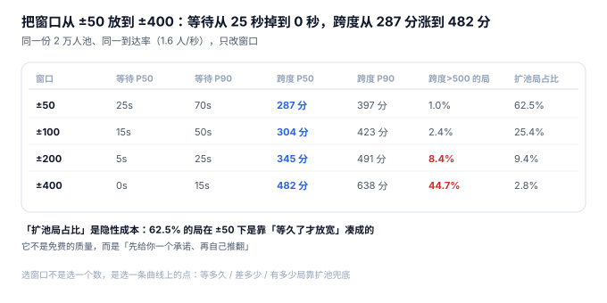
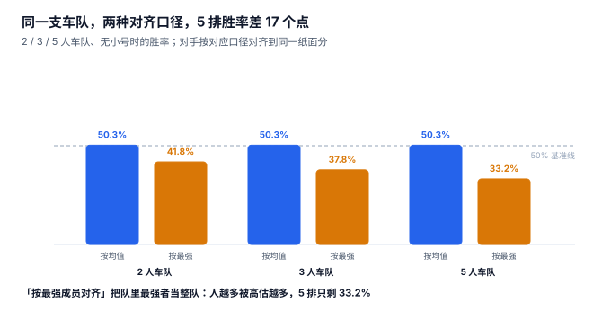

# 配对与匹配质量：窗口每放宽一次，都是用质量换时间

晚上八点，一名钻石玩家排了 25 秒还没进局。系统在第 24 秒把窗口从 ±50 放到 ±100，于是他匹配到了一个「钻石但实际水平差 300 分」的对手。他赢了，但没觉得爽；对面输了，觉得很冤。**这一局对两个人都不公平，而系统认为它「成功了」——因为匹配成功了。**

配对是整条链上唯一一个**没有唯一正确答案**的环节：等待时间和公平性天然对立，任何参数都是一条曲线上的一个点。

::: tip 一句话理解
配对不是在「找最合适的人」，而是在**「可接受的时间」与「可接受的差距」之间选一个点**，并且把这个选择**记录下来**——因为玩家投诉的从来不是「你选错了」，而是「你没解释」。
:::

## 一、一局对局的三个质量指标



| 指标 | 定义 | 谁在感知 | 本机读数（±100 窗口） |
| --- | --- | --- | --- |
| 等待时间 | 从进池到成局 | 玩家（最敏感） | P50 15 秒 / P90 50 秒 |
| 局内跨度 | 十个人里最强与最弱的真实实力差 | 玩家（体感「队友太菜」） | P50 304 分 / P90 423 分 |
| 双方纸面差 | 两队平均分差对应的胜率偏离 50% | 系统（公平性） | 平均 2.9% |

三个指标里，**系统只能直接控制第一个与第三个**，第二个是前两个的副产品。这就是为什么「公平匹配」这句话在工程上必须落成「窗口 + 等待上限」，而不是一句口号。

## 二、窗口曲线：四个点，四种体验

同一份 2 万人池、同一到达率（1.6 人/秒，约合每 6 秒凑一局），只改窗口：

| 窗口 | 成局数 | 等待 P50 | 等待 P90 | 跨度 P50 | 跨度 P90 | 跨度 >500 的局 | 靠扩池凑成的局 |
| --- | --- | --- | --- | --- | --- | --- | --- |
| ±50 | 1,149 | 25 s | 70 s | 287 | 397 | 1.0% | 62.5% |
| ±100 | 1,153 | 15 s | 50 s | 304 | 423 | 2.4% | 25.4% |
| ±200 | 1,154 | 5 s | 25 s | 345 | 491 | 8.4% | 9.4% |
| ±400 | 1,155 | 0 s | 15 s | 482 | 638 | 44.7% | 2.8% |

四行的成局数几乎一样（1,149 ~ 1,155），因为池子里的人数足够——**改变的只有「等多久」和「差多少」**。这张表有三个必须读出来的结论：

1. **收窄窗口不会减少成局，只会把成本转移到等待与扩池上。** ±50 时 62.5% 的局是「等久了才放宽」凑出来的，也就是说窗口的承诺在六成情况下被自己推翻了。
2. **质量不是线性退化，而是有拐点。** 从 ±100 到 ±200，跨度只涨 41 分；从 ±200 到 ±400，跨度涨 137 分、超过 500 分的局从 8.4% 跳到 44.7%。
3. **「跨度 >500 分的局」比「平均跨度」更能反映体感。** 平均值被大量正常局稀释，玩家记住的是那一局被碾压。

## 三、时段：同一套参数，四种表现

窗口固定 ±100，只改到达率（模拟高峰到凌晨）：

| 时段 | 到达率 | 成局数 | 等待 P50 | 等待 P90 | 跨度 P90 | 跨度 >500 的局 |
| --- | --- | --- | --- | --- | --- | --- |
| 高峰 | 3.2 人/秒 | 571 | 5 s | 25 s | 407 | 1.6% |
| 平峰 | 1.6 人/秒 | 284 | 15 s | 45 s | 413 | 1.8% |
| 深夜 | 0.5 人/秒 | 86 | 35 s | 95 s | 453 | 3.5% |
| 凌晨 | 0.2 人/秒 | 34 | 65 s | 221 s | 446 | **0.0%** |

注意最后一行：凌晨的「跨度 >500 的局」是 0.0%，看起来最好——但这是**样本只有 34 局**的统计噪声，而它的等待 P90 是 221 秒。凌晨的真实问题是「人太少」，此时任何质量指标都不可信，唯一可靠的信号是「匹配失败率与等待时长」。

::: warning 一个反直觉的结论
**人越少的时段，配出来的局反而越差。** 凌晨到达率只有高峰的 1/16，跨度 P90 却从 407 分涨到 446 分——因为池子里凑不齐人，只能靠放宽窗口硬配。而凌晨那 0.0% 的「跨度 >500 的局」是 34 局样本的统计噪声，不是质量更好。

**所以质量指标必须带样本量一起看**：正确写法是「跨度 P90 = 446 分（n = 34）」，而不是单独一个百分比。一个只有几十局的百分比，在运营报表上比不写更危险。
:::

## 四、组队：两种对齐口径，17 个点的差距



组队匹配的难点在于「一个队伍的实力是什么」。两种主流口径：

| 口径 | 队伍实力 | 2 人车队 | 3 人车队 | 5 人车队 |
| --- | --- | --- | --- | --- |
| 按平均分 | `avg(mmr)` | 50.32% | 50.32% | 50.32% |
| 按最强成员 | `max(mmr)` | 41.75% | 37.84% | **33.20%** |

按平均分时，车队规模不影响胜率（都接近 50%），因为对手被对齐到同一个纸面分；按最强成员时，人越多被高估得越狠，五人车队只剩 33.20%——**系统把「队伍里最强的那个」当成了「整支队伍」**。

两种口径都不是免费的：

- 按平均分：**带小号最划算**。本机让一名成员「真实实力低 400、MMR 正常」，五人车队胜率仍有 40.50%（只掉 9.8 个点），因为小号的高 MMR 只贡献了 1/5 的均值。
- 按最强成员：**小号被重罚，但正常车队一起被误伤**。同一场景胜率掉到 21.27%，而正常五人车队也只剩 33.20%。

所以工业界的常见做法是**加权**：`w_avg × avg + w_max × max`，权重按模式配置，而不是二选一。关键是**这个函数只能有一处**——两处实现必然漂移。

::: danger 四个「配对看起来成功」的坑
1. **先到先配（FIFO）而不是「最难配的先配」**：高分段玩家如果排在队尾，永远等不到人。正确做法是按「窗口内候选人数」升序处理，先配最稀缺的。
2. **配对成功但没写匹配依据**：`match` 行只有 `avg_mmr`，没有 `window_used`、`spread`、`widened`。玩家投诉时无法解释，运营调参时无法归因。
3. **扩池没有上限**：等待越久窗口越宽，最终会配出「王者打黄金」。必须设硬上限（例如 2 倍窗口或 600 分），超过就允许「继续等」而不是「硬配」。
4. **把「匹配成功」当成「匹配质量达标」**：本机 ±400 窗口下成局 1,155 局、成功率接近 100%，但 44.7% 的局跨度超 500 分。**成功率是最容易被做好的指标，也是最没用的指标。**
:::

## 五、配对的执行顺序

一个可实现的配对循环（每 5 秒一轮）只要四步：

```text
1. 取本轮 WAITING 票据，按 mmr_snapshot 升序
2. 计算每张票据的「有效窗口」= 基础窗口 × 已等待轮次的扩池系数
3. 双指针扫描：以最稀缺的一端为锚点，收集窗口内最近的人
4. 凑满 N 人（5v5 为 10）→ 建 match + 写 match_player → 票据置 MATCHED
```

第三步的「锚点选谁」直接决定公平性。本机的做法是**按窗口内候选人数升序**：候选最少的票据优先配，避免高分段被无限期延后。代价是低分段可能等更久——但低分段候选多，实际上等不久。

第四步之后必须**立刻**把票据置为 `MATCHED`，而不是等对局创建成功。理由很实际：建局可能失败（房间服务超时），如果票据还停在 `WAITING`，下一轮会把它再配一次，于是同一个人进了两局。

## 六、判据族 `MKM-A ~ MKM-H`

本页判据族 `MKM-A` ~ `MKM-H`，共 8 条。它们描述「这一局为什么是他们十个，能不能解释」。

| 编号 | 判据 | 怎么验 |
| --- | --- | --- |
| `MKM-A` | 匹配窗口是配置项，不是代码常量 | 改配置后同一批票据配出不同的局 |
| `MKM-B` | 每局记录 `window_used`、`mmr_spread`、`widened` | 任取一局，能回答「用了多大窗口、跨度多少、是否扩池」 |
| `MKM-C` | 扩池有硬上限，超限则继续等待 | 构造极端稀疏池，不会配出超上限的局 |
| `MKM-D` | 队伍实力函数只有一处，且注明均值/最强/加权 | 全库检索该公式只有 1 处实现 |
| `MKM-E` | 组队人数影响对齐口径（或显式配置） | 同一批人 2 排与 5 排配出的对手不同 |
| `MKM-F` | 票据置 `MATCHED` 与建局在同一事务或先置后建 | 建局失败重试不会配出两局 |
| `MKM-G` | 配对顺序按候选稀缺度，不按到达时间 | 高分段票据不会被无限延后 |
| `MKM-H` | 匹配失败有独立计数（超时/取消），不与成功混淆 | 成功率与「跨度达标率」是两个指标 |

## 七、验证方式

```shell
# 1. 两种对齐口径下，5 人车队被高估多少（期望 max 口径明显更低）
sqlite3 :memory: "
create table party(id int, mmr real);
insert into party values (1,1500),(2,1500),(3,1500),(4,1500),(5,1500);
select avg(mmr) as by_mean, max(mmr) as by_max from party;"
# 期望输出：1500.0|1500.0 —— 同分时两者相等，这就是「看起来没问题」的原因

# 2. 队里有一个高分小号时，两种口径立刻分叉（期望 by_max > by_mean）
sqlite3 :memory: "
create table party(id int, mmr real);
insert into party values (1,1900),(2,1500),(3,1500),(4,1500),(5,1500);
select round(avg(mmr),1) as by_mean, max(mmr) as by_max from party;"
# 期望输出：1580.0|1900.0

# 3. 跨度是否被记录（期望能按局输出最强与最弱之差）
sqlite3 :memory: "
create table mp(match_id text, mmr real);
insert into mp values ('M1',1500),('M1',1720),('M1',1310);
select match_id, max(mmr)-min(mmr) as spread from mp group by match_id;"
# 期望输出：M1|410.0
```

第二条是整页的钥匙：**同分时两种口径完全一样**，所以「按均值」的错误在小号出现之前完全不可见——它只在高分段与带小号的车队上暴露，而那正是投诉最多的人群。

## 参考资料

- Microsoft Azure PlayFab《Matchmaking》文档：匹配规则、扩窗（expansion）、票（ticket）的工程模型。
- Glickman, M. E. *Example of the Glicko-2 system*：以「对手强度 + RD」表达匹配质量的做法。
- ISO/IEC 25010:2023《系统与软件质量模型》：以「时间特性」与「功能正确性」区分等待与公平两类指标。
- 与本页相邻：[匹配池与分层](../Pool/index.md)、[评分与 MMR](../Rating/index.md)、[对局结算与幂等](../Settlement/index.md)。
