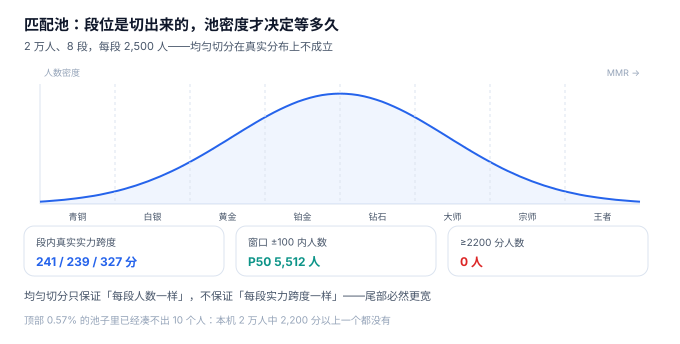

# 匹配池与分层：段位是切出来的，池密度才决定等多久

运营同学拿到一份段位分布报告，发现八个段位「每段都是 2,500 人，非常均匀」，于是判定分档合理。三天后客服收到一堆投诉：「钻石段的人水平差太多了。」他把「王者」段的 2,500 人拉出来看真实实力，P10 到 P90 差了 **327 分**——按 400 分标尺，这是 80% 对 20% 的胜率差，而他们是同一个段位。

**段位不是算出来的，是切出来的。** 切法只保证「每段人数一样」，不保证「每段实力跨度一样」。而匹配真正依赖的不是段位，是池子里**有多少人在你的窗口内**。

::: tip 一句话理解
池子的质量由两个数决定：**窗口内有几个人**（决定等多久）和**这些人实力差多少**（决定这局公不公平）。段位只是给玩家看的一个标签，它对匹配的唯一作用是把池子先切小一点。
:::

## 一、一个玩家其实在五个池子里



点下「开始匹配」的那一刻，这名玩家同时属于五个池：

| 池 | 切分依据 | 作用 | 切错的后果 |
| --- | --- | --- | --- |
| 大区池 | 服务器 / 地区 | 控制延迟 | 跨区匹配，延迟 200 ms 起 |
| 模式池 | 5v5 / 1v1 / 大乱斗 | 规则与地图 | 两套规则混配，结算用错公式 |
| 段位带 | 段位 ± 1 段 | 先粗筛 | 带太窄，高段位永远等不到人 |
| 组队池 | 单排 / 双排 / 五排 | 队伍规模 | 五排混进单排队，五人协同打散人 |
| 时段池 | 赛季阶段 / 活动 | 冷启动隔离 | 新赛季与老赛季的分数不可比 |

五个池是**依次收窄**的关系，不是并列。工程上要小心的是最后两个：组队池与时段池在数据模型里常常没有独立字段，而是靠 `party_id is null` 与 `season_id` 隐式表达，一旦漏掉，就会出现「五排打单排」和「跨季混配」。

## 二、段位是分位数，不是能力值

本机 20,000 名玩家、实力 σ=250 分、按 MMR 八等分切段位，每段 2,500 人：

| 段位 | 人数 | 真实实力 P10 | P90 | 段内跨度 |
| --- | --- | --- | --- | --- |
| 黄金 | 2,500 | 1,266 | 1,507 | 241 分 |
| 钻石 | 2,500 | 1,421 | 1,660 | 239 分 |
| 王者 | 2,500 | 1,726 | 2,053 | **327 分** |

中段最窄、尾段最宽，原因很直白：正态分布的中段人数密集，同样 2,500 人只覆盖 240 分；尾段稀疏，同样 2,500 人要覆盖 327 分。**任何按人数等分的切法，都会让高端段位的实力跨度更大。**

这直接决定了一件事：**不能用段位做匹配的主键**。

| 做法 | 结果 | 本机读数 |
| --- | --- | --- |
| 同段位才能匹配 | 王者段内仍可能差 327 分 | 段内跨度 327 分 |
| 同 MMR ±100 才能匹配 | 跨度收窄到 304 分 | 窗口内 P50 5,512 人 |
| 同 MMR ±50 | 跨度 287 分，但 62.5% 的局靠扩池凑 | 等待 P50 25 秒 |

注意第二行与第三行的差距只有 17 分，但等待从 15 秒变成 25 秒、扩池比例从 25.4% 涨到 62.5%。**再窄下去，收益迅速衰减、成本迅速上升**——这是本册反复出现的「窗口曲线」。

## 三、池密度：决定等待的是人数，不是分数

同一批 2 万人，窗口 ±100 内的人数中位数是 **5,512 人**，但最稀疏的位置只有 **2,044 人**；到了顶部，MMR ≥ 2000 的只有 **115 人（0.57%）**，≥ 2200 的**一个都没有**。

| 池位置 | ±100 内人数 | 结果 |
| --- | --- | --- |
| 中段（P50） | 5,512 | 秒配 |
| 稀疏处（P10） | 2,044 | 仍够配 |
| ≥ 2000 分 | 115 人 | 需要扩池或延长等待 |
| ≥ 2200 分 | 0 人 | **此段实际不可匹配** |

「不可匹配」不是说这些人配不上，而是说**他们只能和比自己弱 200 分以上的人打**。本机凌晨时段（λ=0.2 人/秒）的模拟里，等待 P90 到 191 秒，局内跨度 P90 到 491 分，**9.1% 的局跨度超过 500 分**——这就是「高分段凌晨全是炸鱼局」的量化形态。

::: danger 三个「池子里看不见」的坑
1. **用段位当池的 key**：段位是分位数，赛季重划后会整体平移。正确做法是 `queue_ticket.mmr_snapshot` 存分数快照，段位只用于展示与粗筛。
2. **进池时取一次分，之后不更新**：玩家排队 40 秒期间结算完一局，MMR 变了但票据里的 `mmr_snapshot` 还是旧的。要么进池冻结（可解释），要么匹配时重读（实时），**不能一半一半**。本册选冻结，并在票据上写明 `snapshot_at`。
3. **忽略「同一批次」问题**：新赛季第一天，全服分数被压缩到 1500 附近，窗口 ±100 内人数从 5,512 涨到 **10,382**——池子变挤了，匹配变快，但「挤」的代价是同一窗口里混进了更多真实实力不同的人（见[赛季与软重置](../Season/index.md)）。
:::

## 四、队列在存储层长什么样

配对的本质是「在按分数排序的集合里，找 10 个距离最近的元素」。三种实现各有取舍：

| 实现 | 结构 | 单次扫描复杂度 | 适用 |
| --- | --- | --- | --- |
| 有序集合 | Redis `ZSET`（score=MMR） | `O(log N + M)`，M 为窗口内人数 | 主流：内存、支持范围查询 |
| 内存索引 | 跳表 / B 树，分片锁 | `O(log N + M)` | 单进程、极低延迟 |
| 数据库轮询 | `ORDER BY mmr LIMIT` | 每轮全表或索引扫描 | 只能做兜底与审计 |

关键不在「用哪个」，而在**票据的状态机**：

```text
WAITING ──匹配成功──> MATCHED ──进入对局──> 归档
   │
   └──取消 / 超时──> CANCELLED
```

`queue_ticket.state` 只有三个值，但每一次迁移都要能回答「谁改的、什么时候改的」。本机在实战章用 `state` 上的 `CHECK` 约束加一条部分索引把这件事钉住：

```sql
create index idx_ticket_waiting on queue_ticket(mmr_snapshot, enqueue_at)
  where state = 'WAITING';
```

部分索引的好处是只扫在等的人——一张千万行、99% 已归档的票据表，全量索引和部分索引的差距是数量级的。

## 五、判据族 `MKP-A ~ MKP-H`

本页判据族 `MKP-A` ~ `MKP-H`，共 8 条。它们描述「池切得对不对、票据能不能解释」。

| 编号 | 判据 | 怎么验 |
| --- | --- | --- |
| `MKP-A` | 票据存 `mmr_snapshot` 与 `enqueue_at`，不引用实时分 | 结算后票据里的分数不变，匹配用的是快照 |
| `MKP-B` | 池切分至少包含大区、模式、赛季、组队四个维度 | 四个维度缺失任一，都能构造出一次错配 |
| `MKP-C` | 段位由分档线算出，分档线存在配置表 | 改分档线，段位整体重算且无写死常量 |
| `MKP-D` | 段位不参与匹配的主排序，只做粗筛 | 匹配 SQL 里 `ORDER BY` 用的是分数不是段位 |
| `MKP-E` | 等待票据有 `WAITING` 部分索引 | `EXPLAIN QUERY PLAN` 显示走部分索引 |
| `MKP-F` | 取消匹配必须落状态，不能直接删行 | 取消后行仍在、`state='CANCELLED'`，可统计流失 |
| `MKP-G` | 同一玩家同时只能有一张 `WAITING` 票据 | 第二次插入报部分唯一索引冲突 |
| `MKP-H` | 池内人数可被单独查询（不依赖配对服务） | 给定分数与窗口，能算出候选人数 |

## 六、验证方式

```shell
# 1. 等人数切四段，看每段的实力跨度（期望 两端 > 中间）
sqlite3 :memory: "
create table p(mmr real);
with recursive s(i) as (select 1 union all select i+1 from s where i<20000)
insert into p select 1000 + (i*97)%1000 + (i*89)%1000 from s;
select band, count(*) n, max(mmr)-min(mmr) span from (
  select mmr, ntile(4) over (order by mmr) band from p)
group by band;"
# 期望输出（四段各 5,000 人，跨度两端大、中间小）：
# 1|5000|706.0
# 2|5000|292.0
# 3|5000|292.0
# 4|5000|648.0

# 2. ±100 窗口内的候选人数（期望 中段远多于尾段）
sqlite3 :memory: "
create table p(mmr real);
with recursive s(i) as (select 1 union all select i+1 from s where i<20000)
insert into p select 1000 + (i*97)%1000 + (i*89)%1000 from s;
select (select count(*) from p where abs(mmr-2000)<=100) as mid,
       (select count(*) from p where abs(mmr-2700)<=100) as top;"
# 期望输出：3860|1220

# 3. 同一个人不能有两张等待票据（期望报唯一约束）
sqlite3 :memory: "
create table queue_ticket(id integer primary key, player_id text, state text);
create unique index ux_wait on queue_ticket(player_id) where state='WAITING';
insert into queue_ticket(player_id,state) values ('P1','WAITING');
insert into queue_ticket(player_id,state) values ('P1','WAITING');"
# 期望输出：Error: stepping, UNIQUE constraint failed: queue_ticket.player_id (19)
```

第一条的输出会告诉你「按人数等分」为什么必然让尾段更宽；第三条说明「取消后再排」为什么必须先把旧票据置为 `CANCELLED`——部分唯一索引只在 `WAITING` 上生效，这正是它的价值。

## 参考资料

- Microsoft Azure PlayFab《Matchmaking》文档：队列、票（ticket）、池（pool）与规则的概念模型。
- Redis 官方文档《Sorted Sets》：`ZRANGEBYSCORE` 的复杂度与范围查询语义。
- PostgreSQL 官方文档《Partial Indexes》：部分索引的适用条件，本册票据表索引的依据。
- 与本页相邻：[总览](../Overview/index.md)、[评分与 MMR](../Rating/index.md)、[配对与匹配质量](../Match/index.md)。
