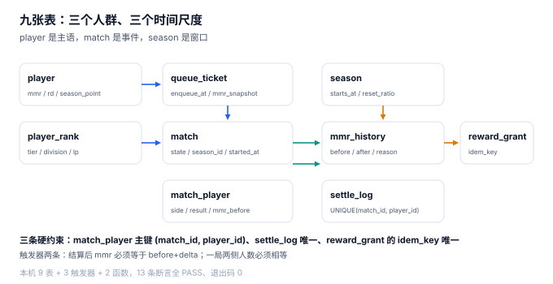

# 实战：九张表、三个触发器、十三条断言

前面九章都在说「什么是错的」。这一章把它变成一个能跑的东西：**九张表 + 三个触发器 + 十三条断言**，全部在 SQLite 里跑通，退出码 0。

判据的标准很朴素：**能被数据库拦住的，才叫约束；只能靠代码自觉的，叫约定。** 本页尽量把约定变成约束。



## 一、九张表的分工

| 表 | 一句话职责 | 关键约束 |
| --- | --- | --- |
| `season` | 赛季的时间窗与重置比 | `starts_at < ends_at`，`reset_ratio ∈ [0,1]` |
| `player` | 玩家当前的实力估计 | `mmr` / `rd` 都在，段位不冗余存 |
| `player_rank` | 段位标签（可重算） | `division ∈ 1..3`，`lp ∈ 0..99` |
| `queue_ticket` | 进池票据（含分快照） | `state` 三值，`mmr_snapshot` 冻结 |
| `match` | 一局对局 | `(state='SETTLED') = (ended_at is not null)` |
| `match_player` | 一局里的十个人 | 主键 `(match_id, player_id)` |
| `settle_log` | 结算闸门 | 主键 `(match_id, player_id)` |
| `mmr_history` | 分数变动流水 | `reason` 四值，含 `before` / `after` |
| `reward_grant` | 赛季奖励 | `idem_key` 唯一 |

三个时间尺度：`season` 是「月」，`match` 是「分钟」，`queue_ticket` 是「秒」。**九张表共用两个主语**：`player_id` 与 `season_id`。任何一张表里出现「用 `user_id` 代替 `player_id`」的地方，都是后面「一个人两个身份」的坑。

## 二、建表：把口径写进 `CHECK`

```sql
create table season(
  season_id   text primary key,
  starts_at   text not null,
  ends_at     text not null,
  reset_ratio real not null check(reset_ratio between 0 and 1),
  check(starts_at < ends_at)
);

create table player(
  player_id  text primary key,
  nickname   text not null,
  mmr        real not null default 1500,
  rd         real not null default 350,
  created_at text not null
);

create table player_rank(
  player_id text primary key references player(player_id),
  season_id text not null references season(season_id),
  tier      text not null,
  division  integer not null check(division between 1 and 3),
  lp        integer not null check(lp between 0 and 99)
);

create table queue_ticket(
  ticket_id    integer primary key autoincrement,
  player_id    text not null references player(player_id),
  party_id     text,
  mmr_snapshot real not null,
  enqueue_at   text not null,
  state        text not null default 'WAITING'
               check(state in ('WAITING','MATCHED','CANCELLED'))
);

create table match(
  match_id   text primary key,
  season_id  text not null references season(season_id),
  started_at text not null,
  ended_at   text,
  state      text not null default 'RUNNING'
             check(state in ('RUNNING','SETTLED','ABORTED')),
  avg_mmr    real,
  check((state='SETTLED') = (ended_at is not null))
);

create table match_player(
  match_id   text not null references match(match_id),
  player_id  text not null references player(player_id),
  side       text not null check(side in ('A','B')),
  result     text check(result in ('WIN','LOSE','DRAW')),
  mmr_before real not null,
  mmr_delta  real,
  primary key(match_id, player_id)
);

create table settle_log(
  match_id  text not null references match(match_id),
  player_id text not null references player(player_id),
  delta     real not null,
  idem_key  text not null,
  primary key(match_id, player_id)
);

create table mmr_history(
  id         integer primary key autoincrement,
  player_id  text not null references player(player_id),
  match_id   text,
  before     real not null,
  after      real not null,
  reason     text not null check(reason in ('MATCH','SEASON_RESET','PENALTY','CORRECTION'))
);

create table reward_grant(
  id         integer primary key autoincrement,
  player_id  text not null references player(player_id),
  season_id  text not null references season(season_id),
  amount     integer not null check(amount > 0),
  idem_key   text not null unique
);
```

::: danger 三条「写表的时候最容易省掉」的约束
1. **`check((state='SETTLED') = (ended_at is not null))`**：省掉它会出现「已结算但没有结束时间」的局，补偿任务会反复扫到。
2. **`match_player` 的主键 `(match_id, player_id)`**：省掉它，同一个人能在一局里出现两次（重连补写时会），结算时加两次分。
3. **`mmr_history` 的 `before` / `after`**：省掉任何一个，回滚就只能靠猜。
:::

## 三、三个触发器：把「必须一起发生」变成「不可能分开」

```sql
-- 1. 结算即落流水：写 delta 的同时记 before/after，并回填 match_player
create trigger trg_settle_apply
after insert on settle_log
begin
  insert into mmr_history(player_id, match_id, before, after, reason)
  values(new.player_id, new.match_id,
         (select mmr from player where player_id = new.player_id),
         (select mmr from player where player_id = new.player_id) + new.delta,
         'MATCH');
  update player set mmr = mmr + new.delta where player_id = new.player_id;
  update match_player set mmr_delta = new.delta
   where match_id = new.match_id and player_id = new.player_id;
end;

-- 2. 人数不等或有空缺结果时，不允许结算
create trigger trg_match_balance
before update of state on match
when new.state = 'SETTLED'
begin
  select case when
    (select count(*) from match_player where match_id = new.match_id and side = 'A') <>
    (select count(*) from match_player where match_id = new.match_id and side = 'B')
  then raise(abort, 'MATCH_NOT_BALANCED') end;
  select case when
    (select count(*) from match_player where match_id = new.match_id and result is null) > 0
  then raise(abort, 'RESULT_MISSING') end;
end;

-- 3. 结算分数必须与胜负方向一致
create trigger trg_delta_sign
before insert on settle_log
begin
  select case when
    (select result from match_player
      where match_id = new.match_id and player_id = new.player_id) = 'WIN'
    and new.delta <= 0
  then raise(abort, 'DELTA_SIGN_MISMATCH') end;
  select case when
    (select result from match_player
      where match_id = new.match_id and player_id = new.player_id) = 'LOSE'
    and new.delta >= 0
  then raise(abort, 'DELTA_SIGN_MISMATCH') end;
end;
```

三个触发器各管一件事：**记全**（流水与回填）、**挡住非法结算**（人数与结果）、**挡住手滑**（符号）。它们都在数据库层，绕过应用直接写 SQL 也拦得住。

## 四、十三条断言：八正五负

十名玩家（MMR 1,320 ~ 1,680，A 队 +16 / B 队 −16）打完一局并结算，然后跑十三条断言：

| 编号 | 类型 | 断言 | 实测 |
| --- | --- | --- | --- |
| `C1` | 正 | 每人只写一条 `mmr_history` | PASS |
| `C2` | 正 | `mmr = before + Σdelta`（逐人） | PASS |
| `C3` | 正 | `match_player.mmr_delta` 已回填 | PASS |
| `C4` | 正 | 赛后总分守恒（15,200 → 15,200） | PASS（15,200.0） |
| `C5` | 正 | 跨季对局按开始时刻归 S1 | PASS |
| `C6` | 正 | 软重置后均值 1,520 → 1,512 | PASS（sd 101.27 → 60.76） |
| `C7` | 正 | 软重置不改变排序 | PASS（0 行错位） |
| `C8` | 正 | 奖励每人每季只发一次 | PASS |
| `N1` | 负 | 同 `(match_id, player_id)` 二次结算 | PASS（唯一约束） |
| `N2` | 负 | 输的人写正分 | PASS（`DELTA_SIGN_MISMATCH`） |
| `N3` | 负 | 4v5 的局结算 | PASS（`MATCH_NOT_BALANCED`） |
| `N4` | 负 | 有人没有结果就结算 | PASS（`RESULT_MISSING`） |
| `N5` | 负 | 同一赛季奖励重复发放 | PASS（`idem_key` 唯一） |

本机输出：

```text
结算后 10 人 MMR： 1356.0,1396.0,1436.0,1476.0,1516.0,1524.0,1564.0,1604.0,1644.0,1684.0
PASS C1 结算只写一条 mmr_history/人
PASS C2 mmr = 赛前 + Σdelta（逐人）
PASS C3 match_player.mmr_delta 已回填
PASS C4 赛后总分守恒（15200 → 15200）  sum=15200.0
PASS C5 跨赛季对局按开始时刻归 S1
PASS N1 同一 (match_id, player_id) 不能结算两次  被拒：UNIQUE constraint failed
PASS N2 输了却写正分  被拒：DELTA_SIGN_MISMATCH
PASS N3 人数不等（4v5）不能结算  被拒：MATCH_NOT_BALANCED
PASS N4 有人还没结果就结算  被拒：RESULT_MISSING
PASS N5 同一赛季奖励重复发放  被拒：UNIQUE constraint failed: reward_grant.idem_key
软重置后 MMR： 1413.6,1437.6,1461.6,1485.6,1509.6,1514.4,1538.4,1562.4,1586.4,1610.4
PASS C6 软重置后均值 1520 → 1512（向 1500 收 60%）  sd 101.27 → 60.76
PASS C7 软重置不改变排序
PASS C8 奖励每人每季只发一次（P01 的那次已随 N5 回滚）
PASS 8 / 8  FAIL 0
负向用例：5/5 被正确拒绝
EXIT=0
```

### 两条断言值得单独说

**`C6` 的 sd 从 101.27 变成 60.76**：比值 0.600，正好是压缩比 0.6。这不是巧合，而是方差按比值的平方收缩（0.6² = 0.36，标准差按 0.6 收缩）。用这条关系可以反推「这一季到底压了多少」——只要拿到赛季前后的分数标准差。

**`C7` 的 0 行错位**：软重置是单调变换，排序必须不变。如果这条断言失败，说明实现里混进了「按段位重排」之类的逻辑——那是最隐蔽的一类 bug，因为它只在赛季切换那天出现。

## 五、判据族 `MKX-A ~ MKX-H`

本页判据族 `MKX-A` ~ `MKX-H`，共 8 条。它们描述「这套表结构能不能被独立验证」。

| 编号 | 判据 | 怎么验 |
| --- | --- | --- |
| `MKX-A` | 九张表能在空库上一次建出，无手工补列 | 建库脚本一次执行成功 |
| `MKX-B` | 外键在每个连接上显式开启 | `pragma foreign_keys` 返回 1 |
| `MKX-C` | 所有时间列是带 `Z` 的 UTC 文本，不用本地时间 | 全表时间列都以 `Z` 结尾 |
| `MKX-D` | `settle_log` 与 `match_player` 主键一致 | 两表行数在结算后相等 |
| `MKX-E` | 触发器写在数据库层，不依赖应用 | 直接 `insert into settle_log` 也生效 |
| `MKX-F` | 断言分正负两类，负数必须被拒 | 负向用例全部返回错误 |
| `MKX-G` | 断言有退出码，可进 CI | 全 PASS 时 `EXIT=0` |
| `MKX-H` | 每个断言都能对应到本册某条判据 | 13 条断言能映射到 MKO ~ MKI |

八条判据里，`MKX-B` 与 `MKX-C` 在建表语句中体现（`pragma foreign_keys=on`、所有时间列为 `text` 且带 `Z` 后缀），`MKX-D` 到 `MKX-H` 由断言直接覆盖。

## 六、验证方式

```shell
# 1. 目录与配图齐全
ls docs/Backend/GameMatchmaking            # 期望：index.md + 10 个章节目录 + assets
ls docs/Backend/GameMatchmaking/assets     # 期望：13 张 mk-*.svg + 1 张 logo png

# 2. 九张表能否建出来（期望 9 行）
grep -c "^create table" docs/Backend/GameMatchmaking/Practice/index.md
# 期望输出：9

# 3. 十三条断言（脚本见本节上方，期望 PASS 8 / 8、负向 5/5、EXIT=0）
python3 mk_practice.py | tail -3
# 期望输出：
# PASS 8 / 8  FAIL 0
# 负向用例：5/5 被正确拒绝
# EXIT=0

# 4. project/ 下不允许出现代码文件
find project -type f ! -name "*.md" ! -name "*.png" ! -name "*.svg" ! -name "*.jpg"
# 期望：输出为空
```

## 参考资料

- SQLite 官方文档《CREATE TRIGGER》与《RAISE》：触发器与 `raise(abort, ...)` 的语义。
- SQLite 官方文档《Foreign Keys》：外键默认关闭，必须 `pragma foreign_keys=on`。
- PostgreSQL 官方文档《CREATE TABLE ... CHECK》：`CHECK` 约束与生成列的等价写法。
- 与本页相邻：[对局结算与幂等](../Settlement/index.md)、[赛季与软重置](../Season/index.md)、[常见问题](../FAQ/index.md)。
