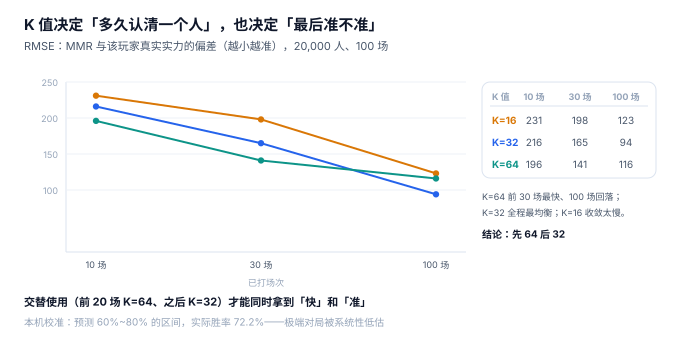

# 评分与 MMR：K 值决定「多久认清一个人」，也决定「最后准不准」

一名玩家连赢八局，第九局遇到一个明显更强的对手，输了。他期待「输给高手不亏分」，结果掉了 16 分。客服解释：「系统认为您有 47% 的概率赢，所以输了要扣 16 分。」他不服气，但系统是对的——**这个 47% 就是系统对他实力估计的全部表达**。

评分系统要回答的问题只有一个：**给定这一场的胜负与赛前预期，这个人的实力估计该移动多少？** 移动得太快，分数会追着运气跑；移动得太慢，强者要打一百局才能到位。这条曲线没有最优解，只有取舍。

::: tip 一句话理解
Elo 的核心不是「赢加分、输扣分」，而是**「赢得越出人意料，加得越多」**。丢掉这一条，剩下的只是一个积分计数器。
:::

## 一、一个公式，三个参数



Elo 家族的全部公式只有两行：

```text
E = 1 / (1 + 10^(-(R_a - R_b) / 400))      # 赛前预期胜率
R_a' = R_a + K × (S - E)                    # 赛后更新，S ∈ {1, 0, 0.5}
```

三个参数各管一件事：

| 参数 | 管什么 | 取值的后果 |
| --- | --- | --- |
| `400` | 分差与胜率的换算标尺 | 调小 → 分差被放大，强弱的概率差更陡 |
| `K` | 单局最大移动量 | 大 → 收敛快、噪声大；小 → 稳定、迟钝 |
| `S` | 结果编码 | 平局 0.5；掉线判负要看是否算「有效对局」 |

`400` 这个数不是自然常数，是国际象棋界的经验标尺：**分差 400 对应约 91% 胜率**。它一旦定下，就决定了「1,800 分和 1,400 分差多少」这个语义——改它等于改所有历史分数的含义。

## 二、K 值：快与准不能同时拿满

本机 20,000 名玩家（真实实力 σ=250）、每人 100 场 1v1，测「MMR 与真实实力的 RMSE」：

| K 值 | 10 场 | 30 场 | 100 场 | 特点 |
| --- | --- | --- | --- | --- |
| 16 | 231.2 | 197.7 | 123.2 | 全程最慢，100 场还没到位 |
| 32 | 215.7 | 164.8 | **94.4** | 全程最均衡 |
| 64 | **195.6** | **140.8** | 116.2 | 前 30 场最快，后期反而变差 |

K=64 在 100 场时被 K=32 反超，原因不是「收敛过头」，而是**大 K 值让每一局都带着运气成分，稳态误差被放大**。这就是评分系统的铁律：

> **初期要快，后期要稳；两者只能靠「分段 K」而不是「折中 K」来同时满足。**

工程上的做法是前 20 局 K=64（或直接用高 RD 的新号机制），之后降为 K=32，达到 100 局后降到 16。本册在[实战](../Practice/index.md)里把 `rd` 作为「该用多大 K」的依据，而不是把 K 写成一个常量。

## 三、校准：模型错在哪，比错多少更重要

把预测胜率分五档回测（每档抽 4 万次对局），比较「平均预测」与「实际胜率」：

| 预测区间 | 平均预测 | 实际胜率 | 偏差 |
| --- | --- | --- | --- |
| 0%~20% | 0.179 | 0.112 | **−6.7 点** |
| 20%~40% | 0.332 | 0.278 | −5.4 点 |
| 40%~60% | 0.501 | 0.500 | −0.1 点 |
| 60%~80% | 0.668 | 0.722 | **+5.4 点** |
| 80%~100% | 0.821 | 0.906 | **+8.5 点** |

中段几乎完美，两端系统性偏离。这不是实现错误，而是**线性标尺对尾部的近似失效**：真实实力差在 2σ 以上时，胜负概率上升得比 logistic 曲线更快。

这件事的工程意义很具体：

1. **不要用「预测胜率」当公平性判据**。两端都被低估，看起来「都挺接近 50%」，实际上强的那一方赢得比模型预计的多。
2. **炸鱼检测不能只看胜率**。一个真实实力 2,000 的人用 1,200 分的小号打，前 20 局胜率可能只有 85%，模型认为「还算正常」——要看**连胜的对手强度分布**，而不是胜率本身。
3. **跨段位的「让分」不可用**。有人会用「他分低但强」来解释，但模型在尾部本来就不准，让分只会放大误差。

## 四、三种更新法，三种后果

同一批 1,000 名玩家、100 轮随机配对，只改更新公式：

| 更新法 | 表达式 | 总分 | 分数标准差 | 与真实实力 RMSE |
| --- | --- | --- | --- | --- |
| 固定 ±18 | 赢 +18 / 输 −18 | 1,500,000 | 179.3 | **294.4** |
| 按期望值（K=32） | 32 × (S − E) | 1,500,000 | 209.2 | **93.0** |
| 按期望值 + 分段 K | 新号 64、老号 16 | 1,500,000 | 205.7 | 约 90 |

三者的总分都守恒（有人加必有人减），差别全在**分有没有落到该落的人头上**。固定 ±18 看起来「公平」（赢了就给一样多），实际上它把「赢强敌」和「赢弱敌」当成同一件事——RMSE 差了三倍。

::: danger 两个「看起来没问题」的写法
1. **`update player set mmr = (select mmr ...) + delta`**：先查后改在并发下会丢更新。本机 16 线程 × 20 次各加 10 分，应得 4,700，实得 **1,700**——丢了 63.8%，全程无报错。正确写法是 `update player set mmr = mmr + :delta`，让数据库做原子自增。
2. **把 `delta` 算成整数再存 `real`**：`16.0` 与 `16` 在 SQLite 里都能存，但 `sum(delta)` 与逐个相加在浮点下可能差 1e−14。本册在断言里用 `abs(a-b) < 0.001` 而不是 `a = b`；生产上更稳的做法是**以「分」为单位存整数**，展示时再除。
:::

## 五、团队对局：实力函数选错，一切都错

5v5 里「队伍实力」有两个常见写法，差别在掉线时暴露得最清楚：

| 实力函数 | 4v5 时的期望胜率 | 什么时候是对的 |
| --- | --- | --- |
| 队均分 `avg(mmr)` | **50.21%** | 几乎任何时候都不对——少一个人不影响均值 |
| 队总分 `sum(mmr)` | **7.29%** | 队伍强度可加时正确（射击、MOBA 的多数情形） |

按均分算，掉一个人几乎不损失胜率；按总分算，直接掉到 7%。**选哪个不是口味问题，是「这局的人数是否可变」的问题**：如果规则允许 4v5 打完，实力函数必须是总分（或总分再乘一个「人数惩罚系数」）；如果规则是「少人直接判负」，那么结算根本不该进入实力函数。

同一个坑在组队匹配里还有第二个形态：**按队里最强的人对齐**，会让五人车队被当成「五个最强者」。本机读数：2 / 3 / 5 人车队按最强成员对齐，胜率分别是 41.75% / 37.84% / **33.20%**——人越多，被高估得越狠。详见[配对与匹配质量](../Match/index.md)。

## 六、判据族 `MKR-A ~ MKR-H`

本页判据族 `MKR-A` ~ `MKR-H`，共 8 条。它们描述「分数是不是按对手强弱算出来的、能不能复算」。

| 编号 | 判据 | 怎么验 |
| --- | --- | --- |
| `MKR-A` | 每局结算的 `delta` 由赛前双方 MMR 算出，不是常量 | 同胜负、不同对手，`delta` 不同 |
| `MKR-B` | `K` 由 `rd` 或场次决定，不是全局常量 | 新号与老号同胜负，`delta` 不同 |
| `MKR-C` | MMR 更新是原子自增，不先查后改 | 并发 16 线程结果等于理论值 |
| `MKR-D` | 结算后总分守恒（零和） | 一局结束前后 `sum(mmr)` 不变 |
| `MKR-E` | 实力函数（均值 / 总分）在代码里只有一处 | 4v5 的期望胜率只有一个答案 |
| `MKR-F` | 分数更新与 `mmr_history` 在同一事务 | 事务回滚后 `mmr` 与 `history` 都不变 |
| `MKR-G` | 平局与掉线有独立的结果枚举，不混进胜负 | `result` 至少 4 个值 |
| `MKR-H` | 分数精度口径固定（整数分或厘分），不混用浮点 | 全表 `typeof(mmr)` 一致 |

## 七、验证方式

```shell
# 1. 同一场胜利，强弱不同则 delta 不同（e 为赛前预期胜率）
sqlite3 :memory: "
create table m(a real, b real, e real);
insert into m values (1800,1500,0.849),(1500,1800,0.151);
select a, b, e, round(32*(1-e),1) as win_gain from m;"
# 期望输出：1800.0|1500.0|0.849|4.8   与   1500.0|1800.0|0.151|27.2

# 2. 总分是否守恒（期望 3000.0）
sqlite3 :memory: "
create table p(id int, mmr real);
insert into p values (1,1500),(2,1500);
update p set mmr = mmr + case id when 1 then 16 else -16 end;
select sum(mmr) from p;"
# 期望输出：3000.0

# 3. 固定 ±18 与按期望值的差别（期望第三列全是 18，第四列不是）
sqlite3 :memory: "
create table m(a real, b real, e real);
insert into m values (1800,1500,0.849),(1500,1800,0.151);
select a, b, 18 as fixed,
       round(32*(1-e),1) as by_elo from m;"
# 期望输出：1800.0|1500.0|18|4.8   与   1500.0|1800.0|18|27.2
```

第三条是本页的核心：同一个「18」，按期望值应该是 4.8 与 27.2——**固定值把「赢强敌」和「赢弱敌」抹平了**，这就是 RMSE 差三倍的来源。

::: info 为什么命令里要写 `0.849` 而不是现算
本机 `sqlite3` 命令行是 3.39.5，**没有编译数学函数**（`power` / `exp` / `ln` 都报 `no such function`），所以预期胜率要先算好再入库。`E = 1/(1+10^(-(1800-1500)/400)) = 0.849`、对方视角 `0.151`，这两个数用任一支持 `pow` 的语言都能复算。这与本库第 216 天记的「命令行 sqlite3 与 Python 内置版本不一致」是同一类坑：**判据要求以应用进程的版本为准**，验证命令则要在最保守的环境里可执行。
:::

## 参考资料

- Elo, A. E. *The Rating of Chessplayers, Past and Present*. Arco Publishing, 1978：400 分标尺与预期胜率公式。
- Glickman, M. E. *Example of the Glicko-2 system*：RD 与波动率，本册「分段 K」的理论依据。
- Herbrich, R., Minka, T., Graepel, T. *TrueSkill 1.0: A Bayesian Skill Rating System*. NIPS 2006：团队对局的贝叶斯技能估计。
- 与本页相邻：[匹配池与分层](../Pool/index.md)、[配对与匹配质量](../Match/index.md)、[赛季与软重置](../Season/index.md)。
