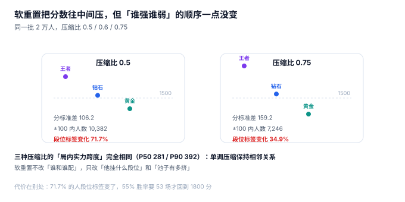
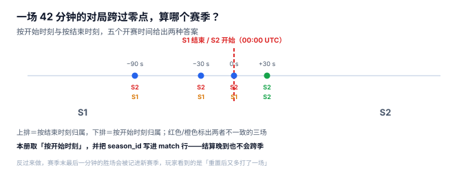

# 赛季与软重置：压缩的是分数，不是顺序

赛季第一天，论坛必有的两个帖子：「我上赛季王者，这赛季怎么定到钻石了」和「我上赛季黄金，怎么匹到王者了」。两个帖子说的是同一件事的两面：软重置把所有人的分数往中间压，**标签变了，但「谁强谁弱」一点没变**。于是高段位的人和低段位的人被塞进同一个池子，前二十局注定难看。

**赛季不是一个「清零按钮」，是一次带参数的重新标定。** 参数选错，玩家会在开季第一周流失一批；参数选对，也只是把阵痛摊平，而不是消除。

::: tip 一句话理解
软重置只做三件事：**压分、重划段位线、发奖励**。它不做的事是「改变排序」——因为单调压缩保序，所以「谁和谁配」这件事，重置前后完全一样。
:::

## 一、三种重置法，三种后果



| 方式 | 规则 | 分标准差 | 段位标签变化 | 55% 胜率回到 1,800 分 |
| --- | --- | --- | --- | --- |
| 不重置 | `mmr` 原样带入 | 212.3 | 0% | 0 场 |
| 软重置 0.75 | `1500 + (mmr−1500) × 0.75` | 159.2 | 34.9% | 33 场 |
| 软重置 0.6 | `1500 + (mmr−1500) × 0.6` | 127.4 | 61.6% | 46 场 |
| 软重置 0.5 | `1500 + (mmr−1500) × 0.5` | 106.2 | **71.7%** | 53 场 |
| 硬重置 | 全部回 1,500 | 0 | 100% | 无法估计（没有区分度） |

本机 2 万人、σ=212.3 的分数分布下，压缩比 0.5 让 **71.7% 的人段位标签发生变化**，而 0.75 只有 34.9%。这就是「重置力度」的真实含义：**不是「分数压了多少」，而是「多少人的段位变了」**。

### 一个必须自己算一遍的例子

一名 1,800 分的玩家，赛季重置压缩比 0.6：

| 步骤 | 表达式 | 结果 |
| --- | --- | --- |
| 压缩分数 | `1500 + (1800−1500) × 0.6` | 1,680 |
| 段位重划（假设线在 1,700） | 1,680 < 1,700 | 从「宗师」掉到「钻石」 |
| 回到 1,800 所需场次（55% 胜率） | 每局期望 +3.2 分左右 | 约 46 场 |

「掉了段」不是因为变弱，而是因为**分母变了**。这句话必须写进赛季公告，否则每个赛季的第一周都会重演同一场舆论。

## 二、软重置不改变「谁和谁配」

这是本页最重要、也最反直觉的一条：**单调压缩保序，所以相邻关系不变**。

本机三种压缩比（0.5 / 0.6 / 0.75）下，按分数排序取相邻十人，计算他们真实实力的跨度：

| 压缩比 | 分标准差 | 局内跨度 P50 | 局内跨度 P90 | ±100 窗口内人数（P50） |
| --- | --- | --- | --- | --- |
| 1.0（不重置） | 212.3 | 281 | 392 | 5,512 |
| 0.75 | 159.2 | **281** | **392** | 7,246 |
| 0.6 | 127.4 | **281** | **392** | 8,840 |
| 0.5 | 106.2 | **281** | **392** | 10,382 |

四行的跨度完全相同。原因很朴素：`y = 1500 + (x−1500) × k` 是单调函数，**排序不变，最近邻不变**。

那软重置到底改变了什么？改变了两个东西：

1. **标签**：段位线是绝对分数，压缩后有 34.9%（0.75）/ 61.6%（0.6）/ 71.7%（0.5）的人跨了线。
2. **密度**：±100 窗口内的候选人数从 5,512 涨到 10,382——池子变挤，匹配变快，但**同一窗口覆盖的真实实力范围也变宽了**（因为分数被压扁，同样的 100 分对应更大的实力差）。

::: warning 这条结论为什么重要
很多团队把「开季体验差」归因于「匹配算法没调好」，于是去调窗口、调 K 值。但真正的根因是：**分数被压扁之后，原本 100 分代表 100 分实力，现在代表 145 分实力**（1/0.6 ≈ 1.67 倍）。

所以正确的动作不是改匹配，而是**在赛季初按压缩比同步放大窗口**（或者反过来，把窗口定义成「真实实力的百分比」而不是绝对分数）。改错地方，越调越差。
:::

## 三、定级赛：用多少局换一个「够用」的估计

新号（或重置后的号）从 1,500 起，打若干局定级。本机模拟「真实实力 σ=250 的玩家从 1,500 开始、对手都是 1,500」：

| 定级场次 | 平均绝对误差 | 中位误差 | P90 误差 |
| --- | --- | --- | --- |
| 5 局 | 178 | 147 | 370 |
| 10 局 | 163 | 137 | 340 |
| 20 局 | 138 | 116 | 285 |
| 30 局 | 119 | 102 | 244 |

从 5 局加到 10 局，平均误差只降 15 分；从 10 局加到 30 局，降 44 分。**收益递减非常明显**，所以行业普遍选 10 局左右——不是因为 10 局准，而是因为**10 局之后的边际收益抵不过玩家流失**。

这里还有一个隐藏假设：定级赛的对手都是 1,500。真实系统里，新号会被优先配给其他新号或低分段，于是**估计误差会更大**（对手本身也不准）。所以「10 局定级」的真实误差通常比表里的 163 更大——这也是为什么定级赛后还要留一个「前 20 局双倍分变动」的缓冲期。

## 四、赛季边界：一局跨过零点算哪一季



赛季切换时刻（本册取 00:00 UTC）与对局时长（42 分钟）一叠加，就出现归属问题：

| 开赛时刻 | 结束时刻 | 按结束时刻 | 按开始时刻 |
| --- | --- | --- | --- |
| 23:58:30 | 00:40:30 | S2 | **S1** |
| 23:59:30 | 00:41:30 | S2 | **S1** |
| 00:00:00 | 00:42:00 | S2 | **S1** |
| 00:00:30 | 00:42:30 | S2 | S2 |
| 00:01:30 | 00:43:30 | S2 | S2 |

五种情况里有三种，两种口径给出不同答案。本册取「按开始时刻」，并把 `season_id` 直接写在 `match` 行上——这样**结算晚到也不会跨季**，重算也不会换季。

反过来做（按结算时刻推导）会出两个具体问题：

1. 赛季末最后一分钟的胜场被记进新赛季，玩家看到的是「重置之后又多打了一场」，分数对不上。
2. 补偿任务在赛季切换后跑，把上一季的局全算进新季，**一次重放污染整个新赛季的初始分布**。

## 五、奖励：发一次，且只发一次

赛季奖励有三个「只能一次」的约束叠加：**每人每季一次**、**每档一次**、**重试不重发**。本册用 `reward_grant(player_id, season_id, idem_key)`，其中 `idem_key` 唯一，格式建议 `{season_id}:{tier}:{player_id}`。

| 约束 | 靠什么 | 失败形态 |
| --- | --- | --- |
| 每人每季一次 | `UNIQUE(idem_key)` | 重复发奖，财务对不上 |
| 每档一次 | 发奖前校验 `player_rank.tier` | 玩家掉段后又升回来，领两次 |
| 重试不重发 | 同上 + 幂等键 | 网关重试导致双倍 |

::: info 怀旧服与旧赛季的兼容口径
只跑旧规则的怀旧服**不新建章节**，在下面的兼容性表里加一行，标注状态即可：

| 形态 | 规则差异 | 维护状态 |
| --- | --- | --- |
| 正式服 | 软重置 0.6 + 10 局定级 | 维护中 |
| 怀旧服 | 不重置、固定分段、无定级赛 | 仅存量玩家使用，不参与软重置 |
| 赛事服 | 每赛季硬重置，独立榜单 | 仅赛事期间开放 |

这条口径与本库对 [Spring5](../../Java/Frame/Spring/Spring5/index.md) / [Vue2](../../../Frontend/Frame/Vue/Vue2/index.md) 的处理一致：旧内容保留、标注状态、不覆盖。
:::

## 六、判据族 `MKL-A ~ MKL-H`

本页判据族 `MKL-A` ~ `MKL-H`，共 8 条。它们描述「跨期这件事是不是可复算」。

| 编号 | 判据 | 怎么验 |
| --- | --- | --- |
| `MKL-A` | 重置比是 `season` 表字段，不是代码常量 | 改配置后新赛季分数按新比例压 |
| `MKL-B` | 重置写 `mmr_history(reason='SEASON_RESET')` | 重置后每人有一条原因明确的记录 |
| `MKL-C` | 重置前后排序不变 | 按新分排名与按旧分排名逐人对比，0 差异 |
| `MKL-D` | 对局行带 `season_id`，不按结算时刻推导 | 23:58 开赛的局归上一季 |
| `MKL-E` | 重置与发奖分离，各自幂等 | 重置可重跑（结果相同），发奖不可重跑 |
| `MKL-F` | 定级赛场次是配置，且定级期有独立标记 | 定级期的局可以被单独统计 |
| `MKL-G` | 赛季起止时间用同一时区（建议 UTC）且入库 | 不存在「本地时间算边界」的代码 |
| `MKL-H` | 重算历史赛季不改动当前赛季分 | 重算 S1 后 S2 的 `mmr` 一分不变 |

## 七、验证方式

```shell
# 1. 压缩后排序是否不变（期望 0 差异）
sqlite3 :memory: "
create table p(id int, mmr real);
insert into p values (1,1300),(2,1500),(3,1900),(4,1700);
create table n as select id, 1500 + (mmr-1500)*0.6 as mmr from p;
select count(*) from (
  select p.id, row_number() over (order by p.mmr) a,
         row_number() over (order by n.mmr) b
  from p join n using(id)) where a <> b;"
# 期望输出：0

# 2. 压缩后方差按比例平方收缩（期望 106667 → 38400，比值 0.36）
sqlite3 :memory: "
create table p(mmr real);
insert into p values (1100),(1500),(1900);
select round(avg((mmr-1500)*(mmr-1500)),0) as var0,
       round(avg(((1500+(mmr-1500)*0.6)-1500)*((1500+(mmr-1500)*0.6)-1500)),0) as var1 from p;"
# 期望输出：106667.0|38400.0 —— 比值 0.36 = 0.6²

# 3. 跨季对局归属（期望 S1）
sqlite3 :memory: "
create table season(id text, starts_at text, ends_at text);
insert into season values ('S1','2026-10-01','2026-12-01'),('S2','2026-12-01','2027-02-01');
create table match(id text, started_at text, season_id text);
insert into match values ('M1','2026-11-30T23:58:30Z','S1');
select m.id,
  (select id from season where m.started_at >= starts_at and m.started_at < ends_at) as by_start,
  m.season_id as stored from match m;"
# 期望输出：M1|S1|S1
```

第二条值得留意：方差按 **压缩比的平方** 收缩（0.6² = 0.36，106,666 → 38,400）。这条关系可以用来反推「这一季到底压了多少」——只要拿到赛季前后的分数方差。

## 参考资料

- Glickman, M. E. *Example of the Glicko-2 system*：RD 在长期不活跃后的增长，与本册「赛季重置」是同一类「不确定性重估」。
- Microsoft Azure PlayFab《Seasonal progression》文档：赛季重置、段位线与奖励的工程口径。
- ISO 8601-1:2019《日期和时间 信息交换表示法 第 1 部分：基本规则》：时区与区间表示，本册「赛季边界按 UTC」的依据。
- 与本页相邻：[评分与 MMR](../Rating/index.md)、[排行榜与名次](../Leaderboard/index.md)、[公平性与反作弊](../Integrity/index.md)。
