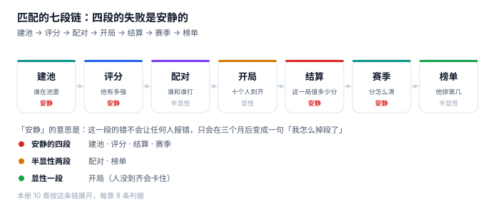

# 游戏匹配与赛季竞技工程

一个玩家在论坛发帖：「我十连胜，段位一点没动。」客服查了后台，回了一句「您的隐藏分上涨了 96 分」。玩家更生气了——他要的是段位动，而系统告诉他「另一个你看不见的数字动了」。

**这就是匹配系统的典型形态：它同时在维护三个「你有多强」，而只有一个对玩家可见。** 三个数各自都算得对，只是因为服务的对象不同，所以在某些时刻必然不一致。工程上真正难的不是「怎么算分」，而是**让三个数的不一致有解释、有边界、可复现**。

::: tip 一句话理解
匹配不是「找十个分差不多的人」，而是**在可接受的时间内凑齐一局，并让这一局的结果能被事后解释**：为什么是他们十个、为什么赢的人只加 16 分、为什么赛季末这一局算上一季。
:::

## 一、这个专题讲什么

从玩家点下「开始匹配」到他的名字出现在榜上，一局要走七段：

| 段 | 这一段在做什么 | 产物 | 失败是否安静 |
| --- | --- | --- | --- |
| ① 建池 | 谁有资格进池、进哪个池 | `queue_ticket` | **安静**（分错池也能匹配，只是慢） |
| ② 评分 | 他现在的实力估计是多少 | `player.mmr` / `rd` | **安静**（分算偏了不会报错） |
| ③ 配对 | 十个人怎么凑成一局 | `match` | 半显性（凑不出会一直等） |
| ④ 开局 | 人到齐、进对局、掉线怎么算 | `match_player` | 显性（人没到齐卡住） |
| ⑤ 结算 | 这一局每个人加减多少分 | `settle_log` / `mmr_history` | **安静**（重算一次也没人发现） |
| ⑥ 赛季 | 什么时候清、清多少、算哪一季 | `season` | **安静**（跨季归属错了也照常发奖） |
| ⑦ 榜单 | 他排第几、同分怎么办 | 榜单视图 | 半显性（玩家会截图对比） |

七段里**四段的失败是安静的**。它们的共同形态是：玩家匹配成功、打完、分数变了、榜也刷了，只有「这一局为什么这么配、这个分为什么这么加」没人能回答。

本机读数最能说明问题的一组数字：在一个 2 万人的池子里，按 `±100` 的窗口配了 1,153 局，**等待中位 15 秒、局内真实实力跨度中位 304 分**；把窗口放到 `±400`，等待掉到 0 秒，**跨度涨到 482 分，44.7% 的对局跨度超过 500 分**。同一个池子、同一批人，只改一个参数，玩家体验就从「等太久」跳到「队友太菜」。

## 二、三个「他有多强」

| 口径 | 定义 | 谁在关心 | 常见错法 |
| --- | --- | --- | --- |
| 真实实力 | 假设存在的「真值」，只有出题人知道 | 评测、研究者 | 把 MMR 当成真值去做实验 |
| 隐藏 MMR | 系统对实力的估计，配对只看它 | 匹配、风控 | 直接拿显示分去配对 |
| 显示段位分 | 玩家看得见的 LP / 星数 / 段位 | 玩家、运营、奖励 | 把段位当能力值卖给广告主 |

三者必须由**同一份数据**算出来，而且必须能各自被复核。本机实测：20,000 名玩家、σ=250 分的实力分布下，按 MMR 八等分切段位，**「王者」段内（2,500 人）真实实力跨度就有 327 分**；而跨两个大段（1,200 分）的人，真实实力差是 824 分。段位是分位数，不是能力值。

### 一个必须自己算一遍的例子

一名玩家真实实力 1,800，MMR 停在 1,500，打一局遇到 MMR 1,500 的对手。

| 算法 | 表达式 | 变化 | 后果 |
| --- | --- | --- | --- |
| 固定 ±18 | 赢 +18 / 输 −18 | +18 | 不记对手强弱，分数是随机游走 |
| 按期望值（K=32） | 32 × (1 − 0.5) | +16 | 对手越弱赢得越多，收益越小 |
| 按期望值打强敌 | 32 × (1 − 0.09) | +29 | 同一场胜利，价值不同——这才是 Elo 的意思 |

本机 1,000 人、100 轮的对照：固定 ±18 的分数与真实实力 RMSE **294.4**，按期望值只有 **93.0**。两者总分都守恒（1,500,000 不动），差别全在「分有没有落到该落的人头上」。

::: danger 三件事必须写进数据模型，不能留给「算分的时候看一眼」
1. **结算必须有唯一键**（`UNIQUE(match_id, player_id)`），不能靠「查一下有没有结算过」：本机网关重试 3 次，无键的玩家从 1,518 变成 **1,554**，有键的仍是 1,518。多出来的 36 分没有任何记录能证明它不该存在。
2. **MMR 只能用原子自增，不能先查后改**：16 线程各加 10 分 20 次，应得 4,700，先查后改实得 **1,700**（丢了 63.8%），而且全程不报错。
3. **赛季归属必须写进 `match` 行**，不能结算时按「现在几点」推：一场 23:58 开、00:40 结束的对局，按结束时刻归下一季，按开始时刻归上一季，五种开赛时间里有三种会得出不同答案。
:::

## 三、专题地图

按「一局的生命周期」读：

| 阶段 | 页面 | 一句话 |
| --- | --- | --- |
| 定调 | [总览：三个「他有多强」](Overview/index.md) | 一局里有九个数字，只有一个是谈出来的 |
| 建池 | [匹配池与分层](Pool/index.md) | 段位是切出来的，池密度才决定等多久 |
| 评分 | [评分与 MMR](Rating/index.md) | K 值决定「多久认清一个人」，也决定「最后准不准」 |
| 配对 | [配对与匹配质量](Match/index.md) | 窗口每放宽一次，都是用质量换时间 |
| 结算 | [对局结算与幂等](Settlement/index.md) | 七个写入点，只有一处是「分数」 |
| 赛季 | [赛季与软重置](Season/index.md) | 压缩的是分数，不是顺序 |
| 榜单 | [排行榜与名次](Leaderboard/index.md) | 五万人整数分，前 100 名只占 5 种分值 |
| 公平 | [公平性与反作弊](Integrity/index.md) | 一条规则能抓全，但要先算清误伤 |
| 落地 | [实战：九张表、三个触发器、十三条断言](Practice/index.md) | 能被触发器拦住的，才叫约束 |
| 排障 | [常见问题](FAQ/index.md) | 先问哪一段的数不对，再问为什么 |

## 四、和相邻专题的分工

本册只讲「一局怎么被凑出来、这一局值多少分」。相邻主题各自讲透的部分，这里不重复：

| 相邻专题 | 它讲什么 | 本专题不重复讲 |
| --- | --- | --- |
| [推荐系统](../RecommenderSystems/index.md) | 召回、排序、多样性 | 匹配是**双边约束**，推荐是单边排序 |
| [订单状态机](../Ecommerce/OrderStateMachine/index.md) | 订单的合法迁移 | 对局状态只有五个，重点是「结算只能一次」 |
| [幂等与状态机](../IdempotencyStateMachine/IdempotencyKey/index.md) | 请求级幂等键 | 结算幂等键的**作用域是 (match, player)** |
| [分布式调度](../DistributedScheduling/Overview/index.md) | 定时任务、分片、漏跑补偿 | 配对是**在线长循环**，不是批处理 |
| [实时风控决策](../RiskDecision/Overview/index.md) | 规则引擎、评分卡 | 反作弊只讲**赛后判定**与误伤成本 |
| [授权与权限](../Auth/Authorization/index.md) | 主体、资源、策略 | 封禁只讲「封了之后分怎么回滚」 |
| [消息触达](../NotificationDelivery/Delivery/index.md) | 通道、重试、回执 | 只讲「开赛通知」这一种触达 |
| [多租户隔离](../MultiTenantSaaS/TenantContext/index.md) | 租户上下文与数据隔离 | 分区（大区/服务器）是**玩法分区**，不是计费租户 |
| [容量与成本](../../Ops/CapacityCost/Overview/index.md) | 单机容量、单位成本 | 只给「配对循环每轮扫多少人」的量级 |

## 五、版本组织：为什么不建版本目录

匹配领域最常见的疑问是「从 Elo 到 Glicko 到 TrueSkill，文档是不是要分一代」。本册**不建 `GameMatchmaking/V1` 这类目录**，三条理由：

1. **换代的是估计器，判据一字没变。** Elo、Glicko、TrueSkill、OpenSkill 变的只是「怎么从胜负推实力」；「一局只能结算一次、分数只能原子自增、赛季归属写在行上」这四条从 Elo 诞生那年就成立。
2. **并存差异是玩法与地区，不是代际。** 5v5 与 1v1、有无组队、分区与全球服，差别在**队伍怎么组、池怎么切**，不在链路本身。用版本目录去装「1v1 模式」，会把玩法参数问题伪装成代码分支问题。
3. **真正需要版本目录的是「同一份代码两套写法」。** 本库已有先例：[Spring5](../Java/Frame/Spring/Spring5/index.md) / [Spring6](../Java/Frame/Spring/Spring6/index.md)、[Vue2](../../Frontend/Frame/Vue/Vue2/index.md) / [Vue3](../../Frontend/Frame/Vue/Vue3/index.md)——同一框架两代 API 并存，旧版必须原样保留并标注维护状态。匹配侧不是这种情形：一套链路接不同玩法，差异落在配置表里。

::: info 旧玩法与旧赛季的处置口径
遇到只跑旧赛季规则的怀旧服，**不新建章节**，在[赛季与软重置](Season/index.md)的兼容性表里加一行，标注「怀旧服仅用固定分段，不参与软重置」。这条口径和本库对 Spring5 / Vue2 的处理一致：旧内容保留、标注状态、不覆盖。
:::

## 六、建议阅读顺序

1. 先读[总览](Overview/index.md)——把「三个分数」和「七个写入点」立起来，它是后面所有判据的地基。
2. 再读[匹配池与分层](Pool/index.md)与[评分与 MMR](Rating/index.md)——这两页决定「谁能和谁配」。
3. 然后读[配对与匹配质量](Match/index.md)与[对局结算与幂等](Settlement/index.md)——一局怎么凑出来、怎么落账。
4. 接着读[赛季](Season/index.md)与[排行榜](Leaderboard/index.md)——跨期的账怎么算、怎么展示。
5. 最后按[实战](Practice/index.md)把九张表建出来，跑一遍十三条断言；卡住了查[常见问题](FAQ/index.md)。

## 七、本册的读数从哪来

所有数字来自一台 16 GB 笔记本上的 Python 3.13 + SQLite 3.50.4，种子 `20261105`，规模是 20,000 名玩家（σ=250）、最长 120 分钟的匹配队列模拟、50,000 行的榜单表，**不是生产数据，也不是压测结论**。写进正文的每一个数都可以按各页「验证方式」重跑：

| 读数 | 值 | 出现在 |
| --- | --- | --- |
| 段位内真实实力跨度 | 241 / 239 / 327 分 | [总览](Overview/index.md) |
| MMR 收敛 RMSE（K=32） | 10 场 215.7 → 100 场 94.4 | [评分与 MMR](Rating/index.md) |
| 匹配窗口与跨度 | ±50：25 s / 287 分；±400：0 s / 482 分 | [配对与匹配质量](Match/index.md) |
| 组队按最强成员对齐 | 5 排胜率 33.20% | [配对与匹配质量](Match/index.md) |
| 无幂等键重试 3 次 | 1,518 → 1,554 | [对局结算与幂等](Settlement/index.md) |
| 先查后改丢更新 | 4,700 → 1,700（63.8%） | [对局结算与幂等](Settlement/index.md) |
| 软重置压缩 0.5 | 段位标签变化 71.7% | [赛季与软重置](Season/index.md) |
| 榜单并列 | 前 100 名只占 5 种分值 | [排行榜与名次](Leaderboard/index.md) |
| 互刷规则精度 | 87.0%（460 标 400 中） | [公平性与反作弊](Integrity/index.md) |
| 实战断言 | 13 / 13，退出码 0 | [实战](Practice/index.md) |

::: warning 这些数字不能直接当 SLA
单机模拟的秒级与真实匹配集群的高并发不是一回事。本文用它们判断**方向和量级**（例如「放宽窗口换等待」「压缩不改排序」），不用它们承诺性能。凡涉及性能的结论，文中都注明了「按本机读数」。
:::

## 参考资料

- Elo, A. E. *The Rating of Chessplayers, Past and Present*. Arco Publishing, 1978：Elo 评分与 400 分标尺的原始出处。
- Glickman, M. E. *Example of the Glicko-2 system*（glicko.net 公开文档）：RD（Rating Deviation）与波动率的更新公式，本册「K 值 / RD」一节的依据。
- Herbrich, R., Minka, T., Graepel, T. *TrueSkill 1.0: A Bayesian Skill Rating System*. NIPS 2006：团队对局下的贝叶斯技能估计。
- Microsoft Azure PlayFab《Matchmaking》官方文档：匹配队列、票（ticket）、规则与扩窗的工程模型。
- 与本册相邻：[推荐系统](../RecommenderSystems/index.md)、[订单状态机](../Ecommerce/OrderStateMachine/index.md)、[幂等键](../IdempotencyStateMachine/IdempotencyKey/index.md)。
