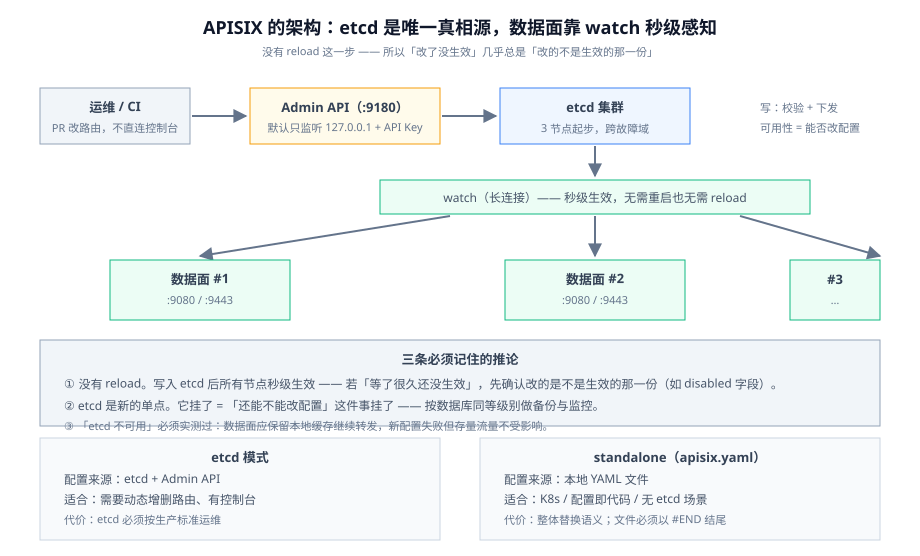

# APISIX 深入

APISIX 的配置模型跟 Kong 很像,但**「配置存在哪」这件事完全不同**：它把 etcd 当成唯一真相源,数据面通过 watch 秒级感知。这个差别决定了它的运维方式——**你几乎不需要「发布」,但也必须把 etcd 当成生产级组件来对待。**

这一页只讲 APISIX。与 Kong 的对照见 [Kong 深入](../Kong/index.md) 末节。



## 一、控制面是 etcd,不是一个数据库

```text
 运维 / CI ──▶ Admin API（:9180，默认只允许 127.0.0.1）
                 │  写
                 ▼
              etcd 集群（唯一真相源）
                 │  watch（长连接，秒级）
     ┌───────────┼───────────┐
     ▼           ▼           ▼
  APISIX #1   APISIX #2   APISIX #3   ← 数据面（:9080 / :9443）
```

三个必须记住的推论：

1. **没有「reload」这一步**。写入 etcd 后,所有数据面节点在**秒级内**自动生效——不需要重启,也不需要 `nginx -s reload`。所以「我改了配置却要等一会儿」这类问题在 APISIX 上通常不是延迟,而是**你改的不是生效的那一份**（比如改了一个 `disabled: true` 的路由）。
2. **etcd 是新的单点**。它的可用性直接决定「还能不能改配置」。做法：**3 节点起步、跨故障域**,并且把它纳入和数据库同等级别的备份与监控（见 [`BackupDR`](../../../Ops/BackupDR/index.md)）。
3. **数据面在 etcd 不可用时的行为必须实测**。数据面会保留本地缓存继续转发,但**新配置会失败**。这与[概述](../Overview/index.md)里「控制面挂了,数据面还能活一阵」是同一条要求——**要真的停掉 etcd 试一次**。

::: danger Admin API 是网关最大的一个默认风险面
APISIX 的 Admin API **默认只监听 `127.0.0.1:9180`**,这是一个正确的默认值。上线时最容易发生的错误是：为了「方便用 Postman 改」,把它改成 `0.0.0.0` 并沿用默认密钥。

**它等价于把网关的全部配置权限挂到公网上。** 三条纪律：

1. **Admin API 绝不暴露公网**。需要远程操作就走跳板机/内网/端口转发。
2. **改掉默认 API Key**。默认密钥就写在官方文档里,不改等于没有。
3. **给 Admin API 单独一套访问控制**（`allow_admin` 指定网段）,并**只允许运维与 CI 使用**;业务团队改路由走 PR,不直连 Admin API。
:::

## 二、实体模型

| 实体 | 一句话 | 关键字段 |
| --- | --- | --- |
| **Route** | 「什么样的请求」→ 打给哪个上游 | `uri` / `uris` / `host` / `methods` / `vars` / `priority` / `plugins` |
| **Service** | 可复用的「上游 + 插件」抽象,多个 Route 可共享 | `upstream` / `plugins` / `upstream_id` |
| **Upstream** | 一组节点 + 负载均衡 + 健康检查 | `type` / `nodes` / `hash_on` / `checks` / `scheme` |
| **Consumer** | 调用方身份 | `username` + 认证插件配置 |
| **Consumer Group** | 一批 Consumer 的共享插件配置（如统一配额） | `plugins` |
| **Plugin Config** | **可复用的插件配置块**,被多个 Route 引用 | `plugins` |
| **Global Rule** | 对所有请求生效的插件（全局兜底） | `plugins` |
| **SSL** | 证书与 SNI 绑定 | `cert` / `key` / `snis` |
| **Stream Route** | TCP/UDP 四层路由 | `server_addr` / `server_port` / `upstream_id` |

::: tip `Plugin Config` 是 APISIX 一个很实用的抽象
同一套限流参数要挂在 20 条路由上时,不要复制 20 遍。建一个 `plugin_config`,让 20 条 Route 引用它——**改一次,20 条同时变**。

这直接关系到[概述](../Overview/index.md)里的边界二：**配置的「一份还是多份」是治理问题**。同一个策略写在多处,就一定有漂移。
:::

## 三、路由匹配：radixtree 与「谁赢」

APISIX 用 **radixtree（基数树）** 做路由匹配,支持多种模式,比线性匹配更适合大量路由。

| 匹配字段 | 说明 |
| --- | --- |
| `uri` / `uris` | 单个或多个路径;**`uri` 与 `uris` 不能同时出现** |
| `host` / `hosts` | 单个或多个域名,支持通配（`*.example.com`） |
| `methods` | HTTP 方法 |
| `vars` | **表达式条件**（如 `["arg_version", "==", "beta"]`),灰度与 A/B 的主力 |
| `filter_func` | 自定义 Lua 匹配函数（最灵活也最不可控） |
| `priority` | 数值,越大越优先;相同时按匹配的具体程度 |

通过配置项 `router.http` 可切换匹配模式,常用三档：

- **`radixtree_uri`**（默认）：只按 `uri` 匹配,最快。
- **`radixtree_uri_with_parameter`**：识别路径参数,适合 REST 风格。
- **`radixtree_host_uri`**：同时按 host 与 uri 匹配（多域名共用一个网关时的常见选择）。

::: danger 四个「加了路由但不生效」的原因
1. **`uri` 与 `uris` 同时写了**。二者互斥,写两个的行为不是你想要的。**只留一个。**
2. **`priority` 没写,靠「谁先建」猜**。APISIX 在路径相同的情况下会按优先级排序,但**你猜的顺序不稳定**。做法：凡是可能与别的路由重叠的路由,**显式写 `priority`**。
3. **`vars` 的类型写错**。`arg_version` 取到的是**字符串**,写 `["arg_version", "==", 1]`（数字）永远不成立——Nginx 变量在 Lua 里是字符串。写成 `"1"`。
4. **`disabled: true` 忘删**。停用一条路由时改了 `disabled`,后面对同一 `id` 做 PATCH 时**只会覆盖你传的字段**——你以为改回来了,其实 `disabled` 还在。
:::

## 四、两种部署形态

| 形态 | 配置来源 | 适合 | 注意 |
| --- | --- | --- | --- |
| **etcd 模式（默认）** | etcd + Admin API | 需要动态增删路由、有控制台 | etcd 必须按生产标准运维 |
| **standalone（`apisix.yaml`）** | **本地 YAML 文件** | Kubernetes / 配置即代码 / 无 etcd 场景 | 改配置靠**重载**;`ConfigMap` 挂载要核对生效方式 |

```yaml [conf/config.yaml（standalone 关键项）]
deployment:
  role: traditional
  role_traditional:
    config_provider: yaml     # 关键：把配置来源切成文件
  admin:
    allow_admin:              # 显式收紧 Admin API 网段
      - 10.0.0.0/8
    admin_key:
      - name: admin
        key: REPLACE_WITH_A_STRONG_KEY   # 不要用文档里的默认值
        role: admin

wasm:
  plugins:                    # Wasm 插件在这里登记（见《插件开发》）
    - name: wasm_log
      priority: 7999
      file: /usr/local/bin/log.go.wasm
```

```yaml [apisix.yaml（standalone 的路由文件）]
routes:
  - uri: /api/v1/orders
    name: orders-v1
    priority: 100
    plugins:
      rate-limit:
        count: 600
        time_window: 60
        key: remote_addr        # 关键：限流维度必须显式选择
        policy: redis           # 关键：多副本必须用共享策略
    upstream:
      type: roundrobin
      scheme: http
      nodes:
        10.0.1.7:8080: 100
        10.0.1.8:8080: 100
      checks:
        active:
          http_path: /healthz
          healthy:   { interval: 5, successes: 2 }
          unhealthy: { interval: 3, http_failures: 3 }
#END
```

::: danger `#END` 与「整体替换」两个 standalone 特有的坑
1. **`apisix.yaml` 必须以 `#END` 结尾**。缺了它,文件末尾的配置会被静默忽略——表现为「最后一条路由死活不生效」。
2. **standalone 是「整体替换」语义**。改了文件重载后,**文件里没有的路由会消失**。所以要么把全部路由都放在一个文件里统一管理,要么用支持多文件/多来源的方式组织;**不要「在控制台加一条、再在文件里加一条」**——重载之后其中一半会没。
:::

## 五、限流与「维度」

APISIX 的限流插件家族很全,但**它们不是同一件事**：

| 插件 | 限什么 | 典型用法 |
| --- | --- | --- |
| `limit-req` | 请求速率（**漏桶**,超出部分可延迟或拒绝） | 平滑突发 |
| `limit-count` | **时间窗口内的总次数**（固定/滑动窗口） | 配额、免费额度 |
| `limit-conn` | **并发连接数** | 防止慢客户端占满连接 |
| `limit-speed` | 出口带宽 | 下载类接口 |

::: danger 三个「限流不生效 / 忽紧忽松」的原因
1. **没选 `key`**。限流必须有一个「按什么维度计数」的键（`remote_addr` / `consumer_name` / `http_x_api_key` / 组合 `vars`）。不选或选错,会出现「所有调用方共享一个桶」或「每个调用方各有一桶」。**选键就是选业务口径,不能默认。**
2. **`policy` 留在 `local`**。本地计数在多副本下误差 = 副本数。生产环境要么用 `redis`,要么明确接受「限 N × 副本数」并写进设计。
3. **多插件叠加算了两次**。同时挂 `limit-req` 与 `limit-count`,两个桶彼此独立——**你以为在限 600/min,实际是两把尺子各限一次**,表现出来是「有时候 429 得比预期早」。
:::

## 六、一份可执行的验证清单

```shell
# 1) 活性与配置总量
curl -s http://127.0.0.1:9180/apisix/admin/routes -H "X-API-KEY: $ADMIN_KEY" | jq '.total'
curl -s http://127.0.0.1:9180/apisix/admin/upstreams -H "X-API-KEY: $ADMIN_KEY" | jq '.total'

# 2) 路由命中确认（响应头会带命中的 route 信息，注意不同版本头名可能不同）
curl -i http://127.0.0.1:9080/api/v1/orders -H 'Host: api.example.com' | head -1

# 3) etcd 变更是否真的下发（改一条再读回来）
curl -s http://127.0.0.1:9180/apisix/admin/routes/orders-v1 -H "X-API-KEY: $ADMIN_KEY" | jq '.value.priority'

# 4) 限流的共享性与维度（连续打请求，观察 429 出现的位置）
for i in $(seq 1 30); do curl -s -o /dev/null -w '%{http_code} ' http://127.0.0.1:9080/api/v1/orders; done; echo
# 期望：配额内 200，超出后 429；换一个 remote_addr 应重新开始计数（说明 key 选对了）

# 5) standalone 文件检查（用了 standalone 模式时）
grep -c '^#END$' conf/apisix.yaml   # 期望 1
```

## 七、升级 3.19.0 前必查的三条破坏性变更

| 变更 | 谁会受影响 | 怎么验证 |
| --- | --- | --- |
| **HTTPS / gRPCS 上游证书校验开始生效**（`upstream.tls.verify` 不再只被 `kafka` scheme 读取） | 任何用 https/grpcs 上游、且证书链或主机名与校验不匹配的部署 | 用一个**私有 CA 签发**的上游试一次：升级前能通、升级后会 502 就是命中；显式配 `tls.ca_certs` 或（有意识地）`tls.verify: false` |
| **OIDC introspection 强制校验 `iss` 白名单** | 用 `openid-connect` 且配了 `claim_validator.issuer.valid_issuers` 的路由 | 用一个**其它 issuer 签发**的令牌试一次,期望 401;确认授权服务器返回的 `iss` 与白名单**逐字一致** |
| **`batch-requests` 默认加响应体上限**（单项 1 MiB / 整包 10 MiB） | 用 `batch-requests` 聚合大响应的客户端 | 构造一个超过 1 MiB 的子响应,期望 502;需要放宽就用 `plugin_metadata` 上调 `max_response_body_size` / `max_response_body_size_total` |

::: info 版本组织
APISIX 按 `3.x` 小版本滚动（3.16 / 3.17 / 3.18 / 3.19 …）,**本专题不为它建版本目录**——按 `CloudArchitecture` / `SpeechAudioAI` 的同一口径处理：破坏性变更用 `::: danger` 在页内标注**生效版本与时点**,旧口径并列保留、不删除。
:::

## 相关页面

- [概述：网关的四条边界](../Overview/index.md)｜[Kong 深入](../Kong/index.md)
- [插件开发](../Plugin/index.md)｜[流量治理](../TrafficManagement/index.md)
- [网关可观测](../Observability/index.md)｜[网关安全](../Security/index.md)
- [实战：从零配一个生产级网关](../Practice/index.md)

## 参考资料

- APISIX 快速开始：https://apisix.apache.org/docs/apisix/getting-started/
- APISIX Admin API：https://apisix.apache.org/docs/apisix/admin-api/
- APISIX 路由与 radixtree：https://apisix.apache.org/docs/apisix/router/
- APISIX standalone 模式：https://apisix.apache.org/docs/apisix/deployment-modes/
- APISIX 3.19.0 发布说明（含破坏性变更）：https://apisix.apache.org/blog/2026/09/28/release-apache-apisix-3.19.0/
- APISIX 下载与版本：https://apisix.apache.org/downloads/
