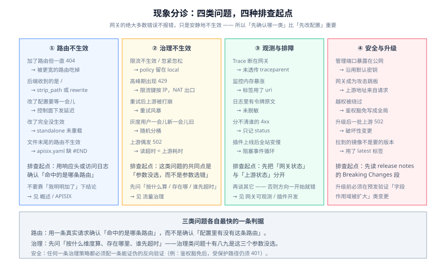

# 常见问题与最佳实践

这一页是**现象速查**：遇到问题时先在这里对号入座,再去对应页面看原因与处置。

## 一、现象分诊表

| 现象 | 最可能的原因 | 去哪看 |
| --- | --- | --- |
| 加了路由但一直 404 | 路由被更宽的路由吃掉 / `priority` 没写 / `disabled` 没删 | [Overview](../Overview/index.md)、[APISIX](../APISIX/index.md) |
| 路由能通,但后端收到的是 `/` | `strip_path`（Kong）或 `proxy-rewrite` 没配 | [Kong](../Kong/index.md) |
| 改了配置要等一会儿才生效 | 控制面下发延迟（Kong 轮询）/ 改的不是生效的那一份 | [Overview](../Overview/index.md) |
| 配置改了但完全没生效 | standalone 模式要 reload;`apisix.yaml` 缺 `#END` | [APISIX](../APISIX/index.md) |
| 限流不生效 / 忽紧忽松 | `policy` 留在 `local`（多副本误差）/ `key` 没选或选错 / 多限流插件叠加 | [流量治理](../TrafficManagement/index.md) |
| 流量高峰出现 429,但后端说没限 | 上一条的镜像：限流键按 IP,而流量来自同一个 NAT 出口 | [流量治理](../TrafficManagement/index.md) |
| 上游偶发 502,重试也没用 | 网关 `read` 超时 < 上游处理时间 / 上游 TLS 校验失败 | [流量治理](../TrafficManagement/index.md)、[Security](../Security/index.md) |
| 重试后上游被打崩 | 重试风暴：固定间隔 + 无退避 + 无预算 | [流量治理](../TrafficManagement/index.md) |
| 灰度用户一会儿新一会儿旧 | 用随机数分桶,而不是按用户 ID 一致性哈希 | [流量治理](../TrafficManagement/index.md) |
| Trace 断在网关 | 网关不透传 / 重写 `traceparent`;入口与下游采样决策不一致 | [网关可观测](../Observability/index.md) |
| 监控系统内存暴涨、查询超时 | 指标标签用了 `uri` / `request_id`（基数爆炸） | [网关可观测](../Observability/index.md) |
| 日志里出现了令牌原文 | 访问日志未脱敏 / 记了完整请求头 | [网关可观测](../Observability/index.md)、[Security](../Security/index.md) |
| 网关成为攻击跳板 | 上游地址或重定向目标来自请求参数（SSRF / 开放重定向） | [Security](../Security/index.md) |
| 插件上线后全站变慢 | 插件阻塞事件循环 / 外部插件每次请求一个跨进程往返 | [插件开发](../Plugin/index.md) |
| 网关进程 OOM | 大请求体被读进内存 / 插件缓存无上限 | [插件开发](../Plugin/index.md)、[Security](../Security/index.md) |
| 升级后一批上游突然 502 | 破坏性变更（如 APISIX 3.19 上游 TLS 校验生效） | [APISIX](../APISIX/index.md) |

## 二、高频十二问

**1. 网关和 Nginx 反代到底差在哪？**
差在**「配置从哪来」与「有没有控制面」**。反代是你自己写配置、自己 `reload` 的进程;网关有控制面、有插件运行时、配置从 API 进入并由它自己热生效。判据：**你需要「动态增删路由 + 插件化横切策略」吗**？需要就是网关,不需要反代就够。

**2. Kong 和 APISIX 怎么选？**
先看**配置存储**：Kong 是 PostgreSQL/Cassandra 或 DB-less,APISIX 是 etcd 或 standalone。再看**扩展语言**：Kong 以 Lua 为主,APISIX 有 Lua + 多语言 Runner + Wasm 三条路。最后看**你要的功能在 OSS 里有没有**（Kong 的部分能力在企业版）。详见两页的对照表。

**3. 一定要引入 etcd / 数据库吗?**
不一定。**standalone / DB-less 模式**用一份 YAML 就能跑,适合「配置走 GitOps、变更不频繁」的场景。代价是改配置要整体重载,且**不能做增量改一条**。

**4. 网关该做鉴权吗？做到什么程度？**
做**粗粒度**：令牌有效性、接口类别级 scope、路径白名单。**不做**「这个用户能不能操作这条数据」。两层都要有,服务层不得依赖「网关查过了」。

**5. 网关该缓存业务数据吗？**
不该。缓存键与失效策略依赖业务语义,放网关后**没人能说清哪次变更让缓存脏了**。要做也是做**与业务无关**的缓存（静态资源、公开配置）。

**6. 限流应该按什么维度？**
优先按**已认证身份**（consumer / credential）。按 IP 只在「没有身份」的接口上用,并且要意识到 NAT 出口会把一整个公司算成一个人。

**7. 多副本部署时,限流为什么不准？**
因为默认 `policy` 往往是**本地内存**。要么改成共享存储（Redis）,要么显式接受「限 N × 副本数」并写进设计。

**8. 网关是单点吗？怎么破？**
是逻辑单点,但可以做到**无单实例**:数据面多副本 + 跨故障域 + 前置 LB。更要紧的是**控制面挂掉时数据面仍能按上次配置转发**这条路径要被实测过。

**9. 灰度用权重还是用 Header？**
权重用于**逐步放量**（但要接受同一用户可能看到两个版本）;Header 用于**精确可控**（内部验证、特定客户）。**想「同一用户始终一致」必须按用户 ID 一致性哈希。**

**10. 插件用 Lua 还是 Wasm？**
问「一天跑多少次」。每请求都要跑、逻辑轻 → Lua;逻辑复杂、要复用 SDK、要隔离 → 外部插件或 Wasm。**任何插件都要单独观测耗时。**

**11. 网关日志该记什么？**
`request_id` / `route` / `upstream_addr` / `upstream_status` / 两类耗时 / 身份标识 / `traceparent`。**不记凭证原文,默认不记 body。**

**12. 升级网关要注意什么？**
三件事：① **读 Breaking Changes 段**（不看版本号看内容）;② **核对镜像/包与 sidecar Runner 的版本**（主程序与 Runner 各自独立发布）;③ **在预发验证**那些「字段作用域被扩大」的变更。

## 三、上线自查清单

发布前逐条打勾,**任何一条不能确认就视为未完成**：

1. ☐ 网关镜像/包**固定到完整版本号**,不用 `latest`,并记录摘要。
2. ☐ 数据面**至少 2 副本、跨故障域**;前置 LB 健康检查指向网关自身健康端点。
3. ☐ **控制面不可用**的路径已实测：存量流量继续转发,新配置失败但不影响存量。
4. ☐ Admin API / 管理端口**不对公网开放**,默认密钥已替换。
5. ☐ 路由**有明确优先级**;存在一条可观测的兜底路由（不静默丢弃）。
6. ☐ 鉴权已开启,且**豁免只对指定路径生效**;已做**反向验证**（受保护路径仍 401）。
7. ☐ 限流的 `key` 与 `policy` 是按业务口径选的;多副本下配额一致性已验证。
8. ☐ 超时三关系成立：**网关 < 客户端**、**上游内部 < 网关 read**、**重试 × 单次超时 < 总预算**。
9. ☐ 重试只作用于**幂等或带幂等键**的请求,且有退避与预算上限。
10. ☐ 灰度**分版本可观测**（新版本错误率/延迟单独统计）,回退动作已演练并计时。
11. ☐ 访问日志字段齐全;**凭证与请求体不落盘**;日志保留期与合规要求一致。
12. ☐ `traceparent` 在网关**原样透传**;采样决策在入口做一次并透传。
13. ☐ 指标标签**无高基数项**（无 `uri` / `request_id`）;序列数在预算内。
14. ☐ 请求体大小、头大小、URI 长度、允许方法**均有上限**;超限返回 413 而不是 502。
15. ☐ 上游地址、重定向目标、镜像目标**全部来自配置,不来自请求**;云元数据地址不可达。
16. ☐ 自定义插件有**单独耗时指标**,且 p99 已量化。
17. ☐ 配置在**版本控制**中;回滚是一次 `git checkout` + reload,且已演练。
18. ☐ 至少一次**真实验证过的演练**：摘除上游、注入错误、回退灰度。

## 四、最佳实践十二条

1. **网关只做「与业务无关、且所有服务都需要」的横切关注点。** 判断标准：换掉网关,业务代码不需要改。
2. **配置即代码。** 无论用哪种模式,配置都要进仓库、可 diff、可回滚;**控制台手改是事故的常见起点**。
3. **每份配置都配一条可执行校验**（schema 校验 + 行为验证），并且**行为验证要能证伪**（例如「豁免之后,受保护路径仍然 401」）。
4. **异步的、跨进程的、会走网络的都不算「轻」**。插件里只放轻逻辑。
5. **超时与重试一起设计。** 它们相乘,不是相加。
6. **限流要能回答「按什么算」。** 选不出维度,说明业务口径没定。
7. **灰度必须可分维度观测,否则是盲发。**
8. **上游状态与网关状态分开统计。** 否则你永远在误判后端的健康度。
9. **指标标签先问「取值上限」。** 答不出来就不加。
10. **日志里永不出现凭证。** 脱敏做在写入前,不是查询时。
11. **升级前先看 Breaking Changes。** 「字段作用域扩大」比「API 改名」更难发现、更容易出事。
12. **把网关纳入值班与演练范围。** 它是唯一「挂了就全站挂」的组件,值得单独一套预案。

## 五、术语表

| 术语 | 含义 |
| --- | --- |
| **数据面（Data Plane）** | 真正转发请求的进程 |
| **控制面（Control Plane）** | 存配置、校验、下发的那一层（etcd / 数据库 / 仓库 YAML） |
| **DB-less / standalone** | 配置来自声明式文件,网关不连配置库的形态 |
| **上游（Upstream）** | 网关背后的一组后端节点及其负载均衡策略 |
| **路由（Route）** | 「什么条件」→「打给哪个上游」的规则 |
| **插件（Plugin）** | 挂在路由/服务/全局上的策略单元 |
| **消费者（Consumer）** | 调用方身份（一个用户可以持有多份凭证） |
| **凭证（Credential）** | 绑定到消费者的密钥/证书/令牌 |
| **优先级（priority）** | 插件或路由的执行/匹配次序（数值语义随产品而异,必须查文档） |
| **`strip_path`** | Kong 的字段：是否从转发路径上切掉匹配到的前缀 |
| **`traceparent`** | W3C Trace Context 的传播头,链路追踪的载体 |
| **基数（Cardinality）** | 指标标签的取值组合数,决定监控系统的容量 |
| **金丝雀（Canary）** | 按比例渐进放量的灰度方式 |
| **流量镜像（Mirror）** | 复制一份流量到新版本,只观察不返回 |
| **SSRF** | 服务端请求伪造：诱导网关去访问内网或元数据地址 |
| **开放重定向** | 重定向目标可被外部控制,常被用于钓鱼 |

## 相关页面

- [概述：网关的四条边界](../Overview/index.md)
- [Kong 深入](../Kong/index.md)｜[APISIX 深入](../APISIX/index.md)｜[插件开发](../Plugin/index.md)
- [流量治理](../TrafficManagement/index.md)｜[网关可观测](../Observability/index.md)｜[网关安全](../Security/index.md)
- [实战：从零配一个生产级网关](../Practice/index.md)

## 参考资料

- Apache APISIX 文档：https://apisix.apache.org/docs/apisix/getting-started/
- Kong Gateway 文档：https://docs.konghq.com/gateway/latest/
- OWASP API Security Top 10：https://owasp.org/API-Security/
- Kubernetes Gateway API：https://gateway-api.sigs.k8s.io/
- W3C Trace Context：https://www.w3.org/TR/trace-context/
