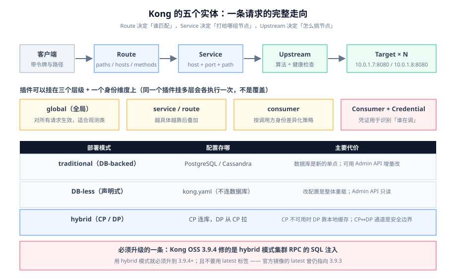

# Kong 深入

Kong 是这批网关里**实体模型最清晰**的一个：一切配置都落到五个对象上,理解了这五个对象就理解了 Kong 的全部配置。

这一页只讲 Kong。与 APISIX 的对照放在 [APISIX 深入](../APISIX/index.md)。



## 一、五个实体,一张图

```text
  客户端 ──▶ Route ──▶ Service ──▶ Upstream ──▶ Target（节点 1..n）
              │           │
              │           └── Plugin（作用在 service 上）
              ├── Plugin（作用在 route 上）
              └── Plugin（全局：作用在所有 route 上）

  Consumer ──▶ Credential（key-auth / jwt / basic-auth …）
       └── Plugin（作用在这个 consumer 的请求上）
```

| 实体 | 一句话 | 关键字段 |
| --- | --- | --- |
| **Route** | 「什么样的请求」：匹配条件 + 关联到哪个 Service | `paths` / `hosts` / `methods` / `headers` / `protocols` / `strip_path` / `regex_priority` |
| **Service** | 「后端是什么」：一个逻辑后端（等价于 APISIX 的 Service） | `protocol` / `host` / `port` / `path` |
| **Upstream** | 「怎么挑节点」：一组 Target + 负载均衡与健康检查 | `algorithm` / `hash_on` / `healthchecks` |
| **Target** | Upstream 里的一个节点 | `target`（`host:port`）/ `weight` |
| **Consumer** | 「谁在调」：调用方身份,用于绑定凭证与配额 | `username` / `custom_id` + 关联 Credential |

::: tip 一个必须记住的抽象
**Service 不是「你的后端应用」,而是「一组等价的 Target 的抽象」。** 没有 Upstream 时,Kong 会把 `service.host` + `service.port` 当成**单个 Target**；一旦你创建了同名 Upstream,Kong 就会把 `service.host` 当作 Upstream 名去解析。

这条规则带来一个非常常见的坑：**你写了一个 `host: api.internal` 的 Service,它也真的能通;然后你建了一个名为 `api.internal` 的 Upstream——流量会静默切换到 Upstream,而你原来的单节点配置不再生效。** 排查时请先确认「这个 host 到底是 DNS 名还是 Upstream 名」。
:::

## 二、三种部署模式

| 模式 | 配置存哪 | 适合 | 代价 |
| --- | --- | --- | --- |
| **traditional（DB-backed）** | PostgreSQL / Cassandra | 频繁通过 Admin API 改配置、用了 Kong Manager 类控制台 | 数据面依赖数据库;**数据库是新的单点** |
| **DB-less（声明式）** | **不连数据库**,配置来自 `kong.yaml` | Kubernetes / GitOps;配置即代码 | 改配置必须**整体重载**,Admin API 变为只读;不能做「增量改一条」 |
| **hybrid（CP/DP）** | CP 连数据库,DP 从 CP 拉配置 | 多集群、跨网络域：DP 只需出站连 CP | CP 不可用时 DP 只能靠本地缓存;**且 CP↔DP 的通道本身是安全边界**（见下） |

::: danger 必须升级的一条：hybrid 模式的 RPC 曾有一个 SQL 注入
Kong Gateway OSS **3.9.4（2026-10-12）** 修的是 **hybrid 模式集群 RPC 的 SQL 注入（CVE-2026-1907）**。

推论有两条,与你的部署模式直接相关：

1. **用 hybrid 模式就必须升到 3.9.4 及以上**。CP↔DP 通道通常只允许出站、看起来「很安全」,但**注入的那一侧恰恰是 CP 收到 DP 上报数据的地方**,不是「公网进不来就没事」。
2. **升级前先确认你拉到的镜像版本**。截至 2026-10-13,Docker Hub 官方 `kong` 镜像的 `latest` 仍指向 **3.9.3**,而 3.9.4 的 Debian 包已经发布。**用 `latest` 部署意味着你可能带着已知漏洞跑**。固定到完整版本号,并把「升级」当成一次显式动作。
:::

### DB-less 的最小声明式配置

```yaml [kong.yaml]
_format_version: "3.0"
_transform: true

services:
  - name: orders-api
    url: http://orders.internal:8080
    routes:
      - name: orders-v1
        paths:
          - /api/v1/orders
        strip_path: false
        plugins:
          - name: rate-limiting
            config:
              minute: 600
              policy: redis          # 关键：多副本必须用共享策略
              redis:
                host: redis.internal
                port: 6379

upstreams:
  - name: orders.internal
    algorithm: round-robin
    healthchecks:
      active:
        http_path: /healthz
        healthy:    { interval: 5,  successes: 2 }
        unhealthy:  { interval: 3,  http_failures: 3 }
    targets:
      - target: 10.0.1.7:8080
        weight: 100
      - target: 10.0.1.8:8080
        weight: 100
```

```shell
# 载入声明式配置（DB-less 模式下由 kong 启动时读，或热重载）
kong config parse  kong.yaml      # 只校验，不生效
kong config db_import kong.yaml   # DB 模式下导入
# DB-less 热重载（容器内）
kong reload
```

::: danger `strip_path` 是 Kong 最容易被忽略的一个默认值
Kong 的 Route 有一个 `strip_path` 字段,**声明式配置里它默认是 `true`**：网关会把匹配到的 `paths` 前缀**从转发路径上切掉**。

于是 `/api/v1/orders` 这条路由,配了 `paths: ["/api/v1/orders"]` 且 `strip_path: true` 时,转发给后端的是 `/`——**后端收到的不是它预期的路径**。

两种正确写法二选一,不要混：

- 想保留完整路径：`strip_path: false`（推荐,前后端路径语义一致,排障时不用做心算）。
- 想切掉前缀：确保后端真的挂在 `/` 上。

**判据**：在网关侧打开访问日志的 `upstream_uri` 字段,**亲眼看过一次**「后端收到的路径」与「预期路径」一致。这条不验证,线上一定会遇到一次「本地好的、上了网关 404」。
:::

## 三、路由匹配：比你想的更讲究

Kong 的路由匹配不是「按添加顺序」,而是有一套优先级。理解它与不理解它,决定了你能否预测「两条都能匹配的路由,到底谁赢」。

| 匹配维度 | 说明 | 优先级影响 |
| --- | --- | --- |
| `hosts` | 域名匹配,支持通配 | 有 host 的路由优先于没有 host 的 |
| `paths` | 路径匹配,**前缀与正则** | 前缀长度**越长越优先** |
| `regex_priority` | 正则路由的优先级数值 | 数值**越大越优先** |
| `methods` / `headers` | 方法与头部匹配 | 匹配条件越多越具体,越优先 |
| `protocols` | `http` / `https` / `grpc` / `grpcs` / `tcp` / `tls` | 不匹配则跳过 |

::: danger 四个静默不生效的写法
1. **通配路径吃掉具体路径**。`paths: ["/api"]`（前缀）与 `paths: ["/api/v1/orders"]` 同时存在时,长的赢——但如果顺序反过来写成通配在前、且你还依赖了别人的「先定义先匹配」直觉,就会出现「加了新路由但不生效」。**判据：新增路由后,用一条真实请求验证它命中的是新的那条**（Kong 的 `X-Kong-Route-Id` 响应头或访问日志的 `route_id`）。
2. **正则里忘记锚定**。`/orders/\d+` 会匹配 `/orders/123/anything`,因为正则匹配的是**子串**。写成 `^/orders/\d+$`。
3. **`protocols` 不含 `grpc`** 却想代理 gRPC——请求会被当作普通 HTTP 处理,表现为「上游直接报协议错误」。
4. **两个 Consumer 用同一个凭证值**。Kong 不会阻止你,运行时会取「第一个匹配到的」,表现为**配额算在另一个人头上**。
:::

## 四、插件的执行顺序

Kong 的插件有两个维度：**作用域**（挂在哪个实体上）与**优先级**（`priority` 数值,决定同一阶段的执行顺序）。

- **作用域**：global → service → route → consumer,越具体的越后叠加。同一个插件挂在不同层,**会各执行一次**（不是覆盖）。
- **优先级**：同一个阶段内,`priority` 大的先执行。各内置插件的 `priority` 是**固定的**,自定义插件必须显式声明。

```text
请求进入
  ├─ 阶段 access（鉴权、限流、路由改写）
  │    ├─ key-auth          priority 1250
  │    ├─ rate-limiting     priority  901
  │    ├─ request-transformer priority 801
  │    └─ 你的自定义插件      priority  待定（见下）
  ├─ 阶段 header_filter（改写响应头）
  ├─ 阶段 body_filter（改写响应体）
  └─ 阶段 log（写日志、埋指标）
```

::: danger 自定义插件的优先级必须显式想清楚
一个「没写 `priority`」或「随手写 1000」的自定义插件,会**和内置插件的优先级撞车**,执行顺序变成一个没人能预测的谜。

正确的定优先级方法,按依赖关系倒推：

- **需要在鉴权之前**（例如「按来源 IP 决定用哪套鉴权策略」）→ 优先级要**高于** `key-auth` 的 1250。
- **需要在鉴权之后、限流之前**（例如「按已识别的 consumer 打标签」）→ 在 1250 与 901 之间。
- **需要在限流之后**（例如「只对已经通过限流的请求做审计」）→ 低于 901。

**并把它写进插件的注释里**：`-- priority 高于 key-auth(1250)，因为需要先决定用哪套凭证校验`。半年后接手的人会感谢你。
:::

## 五、上游健康检查与优雅摘除

健康检查不是「配了就完事」,三个参数必须与你的场景对齐：

| 参数 | 含义 | 配错的后果 |
| --- | --- | --- |
| `healthy.interval` / `unhealthy.interval` | 主动探测间隔 | 探测太密 → 上游被探挂;太疏 → 摘除太慢,故障窗口拉长 |
| `successes` / `http_failures` / `timeouts` | 判定阈值 | 阈值太低 → 一次抖动就摘除全部节点,流量全灭 |
| `passive` | 被动（依赖真实流量结果） | 只配主动不配被动 → **没有真实流量时探不出问题** |

::: tip 优雅摘除：别让一次发布打翻一盘流量
节点下线有两条路：**改权重为 0**（推荐）与 **直接删节点**（会造成在途请求失败）。Kong 提供了 `kong drain` 用于「把节点标记为 draining,不再接新请求但等存量请求结束」。

判据：摘除一个节点后,观察**该节点的在途请求数为 0** 再彻底移除,而不是删完再看错误率。
:::

## 六、一份可执行的验证清单

```shell
# 1) 当前生效的主体（确认你在改的是「真正生效的那一份」）
curl -s http://127.0.0.1:8001/routes | jq '.data[].name'
# DB-less 模式：Admin API 只读，改配置要改文件 + kong reload

# 2) 亲眼确认「后端收到的路径」（验证 strip_path）
curl -s http://127.0.0.1:8001/routes/<name> | jq '{paths, strip_path}'
curl -i http://127.0.0.1:8000/api/v1/orders | head -1

# 3) 验证鉴权在网关处拦住（后端日志不应出现这条请求）
curl -i http://127.0.0.1:8000/api/v1/orders | head -1   # 期望 401

# 4) 验证限流是「全局」而不是「每副本」
for i in $(seq 1 20); do curl -s -o /dev/null -w '%{http_code}\n' http://127.0.0.1:8000/api/v1/orders; done | sort | uniq -c
# 期望：在配额内全部 200，超出后出现 429；若多副本下永远不出现 429，检查 policy 是不是留在了 local

# 5) 版本与镜像核对（生产必做）
docker image inspect kong:3.9.4 --format '{{index .RepoDigests 0}}'
```

## 七、与其它产品对照（速查）

| 维度 | Kong（OSS 3.9.x） | APISIX（3.19.x） |
| --- | --- | --- |
| 配置存储 | PostgreSQL / Cassandra,或 DB-less 声明式 | **etcd**（或 standalone YAML） |
| 配置下发 | 轮询 / hybrid CP 推送 | **etcd watch**,秒级 |
| 扩展首选 | Lua（PDK）自定义插件 | Lua + **多语言 Plugin Runner** + Wasm |
| 声明式工具 | `kong.yaml`（`decK` 可做 diff/sync） | `adc` / standalone `apisix.yaml` |
| 路由匹配 | 前缀 + 正则 + `regex_priority` | **radixtree**,支持多条件表达式 |
| 许可 | Apache-2.0（OSS 主线停在 3.9.x） | Apache-2.0（小版本持续滚动） |

细节与判据见 [APISIX 深入](../APISIX/index.md)。

## 相关页面

- [概述：网关的四条边界](../Overview/index.md)｜[APISIX 深入](../APISIX/index.md)
- [插件开发](../Plugin/index.md)：三条扩展路线的取舍
- [流量治理](../TrafficManagement/index.md)：限流与灰度的具体参数
- [实战：从零配一个生产级网关](../Practice/index.md)

## 参考资料

- Kong Gateway 文档：https://docs.konghq.com/gateway/latest/
- Kong 路由与匹配优先级：https://docs.konghq.com/gateway/latest/key-concepts/routes/
- Kong 插件优先级与执行顺序：https://docs.konghq.com/gateway/latest/key-concepts/plugins/
- Kong DB-less 与声明式配置：https://docs.konghq.com/gateway/latest/production/deployment-topologies/db-less-and-declarative-config/
- Kong 3.9.4 安全公告（CVE-2026-1907）：https://github.com/Kong/kong/releases
