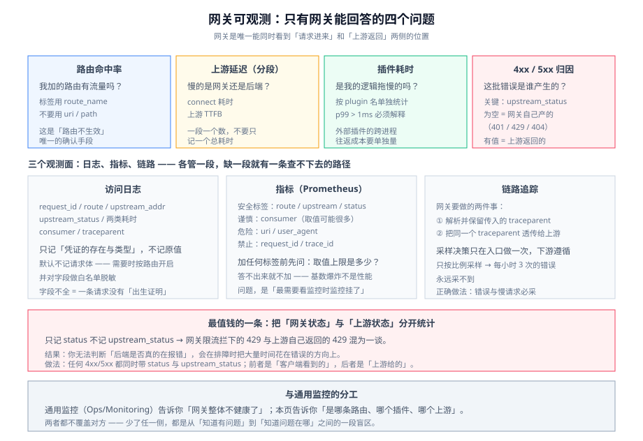

# 网关可观测

网关是**唯一能看见全部请求**的位置。这意味着：网关没记下来的东西,后面再想查就没有了。反过来,网关记错的东西会**污染整条链路**（比如把 IP 当用户、把高基数路径当标签）。

这一页只讲网关这一跳专属的四个信号,以及日志、链路、脱敏三件事的落地口径。通用监控方法论见 [`Ops · 监控告警`](../../../Ops/Monitoring/index.md)。



## 一、四个专属信号

网关侧的指标很多,但真正**只有网关能回答**的是这四个。其余的（CPU、连接数）和普通 Web 服务一样,不必单独设计。

| 信号 | 回答什么问题 | 关键标签 |
| --- | --- | --- |
| **路由命中率** | 「我加的这条路由到底有没有流量?」 | `route_id` / `route_name`（**不是** uri） |
| **上游延迟（分段）** | 「慢的是网关还是后端?」 | `upstream` / `route` + 分段（connect / 上游 TTFB） |
| **插件耗时** | 「是我的自定义逻辑拖慢的,还是后端?」 | `route` + `plugin` 名 |
| **4xx / 5xx 归因** | 「这批错误是谁产生的?」 | `route` + **`upstream_status`**（区分「网关拦下的」与「后端返回的」） |

::: tip 为什么这四条是网关专属
因为**只有网关同时看到「请求进来」和「上游返回」两侧**。

后端的指标只知道「我处理了这个请求用了多久」,它**不知道**：这条请求在网关等了多久、被哪个插件处理过、是不是被网关限流拦下（它根本没收到）。**这些信息只能在网关侧产生。**
:::

### 「上游状态」与「网关状态」必须分开

这是网关可观测里**最容易做错、也最值钱**的一条。

```text
客户端看到的 4xx/5xx
  ├─ 网关自己产生的（鉴权失败 401、限流 429、路由未命中 404）
  └─ 上游返回的（业务 400、上游 500）
        ↑ 这两类混在一起统计，会导致「后端错误率突然上升」的误判
```

::: danger 三个会误导排障的写法
1. **只记 `status`,不记 `upstream_status`**。结果：网关限流拦下的 429 和上游自己返回的 429 混为一谈,**你无法判断「后端是否真的在报错」**。
2. **用 `$uri` 或 `$path` 当指标标签**。带 ID 的路径（`/orders/12345`）会产生**无限多的时间序列**,直接把监控系统打爆（见下节的基数问题）。
3. **把 `instance` 当上游标识**。上游是动态扩缩时,实例名一直在变,指标序列数=实例数×时间。**用「上游/服务名」做标签,而不是「实例」。**
:::

## 二、访问日志：一张必备字段表

网关访问日志的价值在于**它是一条请求的「出生证明」**。字段不全,后面所有排查都要靠猜。

| 字段 | 用途 | 缺了会怎样 |
| --- | --- | --- |
| `request_id` | 唯一的请求标识,**必须能透传到后端与日志链路** | 无法跨服务串一条请求 |
| `route_id` / `route_name` | 命中了哪条路由 | 「我加的路由不生效」无从确认 |
| `upstream_addr` | 实际打到了哪个后端节点 | 无法判断「是不是某个节点有问题」 |
| `upstream_status` | 后端返回的真实状态码 | 见上文,无法归因 |
| `upstream_response_time` | 后端的处理时间 | 无法区分「网关慢」还是「后端慢」 |
| `request_time` | 网关侧端到端耗时 | —— |
| `bytes_sent` / `body_bytes_sent` | 响应大小 | 无法定位大响应 |
| `consumer` / `credential_id` | 调用方身份 | 配额与限流事后无法复盘 |
| `traceparent` | W3C Trace Context 头 | 链路断在网关 |

::: danger 日志里最危险的两类内容
1. **`Authorization` / `Cookie` / `X-Api-Key` 原样落盘**。这些是长期凭证,一旦进日志系统就**等于泄露给了所有能查日志的人**。做法：日志里只记「凭证的存在与类型」（如 `auth=Bearer`、`api_key_id=abc123` 的哈希前 8 位）,**绝不记原值**。
2. **请求体 / 响应体整包落日志**。含个人信息、身份证、密码。做法：**默认不记 body**;需要时只在**特定路由**上开启,并对字段做白名单脱敏。
:::

## 三、链路追踪：怎么让 trace 不断在网关

分布式追踪在网关这一跳最容易断,原因是**网关默认不生成 span,也可能不透传 `traceparent`**。

```text
客户端 ── traceparent ──▶ 网关 ── traceparent ──▶ 服务 A ──▶ 服务 B
                            │
                            └─ 网关必须做两件事：
                               ① 解析并保留传入的 traceparent（不重写）
                               ② 把同一个 traceparent 透传给上游
                           若缺失，则：要么整条链路从网关断开，
                                      要么每个服务各生成一个根 span —— 变成「一堆互不相关的单 span」
```

| 情况 | 表现 | 修法 |
| --- | --- | --- |
| 网关**不透传** `traceparent` | 每个服务一条独立 trace,无法串起来 | 在网关显式开启透传（保留原始 header） |
| 网关**重写** `traceparent` | 链路能串,但**入口那一段丢失**,看起来「网关不存在」 | 只在**没有**传入头时才生成新的 |
| 网关**不透传** `baggage` / 自定义关联头 | 业务标识（租户、灰度标记）在中途丢失 | 明确白名单需要透传的头 |
| 采样决策不一致 | 网关采样、后端不采样（或反之）→ **半截链路** | 采样决策**只在入口做一次**,并通过头传给下游 |

::: danger 采样：最常见的两个「白采」错误
1. **网关 1% 采样,后端各自再采一次**。结果：同一条请求在网关上被采、在后端被丢,或者反过来——**你永远拿不到一条完整的链路**。正确做法：网关做采样决策,把 `sampled` 标志透传,下游**遵循**入口决策。
2. **只按固定比例采样,不采错误**。1% 采样下,一个每小时才出现 3 次的错误,**大概率永远采不到**。正确做法：**分层采样——错误与慢请求必采,正常流量按比例采**。（这与 [`LLMObservability`](../../../AI/LLMObservability/OnlineEval/index.md) 里的分层采样是同一条原则。）
:::

## 四、指标：基数（cardinality）是第一大坑

指标系统的容量由**时间序列数**决定,而序列数 ≈ 标签取值组合数。网关侧**极其容易**把基数做爆。

| 标签 | 安全吗 | 说明 |
| --- | --- | --- |
| `route_id` / `route_name` | ✅ 安全 | 路由数量有限（几十~几百） |
| `upstream` / `service` | ✅ 安全 | 上游数量有限 |
| `status` / `method` | ⚠️ 谨慎 | 状态码与方法是有限集合,安全 |
| `consumer` | ⚠️ 谨慎 | 调用方可能成千上万,要评估 |
| `uri` / `path` | ❌ **危险** | 带 ID 的路径无限多 |
| `request_id` / `trace_id` | ❌ **禁止** | **每个请求一个取值**,这是把监控当数据库用 |
| `user_agent` | ❌ 危险 | 取值几乎无限 |

::: danger 「基数爆炸」不是性能问题,是可用性问题
一个网关 QPS 1 万、有 10 个 `uri` 模板和 2 个状态码 → 序列数可控。

但一旦有人把 `$request_uri`（**完整路径含 ID**）当成标签,序列数会随**请求数**增长。几个小时后,监控系统内存打满、查询全部超时——**而这时恰恰是你最需要看监控的时候**。

**判据**：给任何指标加标签前,先回答「这个标签的**取值数量上限**是多少」。答不出来,就不加。
:::

## 五、一份可执行的验证

```shell
# 1) 确认「网关 4xx」与「上游 4xx」能分辨（关键）
curl -s http://127.0.0.1:9090/api/v1/query --data-urlencode \
  'query=sum by (route, upstream_status) (rate(apisix_http_status{code=~"5.."}[5m]))'
# 期望：upstream_status 为空 = 网关自己产生的；有值 = 上游返回的

# 2) 确认插件耗时被单独观测（而不是混进总耗时）
curl -s http://127.0.0.1:9090/api/v1/query --data-urlencode \
  'query=histogram_quantile(0.99, sum by (le, plugin) (rate(apisix_plugin_latency_bucket[5m])))'

# 3) 确认 traceparent 被原样透传（后端应看到与入口相同的 trace-id）
curl -s -D- -o /dev/null -H 'traceparent: 00-4bf92f3577b34da6a3ce929d0e0e4736-00f067aa0ba902b7-01' \
  http://127.0.0.1:9080/api/v1/orders | grep -i traceparent
# 期望：trace-id 4bf92f35... 原样出现在上游收到的头里（在后端日志核对）

# 4) 确认日志里没有凭证原值
grep -iE 'authorization|cookie|x-api-key' /var/log/gateway/access.log | head -3
# 期望：无输出；或只有脱敏后的标识（如 api_key_id=xxxx）

# 5) 基数体检：列出序列数最多的标签组合，找出异常项
curl -s http://127.0.0.1:9090/api/v1/label/__name__/values | jq -r '.[]' | grep -c '^apisix_'
```

## 六、与通用监控的分工

| | [`Ops · 监控告警`](../../../Ops/Monitoring/index.md) | 本页 |
| --- | --- | --- |
| 关注对象 | 系统与服务的**健康度**（CPU、内存、依赖可用性） | 网关这一跳的**请求归因**（谁拦的、谁慢的、慢在哪一段） |
| 指标体系 | 通用方法论（四大黄金信号等） | 四个网关专属信号 + 基数纪律 |
| 交接点 | 「网关的错误率」是系统健康度的一个输入 | 「哪条路由的哪个上游在出错」是排障的起点 |

**两者都不覆盖对方。** 通用监控告诉你「网关整体不健康了」,本页告诉你「是哪条路由、哪个插件、哪个上游」。

## 相关页面

- [概述：网关的四条边界](../Overview/index.md)｜[流量治理](../TrafficManagement/index.md)
- [插件开发](../Plugin/index.md)：插件耗时从哪来
- [网关安全](../Security/index.md)：日志脱敏与凭证保护
- [运维 · 监控告警](../../../Ops/Monitoring/index.md)｜[运维 · 日志体系](../../../Ops/LogSystem/index.md)
- [AI 应用观测与评估 · 在线评估](../../../AI/LLMObservability/OnlineEval/index.md)：分层采样的同一个原则
- [实战：从零配一个生产级网关](../Practice/index.md)

## 与可观测性深入的分工

本页讲的是**网关这一跳专属的四个信号**，以及日志、链路、脱敏三件事在网关这一层的落地口径。它是「一个具体组件该怎么观测」。

[可观测性深入](../../../Ops/Observability/index.md) 讲的是**把这些信号运出去的管道**：SDK 与 `traceparent` 传播、Collector 的接收与处理、采样、存储与成本。网关在这里有个特殊身份——**它常常是整条链路的第一个 span**，所以它决定了后面所有的服务质量：

| 网关侧要做的决定 | 依据在哪 |
| --- | --- |
| 入站请求的 `traceparent` 是透传、重建还是拒绝 | [上下文传播](../../../Ops/Observability/OpenTelemetry/index.md)：**网关是唯一能决定「链路从哪里开始」的位置** |
| 网关自身要不要采样、采样率与后端是不是同一套 | [采样决策](../../../Ops/Observability/Sampling/index.md)：**网关能采到用户侧全貌**，但采样决策粒度要看它手上有什么标签 |
| 日志里放什么字段、放多久、走不走 OTLP | [Collector 管道](../../../Ops/Observability/Collector/index.md)：脱敏应当是**管道里的一个处理器**，而不是散落在各语言的代码里 |
| 高基数标签（用户 ID、原始路径）带来的成本 | [观测成本治理](../../../Ops/Observability/Cost/index.md)：网关是最容易制造基数爆炸的位置 |

::: danger 网关上的两个不可逆决定
① **丢弃上下文不可逆**：如果网关把入站的 `traceparent` 直接丢掉另起一条新链路，那么**上游（CDN / 浏览器 / 上一个网关上）的证据就永久对不上了**——下游再全也补不回来。② **写入高基数标签不可逆**：标签一旦进入指标，之后每个时间序列都要单独存一份，把某个高基数标签加进指标之后再想移除，历史数据仍然是按高基数计费的。
:::

## 参考资料

- W3C Trace Context：https://www.w3.org/TR/trace-context/
- OpenTelemetry 语义约定（HTTP）：https://opentelemetry.io/docs/specs/semconv/http/
- APISIX Prometheus 指标：https://apisix.apache.org/docs/apisix/plugins/prometheus/
- Kong 日志与指标插件：https://docs.konghq.com/hub/kong-inc/http-log/
- Google SRE Book：Monitoring Distributed Systems：https://sre.google/sre-book/monitoring-distributed-systems/
