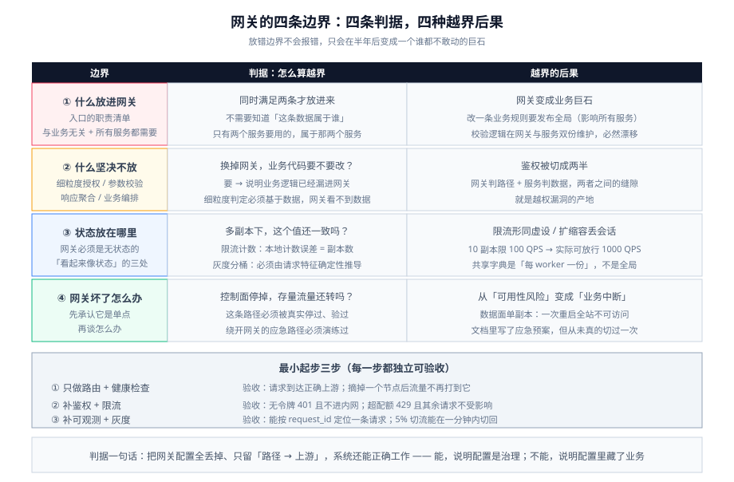

# 概述：网关的四条边界

网关这类组件最难的不是「怎么配」,而是**「什么该放进来、什么坚决不放进来」**。放错了不会立刻报错,只会在半年后变成一个谁都不敢动的巨石。

这一页给出四条边界,后面每一页都在兑现其中的一条。



::: tip 先给结论
**网关应该只做「与业务无关、且所有服务都需要」的横切关注点。** 一旦某段逻辑只有部分服务需要,或者需要知道「这条数据属于谁」,它就不属于网关。

判据很简单：**把这个网关换掉,业务代码需不需要改?** 如果需要,说明业务逻辑漏进了网关。
:::

## 一、先把四个东西分清

「网关」「反向代理」「负载均衡器」「服务网格」「BFF」经常被当成近义词,它们的**判据完全不同**。

| 组件 | 治什么流量 | 判断依据 | 典型例子 |
| --- | --- | --- | --- |
| **反向代理** | 南北向 | 把请求转给「某一组后端」,不理解业务语义 | Nginx `proxy_pass` |
| **负载均衡器** | 南北向 / 东西向 | 从多个等价实例里**挑一个** | NLB、ALB、Nginx `upstream` |
| **API 网关** | 南北向 | 在转发之外还执行**与业务身份相关的横切策略**（鉴权、限流、配额、灰度） | Kong、APISIX、Spring Cloud Gateway |
| **服务网格** | 东西向 | 治理**服务之间**的调用（mTLS、重试、流量镜像） | Istio、Linkerd |
| **BFF** | 南北向 | 聚合多个后端为**某一个客户端形态**定制响应 | 移动端 BFF、GraphQL 网关 |

::: info 一句话区分网关与反代
**反代关心「怎么把包送到」,网关关心「这个包该不该送、以什么身份送、送多快」。**

所以你会看到这样的组合：**负载均衡器 → 网关 → 服务**。三者不互相替代——LB 解决「机器坏了」,网关解决「请求合不合法」,少了哪一层都会在另一层里长出奇怪的东西。
:::

### 控制面与数据面

所有现代网关都是「控制面 + 数据面」两层结构,这是理解它们的第一步。

```text
              ┌───────────── 控制面（Control Plane）─────────────┐
   配置写入 →  │  存配置的地方（etcd / 数据库 / 仓库中的 YAML）    │
              │  校验、下发、版本管理、审计                       │
              └───────────────────────┬──────────────────────────┘
                                      │ 下发（轮询 / watch / 推送）
              ┌───────────────────────▼──────────────────────────┐
   真实流量 →  │  数据面（Data Plane）：真正转发请求的进程          │
              │  路由匹配 → 插件链 → 上游选择 → 转发 → 回写        │
              └──────────────────────────────────────────────────┘
```

两个推论,后面所有页面都会用到：

1. **配置生效有延迟**。控制面写完不等于数据面已经生效——Kong 是轮询到控制面/数据库、APISIX 是 watch etcd。**「我明明改了却没生效」的绝大多数原因是这个延迟,不是配置写错。**
2. **控制面挂了,数据面还能活一阵**。数据面通常会把配置缓存在本地（Kong 的 `lmdb` / APISIX 的 etcd 兜底 + `standalone` 模式）。**但这要求你提前设计过「控制面不可用」这条路径**,而不是出事才想。

## 二、四条边界

### 边界一：什么放进网关

只有同时满足下面两条的,才放进网关：

- **与业务无关**：不需要知道「这条数据属于谁」「这个订单是什么状态」。
- **所有服务都需要**：如果只有两个服务要,那它属于这两个服务。

| 适合放在网关 | 为什么 |
| --- | --- |
| TLS 终止、HTTP/2、HTTP/3 | 证书与协议一家管,避免每个服务各配一份 |
| 粗粒度鉴权（有没有令牌、令牌是否有效、是否白名单路径） | 未认证的请求**不该进内网** |
| 限流与配额（按调用方 / 按接口） | 需要「全局视角」才能算准——单个服务只能看到自己的流量 |
| 灰度与流量切分 | 按权重/Header 分桶,天然是入口的职责 |
| 跨域、压缩、请求/响应头规范化 | 所有服务都需要,且与业务无关 |
| 访问日志与指标 | 入口是**唯一能看见全量请求**的位置 |

### 边界二：什么坚决不放网关

| 不该放 | 后果 |
| --- | --- |
| **细粒度授权**（这个用户能不能删这篇文章） | 判定必须基于数据,而网关看不到数据。放在网关会形成「网关判路径 + 服务判数据」的两半逻辑,**缝隙就是越权漏洞** |
| **业务参数校验**（金额必须大于 0） | 业务规则会变,改一次网关要发布全局;而且校验逻辑会与服务的校验**双份维护、必然漂移** |
| **响应聚合 / 编排**（调 3 个服务拼一个响应） | 网关开始承担业务编排后,**任何一个下游变慢都会变成网关变慢**;这类需求应该用 BFF |
| **请求体转换 / 协议编排的复杂逻辑** | 网关里做数据处理意味着**每字节都要在入口走一遍**,成本 × 全量流量 |
| **缓存业务数据** | 缓存键与失效策略依赖业务语义,放网关后**没有人能说清哪次改动让缓存脏了** |

::: danger 判断标准：问一句「换掉网关,业务代码要改吗」
如果答案是「要」,说明业务逻辑已经漏进了网关。

一条更硬的自检：**把网关的配置全部丢掉,只保留一份「路径 → 上游」的映射,系统还能不能正确工作?** 能,说明配置是「治理」;不能,说明配置里藏了业务。前者可以审计,后者只能祈祷。
:::

### 边界三：状态放在哪里

网关是**无状态**的,这是它能水平扩缩的前提。但有两处必须显式处理「看起来像状态」的东西：

| 看似状态 | 实际归属 | 放网关会怎样 |
| --- | --- | --- |
| 限流计数 | 外部共享存储（Redis）或**本地近似** | 纯本地计数在多副本下**误差 = 副本数**（10 个副本、限 100 QPS → 实际可能放行 1000 QPS） |
| 会话 | 用户侧令牌 / 服务侧会话存储 | 网关存会话 → 扩缩容时会话丢失 |
| 灰度分桶 | 由请求特征**确定性推导**（用户 ID 哈希） | 网关存「谁在灰度组」→ 新副本不认识老分组 |
| 健康状态 | 上游探测结果,**本地缓存** | 无状态的前提是「每个副本自己探、自己判」 |

::: danger 三条「看起来无害」的状态陷阱
1. **限流器默认是本地内存实现**。Kong 的 `rate-limiting`、APISIX 的 `limit-count` 都支持本地与共享两种模式;**默认往往是本地**。多副本部署时,要么改成共享存储,要么把「限 N/副本」当成设计而不是 bug 来接受。
2. **把「粘性会话」当成状态**。用 Cookie 亲和性把同一用户固定到同一后端,看起来解决了状态问题,实际是**把「后端要无状态」这件事藏起来了**——后端一旦重启,亲和上的请求全部打到冷缓存。
3. **在插件里存全局变量**。OpenResty 的 `ngx.shared.DICT` 是**每 worker 一份**,不是「整个网关一份」。用共享字典做全局计数,结果与预期差一个 worker 数。
:::

### 边界四：网关坏了怎么办

网关是**单点**,这个事实必须先承认,再谈「怎么办」。三条硬要求：

1. **数据面必须能多副本**。至少 2 个副本、跨故障域（见 [`CloudArchitecture`](../../../Ops/CloudArchitecture/index.md) 的可用区章节）。
2. **「控制面挂了」必须是一条被测过的路径**。做法：把控制面停掉,确认数据面仍在按上次配置转发、并且新增配置会失败但**不会影响存量流量**。
3. **必须有一条「绕开网关」的应急预案**。哪怕只是「临时把 DNS 切到静态 LB 过滤后的直连」,也必须在演练中真的切过一次——否则它只是文档上的一句话。

| 故障 | 表现 | 第一处置 |
| --- | --- | --- |
| 数据面全部不可用 | 全站不可访问 | 切 DNS / 切 LB 到备用入口（这是唯一需要「秒级」的动作） |
| 控制面不可用 | **存量流量正常**,新配置写不进去 | 不做任何配置变更,先恢复控制面;不要试图绕过它改数据面 |
| 单个副本异常 | 部分请求 5xx | 摘除该副本,查它的日志与资源（常见：连接数打满、内存被大请求体吃光） |
| 配置写错 | 特定路径 404/502 | **回滚配置**（网关配置必须可回滚,见[实战](../Practice/index.md)） |

## 三、什么时候不该上独立网关

多一个组件就多一个必须跟着升级、必须值守、必须演练的东西。下面五种情况下,**先用更简单的东西**：

1. **只有一个后端服务**。反代就够了,网关的「横切集中」在这里没有收益。
2. **团队只有 2~3 人且没有专职运维**。网关的升级与巡检会变成没人管的负债。
3. **需要的是东西向治理**（服务间 mTLS、服务间重试）。这是**服务网格**的活,不是网关的。
4. **需要的是「按客户端形态聚合响应」**。这是 **BFF** 的活;把聚合塞进网关会让网关的每一次变更都变得危险。
5. **入口流量极小且长期稳定**（比如内部后台系统）。用云厂商的托管 LB + 应用内鉴权,成本更低。

::: tip 最小起步三步
真的需要网关时,不要一次把能力铺满。按这个顺序做,每一步都能独立验收：

1. **只做路由 + 健康检查**。目标：`curl -i` 能看到正确的上游响应,以及**摘掉一个上游后不再打到它**。
2. **补鉴权 + 限流**。目标：无令牌请求返回 401 且**不进内网**;超出配额的请求返回 429 且**其余请求不受影响**。
3. **补可观测 + 灰度**。目标：能从访问日志按 `request_id` 定位一条请求经过了哪条路由、耗时分布如何;能把 5% 流量切到新版本并**在一分钟内切回**。

每一步的验收命令见[实战](../Practice/index.md)。
:::

## 四、术语对齐

| 术语 | 含义 | 常被误用为 |
| --- | --- | --- |
| **上游（Upstream）** | 网关背后的**一组**后端节点及其负载均衡策略 | 单个后端地址 |
| **路由（Route）** | 「什么条件的请求」→「打给哪个上游/服务」的规则 | 也叫「规则」「匹配」,同一个产品内叫法统一 |
| **服务（Service）** | 可复用的上游+插件配置的抽象 | 「后端应用」 |
| **插件（Plugin）** | 挂在路由/服务/全局上的一段策略 | 「中间件」（中间件是应用侧的叫法） |
| **消费者（Consumer）** | 调用方身份,用于关联凭证与配额 | 用户（消费者是**调用方**,一个用户可以有多份凭证） |
| **数据面 / 控制面** | 见上文第一节 | —— |
| **DB-less / standalone** | 配置由声明式文件提供,网关不连配置库 | 「没有控制面」（只是控制面的形态不同） |

## 五、三条可执行的验证

在真正上生产之前,先把这三条跑通——它们分别验证「路由对」「鉴权在」「故障隔离在」：

```shell
# 1) 路由命中与上游摘除（以 APISIX 为例，Admin API 默认只允许 127.0.0.1）
curl -s http://127.0.0.1:9180/apisix/admin/routes \
  -H "X-API-KEY: $ADMIN_KEY" | jq '.total'
curl -i http://127.0.0.1:9080/health | head -1
# 期望：200；把某个 upstream 节点权重置 0 后，连续 20 次请求不再落到它

# 2) 鉴权在网关处拦住（未带令牌不应进入内网）
curl -i http://127.0.0.1:9080/api/v1/orders | head -1
# 期望：401；且后端服务的访问日志里**没有**这条请求

# 3) 故障隔离：一个上游挂了不影响其它路由
curl -i http://127.0.0.1:9080/api/v1/orders  | head -1   # 期望 502/503（该上游已挂）
curl -i http://127.0.0.1:9080/api/v1/profile | head -1   # 期望 200（其它路由不受影响）
```

::: info 关于「路由匹配是从上往下第一条命中」
几乎所有网关的路由匹配都是**按优先级/顺序取第一条命中**,命中后不再继续。这意味着**一条写得太宽的路由会「吃掉」后面所有更具体的路由**——而且它不会报错,只会让后面的路由永远不生效。

写路由的顺序纪律：**具体的在前、通配的在后,并且永远给最终兜底留一条能看见的规则**（哪怕是返回 404 的默认路由,也好过「什么都不匹配 → 静默丢弃」）。
:::

## 相关页面

- [Kong 深入](../Kong/index.md)｜[APISIX 深入](../APISIX/index.md)：两条主流产品线的实体模型与配置方式
- [插件开发](../Plugin/index.md)：扩展点与并发模型
- [流量治理](../TrafficManagement/index.md)：限流、熔断、灰度、重试
- [网关可观测](../Observability/index.md)｜[网关安全](../Security/index.md)
- [实战：从零配一个生产级网关](../Practice/index.md)
- [常见问题与最佳实践](../FAQ/index.md)
