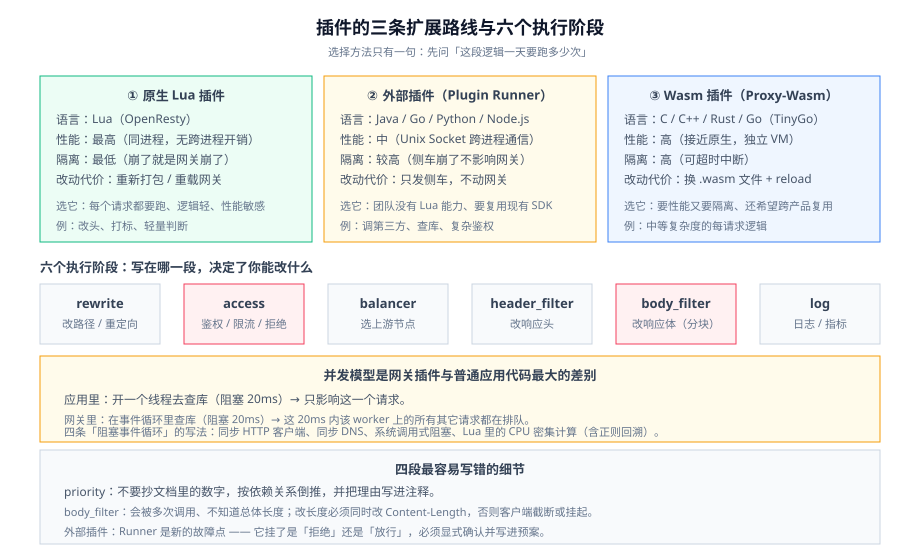

# 插件开发

内置插件不够用时,你要写自己的。网关插件和普通中间件最大的不同是：**它跑在你全部流量的必经之路上,而且跑在一个不能阻塞的事件循环里。** 一段在应用里「有点慢」的代码,在网关里会变成「全站都在等它」。

这一页只讲怎么选扩展路线和怎么写不咬人的插件。策略本身见[流量治理](../TrafficManagement/index.md)。



## 一、先选路线：三条路的代价完全不同

| 路线 | 语言 | 性能 | 隔离性 | 改动的代价 | 什么时候选 |
| --- | --- | --- | --- | --- | --- |
| **原生 Lua 插件** | Lua（OpenResty） | **最高**（同进程、无跨进程开销） | **最低**（崩了就是网关崩了） | 要重新打包/重载网关 | 逻辑轻、调用频繁、性能敏感 |
| **外部插件（Plugin Runner / RPC）** | Java / Go / Python / Node.js | 中（**跨进程通信**） | **较高**（侧车进程,崩了不影响网关主进程） | 只发侧车,**不动网关** | 团队没有 Lua 能力、要复用现有 SDK/库 |
| **Wasm 插件（Proxy-Wasm）** | C / C++ / Rust / Go（TinyGo） | 高（接近原生） | **高**（独立 VM,可超时中断） | 换 `.wasm` 文件 + reload | 要性能又不想用 Lua、或要跨产品复用 |

::: tip 一句话选择法
**先问「这段逻辑一天要跑多少次」。**

- 每个请求都要跑、且只是几十行判断（改个头、打个数）→ **Lua**。
- 一天只跑几万次、但逻辑复杂（调第三方、查库、走 SDK）→ **外部插件**。
- 每个请求都要跑、逻辑中等复杂、且你想要隔离与可移植 → **Wasm**。
:::

::: info 多语言与 Wasm 的现状（2026-10）
- **APISIX 支持三条路线并存**。外部插件通过 **Unix Domain Socket + FlatBuffers 定义的协议**与 Plugin Runner 通信,分三个钩子：`ext-plugin-pre-req`（请求前）、`ext-plugin-post-req`（上游前）、`ext-plugin-post-resp`（响应后）。各语言 Runner 是**独立发布、独立版本**的产品。
- **Wasm 侧**：APISIX 实现了 **Proxy-Wasm 规范**,默认用 **wasmtime** 作为运行 VM（也支持 wasmedge）。规范里定义了 `VMContext → PluginContext → HttpContext` 三层上下文,一个 `.wasm` 可以被多条路由以不同配置加载。
- **Kong 的路线**是 Lua（PDK）为主;Enterprise 3.15 起提供 **Plugin Streaming**（自定义插件从控制面直下发到数据面,免去「重新打包镜像、重启」）、3.16 起提供 **CEL 驱动的插件配置字段**（在 ACL / Rate Limiting 等插件的指定字段上按请求计算取值）。
:::

## 二、执行阶段：写在哪一段决定了你能改什么

网关的插件不是「一个函数」,而是**一组回调**,分别挂在请求生命周期的不同阶段。挂错阶段会「看起来生效了但不该在那个时机生效」。

| 阶段（APISIX 命名） | 时机 | 能做什么 | 典型插件 |
| --- | --- | --- | --- |
| `rewrite` | 路由匹配后、访问控制前 | 改 URI/参数/头,重定向 | `proxy-rewrite`、`redirect` |
| `access` | 转发给上游前 | **鉴权、限流、拒绝请求** | `key-auth`、`limit-count` |
| `balancer` | 选上游节点时 | 自定义负载均衡算法 | 灰度、自定义哈希 |
| `header_filter` | 收到上游响应头后 | 改响应头 | `cors`、`response-rewrite` |
| `body_filter` | 读取响应体时（**分块调用**） | 改响应体 | 内容替换、压缩 |
| `log` | 请求结束后 | 写日志、埋指标 | 日志类插件 |

::: danger `body_filter` 是最容易写错的一段
`body_filter` 会被**多次调用**（按数据块）,并且**不知道总体长度**。三个高频错误：

1. **以为能拿到完整响应体**。想「在响应体里替换一段字符串」时,如果直接对 `chunk` 做替换,字符串可能**横跨两个 chunk**,替换失败且不报错。正确做法是把 chunk 缓存起来,在 `ngx.ctx` 的 `eof` 标记到达时统一处理——**但拼完后如果只写回第一个 chunk,就会丢掉后面的数据**。
2. **改了 `Content-Length` 却不改头**。响应体长度变了但 `Content-Length` 没更新,客户端会**截断或挂起**。要么同时改头,要么把 `Content-Length` 去掉改用 chunked。
3. **在 `body_filter` 里做鉴权**。这时请求已经打到后端了,**拦不住任何东西**。
:::

## 三、并发模型：不要阻塞事件循环

这是网关插件与普通应用代码**最大的差别**,也是新人最容易踩的坑。

```text
应用里的写法（可以接受）：
  收到请求 → 开一个线程 → 查数据库（阻塞 20ms）→ 返回

网关里同样的写法（灾难）：
  收到请求 → 在事件循环里查数据库（阻塞 20ms）→ 返回
                ↑ 这 20ms 内，这个 worker 上的**所有其它请求**都在排队
```

::: danger 四条「阻塞事件循环」的写法
1. **在插件里用同步 HTTP 客户端**。标准库的 `http.get` 在 OpenResty 里是**同步阻塞**的,要用 `resty.http` 这类基于 cosocket 的客户端。
2. **同步 DNS 解析**。每次请求都做一次阻塞解析,延迟直接加在首字节上。要么用 `resolver` + 缓存,要么把域名解析交给上游。
3. **`os.execute` / 读大文件 / 同步读共享字典外的存储**。任何系统调用层面的阻塞都会放大到整个 worker。
4. **在 Lua 插件里做 CPU 密集型计算**（大 JSON 解析、正则回溯）。**ReDoS 是真实风险**：一段「看起来没问题」的正则,遇到特定输入会吃掉几百毫秒。APISIX 内置了防 ReDoS 策略,但**你写的正则不在保护范围内**。

**判据**：把插件的处理时间作为一等指标来观测（见[网关可观测](../Observability/index.md)）。**任何插件的 p99 超过 1ms,都必须解释它在做什么。**
:::

## 四、路线一：原生 Lua 插件骨架

APISIX / Kong 的 Lua 插件结构一致,以下以 APISIX 为例。

```lua [apisix/plugins/tenant-tag.lua]
local core = require("apisix.core")

local schema = {
  type = "object",
  properties = {
    header_name = { type = "string", default = "X-Tenant" },
  },
  required = {},
}

local _M = {
  version  = 0.1,
  priority = 1100,   -- 高于 key-auth(约 2500? 见下解释)，低于/高于按依赖关系定
  name     = "tenant-tag",
  schema   = schema,
}

-- 阶段：access（转发给上游之前）
function _M.access(conf, ctx)
  -- 1) 只做「与业务无关、所有服务都需要」的事：把租户信息归一化到统一头部
  local tenant = core.request.header(ctx, conf.header_name)
  if not tenant or tenant == "" then
    -- 2) 失败路径也要明确：要么放行并打标，要么拒绝，不要静默
    core.log.warn("missing tenant header, uri=", ctx.var.uri)
    return 400, { message = "missing tenant" }
  end

  -- 3) 覆盖而不是追加，避免请求方伪造多个同名头
  core.request.set_header(ctx, "X-Normalized-Tenant", tenant)
  -- 4) 只允许下游读、不允许上游信任客户端原值
  core.request.set_header(ctx, conf.header_name, nil)
end

return _M
```

::: danger 关于 `priority`：不要抄文档里的数字
上面骨架里的 `priority` 是**占位**。真实取值必须按**依赖关系倒推**（同 [Kong 深入](../Kong/index.md) 的第四节）：

- 需要先决定「用哪套凭证校验」→ 优先级要**高于鉴权插件**。
- 需要在鉴权之后、限流之前 → 卡在两者之间。
- 只做日志/埋点 → 放到最后。

**把理由写进注释**。一个没有理由的魔法数字,下一个人改它的时候只能靠猜。
:::

## 五、路线二：外部插件（多语言 Runner）

不适合用 Lua 时（团队没有 Lua 能力、要复用 Java/Go 的 SDK）,把逻辑放在**侧车进程**里。

```text
 请求 ──▶ APISIX（Lua 侧只做「转发并等待」）
              │  Unix Domain Socket（本机，不走网络）
              ▼
        Plugin Runner（Java / Go / Python / Node）
              │  在这里查库、调第三方、跑你的 SDK
              ▼
        返回「继续 / 改头 / 直接拒绝」
```

| 三个钩子 | 语义 | 适合放什么 |
| --- | --- | --- |
| `ext-plugin-pre-req` | 收到请求、路由匹配前后 | 复杂鉴权、风控 |
| `ext-plugin-post-req` | 转发上游前 | 请求改写、加签 |
| `ext-plugin-post-resp` | 收到上游响应后 | 响应改写、审计 |

::: danger 外部插件的两个隐性成本
1. **延迟是「跨进程往返」**。即使同机,UDS 也有开销。**把「每个请求都要跑」的逻辑放在外部插件里,就是在给全部流量加一次进程往返。** 判据：先量出基线（不加插件时的 p99）,再加插件,看差值是否可接受。
2. **Runner 是新的故障点**。Runner 挂了,网关会按配置决定「拒绝请求」还是「放行」。**这个默认行为必须显式确认并写进预案**——最坏的情况是「Runner 挂了,鉴权插件全部跳过,请求直接放行」。
:::

## 六、路线三：Wasm 插件（Proxy-Wasm）

要性能、要隔离、又要跨产品复用,Wasm 是当前最平衡的选择。

```go [main.go（Proxy-Wasm Go SDK 骨架，用 TinyGo 编译）]
package main

import (
  "github.com/tetratelabs/proxy-wasm-go-sdk/proxywasm"
  "github.com/tetratelabs/proxy-wasm-go-sdk/proxywasm/types"
)

func main() { proxywasm.SetVMContext(&vmContext{}) }

type vmContext struct{ types.DefaultVMContext }

func (*vmContext) NewPluginContext(ctxID uint32) types.PluginContext {
  return &pluginContext{ctxID: ctxID}
}

type pluginContext struct {
  types.DefaultPluginContext
  conf string
  ctxID uint32
}

// 插件启动：读取并校验配置。配置非法就返回 Failed，让问题暴露在加载期。
func (ctx *pluginContext) OnPluginStart(size int) types.OnPluginStartStatus {
  data, err := proxywasm.GetPluginConfiguration()
  if err != nil {
    proxywasm.LogCriticalf("cannot read plugin configuration: %v", err)
    return types.OnPluginStartStatusFailed
  }
  ctx.conf = string(data)
  return types.OnPluginStartStatusOK
}

func (ctx *pluginContext) NewHttpContext(ctxID uint32) types.HttpContext {
  return &httpContext{pluginCtxID: ctx.ctxID, ctxID: ctxID}
}

type httpContext struct {
  types.DefaultHttpContext
  pluginCtxID uint32
  ctxID       uint32
}

func (ctx *httpContext) OnHttpRequestHeaders(numHeaders int, endOfStream bool) types.Action {
  // 只做「轻、纯、无外部依赖」的判断。需要查库/调第三方请走外部插件。
  return types.ActionContinue
}
```

```shell
# 编译为 Wasm（TinyGo 是 Proxy-Wasm Go SDK 的官方前提）
tinygo build -o tenant-tag.wasm -scheduler=none -buildmode=wasi-legacy -target=wasi ./main.go

# 放进网关可读的位置并登记（configuration 见《APISIX 深入》的 standalone 示例）
cp tenant-tag.wasm /usr/local/bin/
# 然后 reload 让配置生效
```

::: danger Wasm 的四个「不是银弹」
1. **上下文不是全局的**。`PluginContext` 按「插件实例」创建、`HttpContext` 按请求创建。**想在请求之间共享计数,不能靠内存变量**,要么用共享状态机制,要么依赖外部计数。
2. **TinyGo 不是标准 Go**。反射、`net/http` 等一大票标准库不可用;`go build` 能过不代表 `tinygo build` 能过。
3. **ABI 版本要匹配**。规范在演进,`.wasm` 与网关运行时的 ABI 不匹配时表现为「加载成功但回调不触发」。**升级网关前先确认 Wasm 插件的 ABI 兼容性。**
4. **VM 会崩,但不会拖垮网关**——这正是它的价值;但反过来,**超时中断意味着你不能在 Wasm 插件里做「必须完成」的长任务**。
:::

## 七、一份可执行的验收清单

写自定义插件时,下面五条**每一条都必须亲手跑过**：

```shell
# 1) 配置校验：非法配置必须在加载期就失败，而不是运行时才炸
curl -s http://127.0.0.1:9180/apisix/admin/routes -H "X-API-KEY: $K" -X PUT -d @bad-plugin-conf.json | jq '.error_msg'
# 期望：返回明确的 schema 错误，而不是 200

# 2) 阶段正确性：确认插件在「请求前」就拦住了
curl -i http://127.0.0.1:9080/api/v1/orders | head -1        # 期望被插件拦下（如 400）
# 同时确认后端服务的访问日志里**没有**这条请求

# 3) 不阻塞事件循环：压测时看 p99，而不是只看 QPS
#    先量基线（禁用插件），再量启用后；两条 p99 曲线必须能解释
curl -s http://127.0.0.1:9090/api/v1/query --data-urlencode \
  'query=histogram_quantile(0.99, sum by (le) (rate(apisix_http_latency_bucket{type="request"}[5m])))'

# 4) 插件自身的耗时（把它当一等指标）
#    期望：单个插件 p99 < 1ms；超过就必须解释

# 5) 崩溃隔离：让插件抛错，确认网关整体仍然可用
#    Lua 插件抛错 → 该请求 500，其它请求正常
#    Wasm 插件崩溃 → 网关进程存活，该请求被中断
```

## 相关页面

- [概述：网关的四条边界](../Overview/index.md)
- [Kong 深入](../Kong/index.md)｜[APISIX 深入](../APISIX/index.md)
- [流量治理](../TrafficManagement/index.md)：插件最常用来实现的策略
- [网关可观测](../Observability/index.md)：插件耗时怎么量
- [网关安全](../Security/index.md)：插件里的密钥与鉴权边界
- [实战：从零配一个生产级网关](../Practice/index.md)

## 参考资料

- APISIX 插件开发（Lua）：https://apisix.apache.org/docs/apisix/plugin-develop/
- APISIX 多语言插件（Plugin Runner）：https://apisix.apache.org/docs/apisix/plugin-runner/
- APISIX Wasm 插件：https://docs.apiseven.com/apisix/how-to-guide/custom-plugins/wasm-plugins
- Proxy-Wasm 规范：https://github.com/proxy-wasm/spec
- Kong 自定义插件（PDK）：https://docs.konghq.com/gateway/latest/extensions/plugins/
- OpenResty 最佳实践（cosocket 与阻塞）：https://openresty.org/en/
