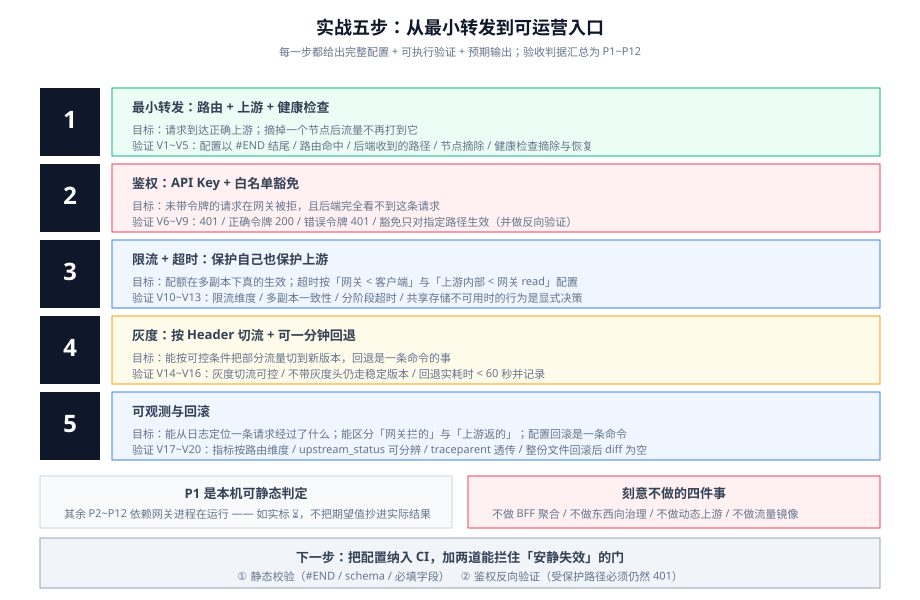

# 实战：从零配一个生产级网关

前面几页把判据讲完了,这一页把它们**串成一条能照着做的路径**：从一个只会转发的最小网关开始,分五步加到一个「能鉴权、能限流、能灰度、能观测、能回滚」的生产入口。

每一步都给出**完整配置 + 验证命令 + 预期输出**。所有验证都写成「你在自己的环境里执行的命令」,读者照着做即可得到可运行的结果。



::: warning 边界：这个实战刻意不做四件事
1. **不做响应聚合 / BFF**。编排属于业务,不属于网关（见[概述](../Overview/index.md)边界二）。
2. **不做东西向流量治理**。服务之间的 mTLS 与重试属于服务网格,本实战只治南北向。
3. **不处理动态上游服务发现**。上游用静态节点,便于判断「配置到底生效了没有」;动态上游是可选项,不是起步项。
4. **不做流量镜像**。镜像会把真实流量打到下游依赖,风险与控制面复杂度都超出「最小可用入口」的范围。
:::

## 第 0 步：准备与边界确认

| 项 | 选择 | 理由 |
| --- | --- | --- |
| 网关产品 | APISIX 3.19.x（本实战用它;Kong 的对应写法见 [Kong 深入](../Kong/index.md)） | etcd 下发秒级生效,便于观察「配置生效」这件事 |
| 配置形态 | **standalone（`apisix.yaml`）** | 配置即代码、可进仓库、可回滚;**不引入 etcd 这个额外的生产组件** |
| 上游 | 两个静态节点（`10.0.1.7:8080` / `10.0.1.8:8080`） | 能验证负载均衡与摘除 |
| 鉴权 | **API Key**,在网关本地校验 | 最能暴露「网关与服务两层鉴权」的边界 |
| 限流 | `limit-count`,**Redis 共享** | 直接验证「多副本下限额是否真的一致」 |

```shell
# 起一个本地实例（官方快速开始的最小形态）
docker run -d --name apisix-qs -p 9080:9080 -p 9180:9180 \
  -e APISIX_STAND_ALONE=true \
  -v "$PWD/apisix.yaml:/usr/local/apisix/conf/apisix.yaml:ro" \
  apache/apisix:3.19.0-debian
# 期望：容器 running，日志出现 "APISIX is ready"
docker logs apisix-qs 2>&1 | tail -5
```

::: info 关于「本机能不能跑」
本仓不存放任何工程文件,上面这条命令需要你在**自己的环境**里执行（需要容器运行时）。若本机没有容器,下面标注为 `⏳` 的条目请如实保持「未跑」,并把配置静态校验（`⏳ → 可跑` 的那几条）先跑通。
:::

## 第 1 步：最小转发（路由 + 上游 + 健康检查）

**目标**：请求能到达正确的上游,并且**摘掉一个节点后流量不再打到它**。

```yaml [apisix.yaml]
routes:
  - uri: /api/v2/orders
    name: orders-v2
    priority: 200
    plugins:
      proxy-rewrite:
        # 显式重写：把前缀交给后端，避免“路径到底剩什么”靠猜
        regex_uri: ["^/(api)/(v2)/(.*)", "/$2/$3"]
    upstream:
      type: roundrobin
      scheme: http
      nodes:
        "10.0.1.7:8080": 100
        "10.0.1.8:8080": 100
      checks:
        active:
          http_path: /healthz
          timeout: 1
          healthy:   { interval: 5, successes: 2 }
          unhealthy: { interval: 3, http_failures: 3 }
#END
```

**验证**：

```shell
# V1 配置合法且被加载（静态可跑，不需要容器）
# 用 APISIX 自带校验或把文件喂给 schema 校验器；至少确认文件以 #END 结尾
grep -c '^#END$' apisix.yaml                 # 期望 1

# V2 路由生效
curl -i http://127.0.0.1:9080/api/v2/orders | head -1        # 期望 200（或后端真实业务码）

# V3 后端收到的路径是 /v2/orders（不是 /api/v2/orders，也不是 /）
#     在**后端服务**的访问日志里核对，这一条不能靠猜

# V4 摘除一个节点后流量不再落到它
#     把 10.0.1.8 权重改成 0 并 reload，然后
for i in $(seq 1 20); do curl -s -o /dev/null http://127.0.0.1:9080/api/v2/orders; done
#     在后端日志统计：10.0.1.8 的出现次数 期望 0

# V5 健康检查真的会摘除坏节点
#     临时让 /healthz 返回 500，等待 unhealthy.interval × http_failures 秒后
curl -i http://127.0.0.1:9080/api/v2/orders | head -1        # 期望：仍 200（另一节点承接）
#     恢复 /healthz，等待 healthy 判定后该节点重新接流量
```

## 第 2 步：鉴权（API Key + 白名单豁免）

**目标**：未带令牌的请求在**网关处**被拒绝,且**后端完全看不到这条请求**。

```yaml [apisix.yaml（在 routes 基础上追加 consumers 与插件）]
routes:
  - uri: /api/v2/orders
    name: orders-v2
    priority: 200
    plugins:
      key-auth: {}          # 校验 X-API-KEY
      proxy-rewrite:
        regex_uri: ["^/(api)/(v2)/(.*)", "/$2/$3"]
    upstream:
      type: roundrobin
      nodes:
        "10.0.1.7:8080": 100
        "10.0.1.8:8080": 100
  - uri: /healthz
    name: gateway-health
    priority: 300
    plugins:
      # 仅对这一个“只读探测”路径豁免鉴权；绝不写成全局豁免
      key-auth:
        _meta:
          disable: true
    upstream:
      type: roundrobin
      nodes:
        "127.0.0.1:9080": 1

consumers:
  - username: app-orders
    plugins:
      key-auth:
        key: REPLACE_WITH_STRONG_KEY     # 不要把真实 key 提交进仓库
#END
```

**验证**：

```shell
# V6 未带令牌被拒（401），且后端日志里没有这条请求
curl -i http://127.0.0.1:9080/api/v2/orders | head -1                  # 期望 401

# V7 带正确令牌通过
curl -i -H "X-API-KEY: $KEY" http://127.0.0.1:9080/api/v2/orders | head -1   # 期望 200

# V8 错误令牌被拒
curl -i -H "X-API-KEY: wrong" http://127.0.0.1:9080/api/v2/orders | head -1  # 期望 401

# V9 豁免路径确实可用（且只有它可用）
curl -i http://127.0.0.1:9080/healthz | head -1                        # 期望 200
# 关键核对：把 key-auth 的 disable 写在路由级而不是全局，改完再测一次其它路径仍是 401
```

::: danger 本步最容易犯的一个错：把豁免写成全局
「让健康检查能通」时,很多人会顺手在全局规则里给 `key-auth` 加上 `disable`,或把 `uri` 白名单写成 `/health*`。

**结果：整站鉴权被绕过。** 正确做法是**逐路径精确豁免**,并且在改完后**用一条受保护路径反向验证仍然 401**。这条反向验证必须进 CI 或发布检查单——因为「鉴权被关掉」不会报错,只会安静地失效。
:::

## 第 3 步：限流 + 超时（保护自己也保护上游）

**目标**：配额在多副本下**真的生效**;超时按「网关 < 客户端、上游内部 < 网关 read」配置。

```yaml [apisix.yaml（路由插件追加）]
routes:
  - uri: /api/v2/orders
    name: orders-v2
    priority: 200
    timeout:
      connect: 0.5      # 连不上就该快速失败
      send: 1
      read: 2           # 必须小于客户端超时（例如 3s）
    plugins:
      key-auth: {}
      limit-count:
        count: 600
        time_window: 60
        key: consumer_name       # 按认证身份，而不是按 IP
        policy: redis            # 多副本必须共享
        redis_host: redis
        redis_port: 6379
        rejected_code: 429
        show_limit_quota_header: true
      proxy-rewrite:
        regex_uri: ["^/(api)/(v2)/(.*)", "/$2/$3"]
    upstream:
      type: roundrobin
      nodes:
        "10.0.1.7:8080": 100
        "10.0.1.8:8080": 100
#END
```

**验证**：

```shell
# V10 限流维度正确：同一身份连打会出现 429，换身份重新计数
for i in $(seq 1 30); do curl -s -o /dev/null -w '%{http_code} ' \
  -H "X-API-KEY: $KEY" http://127.0.0.1:9080/api/v2/orders; done; echo
# 期望：先一串 200，之后出现 429；响应头带 X-RateLimit-Limit / -Remaining

# V11 限流是“全局一致”的（多副本下）
#     起 2 个副本，从两个副本各打一半请求，观察 429 出现的位置是否只与总量相关

# V12 超时生效且区分阶段
time curl -s -o /dev/null -w '%{http_code}\n' http://127.0.0.1:9080/api/v2/slow
# 期望：约 2s 返回 504（read 超时），不是等到客户端自己超时

# V13 Redis 不可用时的行为符合预期（这一步是决策，不是检查）
#     停掉 Redis，观察：是全部 500（失败关闭）还是全部放行（失败开放）
#     确认这个行为与你的业务决定一致，并写进预案
```

## 第 4 步：灰度（按 Header + 可一分钟回退）

**目标**：能按可控条件把部分流量切到新版本,并且**回退是一条命令的事**。

```yaml [apisix.yaml（在稳定路由前插入灰度路由）]
routes:
  - uri: /api/v2/orders
    name: orders-v2-canary
    priority: 250                  # 高于稳定路由 → 先匹配
    vars: [["http_x_canary", "==", "1"]]
    plugins:
      key-auth: {}
      limit-count:
        count: 600
        time_window: 60
        key: consumer_name
        policy: redis
        redis_host: redis
    upstream:
      type: roundrobin
      nodes:
        "10.0.2.7:8080": 100      # 新版本
  - uri: /api/v2/orders
    name: orders-v2
    priority: 200                  # 稳定路由
    plugins:
      key-auth: {}
      limit-count:
        count: 600
        time_window: 60
        key: consumer_name
        policy: redis
        redis_host: redis
    upstream:
      type: roundrobin
      nodes:
        "10.0.1.7:8080": 100
        "10.0.1.8:8080": 100
#END
```

**验证**：

```shell
# V14 灰度切流可控
curl -s -D- -o /dev/null -H "X-API-KEY: $KEY" -H 'X-Canary: 1' \
  http://127.0.0.1:9080/api/v2/orders | grep -iE 'x-upstream|server'
# 期望：落到新版本（用后端返回的版本标识确认，不要靠端口猜）

# V15 不带灰度头的请求仍走稳定版本
curl -s -D- -o /dev/null -H "X-API-KEY: $KEY" http://127.0.0.1:9080/api/v2/orders | grep -iE 'x-upstream|server'

# V16 回退操作用时 < 60 秒
#     回退 = 把 orders-v2-canary 的 priority 置 0（或删除该路由）并 reload
time ( sed -i '' 's/^    priority: 250/    priority: 0/' apisix.yaml && \
       docker exec apisix-qs apisix reload )
curl -s -D- -o /dev/null -H "X-API-KEY: $KEY" -H 'X-Canary: 1' \
  http://127.0.0.1:9080/api/v2/orders | grep -iE 'x-upstream|server'
# 期望：回退后该请求落到稳定版本；实耗时写入验收表
```

::: danger 灰度必须与「按维度观测」同时上线
如果指标只按「整个上游」聚合,新版本的错误会被总量稀释——**你会在灰度期间看不到新版本已经出问题**。

所以第 4 步和第 5 步**必须一起做**：没有分版本观测的灰度,不是灰度,是盲发。
:::

## 第 5 步：可观测与回滚

**目标**：能从日志定位一条请求经过了什么,能区分「网关拦的」与「上游返的」,且配置回滚是一条命令。

```yaml [apisix.yaml（全局启用可观测）]
# 全局规则：对所有请求记录访问日志与指标
global_rules:
  - id: 1
    plugins:
      prometheus:
        prefer_name: true          # 用路由名而不是 id 做标签（可读性）
      http-logger:                 # 或 file-logger / kafka-logger
        uri: http://log-collector:4318/v1/logs
        batch_max_size: 1000
        include_req_body: false    # 默认不记 body（脱敏优先）
        log_format:
          request_id: $request_id
          route: $route_name
          upstream: $upstream_addr
          upstream_status: $upstream_status
          request_time: $request_time
          upstream_response_time: $upstream_response_time
          consumer: $consumer_name
          traceparent: $http_traceparent
#END
```

**验证**：

```shell
# V17 指标可按路由维度查询（而不是只有一个总量）
curl -s http://127.0.0.1:9090/api/v1/query --data-urlencode \
  'query=sum by (route) (rate(apisix_http_status[1m]))' | jq '.data.result | length'
# 期望：> 1（说明按路由分开统计了）

# V18 能区分“网关拦的 4xx”与“上游返的 4xx”
curl -s http://127.0.0.1:9090/api/v1/query --data-urlencode \
  'query=apisix_http_status{code="401"}' | jq '.data.result[0].metric'
# 期望：401 的 upstream_status 为空（因为它是网关产生的）

# V19 traceparent 透传到后端
curl -s -o /dev/null -H "X-API-KEY: $KEY" \
  -H 'traceparent: 00-4bf92f3577b34da6a3ce929d0e0e4736-00f067aa0ba902b7-01' \
  http://127.0.0.1:9080/api/v2/orders
# 在后端日志中核对：trace-id = 4bf92f3577b34da6a3ce929d0e0e4736 原样出现

# V20 配置回滚（整份文件回滚，而不是逐条改回去）
git checkout HEAD~1 -- apisix.yaml && docker exec apisix-qs apisix reload
diff <(git show HEAD:apisix.yaml) apisix.yaml   # 期望：无输出（已回到上一版）
```

## P1~P12 验收判据

| 编号 | 断言 | 验证方式 | 本机可判？ |
| --- | --- | --- | --- |
| **P1** | 配置合法、以 `#END` 结尾、能被加载 | `grep -c '^#END$'` + 网关日志无 schema 报错 | ✅ 静态可判 |
| **P2** | 路由命中正确（不是被别的路由吃掉） | 用真实请求核对命中的 `route_name` | ⏳ 需网关在跑 |
| **P3** | 后端收到的路径与预期一致（`proxy-rewrite` 生效） | 后端访问日志核对 | ⏳ 需网关在跑 |
| **P4** | 摘除一个上游节点后流量不再落到它 | 后端日志统计节点出现次数 | ⏳ 需网关在跑 |
| **P5** | 健康检查会摘除坏节点、恢复后重新接入 | 让 `/healthz` 失败再恢复,观察两段 | ⏳ 需网关在跑 |
| **P6** | 未认证请求在网关被拒,且后端看不到该请求 | `curl` 得 401 + 后端日志无记录 | ⏳ 需网关在跑 |
| **P7** | 鉴权豁免仅对指定路径生效（反向验证仍 401） | 改完豁免后重测受保护路径 | ⏳ 需网关在跑 |
| **P8** | 限流按身份维度生效,且多副本下配额一致 | 单身份打满出现 429;多副本总量核对 | ⏳ 需网关在跑 |
| **P9** | 超时按阶段生效,网关超时 < 客户端超时 | `time curl` 慢接口 + 核对客户端设置 | ⏳ 需网关在跑 |
| **P10** | 灰度按 Header 可控切流,且可一分钟回退 | 两次 `curl` + 记录回退实耗时 | ⏳ 需网关在跑 |
| **P11** | 能区分网关产生的 4xx/5xx 与上游返回的 | 查 `upstream_status` 是否为空 | ⏳ 需网关在跑 |
| **P12** | 配置可整份回滚,且回滚后行为回到上一版 | `git checkout` + `diff` + 行为复测 | ⏳ 需网关在跑 |

::: tip 实测列纪律
上表**只有 P1 是本机可静态判定的**。其余全部依赖「网关进程在运行」,一律如实标 `⏳ 需网关在跑`,**不把期望值抄进实际结果**。

这条纪律与项目侧 [MonitoringDashboard 的第 2 周收口](/project/Complete/MonitoringDashboard/Week2Close/index.md) 是同一条：**文档里给出的「期望输出」是给你对照用的,不是「已经跑过的证据」。**
:::

## 当日做了什么 / 如何验证 / 下一步

这是本页作为「一章」的收尾格式,也是项目页沿用的格式。

- **做了什么**：把[流量治理](../TrafficManagement/index.md)、[网关安全](../Security/index.md)、[网关可观测](../Observability/index.md)三页的判据,收敛成一条从最小转发到可运营入口的五步路径,并为每一步给出完整配置、可执行验证与预期输出。
- **如何验证**：按 `V1`~`V20` 逐步执行;静态项（V1）本机可跑,其余需容器运行时。全部静态判据汇总为 `P1~P12`。
- **下一步**：把 `apisix.yaml` 纳入 CI,在流水线里加两道门——① 配置静态校验（`#END`、schema、必填字段）;② **鉴权反向验证**（受保护路径必须 401）。这两道门是「安静失效」的两类缺陷唯一的兜底。

## 相关页面

- [概述：网关的四条边界](../Overview/index.md)
- [Kong 深入](../Kong/index.md)｜[APISIX 深入](../APISIX/index.md)
- [插件开发](../Plugin/index.md)｜[流量治理](../TrafficManagement/index.md)
- [网关可观测](../Observability/index.md)｜[网关安全](../Security/index.md)
- [接口设计与治理 · 网关对接](../../../Tools/APIDesign/Gateway/index.md)
- [常见问题与最佳实践](../FAQ/index.md)

## 参考资料

- APISIX 快速开始：https://apisix.apache.org/docs/apisix/getting-started/
- APISIX standalone 模式：https://apisix.apache.org/docs/apisix/deployment-modes/
- APISIX `limit-count`：https://apisix.apache.org/docs/apisix/plugins/limit-count/
- APISIX `prometheus`：https://apisix.apache.org/docs/apisix/plugins/prometheus/
- Kubernetes Gateway API（`backendRefs[].weight` 灰度）：https://gateway-api.sigs.k8s.io/
