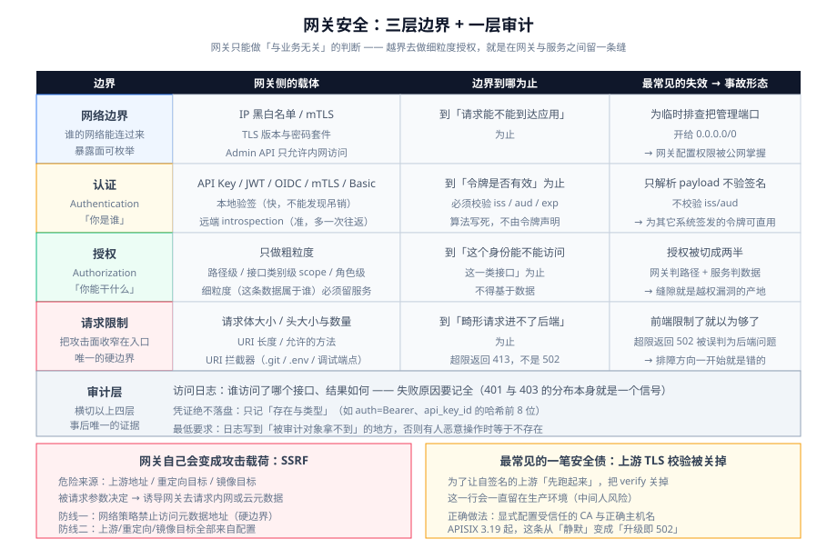

# 网关安全

网关是攻击者的第一个落脚点,也是你**唯一能在请求进入内网之前拦住它**的地方。但网关的安全边界有个反复出现的陷阱：**它只能做「与业务无关」的判断**,一旦越界去做细粒度授权,就会在网关与服务之间留下一条谁也说不清的缝。



## 一、三层边界 + 一层审计

| 层 | 回答 | 网关侧的载体 | 边界在哪 |
| --- | --- | --- | --- |
| **网络边界** | 「谁的网络能连过来」 | IP 黑白名单、mTLS、TLS 版本与密码套件 | 到「请求能不能到达应用」为止 |
| **认证（Authentication）** | 「你是谁」 | API Key、JWT/OIDC、Basic、mTLS 证书 | 到「令牌是否有效」为止 |
| **授权（Authorization）** | 「你能干什么」 | **只做粗粒度**：路径级、scope 级、角色级 | 到「这个身份能不能访问这一类接口」为止 |
| **审计** | 「你干过什么」 | 访问日志 + 安全事件日志（失败原因要记全） | 全链路 |

::: danger 网关鉴权的正确边界：粗粒度留网关,细粒度必须留服务
| 判断 | 放哪 | 依据 |
| --- | --- | --- |
| 有没有令牌 / 令牌是否有效 / 是否白名单路径 | **网关** | 与业务无关 |
| 令牌的 scope 是否覆盖这个**接口类别**（如 `orders:read`） | **网关**（可以） | 仍是接口级,与数据无关 |
| **这个用户能不能删这篇文章** | **服务** | 必须基于数据 |
| 这笔转账金额是否超过该账户的日限额 | **服务** | 必须基于业务状态 |

**越权漏洞最常见的产地,就是「网关按路径放行 + 服务以为网关查过了」。** 两层都要有,且服务层的判断**不得依赖「网关已经检查过」这个假设**。
:::

## 二、令牌校验：本地验签还是远端 introspection

这是网关鉴权最重要的一个取舍。

| 方式 | 机制 | 延迟 | 能发现「已吊销」吗 | 适合 |
| --- | --- | --- | --- | --- |
| **本地验签（JWT）** | 用公钥/密钥本地验证签名与声明 | **极低**（纯计算） | ❌ **不能** | 短有效期令牌（分钟级）、高 QPS |
| **远端 introspection** | 每个请求（或按缓存）调用授权服务器 | **高**（多一次网络往返） | ✅ 能 | 需要即时吊销 |
| **本地验签 + 短 TTL + 撤销名单** | 验签为主,另维护一份小体积撤销名单 | 低 | ✅ 近似 | 大多数生产场景 |

::: danger 三个「用了 JWT 但没验」的写法
1. **只解析 `payload` 不验签名**。把 `alg: none` 或自己伪造的令牌当成合法——**这是最经典的 JWT 漏洞**,网关侧的对应物是「用了只做 decode 的插件」。
2. **不校验 `iss` / `aud` / `exp`**。一个**为其它系统签发的、合法的令牌**,可以直接拿来访问你的接口。这正是 APISIX 3.19.0 把 OIDC introspection 的 `iss` 白名单**变成强制**的原因（见 [APISIX 深入](../APISIX/index.md)）。
3. **接受 `alg` 由令牌自己声明**。攻击者可以把 `RS256` 改成 `HS256` 并用**公钥当 HMAC 密钥**伪造签名。**校验算法必须在网关侧写死,不能由令牌决定。**
:::

::: tip introspection 的缓存必须显式设计
远端 introspection 每个请求打一次授权服务器,会把授权服务器变成新的瓶颈与单点。

做法：**按令牌哈希做短缓存**（例如 30~60 秒）,并明确接受「吊销最多延迟一个缓存周期」。**这个延迟要写进安全说明**,因为它决定了「用户被禁用后多久真正失效」——审计会问这个问题。
:::

## 三、请求限制：把攻击面收窄在入口

网关能给后端的第一个保护,是**不让畸形请求到达后端**。

| 限制项 | 默认值的常见问题 | 建议 |
| --- | --- | --- |
| **请求体大小上限** | 常常很大或没设 | 按接口类型定：JSON 接口 1 MiB、文件上传单独开路由并单独配上限 |
| **请求头大小 / 数量** | 默认值可能过宽 | 收紧;并**限制头数量**（防头注入与慢速攻击） |
| **URI / 查询串长度** | 不设 | 设上限,防超长 URI 触发正则回溯 |
| **超时（connect/read/send）** | 不设会挂住连接 | 必须显式设,且小于客户端超时（见[流量治理](../TrafficManagement/index.md)） |
| **允许的方法** | 全部放行 | 按路由声明允许的方法;`TRACE`/`TRACK` 一律拒绝 |
| **URI 拦截器** | 不配 | 拦截 `.git`、`.env`、备份文件、调试端点等**通用探测路径** |
| **正则 ReDoS 防护** | 自己写的正则不受保护 | 优先用前缀匹配;必须用正则时**限制长度并做回溯测试** |

::: danger 请求体限制的三个连带后果
1. **只在前端限制没用**。前端校验可以绕过,网关的 body 限制是**唯一的硬边界**。
2. **必须区分「内容长度声明」与「实际大小」**。`Content-Length` 可以是伪造的;真正的保护是**在读取时按实际字节数截断**并返回 413。
3. **返回 413 而不是 502**。返回 502 会让排障的人以为是后端问题,浪费大量时间。
:::

## 四、SSRF 与开放重定向：网关自己成为攻击载荷

网关有一个后端服务没有的攻击面：**它接受的配置或请求参数,可能决定它去访问哪个地址**。这就是 SSRF（Server-Side Request Forgery,服务端请求伪造）在网关侧的形态。

| 场景 | 攻击方式 | 防线 |
| --- | --- | --- |
| **动态上游 / 按请求改上游地址** | 攻击者让网关去请求 `169.254.169.254`（云元数据）或内网管理口 | **禁止由请求参数决定上游地址**;若必须,用**白名单**而非黑名单 |
| **重定向插件参数可控** | 攻击者构造 `?next=http://evil` 形成**开放重定向**,用于钓鱼或绕过白名单 | 重定向目标必须**只允许站内路径**（相对路径,或校验 host 属于白名单） |
| **镜像 / 回源类插件** | 镜像目标被改成内网地址 | 镜像目标只能来自配置,不能来自请求 |
| **健康检查路径** | 配置里写了一个能触发副作用的路径（如 `GET /admin/flush`） | 健康检查必须是**幂等的只读端点**,且单独做鉴权豁免而非全局豁免 |

::: danger 云环境里最致命的一个内网地址
`169.254.169.254`（以及各家的等价地址）是云主机的**元数据服务**,上面可能有临时凭证。

**如果网关能被诱导去请求它,攻击者就拿到了你的云身份。** 两道防线一起上：
1. **网关进程所在的网络策略里禁止访问元数据地址**（这是网络层的硬边界,不依赖应用逻辑）。
2. 上游地址、重定向目标、镜像目标**全部来自配置,永不来自请求**。
:::

## 五、密钥与证书

网关是「密钥最集中的地方」——上游凭证、JWT 公钥、TLS 证书、下游服务的 API Key 都在它手里。

| 纪律 | 做法 |
| --- | --- |
| **配置里不出现明文密钥** | 用密钥管理（Vault 等）或注入的环境变量;配置文件进仓库时**必须只有占位符** |
| **TLS 私钥最小权限** | 只有网关进程可读;容器里用只读挂载 |
| **轮转要有流程** | 每次轮转必须**先加新、再删旧**（双密钥并存期）,避免轮转即中断 |
| **公钥与算法写死** | 拒绝由令牌声明算法的场景 |
| **mTLS 的 CA 要独立** | 网关到上游的 mTLS CA,不要与「面向客户端的公网 CA」混用 |
| **审计不给密钥** | 日志、trace、错误响应里**绝不出现密钥与令牌原文**（见[网关可观测](../Observability/index.md)） |

::: danger 「TLS 校验被关掉」是网关最常见的一处安全债
为了让某个自签名的上游「先跑起来」,把上游的 `tls.verify` 或等价开关关掉——**这一行会一直留在生产环境**。

它带来的风险是**中间人**：网关与上游之间的流量可被替换。

**APISIX 3.19.0 把这件事从「静默」变成了「显式」**：`upstream.tls.verify` 现在对 https/grpcs 上游真正生效,原本依赖「校验不生效」的部署会**直接 502**（见 [APISIX 深入](../APISIX/index.md) 第七节）。正确做法不是关校验,而是**显式配置受信任的 CA（`tls.ca_certs`）与正确的主机名（`pass_host` / `upstream_host`）**。
:::

## 六、一份可执行的上线自查

```shell
# 1) Admin / 管理接口不对外（这是网关自身最大风险面）
curl -s -o /dev/null -w '%{http_code}\n' http://<公网IP>:9180/apisix/admin/routes   # 期望：连接被拒 / 超时
curl -s -o /dev/null -w '%{http_code}\n' http://<公网IP>:8001/routes                # Kong 同理

# 2) 未认证请求被拦在网关（后端日志不得出现）
curl -i https://api.example.com/api/v1/orders | head -1     # 期望 401

# 3) 越权请求由服务拒绝（网关放行、服务 403 —— 两层都在）
curl -i -H "Authorization: Bearer $USER_B_TOKEN" \
     -X DELETE https://api.example.com/api/v1/posts/$USER_A_POST | head -1   # 期望 403

# 4) 请求体超限返回 413（而不是 502）
head -c 2000000 /dev/urandom | curl -s -o /dev/null -w '%{http_code}\n' \
     -X POST --data-binary @- https://api.example.com/api/v1/orders           # 期望 413

# 5) 校验 SSL 配置：不友好的 TLS 版本与套件必须被拒
curl -s -o /dev/null -w '%{http_code}\n' --tlsv1.0 https://api.example.com/   # 期望：握手失败
curl -sIL https://api.example.com/ | grep -i 'strict-transport-security'      # 期望：有 HSTS

# 6) 上游 TLS 校验是开着的（不是被关掉的那种"先跑起来"）
#    API/控制面读取 route/upstream 配置，确认 tls.verify 未显式置 false
curl -s http://127.0.0.1:9180/apisix/admin/upstreams -H "X-API-KEY: $K" \
  | jq '.list[] | select(.value.tls.verify == false) | .value.id'
# 期望：无输出

# 7) 凭证不落日志
grep -ciE 'authorization:\s*bearer|password|secret' /var/log/gateway/access.log   # 期望 0
```

## 相关页面

- [概述：网关的四条边界](../Overview/index.md)
- [APISIX 深入](../APISIX/index.md)：Admin API 收紧与 3.19 的安全变更
- [网关可观测](../Observability/index.md)：日志脱敏与凭证保护
- [认证与授权](../../Auth/index.md)：认证协议与权限模型本身
- [前端 · 安全](../../../Frontend/Others/Security/index.md)：浏览器侧边界（CSP、Headers）
- [运维 · 安全加固](../../../Ops/SecurityHardening/index.md)：主机与运行环境加固
- [实战：从零配一个生产级网关](../Practice/index.md)

## 参考资料

- OWASP API Security Top 10：https://owasp.org/API-Security/
- OWASP JWT 安全清单：https://cheatsheetseries.owasp.org/cheatsheets/JSON_Web_Token_for_Java_Cheat_Sheet.html
- OWASP SSRF 防护：https://cheatsheetseries.owasp.org/cheatsheets/Server_Side_Request_Forgery_Prevention_Cheat_Sheet.html
- APISIX 认证插件（key-auth / jwt-auth / openid-connect / mTLS）：https://apisix.apache.org/docs/apisix/plugins/key-auth/
- Kong 认证插件概览：https://docs.konghq.com/hub/#authentication
- RFC 8725（JWT 最佳实践）：https://www.rfc-editor.org/rfc/rfc8725
