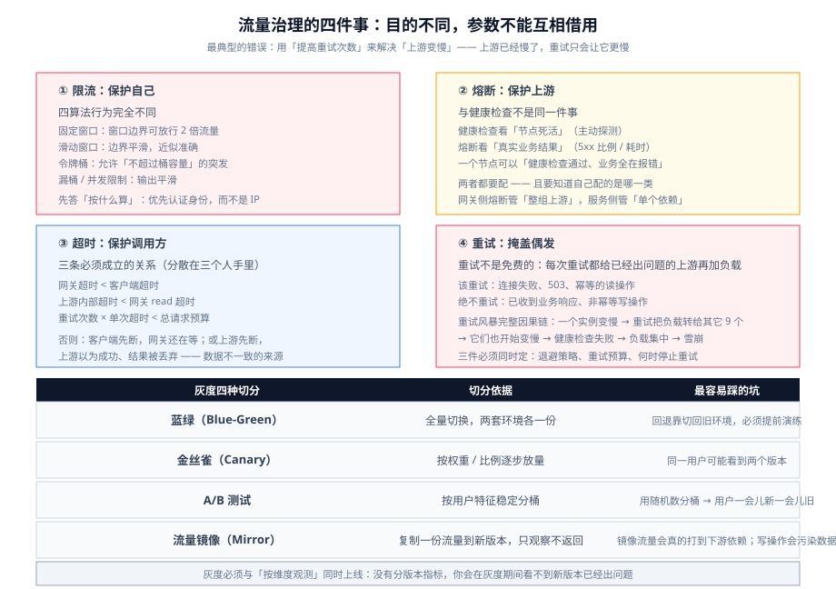

# 流量治理

网关最值钱的能力不是「转发」,而是**在一处对流量做取舍**：谁能进来、进来多少、出了事怎么退、新版本给谁看。这一页把限流、熔断、超时重试、灰度四件事的**取舍依据**讲清楚。



::: tip 先给一条总原则
**限流是「保护自己」,熔断是「保护上游」,超时是「保护调用方」,重试是「掩盖偶发」——四者目的不同,参数不能互相借用。**

最典型的错误：用「提高重试次数」来解决「上游变慢」。上游已经慢了,重试只会让它更慢,并且把你自己的连接池也占满。
:::

## 一、限流：先选算法,再选维度

四类限流器**行为完全不同**,选错会在突发流量下出现你无法解释的现象。

| 算法 | 原理 | 突发行为 | 适合 |
| --- | --- | --- | --- |
| **固定窗口** | 每个窗口独立计数,到点清零 | **窗口边界可放行 2 倍流量** | 成本最低的配额控制 |
| **滑动窗口** | 用多个子窗口近似「过去 N 秒」 | 边界平滑,近似准确 | 对边界敏感的生产限额 |
| **令牌桶** | 按速率补充令牌,桶有容量 | **允许不超过桶容量的突发** | 想「平时限速、允许小突发」的接口 |
| **漏桶 / 并发限制** | 以固定速率流出（超出排队或拒绝）/ 限制在途数量 | 输出平滑 | 保护下游连接池、平滑写放大 |

::: danger 固定窗口的边界效应必须提前算过
两个参数：限 `100 次/分钟`。在 00:59 打 100 次、01:00 再打 100 次,**这一秒通过了 200 次**——两倍的瞬时压力落在后端。

**判据**：如果你的后端在「2 倍瞬时流量」下会出问题,就不要用固定窗口。选滑动窗口,或者用令牌桶把「桶容量」当成显式的突发预算来配置(**桶容量就是你能容忍的突发上限**)。
:::

### 限流的维度（key）就是业务口径

「限多少」之前必须先答「按什么限」。这个选择直接决定配额算在谁头上。

| 维度（key） | 含义 | 用在 |
| --- | --- | --- |
| `remote_addr` | 按来源 IP | 防爬、未登录接口 |
| `consumer_name` / `credential` | 按已认证的调用方 | 按租户/应用分档配额 |
| `http_x_api_key` / `jwt` claim | 按具体凭证或令牌里的字段 | 精细配额 |
| 组合 `vars`（如 `tenant + path`） | 多维复合 | 「每个租户每个接口」各自的额度 |

::: danger 三个「限流不生效」的根因
1. **多副本 + 本地计数**。Kong 的 `policy`、APISIX 的 `policy` 都要显式设成共享存储（Redis）;默认是**本地**。10 个副本限 100 QPS = 实际可能放行 1000 QPS。
2. **共享存储本身成为瓶颈或单点**。Redis 挂了怎么办？**必须显式选「失败开放」还是「失败关闭」**——放行意味着限流失效,拒绝意味着 Redis 一挂全站 429。**这是一个业务决定,不是配置细节。**
3. **`remote_addr` 背后是一整个 NAT 出口**。按 IP 限流时,一个公司出口的几千个用户共用一个桶,表现是「白天正常限流、某个大客户一来别人全被限」。**能拿到认证身份就按身份限,不要按 IP。**
:::

## 二、熔断：网关侧与服务侧是两个不同的熔断器

熔断和限流的区别：**限流是「我主动限制流量」,熔断是「我被动感知到对方不行,暂时不再打它」。**

| | 网关侧熔断 | 服务侧熔断 |
| --- | --- | --- |
| 观测对象 | **整个上游**（这一组节点） | **某一个下游依赖** |
| 粒度 | 粗（一条路由一个上游） | 细（一个方法/一个客户端） |
| 典型触发 | 上游整体 5xx 比例上升、健康检查连续失败 | 下游调用超时率上升 |
| 处置 | 快速失败 / 返回降级响应 / 摘除节点 | 快速失败 / 走 fallback |

::: danger 别把「健康检查」当成「熔断」
两者都能「不再打某个节点」,但**触发条件完全不同**：

- **健康检查**看的是**节点自身死活**（主动探测 `/healthz` 失败、连续超时）。
- **熔断 / 被动健康检查**看的是**真实业务结果**（5xx 比例、响应时间）。

一个节点可以「健康检查通过、但业务全在报错」（比如它连着数据库挂了）。**两者都要配,并且要知道自己配的是哪一类。**
:::

::: tip 熔断最重要的参数不是阈值,是「半开」的探测方式
熔断打开后,必须有**少量请求**去打上游,才能判断它恢复了没有。三个参数要一起调：

- **半开时的放行量**：太多 → 上游还没好就被打崩;太少 → 恢复慢。
- **恢复判定**：是「连续 N 次成功」还是「成功率回升」。
- **冷却时长**：打开后多久进半开。

**判据**：熔断打开、恢复、再打开这三段,必须在演练里各走过一次（见 [`ChaosEngineering`](../../../Ops/ChaosEngineering/index.md)）。只在「打开」这一段验证过,等于没验证。
:::

## 三、超时与重试：一对会互相放大的参数

### 超时预算

网关到上游的每一步都有自己的超时,它们是**相乘**关系,不是相加。

```text
客户端超时（例如 3s）
  └─▶ 网关处理超时（必须 < 客户端超时）
        ├─ connect 超时（连上上游要多快）
        ├─ read 超时（等上游第一个字节）
        ├─ send 超时（把请求体写出去）
        └─ 上游自己的内部超时预算（必须 < 网关的 read 超时）
```

::: danger 三条必须成立的超时关系
1. **网关超时 < 客户端超时**。否则客户端先超时断开,网关还在白等,**连接与资源被浪费在已经没人要的请求上**。
2. **上游内部超时 < 网关 read 超时**。否则网关先切断,上游还在算——**上游以为自己成功了,实际结果被丢掉**,数据不一致的经典来源。
3. **重试 × 单次超时 < 总的请求预算**。否则「3 次重试每个 3 秒」= 客户端等 9 秒,而它 3 秒就断了。

**把这三条写成一个表格,并在上线前逐条核对。** 它们分散在三个不同的人手里（前端、网关、后端),谁都不单独检查。
:::

### 重试

重试不是免费的：**每一次重试都是给已经出问题的上游再加一次负载。**

| 该重试 | 不该重试 |
| --- | --- |
| 连接失败、连接被重置 | **已经收到业务响应**（哪怕 5xx 也别重试非幂等请求） |
| 上游返回 503 / 连接池满 | 4xx（参数错误,重试还是错） |
| 幂等的读操作（GET / 查询） | 非幂等的写操作（POST 下单、支付）——**除非有幂等键** |
| 网络层面的瞬时抖动 | 上游明确的业务失败 |

::: danger 重试风暴（retry storm）的完整因果链
一个上游有 10 个实例,其中一个变慢。

1. 网关按「重试 3 次」把它的慢请求重试给其它 9 个实例;
2. 另外 9 个实例的负载上升 1/3,开始变慢;
3. 健康检查开始失败,更多实例被判定不健康;
4. 负载集中到剩下几个实例,雪崩。

**每加一次重试,都要同时回答三个问题**：用什么退避（指数退避 + 抖动,不要固定间隔）、总预算多少（**重试预算**：例如「重试产生的额外请求不超过正常流量的 10%」）、以及**什么情况下必须不再重试**（熔断打开时）。
:::

## 四、灰度：四种切分方式,判据完全不同

::: tip 先分清四个常被混用的词
| 词 | 切分依据 | 目的 |
| --- | --- | --- |
| **蓝绿（Blue-Green）** | **全量切换**，两套环境各一份 | 一次性换代,回退靠切回旧环境 |
| **金丝雀（Canary）** | 按**权重/比例**逐步放量 | 用小流量验证新版本 |
| **A/B 测试** | 按**用户特征稳定分桶** | 比较两个版本的**业务指标** |
| **流量镜像（Mirror）** | **复制**一份流量到新版本,**只观察不返回** | 零风险验证新版本的处理能力 |
:::

| 切分方式 | 配置位置 | 判据 | 坑 |
| --- | --- | --- | --- |
| **按权重** | 上游节点权重 / Gateway API `backendRefs[].weight` | 比例是否稳定,样本量够不够 | 权重是**每节点**的,加节点会改变实际比例;会话内的请求可能被切到不同版本 |
| **按 Header** | 路由 `vars` / 匹配条件 | 灰度用户是否**始终**看到新版本 | 前端忘了透传灰度头,导致「灰度不生效」 |
| **按用户分桶** | 对用户 ID 做**一致性哈希** | 同一用户始终在同一桶 | 用随机数分桶 → 同一用户一会儿新一会儿旧 |
| **流量镜像** | 镜像插件 | 影子版本的处理结果与线上对比 | **镜像流量会真的打到下游依赖**;写操作镜像会污染数据 |

::: danger 灰度的三个「看起来没问题」的致命写法
1. **只按权重、不按用户**。用户 A 刷新三次,可能看到三个版本的界面——**对用户来说这就是一个 bug**,不是灰度。
2. **灰度没配「按维度观测」**。灰度能否继续,取决于**新版本的错误率与延迟**是否可分别观测。如果指标只按「整个上游」聚合,你**看不到新版本出了问题**——它会淹没在总量里。
3. **没有回退动作**。回退必须是一条命令或一次配置回滚,**在灰度开始之前就写好并演练过**。上线时现想回退方案,等于没有回退方案。
:::

::: tip 灰度的判据：看这四个数
- **新版本的错误率**（与旧版本**分别**统计）——这是唯一能回答「新版本行不行」的数。
- **新版本的 p99 延迟**——均值会掩盖长尾。
- **「灰度中用户」的会话一致性**——同一用户是否稳定在同一个版本。
- **回退耗时**——从决定回退到生效,实际用了多久。

配好这四个,**灰度才是一个可运营的动作**,而不是一次赌博。
:::

## 五、一份可执行的验证

```yaml [灰度 + 限流 + 超时的最小组合（APISIX 风格）]
routes:
  - uri: /api/v1/orders
    name: orders-canary
    priority: 200                     # 具体路由优先级高于稳定路由
    vars: [["http_x_canary", "==", "1"]]   # ① 按 Header 切流：显式可控、可回退
    plugins:
      limit-count:                    # ② 限流：维度是认证身份，不是 IP
        count: 600
        time_window: 60
        key: consumer_name
        policy: redis                 #    多副本必须共享
        redis_host: redis.internal
        rejected_code: 429
    timeout:
      connect: 0.5                    # ③ 超时必须显式，且 网关 < 客户端
      send: 1
      read: 2
    upstream:
      type: roundrobin
      nodes:
        "orders-canary.internal:8080": 100
  - uri: /api/v1/orders
    name: orders-stable
    priority: 100
    upstream:
      type: roundrobin
      nodes:
        "orders.internal:8080": 100
```

```shell
# 1) 灰度切流是否稳定（同一用户可以重复命中同一版本）
for i in 1 2 3; do curl -s -o /dev/null -w '%{http_code} ' -H 'X-Canary: 1' http://127.0.0.1:9080/api/v1/orders; done; echo

# 2) 限流维度是否正确（换身份应重新计数）
for i in $(seq 1 30); do curl -s -o /dev/null -w '%{http_code} ' -H "X-Api-Key: $K1" http://127.0.0.1:9080/api/v1/orders; done; echo
# 期望：配额内 200、超出 429；换成 K2 后重新从 200 开始

# 3) 超时是否真的生效（用一个故意慢的上游验证）
time curl -s -o /dev/null http://127.0.0.1:9080/api/v1/slow
# 期望：耗时贴近你配的 read 超时，而不是客户端自己的超时

# 4) 灰度能否一分钟回退（把 canary 路由 priority 置 0 或删掉，再验证）
curl -s -o /dev/null -w '%{http_code}\n' -H 'X-Canary: 1' http://127.0.0.1:9080/api/v1/orders
# 期望：回退后该请求落到 stable（用响应里的版本标识确认）
```

## 相关页面

- [概述：网关的四条边界](../Overview/index.md)
- [Kong 深入](../Kong/index.md)｜[APISIX 深入](../APISIX/index.md)：限流插件的具体参数
- [插件开发](../Plugin/index.md)：自定义负载均衡与灰度逻辑写在哪
- [网关可观测](../Observability/index.md)：灰度与限流的观测口径
- [微服务 · 负载均衡](../../Microservices/LoadBalance/index.md)｜[微服务 · 熔断](../../Microservices/CircuitBreaker/index.md)：算法与状态机原理
- [工具 · CI/CD · 部署与回滚](../../../Tools/CICD/DeployRollback/index.md)：灰度发布的流程侧
- [实战：从零配一个生产级网关](../Practice/index.md)

## 参考资料

- APISIX 限流插件（limit-count / limit-req / limit-conn）：https://apisix.apache.org/docs/apisix/plugins/limit-count/
- APISIX 流量分割与灰度：https://apisix.apache.org/docs/apisix/tutorials/traffic-split/
- Kong Rate Limiting 插件：https://docs.konghq.com/hub/kong-inc/rate-limiting/
- Kubernetes Gateway API 流量切分（`backendRefs[].weight`）：https://gateway-api.sigs.k8s.io/
- 超时与重试的预算关系（Google SRE Book：Handling Overload）：https://sre.google/sre-book/handling-overload/
