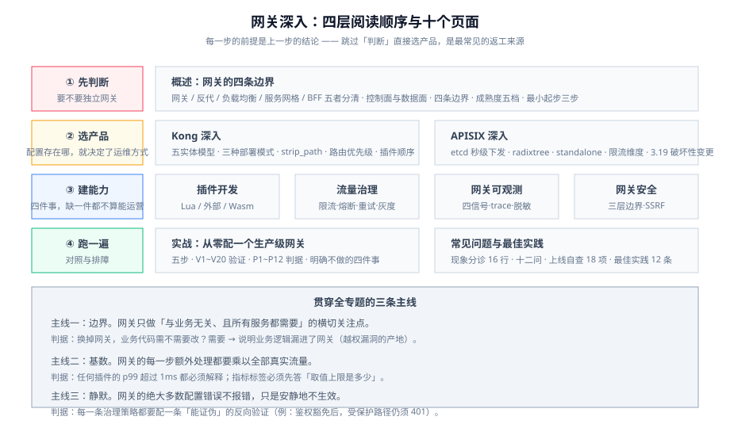

# 网关深入

所有请求的第一跳都落在同一个进程里。这件事有两面：它让「一次改对所有服务」成为可能,也让「一次搞挂所有服务」成为可能。**网关的全部设计取舍,都来自这两句话的拉扯。**

本专题讲的是**网关这个进程本身**：它怎么被配置、怎么被扩展、怎么把流量拆开、怎么把故障挡住、怎么把问题看清楚。它不讲「网关是什么」——那是概念课；它讲**装上去之后会遇到的每一个具体决定**。

::: tip 一句话理解
网关不是「加一层转发」,而是**把横切关注点从 N 个服务里搬到一个进程里**。搬过来之后,你要为「搬过来的东西能不能在 100ms 内做完」负责——**网关的每一步额外处理,都会乘以你全部的真实流量**。
:::

## 与相邻专题的分工

本专题最容易和四处重复：**微服务里的网关概念页**、**Spring Cloud Gateway 的框架页**、**Nginx 的反向代理**、**服务网格的东西向治理**。下表把边界一次写死。

| 专题 | 讲什么 | 与本专题的关系 |
| --- | --- | --- |
| 本专题 | **网关进程的落地**：Kong / APISIX 的配置模型、插件开发、流量治理、网关侧可观测与安全、实战判据 | —— |
| [微服务 · API 网关](../Microservices/Gateway/index.md) | 网关的**概念与职责清单**（为什么需要、有哪几件功能、主流产品一览） | 那边回答「**要不要一个统一入口**」；本专题回答「**入口定了之后,每一条路由、每一个插件怎么写、怎么写错会怎样**」 |
| [Spring Cloud · 网关](../SpringCloud/Gateway/index.md) | **Spring Cloud Gateway** 的路由谓词、过滤器、与注册中心联动 | 那是**JVM 生态内的一个网关实现**（配置是 Spring 的 Bean 与 YAML）；本专题讲**独立部署的网关进程**（Kong / APISIX,配置是控制面 API 与插件）。两者的**判据可以互相借用,配置写法不能互相搬运** |
| [响应式编程](../ReactiveProgramming/index.md) | Reactor、背压、WebFlux 线程模型 | Spring Cloud Gateway 建在响应式之上,**先懂那边才看得懂它的线程与背压**；本专题的 Kong / APISIX 建在 Nginx/OpenResty 的事件循环上,是**另一套并发模型**(见[插件开发](./Plugin/index.md)里的「不要阻塞事件循环」) |
| [微服务 · 负载均衡](../Microservices/LoadBalance/index.md) | 四层/七层负载均衡、一致性哈希、健康检查 | 那边讲**算法与原理**；本专题讲**这些算法在网关配置里怎么选、健康检查阈值怎么定、上游摘除要多久** |
| [微服务 · 熔断](../Microservices/CircuitBreaker/index.md) | 熔断状态机、半开、隔离 | 那边讲**熔断器的模型**；本专题讲**网关侧熔断与服务侧熔断的分工**——网关照「这个上游整体不行了」,服务侧照「这个下游依赖不行了」,一个熔断器解决不了两层 |
| [微服务 · 注册中心](../Microservices/Registry/index.md) | 服务注册发现、健康探测 | 网关的「上游」可以从注册中心动态拉,也可以静态写死。**动态上游是能力,不是默认**——本专题的[流量治理](./TrafficManagement/index.md)会说明什么时候动态上游会咬人 |
| [认证与授权](../Auth/index.md) | 认证协议、令牌、权限模型 | 那边讲**身份本身怎么算出来**;本专题讲**网关这里核什么、不核什么**,以及「网关鉴权 + 服务鉴权」为什么必须两层(见[网关安全](./Security/index.md)) |
| [运维 · Nginx](../../Ops/Nginx/index.md) | Nginx 反向代理、upstream、reload | 两者都基于 Nginx 系,但**所有权不同**：Nginx 是你自己写配置、自己 `reload` 的进程；Kong/APISIX 是**带控制面与插件运行时的产品**,配置从 API 进、由网关自己热生效 |
| [运维 · 容器编排 · 服务网格](../../Ops/ContainerOrchestration/ServiceMesh/index.md) | 控制面/数据面、mTLS、东西向流量治理 | 网格治理的是**服务之间的东西向流量**,本专题治理的是**客户端进来的南北向流量**。两者可以并存,但**不要指望用网关去解服务间治理,也不要用网格去解外部 API 治理** |
| [接口设计与治理 · 网关对接](../../Tools/APIDesign/Gateway/index.md) | 契约与网关配置的同源、漂移点校验 | 那边讲「**契约怎么流向网关**」;本专题讲「**网关自己那一堆配置怎么组织、怎么验证没被改坏**」 |
| [运维 · 监控告警](../../Ops/Monitoring/index.md) | 指标/日志/告警方法论 | 那边是**通用监控方法论**;本专题的[网关可观测](./Observability/index.md)只补**网关这一跳专属的四个信号**(路由命中、上游延迟、插件耗时、4xx/5xx 归因) |
| [工具 · CI/CD · 部署与回滚](../../Tools/CICD/DeployRollback/index.md) | 发布策略、回滚、灰度流程 | 灰度发布的**流程**在那边;本专题讲**网关侧的灰度能力怎么配**(权重、Header、用户分桶),以及「灰度配错了怎么一分钟回退」 |

## 按环节找页面

不确定从哪页读起时,按自己卡住的环节对号入座：

| 环节 | 典型问题 | 去哪看 |
| --- | --- | --- |
| **整体判断** | 「我到底需不需要独立网关?」「和 Nginx 有什么区别?」 | [概述](./Overview/index.md) |
| **选产品** | Kong 和 APISIX 怎么选?控制面怎么摆? | [概述](./Overview/index.md) → [Kong](./Kong/index.md) / [APISIX](./APISIX/index.md) |
| **改配置** | 路由怎么写?为什么加了路由但 404? | [Kong](./Kong/index.md)（声明式与 DB-less）/ [APISIX](./APISIX/index.md)（etcd 与 Admin API） |
| **写扩展** | 内置插件不够用;要接自己的鉴权/计费 | [插件开发](./Plugin/index.md) |
| **流量治理** | 限流为什么忽紧忽松?灰度怎么切?重试为什么放大故障? | [流量治理](./TrafficManagement/index.md) |
| **排障** | 出问题但不知道是哪一跳;trace 断在网关 | [网关可观测](./Observability/index.md) |
| **安全** | 网关鉴权做到哪一层?会不会变成 SSRF 跳板? | [网关安全](./Security/index.md) |
| **动手做一遍** | 想有一个能本地跑起来、能验收的最小网关 | [实战](./Practice/index.md) |
| **查现象** | 具体现象 → 原因 → 处置 | [常见问题与最佳实践](./FAQ/index.md) |

## 专题地图（页面清单）

| 页面 | 内容 | 适合谁读 |
| --- | --- | --- |
| [概述：网关的四条边界](./Overview/index.md) | 概念澄清（网关 vs 反向代理 vs 网格 vs BFF）、控制面/数据面、四条边界、成熟度五档 | 所有人,先读 |
| [Kong 深入](./Kong/index.md) | 实体模型（Service/Route/Upstream/Consumer）、DB-less 与声明式、插件执行顺序、Hybrid 模式 | 选 Kong 或正在用 Kong 的人 |
| [APISIX 深入](./APISIX/index.md) | etcd 数据面、Route/Service/Upstream/Plugin、radixtree 路由、热更新、standalone 模式 | 选 APISIX 或正在用 APISIX 的人 |
| [插件开发](./Plugin/index.md) | 三条扩展路线（原生 Lua / 外部插件 / Wasm）、执行阶段、优先级、可观测性插件 | 要写自定义逻辑的人,**重点读** |
| [流量治理](./TrafficManagement/index.md) | 限流四算法、熔断、重试与超时预算、灰度四种切分、流量镜像 | 定策略的人,**重点读** |
| [网关可观测](./Observability/index.md) | 四个专属信号、访问日志字段、`traceparent` 透传、采样、日志脱敏 | 要排障与值守的人 |
| [网关安全](./Security/index.md) | 三层鉴权边界、令牌校验位置、请求体与大小限制、SSRF 与开放重定向、密钥管理 | 做安全评审的人 |
| [实战：从零配一个生产级网关](./Practice/index.md) | 路由 + 鉴权 + 限流 + 灰度 + 观测 + 回滚,含 P1~P12 验收判据 | 想看完整落地的人 |
| [常见问题与最佳实践](./FAQ/index.md) | 分诊表、十二问、上线自查清单、术语表 | 所有人 |

## 事实与规格速览（2026-10 口径）

按各官方文档与项目仓库核对（检索日 **2026-10-13**）。**这张表是给你一个「当前时间点」的锚,不是选型结论**——网关是大版本迭代较慢、但安全补丁很密的一类产品。

| 对象 | 当前状态 | 需要记住的一句话 |
| --- | --- | --- |
| **Apache APISIX** | **3.19.0**（2026-09-28）,Apache-2.0 | 3.19.0 带**三处破坏性变更**：HTTPS/gRPCS 上游证书校验**开始真正生效**（`upstream.tls.verify`）、OIDC introspection 强制校验 `iss` 白名单、`batch-requests` 默认加了响应体上限（单项 1 MiB / 整包 10 MiB）——**升级前必须在预发验证这三条** |
| APISIX 近期能力 | 3.18.0（2026-08-20）`limit-count` 支持 Sentinel 与滑动窗口；3.19.0 新增原生 **WebSocket 帧处理**、stream 路由 **TLS passthrough**、`openapi-to-mcp`、上游**慢启动**、GraphQL 查询代价限流 | 「限流」这一件事在 APISIX 里有**多种实现**,算法不同、行为不同(见[流量治理](./TrafficManagement/index.md)) |
| **Kong Gateway OSS** | **3.9.4**（2026-10-12）,Apache-2.0 | OSS 主线停在 **3.9.x**（最后一个 OSS minor 是 2024-12 的 3.9.0,此后只在 3.9 线上打补丁）。3.9.4 修的是 **hybrid 模式集群 RPC 的 SQL 注入（CVE-2026-1907）**——**这是必升项** |
| Kong 镜像与包 | 截至 2026-10-13,Docker Hub 官方 `kong` 镜像的 `latest` **仍指向 3.9.3**（标签 10-02 刷新过）,`3.9.4` 标签在 Hub API 上返回 404;3.9.4 的 Debian 包在 `packages.konghq.com` 可取 | **不要用 `latest` 拉生产镜像**。固定到明确版本号,并核对「你拉到的镜像」与「你打算部署的版本」是不是同一个——**这条已经被真实踩过** |
| **Kong Gateway Enterprise** | 3.16.0.0（2026-09-15）;LTS 线为 **3.14 LTS**（2026-04-07 首发,支持到 **2029-04-07**）;**3.4.x 已于 2026-08-31 EOL** | 企业版与 OSS 的差距不只是「更多插件」：3.15 起有 **Plugin Streaming**（自定义插件从控制面直接下发,不用重打包重启）、3.16 起有 **CEL 驱动的插件配置字段** 与 **Entitlement Enforcement**。**做选型时先确认你要的功能在 OSS 里有没有** |
| Kong 合规相关 | 3.16 起提供独立的 **FIPS 140-3 构建**（`-fips-140-3` 后缀包,仅 AMD64）。Kong 明确说明**产品本身未经 NIST 实验室验证**,被验证的密码模块是 **OpenSSL FIPS Provider 3.1.2** | **从 FIPS 140-2 换到 140-3 不是原地升级**,需要重新安装并评估密码套件兼容性 |
| **Kubernetes Gateway API** | **v1.4**（主线,GA 之后持续演进） | 角色分离是它和 `Ingress` 的**根本差别**：`GatewayClass` 归平台方、`Gateway` 归集群运维、`HTTPRoute` 等归业务方。**灰度权重是标准字段（`backendRefs[].weight`）,不再是各家注解** |
| **Envoy Gateway** | **v1.8**（Gateway API v1.5.1,Envoy 1.38;v1.7 EOL 2026-08-05） | 只用**入口**且不需要东西向 mTLS 时它最省运维;**要服务间 mTLS 就用网格,Istio 1.30 是当前主线** |
| **kgateway** | 2.4.x（2026-07-23）,Gateway API 1.32–1.36 | Envoy 系在 Kubernetes 上的另一条实现线。**同一张 Gateway API 在不同实现上的数据面行为差异很大**,换实现要重测而不是重配 |
| **Traefik Proxy** | v3.7.14（2026-10-06,MIT）;v2.11.58 仍在打安全补丁 | 只需要「TLS 终止 + BasicAuth/ForwardAuth + RateLimit」时,**Traefik 可能就够了**——多引进一个网关就是多一个必须跟着升级的组件 |

::: danger 三个最容易踩的事实性错误
1. **用 `latest` 标签拉网关镜像**。网关是**长时间运行的常驻进程**,`latest` 会在某个没人注意的深夜被 `docker pull` 换成另一个版本。正确做法：固定到**完整版本号 + 摘要**;升级是**一次显式动作**,而不是一次「重启就好了」。上面 Kong 3.9.3/3.9.4 的镜像错位就是一个活生生的例子。
2. **把「小版本升级」当成「没有破坏性」**。APISIX 3.19.0 的 `upstream.tls.verify` 从「只对 kafka 生效」变成「对 https/grpcs 生效」——**原本能连通的私有 CA 上游会突然 502**。网关升级的破坏性常常藏在「某个字段的作用域被扩大了」这类地方,**升级前必须读 release notes 的 Breaking Changes 段**,而不是看版本号。
3. **以为「开源网关 = 可以随便改源码」**。Kong OSS 与 Enterprise、APISIX 与各语言 Plugin Runner 的**版本是各自独立的**（例如 APISIX 3.19 配套的 Java Plugin Runner 仍是 0.4.0 / 2022 年）。升级主程序时,**必须同时核对每个 sidecar 运行时的兼容性**,否则会出现「网关升了、插件 runner 崩了」。
:::

## 关于版本组织

本专题**不建大版本目录**。原因：网关的破坏性变化来自**安全补丁与「字段作用域」的静默扩大**,而不是「框架换代」这类能清晰画线的边界;Kong OSS 主线多年停在 3.9.x、企业版按 `3.x.y.z` 滚动,APISIX 按 `3.x` 小版本滚动,**没有哪一条是「旧版本文档应当整目录存档」的界线**。

处理方式与 [`CloudArchitecture`](../../Ops/CloudArchitecture/index.md)、[`SpeechAudioAI`](../../AI/SpeechAudioAI/index.md) 一致：在页内用 `::: info` / `::: danger` 标注**生效时点与旧口径**,需要对比时并列写,**旧口径不删除**。

需要看「按大版本建目录」的范例,可参考 [Spring5 / Spring6](../Java/Frame/Spring/Spring6/index.md)、[Vue2 / Vue3](../../Frontend/Frame/Vue/index.md),以及 Spring Boot 的 [v2](../Java/Frame/SpringBoot/v2/index.md) / [v3](../Java/Frame/SpringBoot/v3/index.md) / [v4](../Java/Frame/SpringBoot/v4/index.md)——那边的规则是「**旧版本目录保留、页内标注维护状态、新内容只面向最新稳定版**」（2026-10 口径）。

## 成熟度自评：你在哪一档

网关的成熟度**不看用了哪个产品**,只看一件事：**改一条路由,需要多久、需要几个人、出错了多久能发现。**

| 档位 | 特征 | 下一步 |
| --- | --- | --- |
| L0 手写转发 | 直接改 Nginx 配置 + 手工 `reload`;没人知道现在生效的配置是什么 | 先把配置**纳入版本控制**并加上「改完必须过校验」这道门 |
| L1 可管 | 配置进仓库、有校验;路由与上游集中管理 | 补**鉴权与限流**——横切逻辑集中到网关才有意义,否则网关只是「一个更远的反代」 |
| L2 可灰度 | 支持按权重/Header 切流;能一分钟回退 | 补[四个专属信号](./Observability/index.md)：没有「路由命中率」与「上游延迟」,灰度就是盲发 |
| L3 可观测 | 访问日志字段齐全、`traceparent` 能透传、插件耗时可量化 | 补**插件耗时预算**——网关的每一次扩展都在给全部流量加税(见[插件开发](./Plugin/index.md)) |
| L4 可运营 | 配置变更走评审、灰度有指标闸门、升级有预发验证清单、密钥有轮转 | 保持,并把「网关变更」纳入故障应急的值班与演练范围 |

## 学习路径

1. **先读[概述](./Overview/index.md)**：先确认你要的是「网关」而不是「反代」「网格」或「BFF」——**这一步能省掉一半的无用功**。
2. **选一条产品线精读**：[Kong](./Kong/index.md) 或 [APISIX](./APISIX/index.md)。**两边都读反而容易混**,建议先吃透一个,再用另一页当对照表。
3. **读[插件开发](./Plugin/index.md)**：决定你的自定义逻辑走哪条扩展路线——**这是一个很难回头的决定**（Lua 改不动了再换 Wasm,等于重写）。
4. **读[流量治理](./TrafficManagement/index.md)**：限流、熔断、灰度、重试,这四件事的默认值几乎都**不适配生产**。
5. **读[网关可观测](./Observability/index.md) 与 [网关安全](./Security/index.md)**：一个决定你能不能排障,一个决定你会不会变成攻击入口。
6. **对照[实战](./Practice/index.md)完整走一遍**,最后通读[常见问题](./FAQ/index.md)收尾。

## 与「边缘计算与 CDN」的分工

网关与边缘都在处理南北向流量，位置却完全不同：

- **网关**在你自己的机房 / 集群里，管的是「**已经进入你的网络之后**」的南北向：路由、鉴权、灰度、限流、协议转换。
- **边缘**在你的机房之外，管的是「**还没进你的网络之前**」的南北向：就近接入、缓存、基础攻击防护、边缘改写。

两者是**串联**的：请求先过边缘、再进网关。由此产生一条很实用的分工判据：

| 要解决的问题 | 放哪一层 |
| --- | --- |
| 让请求少走一段路、少回源 | 边缘（见 [缓存策略](../../Ops/EdgeCDN/CacheStrategy/index.md)） |
| 挡掉明显的恶意流量，别让它进机房 | 边缘（见 [边缘安全](../../Ops/EdgeCDN/Security/index.md)） |
| 按业务身份做鉴权与灰度 | 网关——边缘看不到你的用户体系 |
| 用插件做协议转换、字段改写 | 网关——边缘的运行时限制更硬 |

::: warning 判据可互借，配置不可互搬
「先限流还是先鉴权」这类顺序问题，两层的判断逻辑是相通的；但插件语法、配置格式、生效方式完全不同。把网关插件直接搬到边缘函数上，最常见的后果是**超 CPU 预算**（见 [边缘计算](../../Ops/EdgeCDN/EdgeCompute/index.md) 的三类失败代码）。
:::

## 参考资料

- Apache APISIX 官网与文档：https://apisix.apache.org/ ｜ https://apisix.apache.org/docs/apisix/getting-started/
- Apache APISIX 下载与版本：https://apisix.apache.org/downloads/
- Kong Gateway 文档：https://docs.konghq.com/gateway/latest/
- Kong Gateway 版本支持策略：https://docs.konghq.com/gateway/latest/install-and-run/macos/
- Kubernetes Gateway API：https://gateway-api.sigs.k8s.io/
- Envoy Gateway 兼容性矩阵：https://gateway.envoyproxy.io/news/releases/matrix/
- Traefik Proxy 文档：https://doc.traefik.io/traefik/
- OpenResty 官方文档：https://openresty.org/en/
- Proxy-Wasm 规范：https://github.com/proxy-wasm/spec
