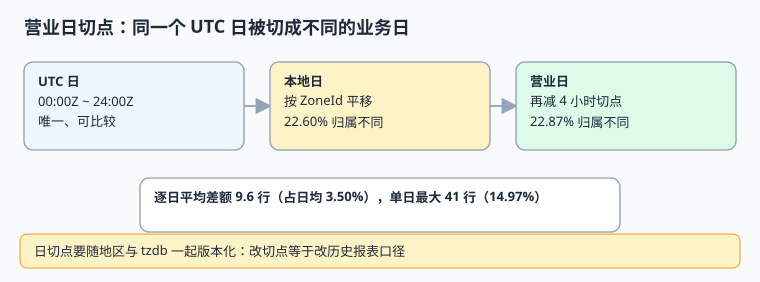

# 营业日与日切：同一天不是同一个日期

「今天」在报表里不是一个自然事实，而是业务定义：从哪个时刻切、按哪个地区的钟、遇节假日怎么顺延。本页把日切写成半开区间与可版本化配置，并给出跨日切、跨 DST 的实测账。

本页判据族 `GCD-A` ~ `GCD-H`，共 8 条。



## 一、三种「日期」，三种用途

| 名称 | 定义 | 谁在用 | 能否做报表主键 |
| --- | --- | --- | --- |
| UTC 日 | `occurred_at_utc` 的 UTC 日期 | 存储、跨系统对账 | 可以，但不是业务口径 |
| 本地日 | 按 `zone_id` 换算后的日历日 | 用户看「我哪天下的单」 | 不建议 |
| 营业日 `biz_date` | 按地区日切点与日历归属的日期 | 日报、结算、SLA、对账 | **是，且必须落库** |

日切点（cutoff）通常不是零点：零售常用本地 04:00（让夜班归前一日），航司与酒店各有自己的切点，跨区连锁还允许每个地区不同。于是同一笔订单在三个口径下可能落进三个日期——这**不是错误**，只是没有把口径写进字段。

::: info 与相邻专题的分工
[离线数仓与任务调度](../../BatchPipeline/index.md) 讲「调度日 / 数据日 / 分区日」三个日期与分区就绪；本页讲的是**业务归属日怎么从瞬时派生**，两者是同一条原则在不同层的应用。[订阅计费周期](../../SubscriptionBilling/Cycle/index.md) 讲账期规则本身，本页只负责把「属于哪一天」算对。[预约档期模型](../../AppointmentBooking/SlotModel/index.md) 的半开区间写法，在这里同样适用。
:::

## 二、半开区间与四个必查项

营业日应写成 `[cutoff_local(t), cutoff_local(t+1))`，右开左闭，且**两端都按同一个 `ZoneId` 计算**。四个必查项：

1. **切点落在 DST 间隙怎么办**：本地 02:00~03:00 可能不存在。要么把切点挪到不冲突的时刻（如 04:00），要么明确「按 UTC 偏移外推」并写成配置版本。
2. **切点落在 DST 折叠怎么办**：一天有 25 小时，切点前后的区间长度是 25 小时或 23 小时，用 `+24h` 硬算必错。
3. **节假日与顺延**：日历要独立成表，不能塞进 `if` 分支。
4. **口径变更**：改切点等于改历史报表，必须落 `cutoff_version` 并提供重算入口，旧口径的报表要能重跑出来。

```sql [V2__business_day.sql]
CREATE TABLE cutoff_config (
  region         TEXT NOT NULL,
  cutoff_local   TEXT NOT NULL,          -- '04:00'
  effective_from DATE NOT NULL,
  version        TEXT NOT NULL,
  zone_id        TEXT NOT NULL,          -- 用 IANA 名称，不用偏移
  PRIMARY KEY (region, version)
);

CREATE TABLE calendar_day (
  region    TEXT NOT NULL,
  biz_date  DATE NOT NULL,
  starts_utc TIMESTAMPTZ NOT NULL,
  ends_utc   TIMESTAMPTZ NOT NULL,
  hours     NUMERIC(4,1) NOT NULL,      -- DST 日可能是 23.0 / 25.0
  PRIMARY KEY (region, biz_date),
  CHECK (ends_utc > starts_utc)
);
```

`hours` 这一列是刻意的：**25 小时与 23 小时的日子必须能被查出来**，否则「日均」类指标会在 DST 切换周莫名波动。

## 三、可运行示例：按地区算营业日

```python [/tmp/bizday.py]
from datetime import datetime, timezone, timedelta, time
from zoneinfo import ZoneInfo


def business_day(instant, zone_id, cutoff_hour=4):
    z = ZoneInfo(zone_id)
    local = instant.astimezone(z)
    cut = time(hour=cutoff_hour)
    if local.timetz().replace(tzinfo=None) >= cut:
        return local.date()
    return (local - timedelta(days=1)).date()


cases = [
    (datetime(2026, 11, 1, 5, 30, tzinfo=timezone.utc), "America/New_York"),
    (datetime(2026, 11, 1, 5, 30, tzinfo=timezone.utc), "Asia/Shanghai"),
    (datetime(2026, 11, 1, 20, 0, tzinfo=timezone.utc), "America/New_York"),
]
for u, z in cases:
    print(z, u.isoformat(), "->", business_day(u, z))
```

预期输出：

```text
America/New_York 2026-11-01T05:30:00+00:00 -> 2026-10-31
Asia/Shanghai 2026-11-01T05:30:00+00:00 -> 2026-11-01
America/New_York 2026-11-01T20:00:00+00:00 -> 2026-11-01
```

> 生产实现必须按 `calendar_day.starts_utc / ends_utc` 查表归属，上面的函数只是把语义讲清楚：它用「减一天」代替了「按切点区间查找」，在折叠日会漏掉 25 小时中的一段，不能直接用在线上。

## 四、本机读数

模拟 10 万笔全年均匀分布订单，用户按 `UTC+8 / +9 / +1 / 0 / -5 / -8` 等偏移分布：

| 读数 | 值 |
| --- | --- |
| UTC 日与本地日归属不同 | **22.60%**（22,601 / 100,000） |
| UTC 日与营业日（本地 04:00 切）归属不同 | **22.87%**（22,871 / 100,000） |
| 全年日均订单量 | 273.9 行 |
| 逐日平均差额 | 9.6 行（占日均 **3.50%**） |
| 单日最大差额 | 41 行（2026-02-03，占日均 **14.97%**） |

日均 3.50% 看起来不大，但**单日能到 14.97%**：对账通常按单日做，撞上这一天就会被当成「丢单」查一整天。

## 五、判据 `GCD-A` ~ `GCD-H`

| 编号 | 判据 | 不满足时改哪里 | 验证方式 |
| --- | --- | --- | --- |
| `GCD-A` | 营业日按半开区间 `[starts_utc, ends_utc)` 查表归属 | 写入逻辑 | 边界时刻各写一笔，归属不重不漏 |
| `GCD-B` | `calendar_day` 主键 `(region, biz_date)` 且带 `hours` | DDL | 重复插入被拒；DST 日 `hours` 为 23.0 / 25.0 |
| `GCD-C` | 切点配置带 `version` 与 `effective_from` | 配置表 | 改切点后旧口径报表可重跑 |
| `GCD-D` | 区间两端按同一 `zone_id` 计算，不用 `+24h` 硬算 | 日历生成任务 | 折叠日区间长度 25 小时 |
| `GCD-E` | 节假日与顺延独立成日历表 | 日历数据 | 用例含节假日顺延 |
| `GCD-F` | `biz_date` 落库并建 `(residency_zone, biz_date)` 索引 | 表结构 | `EXPLAIN` 命中索引 |
| `GCD-G` | 报表查询只读 `biz_date`，不读会话时区派生 | SQL 审查 | 改会话 `TimeZone` 后报表不变 |
| `GCD-H` | 用例覆盖切点前后、DST 两日、跨年边界 | 测试矩阵 | 四类边界断言全绿 |

## 六、易错点与最佳实践

::: danger 五个坑
1. **`DATE(created_at)` 直接出日报。** 会话时区一改，整张报表平移一天。
2. **用 `start + 24h` 算次日区间。** DST 切换日是 23 或 25 小时，会漏单或重复。
3. **切点写死在代码常量里。** 改一次日切要发版，且历史口径无法复现。
4. **切点选在 02:00~03:00。** 该时段在间隙日不存在，配置必须避开或显式定义外推策略。
5. **多地区共用一个切点配置表却不带 `region`。** 主键冲突会静默覆盖某个地区的口径。
:::

::: tip 建议
把 `calendar_day` 当成**一张可审计的维表**来维护：每天生成、可重算、可 diff。它同时服务报表、结算、SLA 与对账，比在四个服务里各写一遍 `if (hour < 4)` 便宜得多。
:::

## 七、验证方式

```shell
cd /tmp && python3 bizday.py
```

预期第一行 `-> 2026-10-31`。再在自建库里执行：

```sql
SELECT region, biz_date, hours FROM calendar_day
WHERE hours <> 24.0 ORDER BY biz_date;
-- 期望：DST 切换的两天，hours 分别为 23.0 与 25.0
```

## 参考资料

- [IANA Time Zone Database Releases](https://recursive.iana.org/time-zones/releases)
- [PostgreSQL: Date/Time Functions（AT TIME ZONE）](https://www.postgresql.org/docs/current/functions-datetime.html)
- [ISO 8601-1:2019](https://www.iso.org/standard/70907.html)
- [Java `java.time` 的 Duration 与 Period 差别](https://docs.oracle.com/en/java/javase/25/docs/api/java.base/java/time/Period.html)
