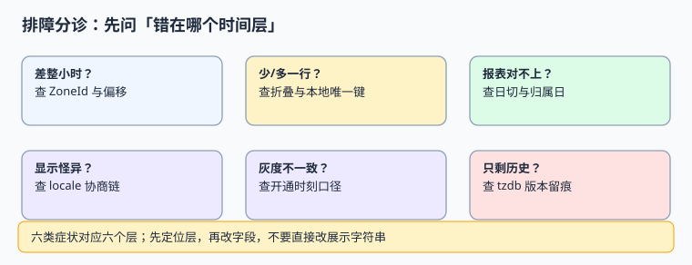

# 常见问题与分诊

跨区时间问题的排查难点在于「症状与层不对应」：差一小时可能是字段问题，也可能是 tzdb 版本问题；少一行可能是唯一键，也可能是日切。本页给一棵先定位层、再改字段的分诊树，附十二问与上线自查表。

本页判据族 `GFQ-A` ~ `GFQ-H`，共 8 条。



## 一、六类症状的分诊树

| 症状 | 先查哪一层 | 具体检查 | 常见根因 |
| --- | --- | --- | --- |
| 时间差整小时 | 时区层 | `zone_id` 是不是固定偏移 | 存了 `+08:00`；tzdb 未升级 |
| 少一行 / 多一行 | 折叠层 | 本地时间有没有做唯一键 | 折叠日 01:30 被吞 |
| 报表对不上 | 日切层 | 用的是 `biz_date` 还是 `DATE(created_at)` | 会话时区漂移、切点没版本 |
| 显示怪异 / 金额变形 | 协商层 | 接口有没有传格式化串 | `1,234.56` 被另一 locale 解析 |
| 灰度不一致 | 开关层 | `opens_at_utc` 是否统一 | 按各地本地零点开 |
| 只剩历史解释不清 | 版本层 | 有没有 `tzdb_version` / `cldr_version` | 规则升级后无留痕 |

::: tip 分诊的第一原则
**先定位层，再改字段，不要直接改展示字符串。** 把页面上的时间 `+1 小时` 能让当前工单消失，但会在下一次 DST 切换时以另一种形态回来。
:::

## 二、十二个高频问答

### 2.1 存储与建模

**Q1：只存 UTC 时间戳够不够？** 不够。还需 `zone_id`（用户当时按哪个钟）、`tzdb_version`（按哪版规则）、`biz_date`（算哪天）。缺了就无法还原当时的展示与归属，见[时间模型](../TimeModel/index.md)。

**Q2：`TIMESTAMP` 与 `TIMESTAMPTZ` 选哪个？** 跨区系统一律 `TIMESTAMPTZ`。前者存的是挂钟，会话时区一变读出就变。

**Q3：为什么不能给 `local_wall` 建唯一索引？** 折叠日同一个挂钟时间真实出现两次，唯一键会吞掉第二条；本机实测 1500 分钟里 60 个重复（4.00%）。

**Q4：时区要不要存成 `+08:00`？** 不要。偏移不含历史与未来规则；只认 IANA 名称，见[时区与夏令时](../TimeZoneDST/index.md)。

### 2.2 夏令时与调度

**Q5：间隙时间（如 02:30）怎么解析？** 显式拒绝或按记录策略调整。`fold` 在间隙里给的是外推值，不是答案；用「转 UTC 再转回本地」的回转检验识别。

**Q6：所有 DST 都是一小时吗？** 不是。`Australia/Lord_Howe` 只挪 30 分钟，`Pacific/Chatham` 是 45 分钟偏移。

**Q7：定时任务按本地时间跑还是 UTC？** 触发时刻按 `ZoneId` 算出下一次 **UTC** 时刻，调度器内部只认 UTC；不要用固定偏移累加。

**Q8：升级 tzdb 要做些什么？** 升级前后对同一批数据双跑派生，输出差异清单并人工确认；不要就地覆盖历史挂钟字符串。

### 2.3 展示、合规与发布

**Q9：`Accept-Language` 能不能用来决定数据存哪？** 不能。语言偏好与法律属地没有因果关系，见[驻留](../RegionalCompliance/index.md)。

**Q10：金额能传 `1,234.56` 吗？** 不能。传整数最小单位 + 币种代码；90.09% 的金额串含千分位，且都能被另一种 locale 解析成别的值。

**Q11：为什么「各地零点上线」会出问题？** UTC+14 到 UTC-12 拉出 26 小时分裂窗口，跨区用户会看到两版；开关用统一 UTC 时刻，见[灰度](../RolloutByRegion/index.md)。

**Q12：旧系统还有 `SimpleDateFormat` 怎么办？** 先加守卫（禁新增、关 lenient、去共享实例），再双跑对比，最后按模块迁移；旧版目录保留原文，见[旧版 API](../LegacyDateTime/index.md)。

## 三、上线自查十二条

| # | 检查项 | 判据来源 |
| --- | --- | --- |
| 1 | 所有时间字段有 UTC 瞬时列 | `GTM-A` |
| 2 | `zone_id` 为 IANA 名称且有 `CHECK` | `GTM-B` / `GTZ-A` |
| 3 | `tzdb_version`、`cldr_version` 落库 | `GTM-C` / `GMD-E` |
| 4 | 折叠与间隙有用例 | `GTZ-B` / `GTZ-C` |
| 5 | 本地时间未做唯一键/分区键 | `GTM-D` / `GTZ-D` |
| 6 | 营业日按半开区间查表 | `GCD-A` |
| 7 | DST 日 `hours` 为 23.0 / 25.0 | `GCD-B` |
| 8 | 接口不传格式化串 | `GLC-E` / `GLC-F` |
| 9 | 驻留键由服务端判定且不可为空 | `GCM-A` / `GCM-B` |
| 10 | 灰度开关为统一 UTC 时刻 | `GRL-A` / `GRL-B` |
| 11 | 门禁含反向探针且 `EXIT=0` | `GPX-G` / `GPX-H` |
| 12 | 旧版目录标注状态、未被覆盖 | `GLD-H` |

## 四、判据 `GFQ-A` ~ `GFQ-H`

| 编号 | 判据 | 不满足时改哪里 | 验证方式 |
| --- | --- | --- | --- |
| `GFQ-A` | 分诊树六类症状都能定位到唯一层 | 排障手册 | 抽三个历史工单能按树归类 |
| `GFQ-B` | 每类症状给出「先查什么」而非「直接怎么改」 | 排障手册 | 手册中无 `+1 小时` 之类的临时修法 |
| `GFQ-C` | 十二问覆盖存储、DST、展示、合规、发布五面 | 本页 | 逐面至少两问 |
| `GFQ-D` | 自查表每条可追溯到具体判据编号 | 本页表格 | 编号在库内存在 |
| `GFQ-E` | 上线自查作为发布门禁执行并留记录 | 发布流程 | 有签字或流水线产物 |
| `GFQ-F` | 术语表区分瞬时、挂钟、业务日、偏移、时区 | 本页 | 新同事能按表复述 |
| `GFQ-G` | 常见问题与[实战门禁](../Practice/index.md)互链 | 交叉链接 | 链接可达 |
| `GFQ-H` | 本页不出现「直接改展示字符串」的建议 | 内容审查 | 全文检索无该类措辞 |

## 五、术语表

| 术语 | 英文 | 一句话 |
| --- | --- | --- |
| 瞬时 | Instant | 时间轴上的一个点，与地理无关 |
| 挂钟时间 | wall clock / plain datetime | 人看到的本地年月日时分，可能重复或不存在 |
| 业务日 | business day | 按日切点与日历派生的归属日 |
| 时区 | time zone / `ZoneId` | 一个地区完整的偏移规则集合 |
| 偏移 | UTC offset | 某个瞬时与 UTC 的差 |
| 折叠 | fold / overlap | 时钟回拨，同一挂钟时间出现两次 |
| 间隙 | gap | 时钟前拨，某段挂钟时间不存在 |
| 消歧 | disambiguation | 明确指定用哪一次折叠 |
| 驻留 | data residency | 数据必须存放的法域 |
| 灰度窗口 | rollout window | 从第一批开通到最后一批开通的时间跨度 |

## 六、易错点与最佳实践

::: danger 三个排障坑
1. **一上来改展示层。** 症状在页面，根因常在字段契约；改展示只会把问题推到下一次规则变更。
2. **用「重启后好了」结案。** 时区默认值、缓存、进程内 tzdb 都会因重启而变，重启掩盖的是配置漂移。
3. **只在本地区复现。** `Asia/Shanghai` 全年固定偏移误差 0%，最容易给出假绿；用例必须含欧美与 30 分钟 DST 地区。
:::

::: tip 收尾建议
每次事故后在[实战门禁](../Practice/index.md)里加一条能复现该事故的断言。判据表是活的，不是写完就封存的一次性清单。
:::

## 七、验证方式

```shell
cd /tmp && python3 gl_practice.py; echo "EXIT=$?"
```

预期 `GLOBAL 10 / 10 PASS / EXIT=0`。再按自查表逐条勾一遍，任何一条为否，回到对应章节而不是改本页。

## 参考资料

- [IANA Time Zone Database](https://www.iana.org/time-zones)
- [PEP 495 — Local Time Disambiguation](https://peps.python.org/pep-0495/)
- [Unicode CLDR Releases](https://cldr.unicode.org/index/downloads)
- [PostgreSQL: Date/Time Types](https://www.postgresql.org/docs/current/datatype-datetime.html)
- [Google SRE Book: Release Engineering](https://sre.google/sre-book/release-engineering/)
