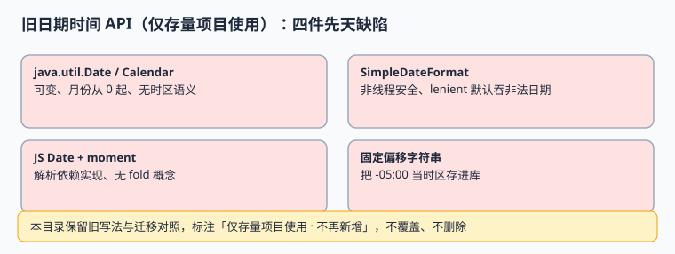

# 旧版日期时间 API（仅存量项目使用）

::: warning 版本与维护状态
本页对应 **`java.util.Date` / `Calendar` / `SimpleDateFormat` 与 JavaScript `Date` + moment** 这一代日期时间 API，标注「**仅存量项目使用 · 已停止新增**」。本页内容保留原文与迁移映射，**不改写、不删除、不与新版合并**。新代码一律使用[当前主线日期时间 API](../ModernDateTime/index.md)；本页只在维护存量系统、排查历史缺陷、制定迁移方案时阅读。
:::

一个存量系统里的日期时间缺陷，多半不是「写错了」，而是旧 API 本身的语义就没法表达跨区需求：可变对象、月份从 0 起、格式化器非线程安全、把偏移当成时区。本页把四类缺陷与迁移映射写清，让维护者知道**哪些能补、哪些只能迁移**。

本页判据族 `GLD-A` ~ `GLD-H`，共 8 条。



## 一、四类旧 API 与它们的先天缺陷

| 旧写法 | 缺陷 | 在跨区系统里的表现 | 能不能靠补丁救 |
| --- | --- | --- | --- |
| `java.util.Date` | 可变、只存毫秒瞬时、无时区语义 | 打印时悄悄用 JVM 默认时区 | 不能，只能封装 |
| `java.util.Calendar` | 月份从 0 起、字段可变、lenient 默认吞非法日期 | `2026-02-30` 被静默变成 3 月 2 日 | 部分（关 lenient） |
| `SimpleDateFormat` | **非线程安全**，共享实例会串数据 | 高并发下偶发解析出别人的日期 | 不能共享，只能每次新建或改用 `DateTimeFormatter` |
| JS `Date` + moment | 解析依赖实现、无 `fold` 概念、可变对象 | 折叠日两个 01:30 塌成一个 | 不能，须换 `Temporal` 或 polyfill |
| 固定偏移字符串 | 把 `-05:00` 当「时区」落库 | DST 期间 65.19% 的时间错 1 小时 | 不能，须换 `ZoneId` |

**这些不是使用姿势问题**：`Date` 里根本没有「地区」这个概念，`SimpleDateFormat` 的共享状态是设计使然。所以本页不给「怎么把旧 API 用对」的教程，只给「怎么在迁移前把风险圈住」。

## 二、可运行示例：三个能复现的坑

### 2.1 Java 旧 API（示意，需在 JDK 上跑）

```java [LegacyDateDemo.java]
import java.text.SimpleDateFormat;
import java.util.*;

public class LegacyDateDemo {
  public static void main(String[] args) throws Exception {
    Calendar c = Calendar.getInstance();
    c.set(2026, 1, 30);                       // 月份 1 实际是二月，且日期非法
    System.out.println("lenient 默认: " + c.getTime());

    SimpleDateFormat f = new SimpleDateFormat("yyyy-MM-dd HH:mm");
    f.setLenient(false);                      // 必须显式关掉
    try { System.out.println(f.parse("2026-02-30 10:00")); }
    catch (Exception e) { System.out.println("拒绝非法日期: " + e.getClass().getSimpleName()); }
  }
}
```

预期要点：第一行会把 2 月 30 日**静默顺延**到 3 月；第二行在 `setLenient(false)` 后抛 `ParseException`。旧代码里最危险的是第一行——它不报错。

### 2.2 JavaScript `Date` 的解析漂移

```javascript [legacy-date.mjs]
// 不同运行时对「无时区字符串」的解析口径可能不同，折叠日尤其危险
const a = new Date("2026-11-01T01:30:00");   // 按本地时区解释，无法表达 fold
const b = new Date("2026-11-01T01:30:00Z");  // 显式 UTC，才是确定的瞬时
console.log(a.toISOString(), b.toISOString());
console.log("同一挂钟时间的两次出现：无法区分");
```

`Date` 只有一个毫秒值，没有 `fold`，因此**物理上无法区分折叠日的两个 01:30**。任何「加个字段标记一下」的补丁都只能记录外部信息，不能让 `Date` 本身变正确。

### 2.3 固定偏移落库

```sql
-- 反例：把偏移当时区存进库
INSERT INTO event(occurred_at_local, zone_id) VALUES ('2026-07-01 12:00', 'UTC-05:00');
-- 正确：存 IANA 名称
INSERT INTO event(occurred_at_utc, zone_id) VALUES ('2026-07-01T16:00:00Z', 'America/New_York');
```

七月纽约实际是 `-04:00`，按 `UTC-05:00` 反推会偏一小时。本机全年实测：`America/New_York` 有 **5,711 / 8,760（65.19%）** 的小时与年初偏移不符，详见[时区与夏令时](../TimeZoneDST/index.md)。

## 三、迁移映射表

| 旧写法 | 当前主线 | 迁移时必须一起改的东西 |
| --- | --- | --- |
| `java.util.Date` | `java.time.Instant` | 字段类型、`toString()` 输出、序列化格式 |
| `Calendar` | `ZonedDateTime` / `LocalDate` | 月份常量、lenient 假设、加减法语义 |
| `SimpleDateFormat` | `DateTimeFormatter`（不可变、线程安全） | 移除共享实例、显式 `Locale`、模式字母差异（`Y` vs `y`） |
| `TimeZone` / 三字母缩写 | `ZoneId`（IANA 名称） | 配置、缓存键、日志字段 |
| JS `Date` | `Temporal.Instant` / `ZonedDateTime` | 特性检测或 polyfill、序列化格式 |
| moment | `Temporal` 或 `Intl` + 结构化值 | 链式可变调用改为不可变调用 |
| 固定偏移字符串 | `zone_id` + `tzdb_version` | 历史数据回填与双跑对比 |

::: danger 迁移期最常见的两类事故
1. **只换类、不换字段**：Java 侧改成了 `Instant`，数据库里仍是 `TIMESTAMP WITHOUT TIME ZONE`，会话时区一变照样漂移。
2. **只换前端、不换契约**：前端用了 `Temporal`，接口还在传 `1,234.56` 这样的格式化串，见[地区与语言协商](../LocaleNegotiation/index.md)。
:::

## 四、判据 `GLD-A` ~ `GLD-H`

| 编号 | 判据 | 不满足时改哪里 | 验证方式 |
| --- | --- | --- | --- |
| `GLD-A` | 旧 API 只在存量模块出现，新增代码零引用 | 代码审查 / 静态规则 | `git grep` 新文件无 `SimpleDateFormat` / `new Date(` |
| `GLD-B` | 共享的 `SimpleDateFormat` 实例已消除 | 存量代码 | 并发解析用例无串数据 |
| `GLD-C` | 所有 `lenient` 解析显式关闭 | 存量代码 | 非法日期用例必须抛异常 |
| `GLD-D` | 三字母时区缩写与固定偏移不入新表 | 配置与 DDL | 扫配置中的 `EST` / `UTC-05:00` |
| `GLD-E` | 旧模块与新模块之间用结构化瞬时值交接 | 接口契约 | 抓包无裸本地时间字符串 |
| `GLD-F` | 迁移前对同一批数据双跑对比并留差异清单 | 迁移方案 | `diff` 有报告且差异已归因 |
| `GLD-G` | 折叠日与间隙日有用例覆盖旧逻辑 | 测试矩阵 | 两类用例在旧模块上有明确预期 |
| `GLD-H` | 旧页标注维护状态且不被覆盖 | 文档维护 | 本页顶部状态块存在且指向新版 |

## 五、易错点与最佳实践

::: danger 五个坑
1. **给 `Date` 加一个 `fold` 字段就以为解决了折叠日。** 类型本身表达不了，只能迁移。
2. **把 `SimpleDateFormat` 声明成 `static final` 共享。** 高并发下会解析出别的请求的值，且不报错。
3. **依赖 `YYYY` 与 `yyyy` 的默认值。** 跨年周两者不同，年底最易出错。
4. **用 `TimeZone.getDefault()` 兜底。** 容器镜像、JVM 参数、部署地区一变，结果全变。
5. **迁移时顺手「修正」历史挂钟时间。** 那是当时写进凭证的事实，见[时间模型](../TimeModel/index.md)。
:::

::: tip 存量系统的务实路线
先加守卫（禁新增、关 lenient、去共享实例），再做双跑对比，最后按模块迁移。**不要一次性全局替换**——跨区事故最容易发生在「一半新、一半旧」的交接处，而双跑报告是唯一能提前看见它们的办法。
:::

## 六、验证方式

```shell
# 存量模块禁止新增旧 API 引用（在自建工程里执行）
git grep -n 'SimpleDateFormat\|new Date(' -- 'src/main/**/*.java' | head -20
```

预期：输出为空或全部落在已登记的存量模块白名单里。再跑一次折叠日回归：折叠日两条 01:30 经旧逻辑后**必须被记录为「已知限制」**，而不是被当成去重成功。

## 参考资料

- [Oracle: Java Date and Time（Legacy API 迁移指南）](https://docs.oracle.com/javase/tutorial/datetime/iso/legacy.html)
- [Java `java.util.Date` API（已由 java.time 取代）](https://docs.oracle.com/en/java/javase/25/docs/api/java.base/java/util/Date.html)
- [MDN: JavaScript `Date`](https://developer.mozilla.org/en-US/docs/Web/JavaScript/Reference/Global_Objects/Date)
- [moment.js: Project Status（维护模式说明）](https://momentjs.com/docs/#/-project-status/)
