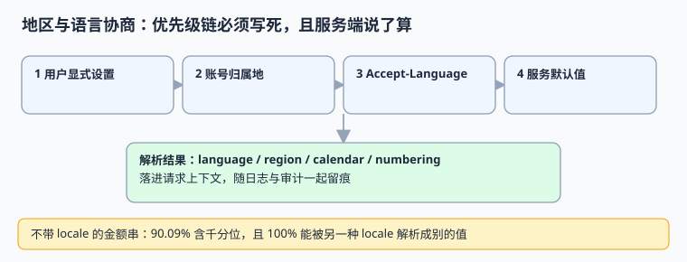

# 地区与语言协商：优先级链必须写死

「这个用户是哪国人」不是一个可以猜的问题：浏览器语言、IP 归属地、账号注册地、结算地、数据驻留地可能指向五个不同答案。本页给出一条**写死的优先级链**，并说明为什么格式化字符串绝不能跨系统传递。

本页判据族 `GLC-A` ~ `GLC-H`，共 8 条。



## 一、locale 到底包含什么

`locale` 不是一个语言代码，而是一组解释规则。按 [BCP 47](https://www.rfc-editor.org/rfc/rfc5646) 与 [UTS #35](https://www.unicode.org/reports/tr35/) 的口径，一次协商至少要确定五项：

| 组成 | 例子 | 影响什么 | 猜错的后果 |
| --- | --- | --- | --- |
| 语言 language | `en` / `zh` | 文案、复数规则、排序 | 界面串错，但通常不致命 |
| 地区 region | `US` / `DE` / `CN` | 日期、数字、货币格式 | `03/04/2026` 被读成另一天 |
| 文字 script | `Hans` / `Hant` | 字形、断词 | 简繁混排 |
| 日历 calendar | `gregory` / `islamic` | 年月日与假日 | 日期差一个月以上 |
| 数字体系 numbering | `latn` / `arab` | 数字字符 | 解析直接失败 |

**版本事实（2026-11-10 核对）**：CLDR **49（2026-10-22）** 为当前稳定版，ICU **79（2026-10-27）** 集成 CLDR 49；48.2 是 2026-03-17 的上一批。格式化结果依赖这两个版本，所以 `cldr_version` 与 `tzdb_version` 一样要落库（见[时间模型](../TimeModel/index.md)）。

## 二、四级优先级链

| 优先级 | 来源 | 可信度 | 什么时候用 |
| --- | --- | --- | --- |
| 1 | 用户显式设置（账号偏好） | 最高，用户自己选的 | 一律优先 |
| 2 | 账号归属地 / 结算地 | 高，与合同绑定 | 用户未设置时 |
| 3 | 请求 `Accept-Language` | 中，只表达浏览器偏好 | 未登录、匿名场景 |
| 4 | 服务默认值 | 兜底 | 前三都拿不到 |

三条硬规则：

1. **服务端说了算。** 客户端可以提偏好，但解析、回退、最终值由服务端确定并落进请求上下文；不要把「已协商的 locale」放在前端再算一遍。
2. **语言不等于地区，更不等于法域。** `en-US` 的用户可以在欧盟结算，也可以在欧盟有数据驻留义务；`Accept-Language` 绝不能用来推导 `residency_zone`（见[驻留](../RegionalCompliance/index.md)）。
3. **IP 只能当提示，不能当依据。** 出差、VPN、移动网络都会让它漂移；把它放进日志可以，放进判定链不行。

```python [/tmp/negotiate.py]
def negotiate(user_setting=None, account_region=None, accept_language=None, default="zh-CN"):
    """返回 (locale, source)；source 落进日志，便于事后解释"""
    if user_setting:
        return user_setting, "user_setting"
    if account_region:
        return f"und-{account_region}", "account_region"  # 语言未知，只定地区
    if accept_language:
        head = accept_language.split(",")[0].split(";")[0].strip()
        return head, "accept_language"
    return default, "default"


cases = [
    ("de-DE", "DE", "en-US,en;q=0.9"),
    (None, "JP", "zh-CN,zh;q=0.9"),
    (None, None, "fr-FR,fr;q=0.8"),
    (None, None, None),
]
for c in cases:
    print(negotiate(*c))
```

预期输出：

```text
('de-DE', 'user_setting')
('und-JP', 'account_region')
('fr-FR', 'accept_language')
('zh-CN', 'default')
```

第二行 `und-JP` 是刻意的：账号只告诉了我们地区，语言未知，就别硬猜成 `ja-JP`。**「不确定」要能表达出来**，比给一个看似完整的错误答案好。

## 三、格式化串不能跨系统传递

本机 20,000 个随机金额的模拟：**90.09%** 的 `en-US` 格式串带千分位逗号；这些串在 `de-DE` 规则下**100% 能被解析成另一个合法但不同的数值**（例如 `1,234.56` 被读成 `1.23456`）。日期更糟：月日都 ≤ 12 时，`03/04/2026` 在 `en-US` 与 `en-GB` 下有 **91.5%** 的组合产生歧义。

| 传递内容 | 是否允许 | 正确做法 |
| --- | --- | --- |
| `occurred_at_utc` + `zone_id` | 允许 | 接口只传瞬时与地区 |
| 结构化数值（整数最小单位） | 允许 | 金额传 `{"amount_minor": 123456, "currency": "USD"}` |
| 带千分位的字符串 `1,234.56` | **禁止** | 只在展示层由 locale 生成 |
| `03/04/2026` 这类裸日期串 | **禁止** | 传 ISO 8601 `2026-04-03` |

::: danger 这类错误为什么难查
解析出来的值**仍是合法数字/合法日期**，不会抛异常、不会触发告警。等它在对账或报表里显形时，原始字符串往往已经被丢弃，无法反查当时的 locale。所以判据必须落在「接口契约」上，而不是靠事后核对。
:::

## 四、判据 `GLC-A` ~ `GLC-H`

| 编号 | 判据 | 不满足时改哪里 | 验证方式 |
| --- | --- | --- | --- |
| `GLC-A` | 优先级链四级写死且服务端解析，结果落请求上下文 | 中间件 | 四组用例输出与 `source` 均符合预期 |
| `GLC-B` | 协商结果含 language / region / calendar / numbering | 上下文结构 | 缺项时显式标 `und`，不硬猜 |
| `GLC-C` | 日志与审计留 `locale` 与 `locale_source` | 日志字段 | 抽一条请求能回答「凭什么选它」 |
| `GLC-D` | `cldr_version` 随记录或随服务版本留痕 | 写入契约 / 发布记录 | 升级 CLDR 前后输出可对比 |
| `GLC-E` | 接口不传格式化数字与日期串，只传结构化值 | 接口契约 | 抓包检查无带逗号金额、无斜杠日期 |
| `GLC-F` | 金额用整数最小单位 + 币种代码传递 | 接口契约 | 两种 locale 解析结果一致 |
| `GLC-G` | 排序用显式 collation，不用数据库默认 | 查询与索引 | 含重音字符的排序用例有预期结果 |
| `GLC-H` | 用例含 `en-US` / `de-DE` / `en-GB` 三种歧义组合 | 测试矩阵 | 双解用例必须报错或按显式 locale 处理 |

## 五、易错点与最佳实践

::: danger 五个坑
1. **用 `Accept-Language` 推导法域或驻留区。** 语言偏好与法律属地没有因果关系。
2. **把 IP 归属地放进判定链。** 它只适合做提示与风控信号。
3. **前端算一遍、后端再算一遍。** 两处回退规则不同，会出现「列表页是 3 月 4 日、详情页是 4 月 3 日」。
4. **金额用浮点 + 格式化字符串传。** 用整数最小单位，币种单独传（金额模型见[多币种与汇率](../../MultiCurrency/index.md)）。
5. **升级 CLDR 不留版本。** 同一个 locale 的分隔符、复数规则可能变，历史导出文件会与新版不一致。
:::

::: tip 一句话建议
把「协商结果 + 来源 + CLDR 版本」三件套写进请求日志。它成本极低，却是事后解释「当时为什么这样显示」的唯一依据，与[审计取证](../../AuditForensics/index.md)的留痕思路一致。
:::

## 六、验证方式

```shell
cd /tmp && python3 negotiate.py
```

预期四行与前文一致，第二行必须是 `und-JP`。再补一条接口契约检查（在自建服务里执行）：

```shell
curl -s http://localhost:8080/api/v1/orders/1 | grep -E '[,][0-9]{3}|[0-9]{2}/[0-9]{2}/[0-9]{4}' && echo "FAIL: 出现格式化串" || echo "PASS: 契约干净"
```

预期输出 `PASS: 契约干净`。

## 参考资料

- [BCP 47 / RFC 5646 — Tags for Identifying Languages](https://www.rfc-editor.org/rfc/rfc5646)
- [UTS #35 — Unicode Locale Data Markup Language (LDML)](https://www.unicode.org/reports/tr35/)
- [Unicode CLDR Releases](https://cldr.unicode.org/index/downloads)
- [RFC 9110 — HTTP Semantics（Accept-Language）](https://www.rfc-editor.org/rfc/rfc9110.html)
- [ICU User Guide: Locale and Formatting](https://unicode-org.github.io/icu/userguide/locale/)
