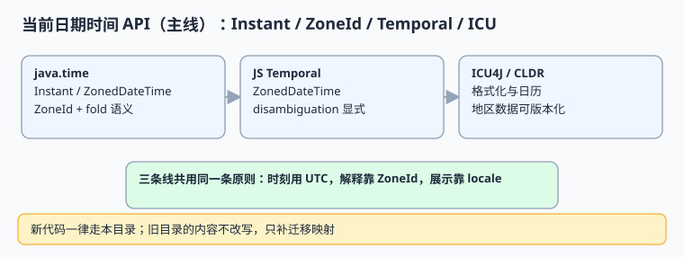

# 当前主线日期时间 API

::: info 版本与维护状态
本页是**当前主线 · 持续维护**。覆盖 `java.time`、JavaScript `Temporal`、Python `zoneinfo` 与 ICU4J / CLDR 四类实现，面向新代码与迁移目标。版本事实联网核对（2026-11-10）：**IANA tzdb 2026e（2026-09-29）**、**CLDR 49（2026-10-22）**、**ICU 79（2026-10-27）**；`Temporal` 已在 Firefox 139+ / Chrome 144+ 落地，但 Safari 稳定版与 Node 各版本支持面不齐，不同资料对标准化阶段口径不一致，以 [TC39 提案页](https://github.com/tc39/proposal-temporal) 与 [MDN](https://developer.mozilla.org/en-US/docs/Web/JavaScript/Reference/Global_Objects/Temporal) 为准，生产请特性检测或带 polyfill。旧写法见[旧版日期时间 API](../LegacyDateTime/index.md)，该目录保留原文、不覆盖。
:::

四条主流实现看上去语法不同，但共享同一条原则：**时刻用 UTC 瞬时，解释靠 `ZoneId`，展示靠 `locale`，三者都不写到同一个对象里**。本页给出对照表、可运行示例与选型判据。

本页判据族 `GMD-A` ~ `GMD-H`，共 8 条。



## 一、四条主线的能力对照

| 能力 | `java.time` | JS `Temporal` | Python `zoneinfo` | ICU4J / CLDR |
| --- | --- | --- | --- | --- |
| 瞬时类型 | `Instant` | `Temporal.Instant` | `datetime` with `timezone.utc` | `UDate` / `Instant` 互转 |
| 带时区类型 | `ZonedDateTime` | `Temporal.ZonedDateTime` | `datetime` with `ZoneInfo` | `Calendar` + `TimeZone` |
| 挂钟类型 | `LocalDateTime` | `Temporal.PlainDateTime` | naive `datetime` | `Calendar` 字段 |
| 折叠消歧 | `withEarlierOffsetAtOverlap()` / `withLaterOffsetAtOverlap()` | `disambiguation: 'earlier' \| 'later' \| 'compatible' \| 'reject'` | `fold=0/1`（PEP 495） | 依实现，需显式策略 |
| 间隙检测 | 解析抛异常或按策略调整 | `reject` | 回转检验 | 需自行检验 |
| 不可变 | 是 | 是 | `datetime` 不可变 | 否（`Calendar` 可变） |
| 规则数据源 | JDK 内置 tzdb | 运行时 tzdb | 系统 / `tzdata` 包 | CLDR + ICU 数据 |

**选型结论**：服务端存算用 `java.time` / `zoneinfo`；前端展示用 `Temporal`（不足时 polyfill）+ `Intl`；格式化与日历数据统一交给 ICU/CLDR 版本管理。四者的 `ZoneId` 必须是**同一个 IANA 名称**，否则跨语言边界会漂移。

## 二、可运行示例（三语言最小对照）

```java [ModernTimeDemo.java]
import java.time.*;

public class ModernTimeDemo {
  public static void main(String[] args) {
    Instant u = Instant.parse("2026-11-01T05:30:00Z");
    ZoneId ny = ZoneId.of("America/New_York");
    ZonedDateTime local = u.atZone(ny);
    System.out.println(local);                       // 2026-11-01T01:30-04:00[America/New_York]
    System.out.println(local.withLaterOffsetAtOverlap()); // 同一挂钟时间的第二次出现
  }
}
```

```javascript [modern-time.mjs]
// 需运行时支持 Temporal；不支持时引入 temporal-polyfill
const zdt = Temporal.ZonedDateTime.from({
  timeZone: "America/New_York", year: 2026, month: 11, day: 1,
  hour: 1, minute: 30, disambiguation: "earlier"
});
console.log(zdt.toInstant().toString());  // 2026-11-01T05:30:00Z
console.log(zdt.with({ hour: 1 }).offset); // -04:00（第一次出现的偏移）
```

```python [/tmp/modern_time.py]
from datetime import datetime, timezone
from zoneinfo import ZoneInfo

u = datetime(2026, 11, 1, 5, 30, tzinfo=timezone.utc)
ny = ZoneInfo("America/New_York")
for fold in (0, 1):
    local = u.astimezone(ny)
    print(fold, local.isoformat(), local.utcoffset())
print("zone:", ny.key, "tzdb 版本随运行环境，须另行落库")
```

Python 段的预期输出：

```text
0 2026-11-01T01:30:00-04:00 -1 day, 20:00:00
1 2026-11-01T01:30:00-04:00 -1 day, 20:00:00
zone: America/New_York tzdb 版本随运行环境，须另行落库
```

> 注意这里 `fold` 是**输入侧**的消歧参数，不是输出侧的属性：上面两次都从同一个 UTC 瞬时出发，所以结果相同。要构造「本地 01:30 的第二次出现」，应从挂钟时间带 `fold=1` 出发再转 UTC，见[时区与夏令时](../TimeZoneDST/index.md)的折叠示例。这个区别本身就是一个高频坑。

## 三、版本与数据治理

| 数据 | 当前口径 | 落地要求 |
| --- | --- | --- |
| 时区规则 | tzdb `2026e` | 记录 `tzdb_version`，升级前双跑对比 |
| 本地化数据 | CLDR `49` / ICU `79` | 记录 `cldr_version`，格式化结果可复现 |
| 运行时能力 | `Temporal` 支持面不齐 | 特性检测 + polyfill，不假定全局可用 |
| 系统 tzdata | 各语言/镜像不同 | 容器镜像固定 tzdata 版本并纳入构建清单 |

::: danger 最常见的「新版也踩」的两个坑
1. **以为换了 API 就不用记版本。** `ZoneId` 只是名字，规则内容来自运行时的 tzdb；同一名称在 `2026d` 与 `2026e` 下对未来的解释可以不同。
2. **把 `Temporal.PlainDateTime` 当瞬时传接口。** 它不带时区，等价于裸挂钟时间，跨系统后无法还原；要传 `Temporal.Instant` 的 ISO 字符串。
:::

## 四、判据 `GMD-A` ~ `GMD-H`

| 编号 | 判据 | 不满足时改哪里 | 验证方式 |
| --- | --- | --- | --- |
| `GMD-A` | 新代码只用不可变类型表达瞬时与挂钟 | 代码审查 | 无 `Calendar` / 可变 `Date` 新增引用 |
| `GMD-B` | `ZoneId` 一律用 IANA 名称，四语言取值一致 | 配置与契约 | 跨语言用例输出同一 `zone_id` |
| `GMD-C` | 折叠消歧显式指定，不依赖默认策略 | 解析层 | `earlier` / `later` 各一条用例 |
| `GMD-D` | 间隙时刻显式拒绝或按记录策略处理 | 解析层 | 2026-03-08 02:30 被 `reject` |
| `GMD-E` | `tzdb_version` / `cldr_version` 落库并随发布记录 | 写入契约 | 空值率 0 |
| `GMD-F` | 前端对 `Temporal` 做特性检测或带 polyfill | 构建配置 | 无原生支持的运行时用例通过 |
| `GMD-G` | 接口只传瞬时 ISO 字符串 + `zone_id` | 接口契约 | 抓包无 `PlainDateTime` 裸串 |
| `GMD-H` | 升级 tzdb / CLDR 前做双跑差异对比 | 发布流程 | `diff` 报告已归档 |

## 五、易错点与最佳实践

::: danger 五个坑
1. **混用 `Instant` 与 `LocalDateTime`。** 一个带时区一个不带，序列化后长得几乎一样。
2. **把 `ZoneId` 的 `key` 与展示名混用。** `Asia/Shanghai` 是身份，「中国标准时间」是文案。
3. **认为 `Temporal` 全平台可用。** Safari 稳定版与部分 Node 版本仍需 polyfill。
4. **容器镜像不固定 tzdata 版本。** 同一份代码在不同镜像里解释出不同结果。
5. **迁移时把旧目录内容改写成新版。** 旧版目录标注「仅存量项目使用」，原文保留，见[版本目录说明](../index.md)。
:::

::: tip 一条落地建议
把「`ZoneId` 白名单 + tzdb 版本 + CLDR 版本」三样写进服务启动日志。出问题时第一句就能问清「当时按哪版规则」，这比翻几个月前的镜像构建记录快得多。
:::

## 六、验证方式

```shell
cd /tmp && python3 modern_time.py
```

预期输出含 `zone: America/New_York`。再核对运行时数据版本：

```shell
python3 -c "import importlib.metadata as m; print('tzdata', m.version('tzdata'))" 2>/dev/null || echo "使用系统 zoneinfo"
node -e "console.log(typeof Temporal !== 'undefined' ? 'Temporal 可用' : '需 polyfill')"
```

第二条输出 `需 polyfill` 时，按判据 `GMD-F` 补上特性检测再上线。

## 参考资料

- [Java `java.time` Package（JDK 25 API）](https://docs.oracle.com/en/java/javase/25/docs/api/java.base/java/time/package-summary.html)
- [TC39 Temporal Proposal](https://github.com/tc39/proposal-temporal)
- [MDN: Temporal](https://developer.mozilla.org/en-US/docs/Web/JavaScript/Reference/Global_Objects/Temporal)
- [Python `zoneinfo`](https://docs.python.org/3/library/zoneinfo.html) / [PEP 495](https://peps.python.org/pep-0495/)
- [Unicode CLDR Releases](https://cldr.unicode.org/index/downloads) / [ICU User Guide](https://unicode-org.github.io/icu/userguide/)
