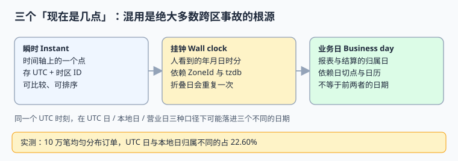
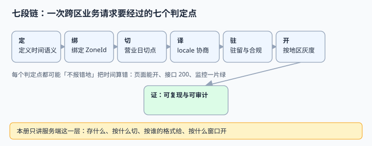

# 总览：三个「现在是几点」与六个安静的失败

跨区系统的时间事故，几乎都不是「算错了」，而是**同一个词在三处指了三样东西**：数据库里的 `created_at`、页面上的「11 月 1 日 01:30」、日报里的「11 月 1 日营收」，谁也不等于谁。本页把这三种语义拆开，并给出七段链上六个不报错的失败。

本页判据族 `GLO-A` ~ `GLO-H`，共 8 条。



## 一、问题从哪里来

一个单地区系统里，`created_at` 一个字段就够了：本地时间既是发生的时刻，也是报表归属日，也是给人看的字符串。跨地区之后这三件事同时分裂：

| 角色 | 关心什么 | 用什么字段 | 最容易犯的错 |
| --- | --- | --- | --- |
| 存储与排序 | 事情发生的先后 | UTC 瞬时（`TIMESTAMPTZ`） | 存本地时间字符串 |
| 用户与展示 | 我这边是几点几分 | `ZoneId` + `tzdb_version` 派生 | 存固定偏移 `+08:00` |
| 报表与结算 | 算到哪一天 | 地区日切点 + 日历派生 `biz_date` | 直接拿 UTC 日期 |
| 合规与审计 | 这条数据按哪版规则解释、留在哪 | 解释版本 + 驻留键 | 只在日志里写一句 |

**关键点**：后三者都应该是**派生字段**，而且派生所依赖的输入必须落库。只存一个 UTC 时间戳，等于把「当时用的是哪版时区规则、按哪个日切算」交给运气。

## 二、三个「现在是几点」逐个拆

### 2.1 瞬时（Instant）

时间轴上的一个点，用 UTC 表示，与地理无关。它是唯一可以直接比较、排序、做区间判断的时间类型。`2026-11-01T05:30:00Z` 与 `2026-11-01T06:30:00Z` 相差 3600 秒，这件事在任何地区都成立。

### 2.2 挂钟（Wall clock）

「2026-11-01 01:30」这样的本地年月日时分。它不是时间轴上的点，除非附带 `ZoneId` 与消歧标志（`fold`）：在 `America/New_York` 的 2026-11-01，这个挂钟时间**真实出现了两次**（`05:30Z` 与 `06:30Z`）。挂钟时间的用途只有一个：给人看。

### 2.3 业务日（Business day）

「这笔订单算 11 月 1 日还是 10 月 31 日」是业务定义，不是物理事实。它依赖地区、日切点（例如本地 04:00）、节假日日历，以及口径版本。改日切点等于改历史报表，必须有版本与重算入口。

## 三、六个安静的失败



| 编号 | 失败 | 表现 | 为什么监控看不出来 |
| --- | --- | --- | --- |
| F1 | 只存固定偏移 | 夏令时期间展示差 1 小时 | 接口 200，只是「时间看起来怪」 |
| F2 | 本地时间做唯一键 | 折叠日第二个 01:30 被拒或相互覆盖 | 唯一键冲突被当成正常去重 |
| F3 | UTC 日当营业日 | 日报与当地账对不上 | 两个口径各自自洽 |
| F4 | 格式化串不带 locale | `1,234.56` 被另一地区解析成 `1.23456` | 数值仍是合法数字 |
| F5 | 各地本地零点开灰度 | 跨区用户 26 小时内看到两版 | 每个地区自己的日志都正常 |
| F6 | 规则改了不留版本 | 历史数据换一台机器解释出另一个结果 | 只有回看老数据才暴露 |

## 四、可运行示例：同一个时刻，三种口径

下面这段只用 Python 标准库，读者可直接复制到 `/tmp` 运行。它把「同一个瞬时」分别解释成挂钟与业务日。

```python [/tmp/three_clocks.py]
from datetime import datetime, timedelta, timezone
from zoneinfo import ZoneInfo

u = datetime(2026, 11, 1, 5, 30, tzinfo=timezone.utc)
zones = ["Asia/Shanghai", "Europe/Berlin", "America/New_York"]

for z in zones:
    local = u.astimezone(ZoneInfo(z))
    # 营业日：本地时间减 4 小时再取日期（本地 04:00 日切）
    biz = (local - timedelta(hours=4)).date()
    print(f"{z:22} UTC={u.date()} 本地={local.date()} {local:%H:%M} 营业日={biz}")
```

预期输出（tzdb 2026e 口径）：

```text
Asia/Shanghai         UTC=2026-11-01 本地=2026-11-01 13:30 营业日=2026-11-01
Europe/Berlin         UTC=2026-11-01 本地=2026-11-01 06:30 营业日=2026-11-01
America/New_York      UTC=2026-11-01 本地=2026-11-01 01:30 营业日=2026-10-31
```

最后一行就是本页要立的规矩：**纽约的 01:30 属于 10 月 31 日的营业日**——不是因为算错了，而是因为 04:00 日切。若把 `date(u)` 直接写进日报，这笔订单就错了一天。

## 五、本机读数

| 读数 | 值 | 含义 |
| --- | --- | --- |
| UTC 日 vs 本地日归属不同 | 22.60%（10 万笔） | 五笔里有一笔 |
| UTC 日 vs 营业日归属不同 | 22.87% | 再叠加日切点 |
| 折叠日重复的本地分钟 | 60 / 1500 = 4.00% | 唯一键会吞数据 |
| New York 固定偏移全年错时 | 65.19% 的小时 | 差 3600 秒 |
| 本地零点灰度分裂窗口 | 26 小时 | 详见[按地区灰度](../RolloutByRegion/index.md) |
| 实战断言 | 10/10 PASS | 详见[实战](../Practice/index.md) |

## 六、判据 `GLO-A` ~ `GLO-H`

| 编号 | 判据 | 不满足时改哪里 | 验证方式 |
| --- | --- | --- | --- |
| `GLO-A` | 瞬时、挂钟、业务日是三个独立字段，不共用一个 `created_at` | 表结构与写入层 | 查表：三种字段都存在且语义注释齐全 |
| `GLO-B` | 所有排序、区间、唯一性判断只用 UTC 瞬时 | DAO 与索引定义 | 折叠日写两条 01:30，都能落库且顺序正确 |
| `GLO-C` | 每条记录带 `zone_id`（IANA 名称）而非固定偏移 | 写入契约 | 扫 `zone_id LIKE '%:%'`，应为 0 行 |
| `GLO-D` | 每条记录带 `tzdb_version` / `cldr_version` | 写入契约与迁移脚本 | 查空值率为 0 |
| `GLO-E` | 业务日由「地区 + 日切点 + 日历」派生并落库 | 日切配置表 | 跨日切点各写一笔，归属日符合配置 |
| `GLO-F` | 格式化输出必须带 locale，且字符串不跨系统传递 | 展示层与接口契约 | 用两种 locale 解析同一串，值必须一致或报错 |
| `GLO-G` | 灰度开关使用统一 UTC 时刻，不使用各地本地零点 | 灰度配置表 | 查 `opens_at_utc` 全表唯一 |
| `GLO-H` | 六类字段的检查写成可重跑断言，含反向探针 | 门禁脚本 | 跑[实战断言](../Practice/index.md)，`EXIT=0` |

## 七、易错点与最佳实践

::: danger 四个高频坑
1. **把「时区」写成 `+08:00`。** 偏移是某个时刻的瞬时差，时区是一整套历史与未来规则。正确写法：`zone_id = 'Asia/Shanghai'`，展示时才算 `utcoffset()`。
2. **用 `DATE(created_at)` 出日报。** 数据库会话时区一改，整张报表就变。正确写法：写入时算好 `biz_date` 并建索引。
3. **认为「夏令时只是差一小时」。** 折叠日会重复一小时、间隙日会消失一小时，30 分钟 DST（如 `Australia/Lord_Howe`）还会打破「按整点切」的假设。
4. **把灰度窗口写成「各地 00:00 生效」。** 正确写法：配置里存一个 UTC 时刻，各地区只影响展示与合规，不影响开关判定。
:::

::: tip 建议
先花半小时把「一行记录要有哪些字段」写进数据库设计评审，比事后在十几个服务里追时间字符串便宜得多。字段契约见[时间模型](../TimeModel/index.md)。
:::

## 八、验证方式

```shell
cd /tmp && python3 three_clocks.py
```

预期最后一行是 `America/New_York ... 营业日=2026-10-31`。若你的输出是 `2026-11-01`，说明本机 tzdb 版本与文中口径不同，请先在页面里记录 `python3 -c "import importlib.metadata as m; print(m.version('tzdata'))"` 的结果，再对照[时区与夏令时](../TimeZoneDST/index.md)的版本漂移一节。

## 参考资料

- [IANA Time Zone Database](https://www.iana.org/time-zones)
- [PEP 495 — Local Time Disambiguation](https://peps.python.org/pep-0495/)
- [RFC 9557 — Date and Time with Additional Information](https://www.rfc-editor.org/rfc/rfc9557.html)
- [PostgreSQL: Date/Time Types（AT TIME ZONE 与 TIMESTAMPTZ）](https://www.postgresql.org/docs/current/datatype-datetime.html)
