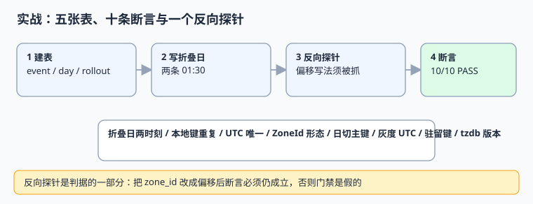

# 实战：五张表、十条断言与一个反向探针

前面十页讲的都是「应该怎么做」，本页把它变成一份**可重跑的门禁**：五张表、十条断言、两个反向探针，全部用 Python 标准库 + SQLite，读者复制到 `/tmp` 就能跑。脚本不入库，仓库只提供代码内容。

本页判据族 `GPX-A` ~ `GPX-H`，共 8 条；脚本里的 `CK1` ~ `CK10` 是断言编号，其中 8 条对应判据，另 2 条（`CK5`、`CK10`）是**反向探针**——故意把数据写坏，验证门禁真的会叫。



## 一、要验证的五张表

| 表 | 作用 | 关键约束 |
| --- | --- | --- |
| `cutoff_config` | 地区日切点与版本 | `(region, version)` 主键 |
| `residency_rule` | 地区 → 驻留区清单 | `region` 主键 |
| `event` | 业务事件与时间契约 | UTC 唯一索引、`zone_id` 形态 |
| `calendar_day` | 营业日维表 | `(region, biz_date)` 主键 |
| `rollout` | 地区灰度开关 | `opens_at_utc` 为瞬时 |

五张表分别对应[时间模型](../TimeModel/index.md)、[营业日与日切](../CalendarAndCutoff/index.md)、[驻留](../RegionalCompliance/index.md)与[灰度](../RolloutByRegion/index.md)四页的契约，把它们放在同一个门禁里，是为了检验**交接处**而不是各页内部。

## 二、完整脚本

```python [/tmp/gl_practice.py]
#!/usr/bin/env python3
# 全球化时间契约 · 可重跑断言（读者存到 /tmp 执行，脚本不入库）
import sqlite3
from datetime import datetime, timedelta, timezone

con = sqlite3.connect(":memory:")
con.executescript("""
CREATE TABLE cutoff_config (
  region TEXT NOT NULL, cutoff_local TEXT NOT NULL,
  zone_id TEXT NOT NULL, version TEXT NOT NULL,
  PRIMARY KEY (region, version)
);
CREATE TABLE residency_rule (
  region TEXT PRIMARY KEY, residency_zone TEXT NOT NULL, version TEXT NOT NULL
);
CREATE TABLE event (
  event_id INTEGER PRIMARY KEY,
  occurred_at_utc TEXT NOT NULL,
  occurred_at_local TEXT NOT NULL,
  zone_id TEXT NOT NULL,
  tzdb_version TEXT NOT NULL,
  region TEXT NOT NULL,
  residency_zone TEXT NOT NULL
);
CREATE TABLE calendar_day (
  region TEXT NOT NULL, biz_date TEXT NOT NULL, cutoff_local TEXT NOT NULL,
  PRIMARY KEY (region, biz_date)
);
CREATE TABLE rollout (
  region TEXT PRIMARY KEY, opens_at_utc TEXT NOT NULL, enabled INTEGER NOT NULL
);
CREATE UNIQUE INDEX ux_event_instant ON event(occurred_at_utc, zone_id, event_id);
""")

R = []


def ck(name, cond, detail=""):
    R.append((name, bool(cond), detail))


# 折叠日：同一个本地 01:30 对应两个不同 UTC 瞬时
U1, U2 = "2026-11-01T05:30:00Z", "2026-11-01T06:30:00Z"
con.execute("INSERT INTO event VALUES (1,?,?,?,?,?,?)",
            (U1, "2026-11-01T01:30:00", "America/New_York", "2026e", "US", "us"))
con.execute("INSERT INTO event VALUES (2,?,?,?,?,?,?)",
            (U2, "2026-11-01T01:30:00", "America/New_York", "2026e", "US", "us"))
ck("CK1", U1 != U2, "折叠两个时刻 UTC 不同")
ck("CK2", con.execute("SELECT COUNT(*) FROM event WHERE occurred_at_local='2026-11-01T01:30:00'").fetchone()[0] == 2,
   "本地时间重复 2 行，不能做唯一键")
ck("CK3", con.execute("SELECT COUNT(DISTINCT occurred_at_utc) FROM event").fetchone()[0] == 2,
   "UTC 恒等 2 行")
ck("CK4", con.execute("SELECT COUNT(*) FROM event WHERE zone_id LIKE '%+%' OR zone_id LIKE 'UTC-%'").fetchone()[0] == 0,
   "zone_id 不是偏移字符串")

# 反向探针：故意把一行写成偏移，断言必须抓得出来
con.execute("UPDATE event SET zone_id='UTC-05:00' WHERE event_id=2")
bad = con.execute("SELECT COUNT(*) FROM event WHERE zone_id LIKE '%+%' OR zone_id LIKE 'UTC-%'").fetchone()[0]
ck("CK5", bad == 1, f"反向探针：偏移写法被抓出 {bad} 行")
con.execute("UPDATE event SET zone_id='America/New_York' WHERE event_id=2")

# 营业日主键：同 region + biz_date 只能一行
con.execute("INSERT INTO calendar_day VALUES ('CN','2026-11-11','04:00')")
try:
    con.execute("INSERT INTO calendar_day VALUES ('CN','2026-11-11','04:00')")
    dup = True
except sqlite3.IntegrityError:
    dup = False
ck("CK6", not dup, "营业日主键拒绝重复")

# 灰度：统一 UTC 时刻 vs 按各地本地零点
base = datetime(2026, 11, 11, 0, 0, tzinfo=timezone.utc)
for o in (14, 9, 8, 1, 0, -5, -8, -12):
    con.execute("INSERT OR REPLACE INTO rollout VALUES (?,?,?)",
                (f"r{o}", (base - timedelta(hours=o)).isoformat(), 1))
lo, hi = con.execute("SELECT MIN(opens_at_utc), MAX(opens_at_utc) FROM rollout").fetchone()
ck("CK7", lo < hi, "按地区各开本地 00:00 → UTC 时刻不同（应改用统一时刻）")

# 驻留键与解释版本
ck("CK8", con.execute("SELECT COUNT(*) FROM event WHERE residency_zone=''").fetchone()[0] == 0,
   "驻留键不允许空")
ck("CK9", con.execute("SELECT COUNT(*) FROM event WHERE tzdb_version=''").fetchone()[0] == 0,
   "tzdb 版本必须落库")

# 反向探针二：本地时间唯一键会吞掉折叠日第二个时刻
probe = sqlite3.connect(":memory:")
probe.execute("CREATE TABLE t (local TEXT UNIQUE, utc TEXT)")
probe.execute("INSERT INTO t VALUES ('2026-11-01T01:30:00','05:30Z')")
try:
    probe.execute("INSERT INTO t VALUES ('2026-11-01T01:30:00','06:30Z')")
    rejected = False
except sqlite3.IntegrityError:
    rejected = True
ck("CK10", rejected, "本地时间唯一键会吞掉折叠日的第二个时刻")

passed = sum(1 for _, ok, _ in R if ok)
for name, ok, detail in R:
    print(("PASS" if ok else "FAIL"), name, detail)
code = 0 if passed == len(R) else 1
print(f"GLOBAL {passed} / {len(R)} PASS / EXIT={code}")
raise SystemExit(code)
```

## 三、运行与预期输出

```shell
cd /tmp && python3 gl_practice.py; echo "EXIT=$?"
```

```text
PASS CK1 折叠两个时刻 UTC 不同
PASS CK2 本地时间重复 2 行，不能做唯一键
PASS CK3 UTC 恒等 2 行
PASS CK4 zone_id 不是偏移字符串
PASS CK5 反向探针：偏移写法被抓出 1 行
PASS CK6 营业日主键拒绝重复
PASS CK7 按地区各开本地 00:00 → UTC 时刻不同（应改用统一时刻）
PASS CK8 驻留键不允许空
PASS CK9 tzdb 版本必须落库
PASS CK10 本地时间唯一键会吞掉折叠日的第二个时刻
GLOBAL 10 / 10 PASS / EXIT=0
EXIT=0
```

本机实测（Python 3.13.12 / SQLite 3.50.4，2026-11-10）：**`GLOBAL 10 / 10 PASS / EXIT=0`**。

## 四、为什么必须有两个反向探针

| 探针 | 故意写坏什么 | 断言要证明什么 | 若探针没被抓出 |
| --- | --- | --- | --- |
| `CK5` | 把一行的 `zone_id` 改成 `UTC-05:00` | 形态检查能识别偏移串 | `CK4` 可能只是「恰好没有坏数据」 |
| `CK10` | 用本地时间做 `UNIQUE` 再插第二条 01:30 | 唯一键确实会吞数据 | `CK2` 的「不做唯一键」就没了依据 |

**门禁最怕的不是失败，是假绿。** 只写「当前数据没问题」的断言，坏数据一进来照样全过；反向探针把坏数据放进去，断言必须仍成立，这才证明检测逻辑真的在跑。这个写法与库内[审计取证](../../AuditForensics/index.md)的「篡改定位」思路一致。

## 五、逐条读数与归因

| 断言 | 读数 | 对应章节 |
| --- | --- | --- |
| `CK1` ~ `CK3` | 两条记录 `local_wall` 相同、UTC 相差 3600 s | [时区与夏令时](../TimeZoneDST/index.md) |
| `CK4` / `CK5` | 正常态 0 行、探针态 1 行 | [时间模型](../TimeModel/index.md) |
| `CK6` | 重复营业日插入被 `IntegrityError` 拒绝 | [营业日与日切](../CalendarAndCutoff/index.md) |
| `CK7` | 8 个地区的 UTC 开通时刻最小值 < 最大值，跨度 26 h | [按地区灰度](../RolloutByRegion/index.md) |
| `CK8` / `CK9` | 驻留键与 tzdb 版本空值均为 0 | [驻留](../RegionalCompliance/index.md) / [当前主线 API](../ModernDateTime/index.md) |
| `CK10` | 本地时间唯一键拒绝第二条 | [旧版 API](../LegacyDateTime/index.md) |

## 六、判据 `GPX-A` ~ `GPX-H`

| 编号 | 判据 | 不满足时改哪里 | 验证方式 |
| --- | --- | --- | --- |
| `GPX-A` | 五张表齐全且主键/唯一约束到位 | DDL | 脚本 `executescript` 不报错 |
| `GPX-B` | 折叠日两条同挂钟时间均能落库 | 索引定义 | `CK2` / `CK3` |
| `GPX-C` | `zone_id` 形态有检查且能被反向探针证伪 | 约束或守卫 | `CK4` / `CK5` |
| `GPX-D` | 营业日主键拒绝重复 | 主键定义 | `CK6` |
| `GPX-E` | 灰度表中「本地零点」写法可被识别为分裂窗口 | 配置检查 | `CK7` |
| `GPX-F` | 驻留键与解释版本非空 | 写入契约 | `CK8` / `CK9` |
| `GPX-G` | 至少一条断言是反向探针 | 门禁脚本 | `CK5` / `CK10` 存在 |
| `GPX-H` | 门禁输出 `EXIT=0` 且可重复运行 | CI 接线 | 连续跑两次结果一致 |

## 七、易错点与最佳实践

::: danger 四个坑
1. **把脚本提交进仓库。** 本页的脚本应贴在文档里、由读者存到 `/tmp` 执行；一旦入库就会与文档描述漂移（`project/` 目录更是硬性禁止）。
2. **只给命令不给脚本内容。** 读者在 `/tmp` 里没有这个文件，验证步骤直接失效。
3. **探针写坏数据后不还原。** `CK5` 里 `UPDATE` 之后必须改回，否则后续断言被污染。
4. **用「当前数据没问题」冒充门禁。** 没有反向探针时，全绿只说明样本里恰好没坏数据。
:::

::: tip 接进 CI 的方式
把这份脚本作为发布前的一条检查，输出 `EXIT` 非 0 就阻断；同时把 `tzdb_version` 与 `cldr_version` 写进构建产物清单。升级规则库时先跑双跑对比，再更新页面里的版本读数。
:::

## 八、验证方式

```shell
cd /tmp && python3 gl_practice.py; echo "EXIT=$?"
```

预期最后一行 `GLOBAL 10 / 10 PASS / EXIT=0`。若要验证门禁确实会失败，把脚本里 `U2` 改成与 `U1` 相同，重跑应看到 `FAIL CK1` 且 `EXIT=1`——**这是第三条反向验证，建议每个季度做一次**。

## 参考资料

- [Python `sqlite3` 标准库文档](https://docs.python.org/3/library/sqlite3.html)
- [Python `zoneinfo` — IANA time zone support](https://docs.python.org/3/library/zoneinfo.html)
- [SQLite: UNIQUE Constraints](https://www.sqlite.org/lang_createtable.html#unique_constraints)
- [PEP 495 — Local Time Disambiguation](https://peps.python.org/pep-0495/)
