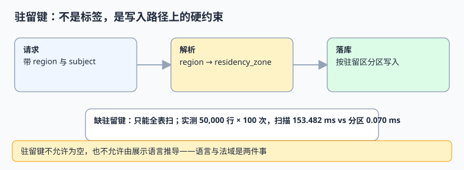

# 地区合规与数据驻留：驻留键是写入约束

「这条数据能不能出境」不是查询时打一个标签就能回答的，而是**写入那一刻就必须确定的路由**。本页把 `region`（用户在哪）、`locale`（怎么显示）、`residency_zone`（按哪条规则留在哪）三件事拆开，并给出写入守卫与本机代价账。

本页判据族 `GCM-A` ~ `GCM-H`，共 8 条。



## 一、三个容易混为一谈的概念

| 概念 | 回答什么 | 由谁决定 | 会不会变 |
| --- | --- | --- | --- |
| `region` | 用户/业务在哪个市场 | 账号、合同、结算地 | 会（用户迁移） |
| `locale` | 显示成什么语言与格式 | 协商链（见[协商](../LocaleNegotiation/index.md)） | 会（用户改设置） |
| `residency_zone` | 数据必须存放在哪个法域 | **法务清单 + 账号归属地**，服务端判定 | 基本不变，变更需迁移 |

**核心结论**：`residency_zone` 不能由 `locale` 或 IP 推导，也不能在查询时临时算。它决定写入哪个库/哪个分区/哪个对象存储桶，是**路由输入**。一句话记住：语言是给人看的，驻留是给数据定位置的。

::: warning 法律口径不写死在文档里
具体哪些地区要求本地存储、留存多久、跨境传输要什么手续，各法域与业务形态差异极大且会变。本页只给**工程约束的落地方式**：法务维护一张「地区 → 驻留区 → 允许的处理活动」清单，系统读清单，不把条款硬编码进 `if`。上线前请由法务与合规评审清单内容，本页不对具体法规做断言。
:::

## 二、写入守卫：四道门

```sql [V3__residency.sql]
CREATE TABLE residency_rule (
  region         TEXT PRIMARY KEY,
  residency_zone TEXT NOT NULL,
  allowed_ops    TEXT[] NOT NULL,
  version        TEXT NOT NULL,
  effective_from DATE NOT NULL
);

CREATE TABLE biz_event (
  event_id        BIGSERIAL PRIMARY KEY,
  occurred_at_utc TIMESTAMPTZ NOT NULL,
  residency_zone  TEXT NOT NULL,
  rule_version    TEXT NOT NULL,
  payload         JSONB NOT NULL,
  CONSTRAINT ck_residency_not_empty CHECK (residency_zone <> '')
);

CREATE INDEX ix_event_residency ON biz_event (residency_zone, occurred_at_utc);

-- 写入守卫：绕不过的触发器（示意，生产请加审计与灰度）
CREATE OR REPLACE FUNCTION tg_require_residency() RETURNS trigger AS $$
BEGIN
  IF NEW.residency_zone IS NULL OR NEW.residency_zone = '' OR NEW.rule_version = '' THEN
    RAISE EXCEPTION 'RESIDENCY_MISSING event_id=%', NEW.event_id;
  END IF;
  RETURN NEW;
END;
$$ LANGUAGE plpgsql;

CREATE TRIGGER bi_residency BEFORE INSERT ON biz_event
  FOR EACH ROW EXECUTE FUNCTION tg_require_residency();
```

四道门按顺序：① 请求进来先查 `residency_rule`；② 服务端把 `residency_zone` 写进上下文；③ 写入时触发器兜底；④ 定期巡检按驻留区核对实际存储位置。**第 ③ 道不能省**——只靠应用层容易在批量导入、异步补偿、后台任务里漏掉。

## 三、本机读数：只打标签、不落分区的代价

模拟 50,000 行记录，按 `region` 标签筛出某个驻留区，重复 100 次；对照组是写入时按驻留区分区：

| 写法 | 100 次筛选耗时 | 相对倍数 |
| --- | --- | --- |
| 无驻留键，全表扫描 | 153.482 ms | 1× |
| 写入时按驻留区分组 | 0.070 ms | **约 2,194×** |

> 这是 Python 内存里的模拟读数，**不是数据库基准**；它想说明的是量级与机制：驻留键缺失时，「列出某法域的全部数据」这件事只能全表扫，且随着数据量线性变贵。真实数据库里差异会体现在分区裁剪、索引命中与跨区传输上，但「只能扫」这个结论不变。

## 四、可运行示例：驻留判定与拒绝路径

```python [/tmp/residency.py]
RULES = {
    "DE": ("eu", "v3"), "FR": ("eu", "v3"),
    "CN": ("cn", "v3"), "US": ("us", "v3"),
    "SG": ("sg", "v3"),
}


def resolve(region, locale=None, client_ip=None):
    """刻意不接收 locale 与 IP：它们与法域没有因果关系"""
    if region not in RULES:
        raise ValueError(f"NO_RESIDENCY_RULE region={region}")
    return RULES[region]


def write(event_id, region, payload):
    zone, ver = resolve(region)
    if not zone:
        raise ValueError("RESIDENCY_MISSING")
    return {"event_id": event_id, "residency_zone": zone,
            "rule_version": ver, "payload": payload}


print(write(1, "DE", {"amount": 10}))
try:
    write(2, "BR", {"amount": 10})
except ValueError as e:
    print("REJECTED:", e)
```

预期输出：

```text
{'event_id': 1, 'residency_zone': 'eu', 'rule_version': 'v3', 'payload': {'amount': 10}}
REJECTED: NO_RESIDENCY_RULE region=BR
```

**「查不到规则就拒绝」比「查不到就给个默认值」安全得多**：后者会把一条应当本地存储的数据静默写进默认区，而且再也分不出来。

## 五、判据 `GCM-A` ~ `GCM-H`

| 编号 | 判据 | 不满足时改哪里 | 验证方式 |
| --- | --- | --- | --- |
| `GCM-A` | `residency_zone` 在写入时确定并落库，不允许为空 | DDL `CHECK` + 触发器 | 插空值必须抛 `RESIDENCY_MISSING` |
| `GCM-B` | 判定只读法务清单，不由 locale / IP / 浏览器语言推导 | 判定函数 | 改 `Accept-Language` 后驻留区不变 |
| `GCM-C` | 清单带 `version` 与 `effective_from`，变更可追溯 | 配置表 | 改规则后旧记录仍带旧版本 |
| `GCM-D` | 查不到规则时拒绝写入，不使用默认值 | 判定函数 | `BR` 用例被 `REJECTED` |
| `GCM-E` | 存储按驻留区分区/分库，索引含 `residency_zone` | 表结构与路由 | `EXPLAIN` 命中分区裁剪 |
| `GCM-F` | 批量导入、异步补偿、后台任务同样经过守卫 | 触发器 | 绕开应用直插仍被拒 |
| `GCM-G` | 删除与留存按驻留区执行，且删除留痕 | 删除流水线 | 见[隐私工程 · 删除](../../../Others/PrivacyEngineering/Deletion/index.md) |
| `GCM-H` | 定期巡检比对「声明驻留区 ⇄ 实际存储位置」 | 巡检任务 | 差异清单为空 |

## 六、易错点与最佳实践

::: danger 五个坑
1. **把 `region` 当 `residency_zone` 用。** 一个市场可能对应多个法域，一个法域也可能服务多个市场。
2. **靠 IP 或语言推法域。** 用户出差、用 VPN、改界面语言都不改变合同与数据属地。
3. **只在应用层做守卫。** 批量导入、消息重投、后台修数三条路径最容易绕过。
4. **查不到规则就给默认值。** 这是最安静的违规，且事后无法识别受影响记录。
5. **删除时只删主表。** 备份、索引、日志、导出文件里的副本同样受驻留约束，见[审计取证 · 留存](../../AuditForensics/index.md)。
:::

::: tip 一条设计建议
把驻留区放进**主键或分区键**，而不是普通列。这样「跨区查询」在物理上就变难，能挡住大量无意中写出的全表扫描——与[报表与自助分析](../../ReportAnalytics/index.md)里「过滤下推」的思路是同一回事。
:::

## 七、验证方式

```shell
cd /tmp && python3 residency.py
```

预期第二行 `REJECTED: NO_RESIDENCY_RULE region=BR`。数据库侧再跑一次反向探针（自建库）：

```sql
INSERT INTO biz_event(event_id, occurred_at_utc, residency_zone, rule_version, payload)
VALUES (999, now(), '', 'v3', '{}');
-- 期望：ERROR: RESIDENCY_MISSING
```

## 参考资料

- [GDPR（欧洲议会与理事会条例 2016/679）官方文本](https://eur-lex.europa.eu/eli/reg/2016/679/oj)
- [NIST SP 800-53 Rev.5 — 数据位置与存储控制](https://csrc.nist.gov/pubs/sp/800/53/r5/final)
- [ISO/IEC 27001:2022 信息安全管理体系](https://www.iso.org/standard/82875.html)
- [CNCF: Data residency 与多集群治理概览](https://www.cncf.io/)
