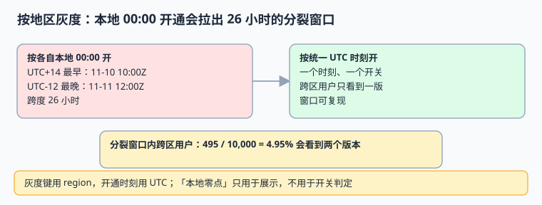

# 按地区灰度开通：一个 UTC 时刻，不是一个本地零点

「各地区在当地时间零点上线」听起来很体贴，实际上会把一次发布拉成 **26 小时的分裂窗口**：UTC+14 已经开、UTC-12 还没开，跨区用户与跨区服务在这段时间里看到两套行为。本页给出统一时刻的开关模型与回滚纪律。

本页判据族 `GRL-A` ~ `GRL-H`，共 8 条。



## 一、分裂窗口是怎么产生的

地球上的时区偏移从 UTC+14 到 UTC-12，跨度 **26 小时**。若每个地区都在「本地 00:00」开同一个功能：

| 口径 | 最早开通 | 最晚开通 | 跨度 |
| --- | --- | --- | --- |
| 各地本地 00:00（换算成 UTC） | UTC+14 → 2026-11-10 10:00Z | UTC-12 → 2026-11-11 12:00Z | **26 小时** |
| 统一 UTC 时刻 | 全地区同一时刻 | 全地区同一时刻 | 0 |

本机模拟：在 26 小时分裂窗口内，假设 5% 用户跨区访问，**495 / 10,000（4.95%）** 会看到两个版本。这 4.95% 的工单会分散在不同地区的值班队列里，每一处都只看到「个别用户反馈」，很难联想到同一次发布。

::: danger 「本地零点」还有一个更隐蔽的问题
它把**功能开关**与**展示口径**绑在了一起。开关本该是「一个可复现的布尔判定」，一旦依赖本地零点，就同时依赖 `ZoneId`、tzdb 版本、DST 状态与设备时钟——四者任意一个漂移，判定结果就变，而日志里往往只记了「已开通」。
:::

## 二、开关模型：三列就够

```sql [V4__rollout.sql]
CREATE TABLE rollout (
  feature      TEXT NOT NULL,
  region       TEXT NOT NULL,
  opens_at_utc TIMESTAMPTZ NOT NULL,   -- 统一时刻；按区分批时也是 UTC 时刻
  enabled      BOOLEAN NOT NULL DEFAULT FALSE,
  rule_version TEXT NOT NULL,
  PRIMARY KEY (feature, region)
);

-- 判定：只比较瞬时，不碰本地时间
-- enabled = (now() >= opens_at_utc) AND enabled
```

按地区分批完全没问题，但**每一批写的是 UTC 时刻**，而不是「当地 00:00」。想让某地区在当地上午开，就把那个上午换算成一个具体的 UTC 时刻写进表里，并把换算依据记在发布单上。

```python [/tmp/rollout.py]
from datetime import datetime, timezone, timedelta

# 统一时刻：一次判定、全地区一致
OPEN_UTC = datetime(2026, 11, 11, 2, 0, tzinfo=timezone.utc)


def enabled(now, region, opens=OPEN_UTC):
    """刻意不接收 locale / zone_id：开关与展示口径无关"""
    return now >= opens


# 对照：按各地本地 00:00 开，换算成 UTC 后各不相同
offs = [14, 9, 8, 1, 0, -5, -8, -12]
local_opens = [datetime(2026, 11, 11, 0, 0, tzinfo=timezone.utc) - timedelta(hours=o) for o in offs]
print("统一时刻:", OPEN_UTC.isoformat())
print("本地零点最早:", min(local_opens).isoformat())
print("本地零点最晚:", max(local_opens).isoformat())
print("分裂小时:", (max(local_opens) - min(local_opens)).total_seconds() / 3600)
print("同一请求判定:", enabled(datetime(2026, 11, 11, 1, 0, tzinfo=timezone.utc), "CN"),
      enabled(datetime(2026, 11, 11, 3, 0, tzinfo=timezone.utc), "CN"))
```

预期输出：

```text
统一时刻: 2026-11-11T02:00:00+00:00
本地零点最早: 2026-11-10T10:00:00+00:00
本地零点最晚: 2026-11-11T12:00:00+00:00
分裂小时: 26.0
同一请求判定: False True
```

## 三、四条发布纪律

1. **开关判定只读 UTC 瞬时**，不读 `zone_id`、不读 `locale`、不读客户端时间。
2. **灰度键用 `region`，缓存键也要带 `feature + region + rule_version`**；缺 `region` 会让先访问的地区把结果缓存给后访问的地区。
3. **回滚是「把开关关掉」，不是「把时间改回去」**。改时间会让已发生的历史判定无法复现，审计也解释不清。
4. **发布单记录换算依据**：若某批按当地上午开，写清「当地 09:00 对应 2026-11-11T01:00Z，依据 tzdb 2026e」。

## 四、判据 `GRL-A` ~ `GRL-H`

| 编号 | 判据 | 不满足时改哪里 | 验证方式 |
| --- | --- | --- | --- |
| `GRL-A` | `opens_at_utc` 是 `TIMESTAMPTZ`，判定只比较瞬时 | 表结构与判定函数 | 改会话时区后判定不变 |
| `GRL-B` | 全地区共用一个开通时刻；分批时每批仍是 UTC 时刻 | 发布配置 | 查表无「本地零点」表达式 |
| `GRL-C` | 判定函数不接收 `zone_id` / `locale` / 客户端时间 | 函数签名 | 代码审查 + 用例覆盖 |
| `GRL-D` | 缓存键含 `feature + region + rule_version` | 缓存层 | 两地区连续访问不串结果 |
| `GRL-E` | 回滚只改 `enabled`，不改 `opens_at_utc` | 发布流程 | 回滚后历史判定可复现 |
| `GRL-F` | `rule_version` 随判定留痕，日志可回答「当时按哪版」 | 日志字段 | 抽一条请求能查到版本 |
| `GRL-G` | 用例含跨区用户、DST 切换日与时钟回拨 | 测试矩阵 | 三类用例全绿 |
| `GRL-H` | 分裂窗口有实测台账，不靠「应该没问题」 | 发布单 | 记录 26 小时与 4.95% 的对照读数 |

## 五、易错点与最佳实践

::: danger 五个坑
1. **配置写「当地 00:00 生效」。** 换成 UTC 时刻，换算依据写进发布单。
2. **用客户端时间做判定。** 设备时钟可调，等于把开关交给用户。
3. **缓存键不带 `region`。** CDN 或本地缓存会把 A 地区的结果喂给 B 地区。
4. **回滚时改开通时间。** 历史判定瞬间变得无法解释，审计链路断掉。
5. **把灰度开关绑在业务日上。** 营业日有日切与 23/25 小时的日子，见[营业日与日切](../CalendarAndCutoff/index.md)。
:::

::: tip 与值班的结合
分裂窗口不是完全不能要——有些业务确实需要按当地营业节奏开。若要，就把它当成**一次 26 小时的发布窗口**来排班：明确起止 UTC、跨区用户口径、两版并存期间的数据兼容策略，而不是当成「一个零点」。
:::

## 六、验证方式

```shell
cd /tmp && python3 rollout.py
```

预期 `分裂小时: 26.0`，且最后一行是 `False True`。再检查配置表里是否残留本地时间表达式：

```sql
SELECT feature, region, opens_at_utc FROM rollout
WHERE opens_at_utc::text LIKE '%00:00:00+08%';
-- 期望：0 行（不应以本地零点表达开关）
```

## 参考资料

- [IANA Time Zone Database](https://www.iana.org/time-zones)
- [PostgreSQL: Date/Time Types](https://www.postgresql.org/docs/current/datatype-datetime.html)
- [RFC 9557 — Date and Time with Additional Information](https://www.rfc-editor.org/rfc/rfc9557.html)
- [Google SRE Book: Release Engineering（渐进发布与回滚）](https://sre.google/sre-book/release-engineering/)
