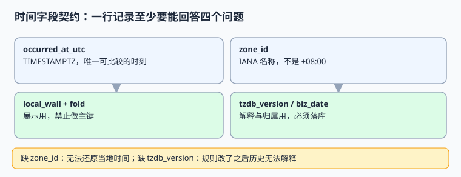

# 时间模型：一行记录要回答的四个问题

一条业务记录里的「时间」不是一列，而是一组契约：这件事**什么时候发生**、**当时按哪个地区的钟**、**按哪版规则解释**、**算到哪个业务日**。少一列，历史数据就会在某个时刻失去解释力。本页给出可直接落库的字段表、DDL 与断言。

本页判据族 `GTM-A` ~ `GTM-H`，共 8 条。



## 一、四个问题与六列字段

| 问题 | 必须能回答的字段 | 类型建议 | 允许为空 |
| --- | --- | --- | --- |
| 事情发生在时间轴的哪个点？ | `occurred_at_utc` | `TIMESTAMPTZ` / `Instant` | 否 |
| 当时按哪个地区的钟解释？ | `zone_id` | IANA 名称字符串，如 `America/New_York` | 否 |
| 按哪版规则解释？ | `tzdb_version` / `cldr_version` | 短字符串，如 `2026e` / `49` | 否 |
| 给人看是什么时候？ | `local_wall` + `fold` | 无时区字符串 + 0/1 | 可派生但建议落库 |
| 算到哪个业务日？ | `biz_date` + `cutoff_version` | `DATE` + 版本 | 否（需归属日时） |
| 数据按哪条法规留在哪？ | `residency_zone` | 枚举 | 否（见[驻留](../RegionalCompliance/index.md)） |

**为什么 `local_wall` 也要落库**：它是当时展示给用户、写进合同与凭证的字符串。时区规则后来改了，用新规则重新派生会得到一个「当年没出现过」的字符串。落库的是**事实**，派生的是**解释**。

::: info 术语对照
`occurred_at_utc` 是瞬时（Instant）；`local_wall` 是挂钟时间（wall-clock / plain datetime）；`biz_date` 是业务日（business date）。英文里 `timestamp` 一词在不同数据库含义不同：PostgreSQL 的 `TIMESTAMPTZ` 存的是瞬时，`TIMESTAMP WITHOUT TIME ZONE` 存的是挂钟，选错一列就等于把三种语义混成一个。
:::

## 二、字段契约模板（完整 DDL）

下面这份 DDL 用 PostgreSQL 语法给出，MySQL / SQLite 读者把 `TIMESTAMPTZ` 换成 `TIMESTAMP` 并保证写入前统一转 UTC 即可。

```sql [V1__event_time_contract.sql]
CREATE TABLE biz_event (
  event_id          BIGSERIAL PRIMARY KEY,
  occurred_at_utc   TIMESTAMPTZ      NOT NULL,
  zone_id           TEXT             NOT NULL,
  tzdb_version      TEXT             NOT NULL,
  cldr_version      TEXT             NOT NULL,
  local_wall        TEXT             NOT NULL,   -- 'YYYY-MM-DDTHH:MM:SS'
  local_fold        SMALLINT         NOT NULL DEFAULT 0 CHECK (local_fold IN (0, 1)),
  biz_date          DATE             NOT NULL,
  cutoff_version    TEXT             NOT NULL,
  residency_zone    TEXT             NOT NULL,
  -- 一条硬约束：zone_id 必须是 IANA 名称，不是固定偏移
  CONSTRAINT ck_zone_id_not_offset CHECK (zone_id NOT LIKE '%+%' AND zone_id NOT LIKE 'UTC-%'),
  CONSTRAINT ck_utc_string         CHECK (occurred_at_utc IS NOT NULL)
);

CREATE INDEX ix_biz_event_instant ON biz_event (occurred_at_utc);
CREATE INDEX ix_biz_event_biz    ON biz_event (residency_zone, biz_date);
-- 注意：故意不给 local_wall 建唯一索引
```

`ck_zone_id_not_offset` 这条 `CHECK` 看着朴素，却能把「把 `-05:00` 当时区存进库」这类错误挡在写入口；实战页的反向探针会验证它确实生效。

### 2.1 为什么不给 `local_wall` 建唯一索引

因为折叠日 `2026-11-01T01:30:00` 会真实出现两次。本机模拟：折叠日共 **1500 个真实分钟**，其中 **60 个本地分钟重复（4.00%）**；若用 `local_wall` 做唯一键，第二个 01:30 会被数据库直接拒掉，表现为「DST 结束当天少了一批事件」，而且不报错——唯一键冲突常被上层当成正常去重吞掉。

## 三、可运行示例：写入与还原

```python [/tmp/time_contract.py]
from datetime import datetime, timezone, timedelta
from zoneinfo import ZoneInfo

TZDB_VERSION = "2026e"
CLDR_VERSION = "49"


def to_row(instant, zone_id, cutoff_hour=4):
    """把一个瞬时展开成一行完整的时间契约"""
    z = ZoneInfo(zone_id)
    local = instant.astimezone(z)
    biz_date = (local - timedelta(hours=cutoff_hour)).date()
    return {
        "occurred_at_utc": instant.astimezone(timezone.utc).isoformat(),
        "zone_id": zone_id,
        "tzdb_version": TZDB_VERSION,
        "cldr_version": CLDR_VERSION,
        "local_wall": local.replace(tzinfo=None).isoformat(),
        "local_fold": local.fold,
        "biz_date": biz_date.isoformat(),
        "residency_zone": "us" if zone_id.startswith("America/") else "eu",
    }


for u in [datetime(2026, 11, 1, 5, 30, tzinfo=timezone.utc),
          datetime(2026, 11, 1, 6, 30, tzinfo=timezone.utc)]:
    print(to_row(u, "America/New_York"))
```

预期输出（节选关键字段）：

```text
{'occurred_at_utc': '2026-11-01T05:30:00+00:00', 'local_wall': '2026-11-01T01:30:00', 'local_fold': 0, 'biz_date': '2026-10-31', ...}
{'occurred_at_utc': '2026-11-01T06:30:00+00:00', 'local_wall': '2026-11-01T01:30:00', 'local_fold': 1, 'biz_date': '2026-10-31', ...}
```

两行的 `local_wall` 完全相同，`local_fold` 与 `occurred_at_utc` 不同——这正是「挂钟不能当身份」的最小证据。

## 四、常用清单：按场景选字段

| 场景 | 读哪些列 | 禁止用哪些列 | 理由 |
| --- | --- | --- | --- |
| 事件排序 / 分页 | `occurred_at_utc` + `event_id` | `local_wall` | 折叠日顺序会颠倒 |
| 用户看到的时间 | `local_wall` + `zone_id` + `tzdb_version` | 重新按当前规则派生 | 规则可能已改 |
| 日报 / 结算 | `biz_date` + `residency_zone` | `occurred_at_utc::date` | 会话时区会漂移 |
| 跨系统对账 | `occurred_at_utc` + `zone_id` | 格式化字符串 | 见[协商](../LocaleNegotiation/index.md) |
| 合规取证 | 全部六列 + 写入审计 | 只留日志 | 见[审计取证](../../AuditForensics/index.md) |
| 定时触发 | UTC 时刻 + `zone_id` | 本地 cron 表达式 | 见[时区与夏令时](../TimeZoneDST/index.md) |

## 五、判据 `GTM-A` ~ `GTM-H`

| 编号 | 判据 | 不满足时改哪里 | 验证方式 |
| --- | --- | --- | --- |
| `GTM-A` | `occurred_at_utc` 为 `TIMESTAMPTZ`，写入前统一转 UTC | 表结构 + DAO | 折叠日两条记录 UTC 不同、相差 3600 s |
| `GTM-B` | `zone_id` 存 IANA 名称且有 `CHECK` 约束拒绝偏移串 | DDL 约束 | 插 `UTC-05:00` 必须被拒 |
| `GTM-C` | `tzdb_version` / `cldr_version` 非空并随记录留痕 | 写入契约 | 全表空值率为 0 |
| `GTM-D` | `local_wall` 与 `local_fold` 成对存储，不做唯一键 | 索引定义 | 两条 01:30 都能写入 |
| `GTM-E` | `biz_date` 由日切配置派生并落库，不读会话时区 | 写入逻辑 | 改会话 `TimeZone` 后 `biz_date` 不变 |
| `GTM-F` | 索引按 `(residency_zone, biz_date)` 建，支持按区裁剪 | 索引定义 | `EXPLAIN` 命中索引而非全扫 |
| `GTM-G` | 跨系统接口只传 `occurred_at_utc` 与 `zone_id`，不传格式化串 | 接口契约 | 抓包检查无裸本地时间字符串 |
| `GTM-H` | 字段契约有可重跑断言与反向探针 | 门禁脚本 | 跑[实战](../Practice/index.md) `10/10 PASS` |

## 六、易错点与最佳实践

::: danger 五个必查项
1. **`TIMESTAMP WITHOUT TIME ZONE` 被当成 UTC 用。** 它存的是挂钟，会话时区一变读出就变；跨区系统一律用 `TIMESTAMPTZ`。
2. **把 `zone_id` 存成 `Asia/Shanghai` 的中文别名或 `GMT+8`。** 别名会失效，偏移不含规则；只认 IANA 名称。
3. **只存 UTC 不留 `zone_id`。** 事后无法回答「用户当时看到的是几点」，也无法重算营业日。
4. **把 `local_wall` 做成分区键或唯一键。** 折叠日直接吞数据；分区键请用 `biz_date`。
5. **日切点写死在代码里。** 改一次日切等于改全部历史报表，必须落 `cutoff_version` 并提供重算入口。
:::

::: tip 一条实用建议
字段多不是负担，是**把「当时怎么解释」固定下来**。真要精简，也只精简展示用的派生列，绝不能精简 `zone_id` 与 `tzdb_version`——它们是不可恢复的信息，丢了就再也补不回来。
:::

## 七、验证方式

```shell
cd /tmp && python3 time_contract.py
```

预期两行 `local_wall` 相同、`local_fold` 分别为 0 与 1。再用一条 SQL 收尾（在自建库里执行）：

```sql
SELECT count(*) FROM biz_event WHERE zone_id LIKE '%+%' OR zone_id LIKE 'UTC-%';
-- 期望：0
```

## 参考资料

- [PostgreSQL: Date/Time Types](https://www.postgresql.org/docs/current/datatype-datetime.html)
- [Java `java.time` Package（Instant / ZonedDateTime）](https://docs.oracle.com/en/java/javase/25/docs/api/java.base/java/time/package-summary.html)
- [RFC 9557 — Date and Time on the Internet with Additional Information](https://www.rfc-editor.org/rfc/rfc9557.html)
- [ISO 8601-1:2019（日期时间表示）](https://www.iso.org/standard/70907.html)
