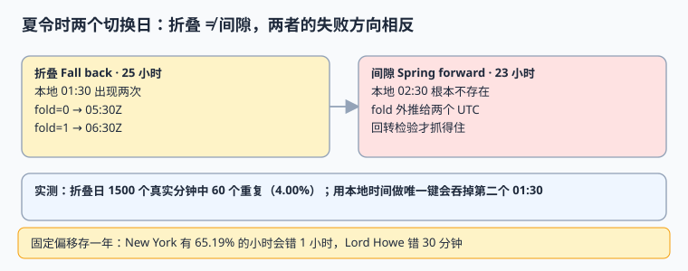

# 时区与夏令时：折叠、间隙和固定偏移的账

时区不是偏移，是一整套会变的规则；夏令时不是一个「差一小时」的开关，而是每年两次把本地时钟撕裂。本页用本机实测把三笔账算清楚：固定偏移错多少、折叠日丢多少、规则改了历史怎么解释。

本页判据族 `GTZ-A` ~ `GTZ-H`，共 8 条。



## 一、时区、偏移、规则版本

| 概念 | 英文 | 定义 | 会不会变 | 例子 |
| --- | --- | --- | --- | --- |
| 时区 | time zone / `ZoneId` | 一个地区从过去到未来的完整偏移规则集合 | 会，立法决定 | `America/New_York` |
| 偏移 | UTC offset | 某个**瞬时**与 UTC 的差 | 随时区规则变 | `-05:00` / `-04:00` |
| 规则库 | tzdb / zoneinfo | IANA 发布的规则数据 | 一年多次 | `2026e`（2026-09-29） |
| 折叠 | fold / overlap | 时钟回拨，同一挂钟时间出现两次 | 每年一次（有 DST 的地区） | 2026-11-01 01:30 |
| 间隙 | gap / spring forward | 时钟前拨，某段挂钟时间不存在 | 每年一次 | 2026-03-08 02:30 |
| 消歧 | disambiguation | 指定用哪一次折叠 | 显式参数 | Python `fold=0/1` |

**版本事实（2026-11-10 联网核对）**：IANA 2026 年内已发布 `2026a`（03-01）、`2026b`（04-22）、`2026c`（07-08）、`2026d`（09-11）、`2026e`（09-29）。其中 `2026c` 记录 Alberta 与 Morocco 改为永久偏移，`2026d` 记录加拿大西北地区，`2026e` 记录 Manitoba 于 2026-10-31 改为永久 -05。**一年五版意味着：不记版本，就无法解释一年前的本地时间是怎么算出来的。**

## 二、折叠与间隙：方向相反的两个坑

### 2.1 折叠（Fall back，25 小时的一天）

```python [/tmp/dst_fold.py]
from datetime import datetime, timezone
from zoneinfo import ZoneInfo

ny = ZoneInfo("America/New_York")
t = datetime(2026, 11, 1, 1, 30, tzinfo=ny)
for fold in (0, 1):
    print(fold, t.replace(fold=fold).astimezone(timezone.utc).isoformat())
```

预期输出：

```text
0 2026-11-01T05:30:00+00:00
1 2026-11-01T06:30:00+00:00
```

同一个字符串 `2026-11-01 01:30` 对应两个相隔 **3600 秒**的瞬时。本机逐分钟扫描：折叠日实际有 **1500 个本地分钟**，映射到 1500 个不同 UTC 分钟，其中 **60 个本地分钟重复**（4.00%）。用本地时间做唯一键，会静默吞掉第二条。

### 2.2 间隙（Spring forward，23 小时的一天）

```python [/tmp/dst_gap.py]
from datetime import datetime, timezone
from zoneinfo import ZoneInfo

ny = ZoneInfo("America/New_York")
naive = datetime(2026, 3, 8, 2, 30)
for fold in (0, 1):
    aware = naive.replace(tzinfo=ny, fold=fold)
    u = aware.astimezone(timezone.utc)
    back = u.astimezone(ny).replace(tzinfo=None)
    print(fold, u.isoformat(), "回转一致=", back == naive)
```

预期输出：

```text
0 2026-03-08T07:30:00+00:00 回转一致= False
1 2026-03-08T06:30:00+00:00 回转一致= False
```

::: danger 间隙时刻没有「正确答案」
`fold=0/1` 在间隙里给出的两个 UTC 时刻都是**外推值**，不是真实发生过的本地时刻。PEP 495 规定此时 `fold` 只用于保持运算可逆，**不能**当作消歧答案。唯一的检测办法是「转 UTC 再转回本地，看是否等于原挂钟时间」——上例两次回转都 `False`。业务上遇到间隙时间，要么拒绝并让用户改，要么按明确的策略（前移/后移）记录，绝不静默接受。
:::

### 2.3 不是所有 DST 都是一小时

`Australia/Lord_Howe` 的夏令时只挪 **30 分钟**：本机实测 1 月偏移 `+11:00`、7 月 `+10:30`，差 30 分钟。`Pacific/Chatham` 是 `+12:45/+13:45`。任何「按整小时切窗口」「偏移一定是整点」的假设都会在这些地区失效。

## 三、固定偏移的全年误差账

模拟 2026 全年 8,760 个小时，用「1 月 1 日的偏移」当作全年固定偏移，与真实 `ZoneId` 逐小时比对：

| 时区 | 偏移与年初不符的小时 | 占比 | 最大差值 |
| --- | --- | --- | --- |
| `America/New_York` | 5,711 / 8,760 | **65.19%** | 3600 s |
| `Europe/London` | 5,040 / 8,760 | 57.53% | 3600 s |
| `Europe/Berlin` | 5,040 / 8,760 | 57.53% | 3600 s |
| `Australia/Lord_Howe` | 4,369 / 8,760 | 49.87% | **1800 s** |
| `Pacific/Chatham` | 4,200 / 8,760 | 47.95% | 3600 s |
| `America/Santiago` | 3,697 / 8,760 | 42.20% | 3600 s |
| `Asia/Shanghai` | 0 / 8,760 | 0.00% | 0 s |
| `Asia/Kolkata` | 0 / 8,760 | 0.00% | 0 s |

再补一笔更贴近事故的读数：把 DST 期间的本地时间按「年初偏移」反推 UTC，1,252 个采样点的**平均误差 2,346.3 秒**（约 39 分钟），最大 3,600 秒，65.18% 的采样非零。注意 `Asia/Shanghai` 与 `Asia/Kolkata` 全年 0% ——**这正是固定偏移写法能长期潜伏的原因**：在国内测试全绿，一到欧美就错。

## 四、规则版本漂移怎么处理

规则会改，且改动可能追溯历史。三条纪律：

1. **写入时记 `tzdb_version`**：让每条记录自带「当时按哪版规则解释」。
2. **不要就地重算历史 `local_wall`**：升级 tzdb 后，新规则可能把旧时刻解释成另一个挂钟时间；保留落库字符串，只在需要时按记录的版本重算并存成新列。
3. **升级做双跑对比**：升级前后对同一批 `occurred_at_utc + zone_id` 各派生一次，输出差异清单，人工确认后才切换解释源。

```shell
# 升级前后各跑一次，比较差异（示意命令，脚本内容见实战页）
python3 derive_wall.py --tzdb 2026d > /tmp/wall_before.txt
python3 derive_wall.py --tzdb 2026e > /tmp/wall_after.txt
diff /tmp/wall_before.txt /tmp/wall_after.txt | head -20
```

预期：升级引发规则变化的地区会出现在 `diff` 里；**没有差异不等于可以跳过这一步**，因为下一次升级可能就有。

## 五、判据 `GTZ-A` ~ `GTZ-H`

| 编号 | 判据 | 不满足时改哪里 | 验证方式 |
| --- | --- | --- | --- |
| `GTZ-A` | 存储与传输只用 IANA `ZoneId`，不使用固定偏移 | 写入契约与 DDL `CHECK` | 扫 `zone_id` 中的 `+` / `UTC-`，应为 0 行 |
| `GTZ-B` | 折叠时间显式带 `fold` / `disambiguation` | 解析层 | 两个 01:30 转 UTC 相差 3600 s |
| `GTZ-C` | 间隙时间用回转检验拒绝，不静默接受 | 解析层 | 2026-03-08 02:30 回转不一致，必须报错 |
| `GTZ-D` | 本地时间不用于唯一键、排序与分区 | 索引与 DAO | 折叠日两条同挂钟时间均可落库 |
| `GTZ-E` | 每条记录带 `tzdb_version` | 写入契约 | 空值率 0 |
| `GTZ-F` | 升级 tzdb 前做双跑差异对比并留报告 | 发布流程 | `diff` 产物入库/入档 |
| `GTZ-G` | 定时触发按 `ZoneId` 计算下一次 UTC 时刻，不按固定偏移累加 | 调度器 | 跨 DST 切换周逐日核对触发 UTC |
| `GTZ-H` | 存在 30 分钟 / 45 分钟偏移地区的用例 | 测试矩阵 | 用例含 `Australia/Lord_Howe` 与 `Pacific/Chatham` |

## 六、易错点与最佳实践

::: danger 六个坑
1. **用 `+08:00` 当时区存库。** 偏移不含历史与未来规则，DST 期间直接错。
2. **把 `fold` 当布尔标志随手丢掉。** 丢了之后两个 01:30 无法区分，重试与去重都会串。
3. **间隙时刻直接 `new Date('2026-03-08 02:30')`。** 各运行时解析策略不同，可能给出 01:30 或 03:30。正确做法：显式检测并拒绝。
4. **假设 DST 都是 1 小时、偏移都是整点。** Lord Howe 30 分钟、Chatham 45 分钟都是反例。
5. **升级 tzdb 后重算历史挂钟时间并覆盖原值。** 那会把「当时写进合同的字符串」改掉。
6. **只在 `Asia/Shanghai` 下跑测试。** 全年 0% 误差，最容易给出虚假的绿灯。
:::

::: tip 一句话建议
把「折叠日、间隙日、30 分钟 DST 地区、两次 tzdb 升级」写进每季度一次的回归用例；这四条覆盖了绝大多数跨区时间事故。
:::

## 七、验证方式

```shell
cd /tmp && python3 dst_fold.py && python3 dst_gap.py
```

预期：折叠脚本输出两个相差一小时的 UTC；间隙脚本两次都打印 `回转一致= False`。若本机 tzdb 较旧导致 `America/New_York` 规则不同，先执行 `python3 -c "from zoneinfo import ZoneInfo; from datetime import datetime; print(datetime(2026,11,1,1,30,tzinfo=ZoneInfo('America/New_York')).utcoffset())"` 记录本机版本，再对照本页读数。

## 与「网络时间同步与时钟治理」专题的分工（第 272 天补充）

本页管「同一个时刻在不同地方该显示成几点」；[网络时间同步与时钟治理](../../../Ops/ClockSync/index.md) 管「那个时刻本身准不准」。这两件事经常被混成一件，后果是**把时区偏移当成时钟偏差去校正**。

**一页一坑**：DST 切换当天看到「所有时间戳差一小时」，于是去调 NTP。真实情况是 UTC 时刻没错、只是本地呈现换了偏移——此时 `date` 看起来对不上，`chronyc tracking` 的 `System time` 却是 0.000000。判定顺序必须是先看 UTC 与 `offset`，再看时区：`timedatectl` 里的 `RTC in local TZ: no` 与 `Time zone:` 两行能在一秒内把这两类问题分开。反过来，若 UTC 真的偏了，DST 页面上的所有边界计算都会跟着错，而且错得很整齐——这正是它难发现的原因。

- 要判「三个『现在是几点』分别指什么」→ [总览：三个「现在是几点」](../../../Ops/ClockSync/Overview/index.md)
- 要判「UTC 之外的第五种时间（TAI）差多少」→ [闰秒与 smearing](../../../Ops/ClockSync/LeapSecond/index.md)
- 要判「容器里时区对、时钟不对」→ [当前主线：chrony](../../../Ops/ClockSync/ModernChrony/index.md)

## 参考资料

- [IANA Time Zone Database Releases](https://recursive.iana.org/time-zones/releases)
- [PEP 495 — Local Time Disambiguation](https://peps.python.org/pep-0495/)
- [Python `zoneinfo` — IANA time zone support](https://docs.python.org/3/library/zoneinfo.html)
- [Java `ZoneId` 与 `ZonedDateTime`](https://docs.oracle.com/en/java/javase/25/docs/api/java.base/java/time/ZonedDateTime.html)
- [MDN: Temporal.ZonedDateTime 与消歧](https://developer.mozilla.org/en-US/docs/Web/JavaScript/Reference/Global_Objects/Temporal/ZonedDateTime)
