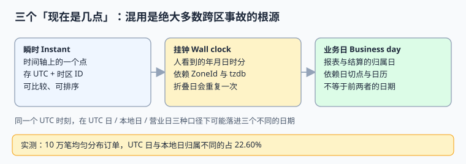
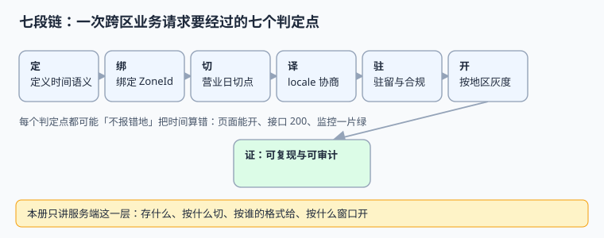

# 全球化与时区本地化工程

一个系统跨出国界之后，最先坏掉的通常不是翻译，而是**时间**：同一笔订单在三个地区落进三个不同的「日期」，同一次夏令时切换让本地时间 01:30 出现两次，而按「各地零点」灰度的新功能会在 26 小时里让跨区用户看到两个版本。这些失败几乎都不报错——页面能开、接口返回 200、监控一片绿。

本册讲的是**服务端怎么把跨区时间与地区语义做对**：存什么、按什么切、按谁的格式给、按什么窗口开、按哪条法规留在哪个区。界面层的翻译与排版不在这里，金额与汇率换算也不在这里。

::: info 本册的定位与版本
适用对象：要给业务系统补上多时区、多地区、多法域能力的后端与平台工程师。新内容面向当前主流实现，不绑定某个厂商产品。

版本事实联网核对（2026-11-10 检索）：**IANA Time Zone Database 最新为 2026e（2026-09-29）**，2026 年内已连续发布 2026a（03-01）/ 2026b（04-22）/ 2026c（07-08）/ 2026d（09-11）/ 2026e，其中 2026c 起 Alberta、Morocco、加拿大西北地区与 Manitoba 先后改为永久偏移；**Unicode CLDR 49（2026-10-22）** 为当前稳定版（48.2 为 2026-03-17）；**ICU 79（2026-10-27）** 集成 CLDR 49。JavaScript `Temporal` 已进入主流运行时（Firefox 139+、Chrome 144+），但 Safari 稳定版与 Node 各版本支持面不齐，且不同资料对标准化阶段的口径不一致——以 [TC39 提案页](https://github.com/tc39/proposal-temporal) 与 [MDN](https://developer.mozilla.org/en-US/docs/Web/JavaScript/Reference/Global_Objects/Temporal) 为准，本册按「可用但要特性检测或带 polyfill」处理，不写死阶段号。

本册读数全部来自本机 **Python 3.13.12 标准库 `zoneinfo` + SQLite 3.50.4** 的模拟实验（固定种子 `20261110`，脚本不入库、读者可照文档复现），**不是生产系统基准**；涉及金额、时区规则变更等敏感结论，上线前请以本地实测替换。
:::

## 一、为什么是「改层不改题」

轮换表第 269 行原题「全球化与时区本地化工程」，建议章节包含时区与夏令时、货币与汇率、文案与格式、地区合规、灰度开通。动手前按「**邻页行数 + 未回答的问题**」双判据逐项核查：

| 邻页 | 规模 | 它已经回答了什么 | 本册不重复什么 |
| --- | --- | --- | --- |
| [多币种与汇率](../MultiCurrency/index.md) | 11 页 / 1,884 行 | 金额模型、汇率源、舍入、估值、结算与对账 | 不再讲汇率、舍入、多币种账 |
| [国际化与无障碍](../../Frontend/IntlA11y/index.md) | 11 页 / 2,452 行 | i18n 架构、原生 `Intl`、翻译工作流、框架落地、a11y | 不再讲界面文案与组件层格式化 |
| [Cron 语义](../DistributedScheduling/CronSemantics/index.md) | 成建制单页 | 触发器、misfire、选主与漏跑补偿 | 不再讲调度器怎么配 |
| [订阅计费周期](../SubscriptionBilling/Cycle/index.md) | 成建制单页 | 账期、续订日、周期边界 | 不再讲计费规则本身 |
| [预约档期模型](../AppointmentBooking/SlotModel/index.md) | 成建制单页 | 容量、半开区间、占座与释放 | 不再讲库存与档期 |
| [时序数据库](../../DB/TimeSeries/index.md) | 成建制专题 | 时间线存储、降采样与查询 | 不再讲存储引擎 |
| [多活单元模型](../../Ops/MultiActive/CellModel/index.md) | 成建制单页 | 单元化、路由与容灾 | 不再讲多活架构 |

逐词检索（`git grep`，2026-11-10）：「全球化」在 `docs/` 下只有 **4 处顺带提及**，「时区」虽有 **156 篇**命中，但全都是「在某一业务里提一句 DST/日切」；「时区ID」「地区灰度」「locale 协商」「数据驻留」基本是 **0 命中**，`docs/` 下没有任何 `Global*` / `TimeZone*` 独立主题。

::: danger 判「已覆盖」不能只看关键词命中数
「时区」156 篇看起来很多，但打开会发现它们分散在报名、招投标、SLA 时钟、订阅周期等页面里，各自只回答本业务的那一段。**空白不在主题，在层**：没有一处系统回答「一条记录要存哪些时间字段、按哪个日切归属、按哪版时区规则解释、按哪个窗口开功能、按哪条法规留在哪个区」。所以本册保留题名，把范围收窄到**服务端时间/地区工程层**。
:::

## 二、三个「现在是几点」

| 名字 | 英文 | 定义 | 能不能比较 | 典型误用 |
| --- | --- | --- | --- | --- |
| 瞬时 | Instant | 时间轴上的一个确定点，与地理无关 | **能**，全序 | 拿本地字符串去排序，折叠日两条 01:30 顺序颠倒 |
| 挂钟 | Wall clock | 人看到的「年月日 时分秒」，依赖 `ZoneId` | 不能，可能重复或不存在 | 用 `2026-11-01 01:30` 做唯一键 |
| 业务日 | Business day | 报表、结算、SLA 的归属日，依赖日切点与日历 | 只在口径内可比 | 把 UTC 日期直接写进日报 |

本机 10 万笔均匀分布订单的模拟里，**UTC 日与用户本地日的归属差异是 22.60%**；再叠加「本地 04:00 日切」的营业日口径，差异是 **22.87%**。也就是说，五笔订单里就有一笔会落在两个不同的「日期」下——而这两个日期都是对的，只是口径不同。

## 三、七段链与六个安静的失败

| 段 | 做什么 | 安静的失败 | 本册实测 |
| --- | --- | --- | --- |
| 定 | 定义瞬时、挂钟、业务日三类语义与字段契约 | 一个 `created_at` 字段承担三种职责 | 三个口径下同一时刻可落进三个日期 |
| 绑 | 每条记录绑定 `ZoneId` 与 `tzdb_version` | 只存 `+08:00` 固定偏移 | New York 全年 **65.19%** 的小时错 1 小时 |
| 切 | 按地区日切点算营业日 | 用 UTC 日代替营业日 | 逐日平均差 **9.6 行（3.50%）**，单日最大 41 行 |
| 译 | 按协商出的 locale 格式化 | 不带 locale 的金额/日期串 | **90.09%** 的金额串含千分位，且都能被另一种 locale 解析成别的值 |
| 驻 | 写入时落 `residency_zone` | 只打 `region` 标签、事后全表捞 | 50,000 行 × 100 次：扫描 153.482 ms vs 分区 0.070 ms（**约 2,194×**） |
| 开 | 按地区灰度，开关用统一 UTC 时刻 | 按「各地本地零点」开 | UTC+14 到 UTC-12 拉出 **26 小时**分裂窗口，4.95% 跨区用户看到两版 |
| 证 | 留痕、可复现、可审计 | 规则改了没记版本 | 实战 10 条断言含反向探针，`10/10 PASS` |

## 四、两条贯穿全册的主张

1. **存时刻、存地区、存解释版本；展示是派生物。** `occurred_at_utc` / `zone_id` / `tzdb_version` / `locale` / `biz_date` / `residency_zone` 六个字段缺一不可，缺任何一个，历史数据就会在规则变更、地区变更或复盘时失去解释力。
2. **开关与统计口径一律用 UTC 与 UTC 时刻；本地时间只用于给人看。** 「本地零点开功能」「本地日期做主键」「本地时间排序」这三种写法，分别对应灰度分裂、折叠日吞数据、顺序错乱三类事故。

::: tip 一句话理解
治理层回答「要不要支持多地区」，本册回答「**支持之后，系统凭什么还自洽**」。前者错了会在需求评审被拦下，后者错了往往要等一次 DST 切换或一次跨区对账才暴露。
:::

## 五、版本目录：按 API 代际拆，不按数据年份拆

本主题确实存在**同一份需求、两套不兼容写法**，因此按 `AGENTS.md` 第 3 节「大版本管理」建两个版本目录，旧内容原样保留、标注状态、不覆盖：

| 目录 | 覆盖内容 | 维护状态 | 新代码是否使用 |
| --- | --- | --- | --- |
| [旧版日期时间 API](LegacyDateTime/index.md) | `java.util.Date` / `Calendar` / `SimpleDateFormat`、JS `Date` + moment、固定偏移字符串 | **仅存量项目使用 · 已停止新增** | 否，只用于维护存量与做迁移映射 |
| [当前主线日期时间 API](ModernDateTime/index.md) | `java.time`、JS `Temporal`、ICU4J / CLDR、`zoneinfo` | **当前主线 · 持续维护** | 是 |

三条理由写在这里，避免后来者误判：

1. **换代的是 API 形态，不是判据。** 本册 11 族判据（时间语义、折叠、日切、驻留、灰度……）在两代 API 上都成立，按「问题」切成 9 章正文；若硬按 API 把所有章节复制两遍，90% 正文会重复。
2. **真正需要版本目录的是「同一件事两套写法」。** `Date` 可变、月份从 0 起、无时区语义；`java.time` 不可变、显式 `ZoneId`。这与库内 [Spring5 / Spring6](../../Backend/index.md)、`Vue2 / Vue3`、`Graphql16 / Graphql17` 是同一类差异，故只把**写法与迁移映射**拆成两个版本目录。
3. **tzdb / CLDR 是数据版本，不是代码代际。** 2026 年一年就发了 5 个 tzdb 版本，若按年份建目录会造出 5 份几乎相同的正文，且历史记录本来就该由字段 `tzdb_version` 说明「当时按哪版规则解释」。所以数据版本**落库、不建目录**，并在[时区与夏令时](TimeZoneDST/index.md)页给出版本漂移的处理办法。

::: warning 旧版目录的处置纪律
`LegacyDateTime/` 的内容不改写、不删除、不与新版合并；目录页与侧边栏同时保留入口（折叠展示），并在该页顶部标注「仅存量项目使用 · 已停止新增」。需要新增能力时一律写进 `ModernDateTime/`，需要迁移说明时只在旧页补一张映射表。
:::

## 六、本册结构

- [总览：三个「现在是几点」与六个安静的失败](Overview/index.md) — `GLO`
- [时间模型：一行记录要回答的四个问题](TimeModel/index.md) — `GTM`
- [时区与夏令时：折叠、间隙和固定偏移的账](TimeZoneDST/index.md) — `GTZ`
- [地区与语言协商：优先级链必须写死](LocaleNegotiation/index.md) — `GLC`
- [营业日与日切：同一天不是同一个日期](CalendarAndCutoff/index.md) — `GCD`
- [地区合规与数据驻留：驻留键是写入约束](RegionalCompliance/index.md) — `GCM`
- [按地区灰度开通：一个 UTC 时刻，不是一个本地零点](RolloutByRegion/index.md) — `GRL`
- [旧版日期时间 API（仅存量项目使用）](LegacyDateTime/index.md) — `GLD`（版本目录）
- [当前主线日期时间 API](ModernDateTime/index.md) — `GMD`（版本目录）
- [实战：五张表、十条断言与一个反向探针](Practice/index.md) — `GPX`
- [常见问题与分诊](FAQ/index.md) — `GFQ`

合计 11 章 / 11 族 88 条判据，每章 8 条，逐族实测无撞号。

## 七、建议阅读顺序

1. 先读[总览](Overview/index.md)与[时间模型](TimeModel/index.md)，把「一行记录该有哪些字段」定下来——后面所有章节都建立在这份契约上。
2. 再读[时区与夏令时](TimeZoneDST/index.md)、[营业日与日切](CalendarAndCutoff/index.md)，这两章回答「为什么本地时间不能当身份」。
3. 然后按需要选读[协商](LocaleNegotiation/index.md)、[驻留](RegionalCompliance/index.md)、[灰度](RolloutByRegion/index.md)——它们是三条独立的工程线。
4. 最后照[实战](Practice/index.md)跑一遍断言，用[版本目录](ModernDateTime/index.md)选 API，用[分诊](FAQ/index.md)排障。已有存量系统的读者可以直接从[旧版目录](LegacyDateTime/index.md)的迁移映射表入手。

## 八、参考资料

- [IANA Time Zone Database（官方）](https://www.iana.org/time-zones)
- [IANA Time Zone Database Releases（版本与变更说明）](https://recursive.iana.org/time-zones/releases)
- [Unicode CLDR Releases / Downloads](https://cldr.unicode.org/index/downloads)
- [Unicode CLDR 项目主页](https://cldr.unicode.org/)
- [ICU 与 ICU4J 用户指南](https://unicode-org.github.io/icu/userguide/)
- [PEP 495 — Local Time Disambiguation](https://peps.python.org/pep-0495/)
- [Python `zoneinfo` — IANA time zone support](https://docs.python.org/3/library/zoneinfo.html)
- [RFC 9557 — Date and Time on the Internet with Additional Information](https://www.rfc-editor.org/rfc/rfc9557.html)
