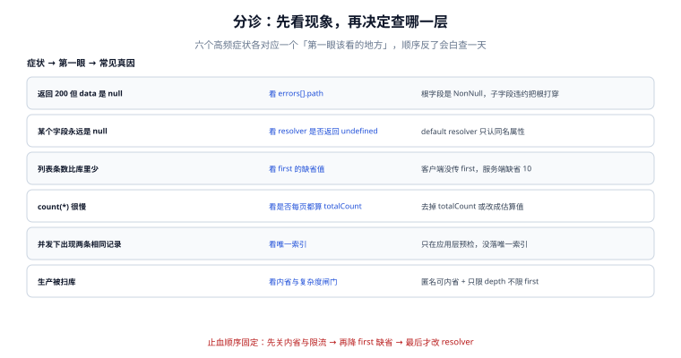

# 常见问题与分诊

**这一页不是"问答合集"，是一张分诊表。** 同一个现象在 GraphQL 里可能来自四个完全不同的层（校验、执行、批量、数据），顺序查错就会白花一天。下面每一行都给出「第一眼看哪里」——它是这一行的全部价值。

一句话定位：本页回答「看到某个现象时，先查哪一层、再查哪一层、以及哪五步是不管什么情况都先做的」。



本页判据族 `GQF-A` ~ `GQF-H`，共 8 条。

## 分诊表：现象 → 第一眼 → 常见真因

| 现象 | 第一眼看 | 常见真因 |
| --- | --- | --- |
| HTTP 200，但 `data` 是 `null` | `errors[].path` | 根字段声明成非空，子字段违约把根打穿 |
| 某个字段永远是 `null` | resolver 里 `Object.keys(parent)` | 默认 resolver 只取同名属性，`duration_sec` 对不上 `durationSec` |
| 列表条数比库里少 | 客户端有没有传 `first` | 没传时用的是服务端缺省值（常见 10） |
| 列表条数比 `first` 多 | `hasNextPage` 的实现 | 多取一条的判断写错了，把 `first+1` 条也返回了 |
| 首屏慢、翻页更慢 | `totalCount` 是否每页都算 | 每页一次 `count(*)` |
| 并发下出现两条相同记录 | 唯一索引是否存在 | 只在应用层预检，没落唯一索引 |
| 并发下更新丢失 | `update` 的 `where` 有没有版本条件 | 后写覆盖前写 |
| 生产被扫库 / 流量异常 | 内省是否匿名可查 | 匿名内省 + 只限深度不限 `first` |
| 加了个枚举值就崩 | 客户端 `switch` 的 `default` | 客户端把未知值当异常 |
| 升级 graphql 后装不上 | `peerDependencies` | `graphql@17` 与 `@apollo/server@5` 冲突 |
| 升级后某处 `import` 报 undefined | 六个被移除的导出 | `formatError` / `assertValidName` 等已删 |
| 本地正常、CI 构建失败 | 链接与文件名大小写 | 大小写不敏感文件系统掩盖了路径错拼 |

最后两行不属于 GraphQL 本身，但在这个仓里出现的频率很高，所以一并列出——**分诊表的价值在于它覆盖的是"你实际会遇到的现象"，不是"这门技术的知识点"。**

## 五个高频误区

### ① 「GraphQL 比 REST 快」

不成立。GraphQL 快的地方是**请求数**（一个页面一次请求代替 N 个接口），慢的地方是**单请求成本不可预测**。同一份数据，REST 下每个接口的成本是固定的、可压测的；GraphQL 下成本由客户端查询决定，可能比 REST 低一个数量级，也可能高两个数量级。

正确的表述是：**GraphQL 把「多次往返」换成了「一次不确定成本的往返」**，值不值取决于你能不能把成本管住（闸门）。

### ② 「用了 DataLoader 就没有 N+1」

DataLoader 只解决「同一层里同类字段的批量」。三种情况它救不了：

- **不同字段各自 N+1**：`author` 用 loader 了，`tags` 没用，还是 N+1。
- **嵌套两层的 N+1**：`course → lessons → author`，每个 lesson 的 author 又各查一次；loader 能批，但批的是「本 tick 内所有 author」，若 executor 是深度优先串行执行，一个 tick 里可能只有 1 个 key。这时候需要 `maxBatchSize` 与调度配合，或者干脆在父层一次把关联数据捞全。
- **resolver 内部的循环**：`Author.avatar` 里 `for (const f of files) { await db.find(f) }`，DataLoader 管不到这一层。

### ③ 「关掉内省就安全了」

不。内省只是降低暴露面。schema 的形状会通过错误信息、字段行为、文档、客户端包里的 `.graphql` 文件泄漏出去。真正的安全靠三处鉴权，见[安全一页](../Security/index.md)。

### ④ 「一个 mutation 就是一个事务」

不。规范只保证顶层字段串行，不保证回滚。要事务就开数据库事务，且事务边界必须在**一个** resolver 里（跨 resolver 的事务需要把 `BEGIN/COMMIT` 提到执行器外面，这已经超出 GraphQL 的语义范围）。

### ⑤ 「schema 变了就开 v2」

GraphQL 的演进工具是 `@deprecated` + 只加不删。开 `v2` 意味着两套 schema 并行维护，而那正是 GraphQL 想避免的事。真正需要开版本的情形只有一种：**破坏性变更无法通过"加字段"表达**（比如把一个字段的语义整体换掉），那时用新字段名 + 弃用旧字段，仍然不需要 `v2` 端点。

## 止血五步：顺序不能换

线上出问题时的固定动作，**从最便宜的、影响面最小的开始**：

1. **关内省、关 GraphiQL、拒数组批处理。** 三行配置，重启即可，风险最低。
2. **把 `first` 的缺省值与上限压下去**（如缺省 20、上限 100）。这一步能立刻压掉大部分宽查询。
3. **给单端点加请求级限流与并发上限。** 注意这是"止血"不是"修复"——它会让正常用户也变慢。
4. **改 resolver。** 补 DataLoader、补 `where`、去掉多余字段。这一步要发版，最慢。
5. **回滚。** 如果问题是某次发布引入的，第 5 步应该提到第 1 步——判断依据是「发布前后 30 分钟的错误率曲线有没有拐点」。

::: danger 注意
**第 3 步有个反直觉的陷阱：限流会把「一个坏查询」变成「所有人的请求都超时」。** 一个客户端的宽查询占满并发后，限流对它是有效的（它自己也被限），但它已经占住的那部分槽位不会立刻释放——于是正常请求排在后面超时。正确的顺序是先压 `first` 上限（第 2 步），再限流。这两步反了，事故会从"部分用户慢"扩大到"全站 504"。
:::

## 术语表：六组容易混的

| 术语 | 容易混成 | 区别 |
| --- | --- | --- |
| `query` / `mutation` | 「读接口 / 写接口」 | 关键差别不是读写，是**顶层字段可否并行** |
| null 冒泡 / 字段返回 null | 同一个东西 | 冒泡是**规范行为**：非空违约会让父对象变 null |
| 复杂度 / 深度 | 「差不多」 | 深度是层数，复杂度是**层数 × 扇出**的乘积 |
| 持久化查询 / 缓存 | 同一个东西 | 持久化省的是**请求体**，缓存省的是**执行** |
| `edges.cursor` / `node.id` | 都能当游标 | cursor 必须不透明；`id` 可以猜，猜了就会有人拼 |
| `errors[]` / `userErrors[]` | 都是错误 | 前者是系统故障，后者是业务拒绝 |

## 本页判据

| 判据 | 看什么现象 | 判成什么 | 不满足时改哪里 |
| --- | --- | --- | --- |
| `GQF-A` | 分诊表里每行都有「第一眼看哪里」 | 现象可定位 | 缺一列就补一列 |
| `GQF-B` | 每个读数都标明口径（实测 / 建模 / 推算） | 数字不被误信 | 页内加口径说明 |
| `GQF-C` | 止血步骤按「影响面从小到大」排序 | 止血不扩大事故 | 调整顺序并写明理由 |
| `GQF-D` | 「关内省 ≠ 安全」被明确写出来 | 不产生虚假安全感 | 补一句边界说明 |
| `GQF-E` | 「一个 mutation 不是事务」被明确写出来 | 不误用 | 补规范引用 |
| `GQF-F` | 术语表覆盖六组高频混淆 | 沟通成本下降 | 按事故复盘补条目 |
| `GQF-G` | 误区条目都带「正确表述」而不是只否定 | 可执行 | 每条加一句怎么才对 |
| `GQF-H` | 与本册其他页的交叉链接可达 | 读者能跳到细节 | 补相对路径链接并跑链接巡检 |

## 验证方式

分诊表本身也可以被验证：**每一行都应该在库内找到一条可执行的探针**。用一条命令检查这张表有没有「空行」：

```shell
# 表格每行是否都给出了「第一眼」与「真因」两列（期望 12 行，无空单元格）
awk -F'|' '/^\| .* \| .* \| .* \|$/ && NR>60 {print NF-2}' docs/Backend/GraphQL/FAQ/index.md \
  | sort | uniq -c
```

预期输出：所有行的列数一致（4 列内容）。出现 3 说明某行少了一列——分诊表少一列就退化成"现象清单"，读者仍然不知道先查哪里。

```graphql
# 抽检第 2 行（字段永远为 null）：确认默认 resolver 的行为
query { course(id: "C1") { durationSec } }
```

预期输出：若库里 `duration_sec` 有值而这里返回 `null`，且 `errors` 为空——`GQF-A` 那一行命中，按 `GQC-A` 补 resolver。这条查询是"字段永远为 null"这个现象的最小复现。

## 参考资料

- GraphQL 官方 FAQ（与本文的「五个误区」对照阅读）：<https://graphql.org/faq/>
- GraphQL 规范「Errors」（`errors[]` 与 null 冒泡的权威定义）：<https://spec.graphql.org/September2025/#sec-Errors>
- Apollo Server 迁移指南（4 → 5 的破坏性变更清单）：<https://www.apollographql.com/docs/apollo-server/migration>
- OWASP GraphQL Cheat Sheet（滥用面与缓解措施的清单）：<https://cheatsheetseries.owasp.org/cheatsheets/GraphQL_Cheat_Sheet.html>
