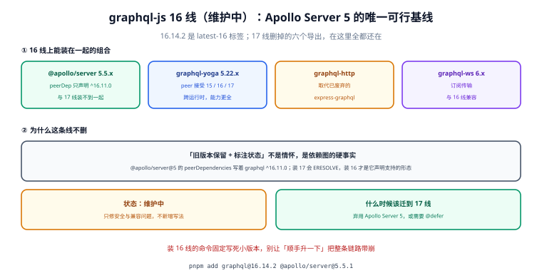

# graphql-js 16 线（维护中）

::: info 信息
**维护状态：维护中。** 只修安全与兼容问题，不新增写法。这条线不是"过渡期存档"——`@apollo/server@5` 的 `peerDependencies` 只声明 `graphql: ^16.11.0`，所以**任何用 Apollo Server 5 的项目都在这条线上**，无论它想不想。当前小版本为 `16.14.2`（npm 的 `latest-16` 标签）。
:::

**16 线与 17 线不是「新旧」关系，是两条并行的可行域。** 它们的分叉点不是某个 API，而是**依赖图**：17 线要求 Node 22 起、删了六个导出、把 `@defer` 搬进了实现；16 线保留全部旧导出、能跑 Node 18，而且是 Apollo Server 5 唯一声明支持的版本。

一句话定位：这一页回答「什么情况下你必须留在 16 线、留在 16 线要放弃什么、以及什么时候该迁走」。



本页判据族 `GQV6-A` ~ `GQV6-H`，共 8 条。

## 16 线上能装在一起的组合

| 组合 | 兼容声明 | 说明 |
| --- | --- | --- |
| `graphql@16.14.2` + `@apollo/server@5.5.1` | AS5 peer 为 `graphql ^16.11.0` | **唯一被官方声明支持的 Apollo 组合** |
| `graphql@16.14.2` + `graphql-yoga@5.22.x` | Yoga 5 peer 接受 `15 / 16 / 17` | 跨运行时，插件生态走 Envelop |
| `graphql@16.14.2` + `graphql-http` | 取代已废弃的 `express-graphql` | 只做传输层，不绑定框架 |
| `graphql@16.14.2` + `graphql-ws@6.x` | 订阅传输 | 与两条线都兼容 |

四条里只有第一行是"被声明"的，其余都是"能装且能跑"。这个区别在出问题时很关键：**只有被声明的组合，上游才有义务帮你修。**

## 留在 16 线要放弃什么

| 能力 | 16 线 | 17 线 |
| --- | --- | --- |
| 增量交付（`@defer` / `@stream`） | 不可用（除非接 `graphql@17.0.0-alpha` 的旧协议，且需要额外转换包） | 实现已就绪，但要自己把指令注册进 schema |
| Node 底盘 | 可跑 Node 18 / 20 / 22 | 只认 Node 22 / 24 / 25+ |
| `formatError` / `assertValidName` 等六个导出 | 全部可用 | 已移除 |
| Apollo Server 5 | 支持 | **不支持**（`ERESOLVE`） |

第一行的取舍值得单独说：`@defer` 让服务端先返回"骨架"、稍后补上慢字段，对首屏体验有实际意义。但 16 线要拿到它，得引入 `graphql@17.0.0-alpha`，而 alpha 又与 Apollo Server 5 的 peer 冲突——**这是一条走不通的路**，不要尝试。真需要 `@defer` 的正确做法是换到 17 线 + Yoga（或用 `graphql-http` 自建传输），而不是在 16 线上打补丁。

## 什么时候必须留在 16 线

三条硬条件，命中任意一条就不要迁：

1. **你在用 Apollo Server 5。** 它声明只支持 `graphql ^16.11.0`，迁 17 就是 `ERESOLVE`。等工作上线了再迁，不要反向操作。
2. **你的运行时低于 Node 22。** 17 线的 `engine` 下限是 Node 22，Node 18/20 上装不上（不是"能装但有警告"，是 `EBADENGINE` 直接拒）。
3. **你的代码直接 import 了那六个被移除的导出。** 尤其是 `formatError`——它是很多自定义错误格式化的入口，被删之后整条错误处理链要重写。

## 什么时候该迁到 17 线

| 触发条件 | 说明 |
| --- | --- |
| 弃用 Apollo Server（换 Yoga / 自建） | 这是最常见的迁移动机 |
| 需要 `@defer` / `@stream` | 17 线是唯一现成路径 |
| 需要 Node 22+ 的运行时特性 | 反正已经在新底盘上，没有额外成本 |
| 上游依赖要求 `graphql ^17` | 例如新版 `@graphql-tools` 系列的某些包 |

迁移本身不难，难的是**顺序**：先升 Node、再换服务端、最后升 `graphql`。反过来做会在中间卡住（`graphql@17` 装不上、服务端又还没换）。

## 迁移到 17 线的六步清单

```shell
# ① 先确认运行时底盘
node -v    # 必须是 22 / 24 / 25 或更高
```

```shell
# ② 找出六个被移除导出的引用点（在升级前做，不要升级后靠报错找）
grep -rn "assertValidName\|formatError\|getOperationRootType\|getVisitFn\|isValidNameError\|printError" src/
```

预期输出：**0 行**才能继续。有行的，先按下面的替换表改完再升。

| 被移除的导出 | 替代方案 |
| --- | --- |
| `formatError` | `GraphQLError` 的 `toJSON()` / 自己在 `formatError` 钩子里实现 |
| `assertValidName` | `assertName`（保留）或自行校验 `/^[_A-Za-z][_0-9A-Za-z]*$/` |
| `isValidNameError` | 同上，自行校验 |
| `getOperationRootType` | `schema.getQueryType()` / `getMutationType()` / `getSubscriptionType()` |
| `getVisitFn` | 用 `visit` 的 visitor 对象形态 |
| `printError` | `error.toString()` / `print(error)` |

```shell
# ③ 换服务端（如果在用 Apollo Server 5）
pnpm remove @apollo/server && pnpm add graphql-yoga@5.22.0 graphql@17.0.2
```

```shell
# ④ 确认没有残留的 16 线副本（幽灵依赖最常见的形态）
pnpm why graphql
```

预期输出：只有一条 `graphql 17.0.2`。出现两条（16 与 17 并存）说明某个依赖自带了一份，必须用 `pnpm.overrides` 收敛。

```shell
# ⑤ 跑一遍 schema 与用例
node -e "const {buildSchema,validateSchema}=require('graphql');const s=buildSchema(require('fs').readFileSync('schema.graphql','utf8'));console.log(validateSchema(s).length===0?'OK':'FAIL')"
pnpm test
```

预期输出：`OK` + 全部用例 PASS。若某条用例因错误信息格式变化而失败，改断言而不是改实现——17 线的错误消息措辞有调整。

```graphql
# ⑥ 需要 @defer 时，指令要手动注册（它不在 specifiedDirectives 里）
query {
  course(id: "C1") {
    title
    ... on Course @defer {
      lessons { id title }
    }
  }
}
```

预期：不加 `GraphQLDeferDirective` 到 schema 时，这句在校验期报「Unknown directive "@defer"」。这条报错是**正确的**——17 线刻意没把它放进 `specifiedDirectives`（那个列表仍然只有 `include`、`skip`、`deprecated`、`specifiedBy`、`oneOf`），因为规范还没把它收进去。

## 本页判据

| 判据 | 看什么现象 | 判成什么 | 不满足时改哪里 |
| --- | --- | --- | --- |
| `GQV6-A` | 入口页顶部有明确的状态标注（维护中） | 读者知道这是活线不是存档 | 加状态容器与理由 |
| `GQV6-B` | `graphql` 与 `@apollo/server` 的版本组合符合 peer 声明 | 装得上且被支持 | 锁 `graphql@16.14.2` + `@apollo/server@5.5.1` |
| `GQV6-C` | 锁文件里只有一份 `graphql` | 无幽灵依赖 | `pnpm why graphql` 核对，必要时 overrides |
| `GQV6-D` | 不通过 `graphql@17.0.0-alpha` 去拿 `@defer` | 不引入不可维护的依赖 | 需要 `@defer` 就整体迁 17 线 |
| `GQV6-E` | 运行时版本满足 16 线的底盘要求（Node 18+） | 不会 `EBADENGINE` | 固定基础镜像版本 |
| `GQV6-F` | 迁出顺序为「Node → 服务端 → graphql」 | 中间不卡住 | 按六步清单执行 |
| `GQV6-G` | 六个被移除导出在升级**前**已清零 | 升级不靠报错驱动 | 先 `grep` 再升 |
| `GQV6-H` | 本页给出指向 17 线的入口 | 读者能往上走 | 保留升级链接 |

## 验证方式

```shell
# ① 依赖组合是否真的符合 peer 声明（不是"能装"，是"声明支持"）
node -e "
const p = require('./node_modules/@apollo/server/package.json');
console.log('AS5 peer graphql =', p.peerDependencies.graphql);
console.log('installed graphql =', require('./node_modules/graphql/package.json').version);
"
```

预期输出：`AS5 peer graphql = ^16.11.0` 与被装版本（`16.14.2`）。被装版本若是 17.x，说明锁文件被静默降级前的状态记录错了——`pnpm why graphql` 会指出是谁带进来的。

```shell
# ② 底盘是否满足（E 级：不满足则整条线不可用）
node -e "const v=process.versions.node.split('.').map(Number);console.log(v[0]>=18?'OK node '+process.versions.node:'FAIL node '+process.versions.node)"
```

预期输出：`OK node 22.x`（或 18/20）。16 线的下限实际比 17 线宽松，但低于 18 时很多现代依赖装不上。

```shell
# ③ 幽灵依赖探针：除了一处声明，还有没有别的 graphql 副本
find node_modules -name "package.json" -path "*/graphql/package.json" -not -path "*/node_modules/*/node_modules/*/node_modules/*" \
  -exec node -e "console.log(process.argv[1], require('./'+process.argv[1]).version)" {} \;
```

预期输出：只有一行 `.pnpm/graphql@16.14.2/...`。多行说明有多个副本，`pnpm why graphql` 逐个追。

## 与 17 线的对照与去向

| 维度 | 16 线（本页） | 17 线 |
| --- | --- | --- |
| 状态 | **维护中**：只修安全与兼容 | **当前主线**：新增特性在这里 |
| Node | 18 / 20 / 22 | 22 / 24 / 25+ |
| Apollo Server 5 | 支持 | 不支持 |
| `@defer` | 不可用 | 可用（需自行注册指令） |
| 六个旧导出 | 可用 | 已移除 |
| 适用判断 | 在用 AS5，或底盘低于 Node 22 | 换掉 AS5，或需要增量交付 |

升级路径与逐条替换表见 [graphql-js 17 线](../Graphql17/index.md)。

## 参考资料

- graphql-js 发行说明（16.14.2 是 `latest-16` 标签上的最后一版）：<https://github.com/graphql/graphql-js/releases>
- npm `graphql` 的 dist-tags（`latest` / `latest-16` / `latest-15` 的对应关系）：<https://www.npmjs.com/package/graphql?activeTab=versions>
- Apollo Server 5 的 `peerDependencies` 声明与其迁移指南：<https://www.apollographql.com/docs/apollo-server/migration>
- `graphql-http` 项目主页（`express-graphql` 的官方替代）：<https://github.com/graphql/graphql-http>
