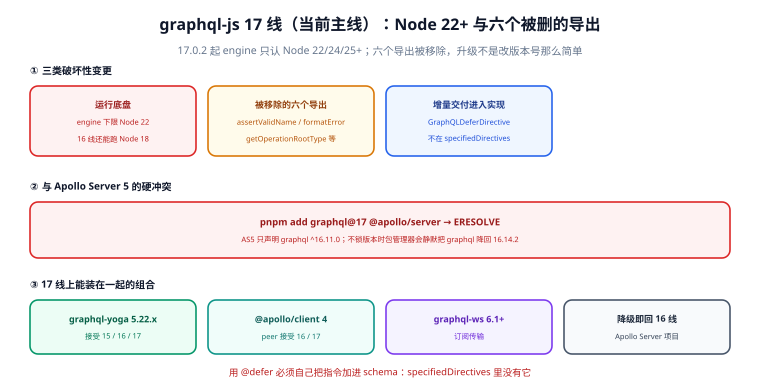

# graphql-js 17 线（当前主线）

::: info 信息
**维护状态：当前主线。** 新特性只在这条线上加。当前版本 `17.0.2`（2026-07-03 发布，17.0.0 于 2026-06-15 发布）。`engine` 只接受 **Node 22 / 24 / 25 或更高**；移除了六个旧导出；`@defer` / `@stream` 的实现已就绪但**不在** `specifiedDirectives` 里。
:::

**17 线不是"16 线加了个数字"。** 它同时改了三件事：运行底盘（Node 22 起）、公开导出（删了六个）、增量交付（指令进了实现但没进规范）。这三件事的迁移成本不一样：底盘是环境问题，导出是代码问题，指令是设计问题。

一句话定位：这一页回答「17 线改了什么、为什么装不上 Apollo Server 5、以及 `@defer` 到底要不要用」。



本页判据族 `GQV7-A` ~ `GQV7-H`，共 8 条。

## 三类破坏性变更

| 类别 | 具体变化 | 影响面 |
| --- | --- | --- |
| 运行底盘 | `engine` 只认 Node 22 / 24 / 25+ | 基础镜像、CI runner、本地 Node 版本 |
| 公开导出 | 移除 `assertValidName`、`formatError`、`getOperationRootType`、`getVisitFn`、`isValidNameError`、`printError` | 直接 import 这些名字的代码 |
| 增量交付 | 新增 `GraphQLDeferDirective`、`GraphQLStreamDirective`、`experimentalExecuteIncrementally` | 想用 `@defer` 的项目 |

第一类是**硬阻断**：不是"能装但有警告"，是 `EBADENGINE` 直接拒绝。第二类是**运行时 undefined**：`import { formatError } from 'graphql'` 不会在编译期报错（没有类型检查的话），而是在调用时 `TypeError: formatError is not a function`。第三类是**新增**，不影响既有代码。

`specifiedDirectives` 的值在 17.0.2 里仍然是 `include`、`skip`、`deprecated`、`specifiedBy`、`oneOf` 五个——`@defer` 与 `@stream` **不在里面**。所以：

```javascript
import {
  GraphQLSchema, GraphQLObjectType,
  GraphQLDeferDirective, specifiedDirectives,
} from 'graphql';

const schema = new GraphQLSchema({
  query: QueryType,
  // 必须手动加进去，否则 @defer 在校验期就是「未知指令」
  directives: [...specifiedDirectives, GraphQLDeferDirective],
});
```

::: danger 注意
**别把 `@defer` 当"免费的首屏优化"接。** 它有三个前置条件：① 客户端与传输层都支持 `multipart/mixed` 增量响应（Apollo Server 5.1 起支持，但要求客户端发送特定的 `Accept` 头；Yoga 走 SSE/增量协议）；② 你的 CDN / 反代不缓冲整个响应体（缓冲会把"先返回骨架"的优势完全抵消）；③ 你的慢字段确实是**可延迟**的（不是主键、不是权限判断的输入）。三者缺一个，`@defer` 的效果就是"多了一段协议复杂度，首屏没变快"。
:::

## 与 Apollo Server 5 的硬冲突

```text
pnpm add graphql@17 @apollo/server
→ ERR_PNPM_PEER_DEP_ISSUES  Unmet peer dependency "graphql@^16.11.0"
```

这不是配置问题，是**声明冲突**：`@apollo/server@5.5.x` 的 `peerDependencies` 只写了 `graphql: ^16.11.0`。三种处置，只有一种对：

| 做法 | 结果 | 评价 |
| --- | --- | --- |
| 忽略 peer 警告强装 | 运行时可能正常，但上游不保证 | ✗ 出问题时没人帮你修 |
| 不锁版本，让包管理器自己解决 | **静默**把 `graphql` 解析成 16.14.2 | ✗ 最坏：你以为在 17 线，实际不在 |
| 换服务端（Yoga / `graphql-http`） | 17 线可用 | ✓ 迁移的唯一正路 |

第二行是本册最想强调的一点：**"装上了"不等于"装的是你写的那个版本"**。`package.json` 里写 `"graphql": "^17.0.0"`，锁文件里却是 `16.14.2`——这种状态在 CI 里不报错，只有 `pnpm why graphql` 或运行时打印 `version` 才能发现。

## 17 线上能装在一起的组合

| 组合 | 兼容声明 | 说明 |
| --- | --- | --- |
| `graphql@17.0.2` + `graphql-yoga@5.22.x` | Yoga 5 peer 接受 `15 / 16 / 17` | 目前最省心的 17 线服务端 |
| `graphql@17.0.2` + `@apollo/client@4` | peer 接受 `^16 \|\| ^17` | 客户端可以先行 |
| `graphql@17.0.2` + `graphql-ws@6.1+` | 订阅传输 | 与两条线都兼容 |
| `graphql@17.0.2` + `@apollo/server@5` | **不兼容** | `peerDependencies` 冲突 |

## 六个被移除导出的替换写法

| 移除的导出 | 曾经的用途 | 17 线的写法 |
| --- | --- | --- |
| `formatError` | 把 `GraphQLError` 转成对外 JSON | 在服务端的 `formatError` 钩子里自己实现，或直接用 `error.toJSON()` |
| `assertValidName` | 断言标识符合法 | 保留的 `assertName`，或自行 `/^[_A-Za-z][_0-9A-Za-z]*$/` |
| `isValidNameError` | 同上，返回错误对象 | 自行校验后 `new GraphQLError(...)` |
| `getOperationRootType` | 取 operation 对应的根类型 | `schema.getQueryType()` / `getMutationType()` / `getSubscriptionType()` |
| `getVisitFn` | 从 visitor 对象取某个 kind 的处理函数 | 直接用 visitor 对象形态，`visit(ast, { Field: fn })` |
| `printError` | 把错误打印成可读文本 | `error.toString()` 或 `print(error)` |

::: warning 说明
**`formatError` 的移除最容易被低估。** 它不是一个工具函数，它是"错误信息脱敏"的唯一统一入口——很多项目在这里裁掉 SQL 原文与堆栈，17 线删掉它之后，这段逻辑要跟着搬到服务端的错误格式化钩子里。搬漏的后果不是编译错，是**生产环境开始把内部错误原文返回给客户端**。
:::

## 迁移清单：六步，顺序不能换

1. **升 Node 到 22+**（`node -v` 确认，改 `Dockerfile` 与 CI 的 `node-version`）。
2. **`grep` 六个导出，清零。** 这一步必须在升级**前**做——升级后再查，你分不清"本来就没有"和"报错才发现"。
3. **换服务端**（`@apollo/server` → `graphql-yoga` 或 `graphql-http`）。
4. **升 `graphql` 到 17.0.2**，并 `pnpm why graphql` 确认只有一份。
5. **跑 schema 校验与用例。** 17 线的错误消息措辞有调整，断言可能要改（改断言，不要改实现）。
6. **需要 `@defer` 时再注册指令**，并且先确认传输层与 CDN 都支持增量响应。

第 2 步与第 3 步的顺序理由：如果先换服务端，`@apollo/server` 被移除后 `graphql` 的 peer 约束消失，包管理器可能在你不注意时已经把它升到 17——而代码里还引用着 `formatError`，于是得到一个"装得上但运行时炸"的状态。

## 本页判据

| 判据 | 看什么现象 | 判成什么 | 不满足时改哪里 |
| --- | --- | --- | --- |
| `GQV7-A` | 入口页有状态标注（当前主线）与版本号 | 读者知道这是活线 | 加 `::: info` 容器 |
| `GQV7-B` | `node -v` 为 22 / 24 / 25+，且 CI 与镜像一致 | 不会 `EBADENGINE` | 改 `Dockerfile` 与 `node-version` |
| `GQV7-C` | 六个被移除导出在升级前已清零 | 不靠报错驱动迁移 | 先 `grep` 再升 |
| `GQV7-D` | `pnpm why graphql` 只有一份 17.x | 无幽灵依赖与静默降级 | 加 `pnpm.overrides` 收敛 |
| `GQV7-E` | 不与 `@apollo/server@5` 同装 | 依赖树可解 | 换 Yoga / `graphql-http` |
| `GQV7-F` | 用 `@defer` 时把指令显式加入 schema | 校验期不报未知指令 | `directives: [...specifiedDirectives, GraphQLDeferDirective]` |
| `GQV7-G` | 错误格式化逻辑已从 `formatError` 搬走 | 不泄漏内部错误 | 在服务端钩子里重写脱敏 |
| `GQV7-H` | 本页给出指向 16 线的返回入口 | 双向往来 | 保留 `../Graphql16/index.md` 链接 |

## 验证方式

```shell
# ① 底盘（E 级：不满足则整条线不可用）
node -e "const m=process.versions.node.split('.').map(Number)[0];console.log(['22','24','25'].includes(String(m))?'OK '+process.versions.node:'FAIL '+process.versions.node)"
```

预期输出：`OK 22.x`。低于 22 时 `pnpm i` 会报 `EBADENGINE`，不是"能装但警告"。

```shell
# ② 六个导出是否真的不存在了（期望全部 undefined）
node -e "
const g = require('graphql');
for (const k of ['assertValidName','formatError','getOperationRootType','getVisitFn','isValidNameError','printError'])
  console.log(k, typeof g[k]);
"
```

预期输出：六行全部 `undefined`。**若某个是 `function`，说明装的是 16.x**——这正是"不锁版本被静默降级"的形态。

```shell
# ③ specifiedDirectives 到底有几个（期望 5 个，且不含 defer/stream）
node -e "
const { specifiedDirectives } = require('graphql');
console.log(specifiedDirectives.length, specifiedDirectives.map(d => d.name).join(','));
"
```

预期输出：`5 include,skip,deprecated,specifiedBy,oneOf`。若输出里有 `defer`，说明你用的是 alpha 版或自行加过指令——两种情况的结论完全不同，要看清楚再判断。

```javascript
// ④ @defer 是否真的在生效（未注册时应当在校验期失败）
const { validate, parse } = require('graphql');
const q = parse('query { course(id:"C1") { title ... @defer { lessons { id } } } }');
console.log(validate(schemaWithoutDefer, q).map(e => e.message));
// 期望：['Unknown directive "@defer".']
console.log(validate(schemaWithDefer, q).length);
// 期望：0
```

预期输出：两行——第一行报未知指令，第二行 `0`。这一对是 `GQV7-F` 的探针：只测第二行，你无法确认"注册指令"这一步是必需的。

## 与 16 线的对照与来路

| 维度 | 16 线 | 17 线（本页） |
| --- | --- | --- |
| 状态 | 维护中：只修安全与兼容 | **当前主线**：新增特性在这里 |
| Node | 18 / 20 / 22 | 22 / 24 / 25+ |
| Apollo Server 5 | 支持 | 不支持 |
| `@defer` | 不可用 | 可用（需自行注册指令） |
| 六个旧导出 | 可用 | 已移除 |
| 适用判断 | 在用 AS5，或底盘低于 Node 22 | 换掉 AS5，或需要增量交付 |

留在 16 线的三条硬条件、以及为什么不要在 16 线上用 alpha 版去拿 `@defer`，见 [graphql-js 16 线](../Graphql16/index.md)。

## 参考资料

- graphql-js `17.0.0` 与 `17.0.2` 发行说明（`engine`、导出移除、增量交付）：<https://github.com/graphql/graphql-js/releases>
- graphql-js `specifiedDirectives` 的定义（五个内置指令的权威来源）：<https://github.com/graphql/graphql-js/blob/main/src/type/directives.ts>
- GraphQL 规范的 Working Draft（`@defer` / `@stream` 尚未进入正式版）：<https://spec.graphql.org/draft/>
- graphql-yoga 的增量交付与 `@defer` 支持：<https://the-guild.dev/graphql/yoga-server/docs/features/defer-stream>
