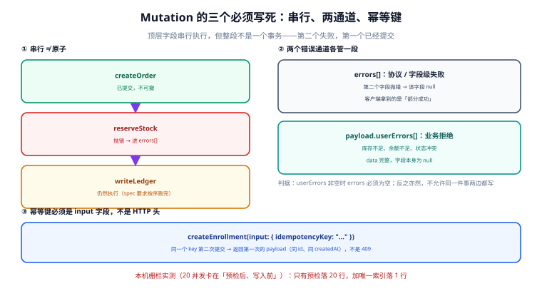

# Mutation：串行、两通道与幂等键

**Mutation 是唯一会改变状态的那一半。** 它有三个必须写死的性质：顶层字段按文档顺序串行执行、业务拒绝与系统故障走两个通道、重复提交必须返回同一个结果。三者里任意一条缺失，都会在并发或重试时变成「多了一行」「少扣了库存」「账对不上」。

一句话定位：本页回答「一个 mutation 执行完的真实状态是什么、payload 该长什么样、幂等键为什么要写成 input 字段而不是 HTTP 头」。



本页判据族 `GQM-A` ~ `GQM-H`，共 8 条。

## 串行 ≠ 原子

规范对 mutation 的执行有一条硬规定：**根选择集里的字段必须串行执行，按文档出现顺序**。这是它和 query 唯一的执行语义差别（query 的顶层字段可以并行）。

但「串行」只保证顺序，不保证回滚：

```graphql
mutation PlaceOrder($input: PlaceOrderInput!) {
  createOrder(input: $input) { order { id } userErrors { code } }   # ① 提交
  reserveStock(orderId: "O-1") { ok userErrors { code } }           # ② 抛错
  writeLedger(orderId: "O-1") { id }                               # ③ 照跑
}
```

执行完的真实状态：订单存在、库存没扣、账记了。② 的异常进 `errors[]`，①③ 正常。HTTP 200。

::: danger 注意
**三件不能做的事：**

1. **不要用「一个 mutation 里挂多个写」换原子性。** 要原子就开数据库事务；跨服务就拆请求 + 补偿（Saga）。GraphQL 不提供跨字段事务，任何声称"一个 mutation 就是一次事务"的框架都只是把多个写包进了一个 `BEGIN`——一旦中间有跨服务调用，它就失效了。
2. **不要用「100 个别名」做批量导入。** 那是 100 次**串行**写：100 次往返的延迟、100 次独立提交、100 个可失败的中间态。正确形态是一个 mutation 带一个数组参数，服务端在一个事务里批处理。
3. **不要在 mutation 里做「读-判断-写」。** 判断必须在库里（唯一索引、`CHECK`、触发器或条件 `UPDATE`），因为应用层的读与写之间永远有时间。
:::

## Payload 形状：一条 mutation 一个返回对象

规范不强制 payload 形状，但工程上有一个几乎无争议的形态：

```graphql
type UserError {
  code: String!
  message: String!
  field: String
}

type CreateEnrollmentPayload {
  enrollment: Enrollment
  userErrors: [UserError!]!
}

type Mutation {
  createEnrollment(input: CreateEnrollmentInput!): CreateEnrollmentPayload!
}
```

四条理由，每一条都是踩过的坑：

| 设计 | 解决什么 | 不这样会怎样 |
| --- | --- | --- |
| 返回一个 `Payload` 对象而不是裸实体 | 以后能加字段而不破坏契约 | 想加 `userErrors` 时必须开新 mutation |
| `userErrors` 声明为 `[UserError!]!` | 客户端一次判空即可，不用判 `null` | 客户端要写 `if (errors && errors.length)` |
| `Payload` 本身是 `!` | 客户端不必判 `data.createEnrollment` 是否为 null | 每个调用点都要判空 |
| `enrollment` 可空 | 被拒绝时它就是 `null`，语义干净 | 硬塞一个假对象，客户端会拿它当真的 |

最后一条值得强调：**被拒绝时 `enrollment: null` 是正确结果，不是缺陷。** 它的含义是「这次没创建出东西」，而 `userErrors` 解释了为什么。反过来，如果 `enrollment` 声明成 `Enrollment!`，被拒绝时就只能抛异常——那又回到"业务拒绝走 errors"的坑里了。

## 两通道：谁走哪里，写死一张表

| 情况 | 走哪里 | `data` 的状态 | 客户端该怎么处理 |
| --- | --- | --- | --- |
| 字段不存在、参数类型错 | 校验期错误（HTTP 400） | 无 `data` | 修代码，不进重试 |
| resolver 抛异常（DB 断连、下游 500） | `errors[]`（HTTP 200） | 对应字段 `null` | 可重试，按 `path` 归因 |
| 库存不足、余额不足、状态冲突 | `payload.userErrors[]` | 完整 | 提示用户，**不重试** |
| 幂等键重复提交 | `payload` 与首次完全一致 | 完整 | 当作成功 |

::: danger 注意
**两个通道不允许同一件事两边都写。** 见过的最坏形态是一条「库存不足」同时出现在 `errors[]` 与 `userErrors[]` 里——客户端弹了两次提示，监控把它算成两起故障，而它其实只是一次正常的业务拒绝。判据很硬：`userErrors` 非空时 `errors` 必须为空，反之亦然。
:::

## 幂等键：写成 input 字段，不要用 HTTP 头

REST 里幂等键通常放 `Idempotency-Key` 头；GraphQL 里应该放进 input：

```graphql
input CreateEnrollmentInput {
  courseId: ID!
  studentId: ID!
  idempotencyKey: String!      # 客户端生成，一次业务意图一个
}
```

三个理由：

1. **头是传输层的，schema 看不到它。** 放头里意味着校验、文档、代码生成、内省全都不知道它的存在，客户端只能靠口头约定。
2. **一个请求可以有多个 mutation。** 头只能有一个值，而两个 `createX` 别名需要两个不同的键。
3. **头会被中间层剥掉。** 网关、日志脱敏、重放工具都可能丢自定义头，而 body 不会。

落地只有一句话：**`idempotency_key` 上必须有唯一索引。**

```sql
create table enrollment (
  id         bigserial primary key,
  course_id  text not null,
  student_id text not null,
  idem_key   text not null,
  state      text not null default 'ACTIVE'
);
create unique index ux_enrollment_idem on enrollment(idem_key);
```

本机栅栏实测（SQLite 3，20 个线程卡在「预检之后、写入之前」同时放行）：

| 实现 | 落库行数 | 失败侧 |
| --- | --- | --- |
| 只有预检（查一下有没有，没有就插） | **20 行** | 20 个线程全部读到「0 行」 |
| 预检 + 唯一索引 | **1 行** | 19 个拿到 `IntegrityError` |

::: warning 说明
**这 20 行不是"多插了几条测试数据"这么轻。** 在真实系统里它们是 20 条有效报名：20 条记录、20 个课时额度、20 次通知、20 笔可能的收款。而**应用层的预检永远拦不住它**——读与写之间那个窗口，靠加锁才能关掉，而唯一索引就是数据库自带的、最便宜的那把锁。
:::

重复提交的正确返回**不是 409**，而是「和第一次完全一致的 payload」：

```javascript
// createEnrollment 的幂等实现骨架
async function createEnrollment({ input }, ctx) {
  try {
    const row = await ctx.db.insertEnrollment({ ...input, state: 'ACTIVE' });
    return { enrollment: row, userErrors: [] };
  } catch (e) {
    if (e.code === 'UNIQUE_VIOLATION' && e.constraint === 'ux_enrollment_idem') {
      // 命中幂等键：返回首次的那一条，而不是报错
      const row = await ctx.db.findByIdemKey(input.idempotencyKey);
      return { enrollment: row, userErrors: [] };
    }
    throw e;   // 其余错误照常进 errors[]
  }
}
```

为什么不是 409：GraphQL 没有「状态码」这个概念可用于业务语义（HTTP 200 是常态），而「你是重试还是新请求」这件事只有服务端知道。返回 409 会逼客户端写特判，且**第一次真的失败、第二次成功**这种正常业务（比如上次超时但实际写入了）会被误判成冲突。

## 并发写：乐观锁比悲观锁更配 GraphQL

mutation 的第二个并发面是「同一行被两个人先后改」。GraphQL 的请求粒度比 REST 细，一个页面可能同时发 3 个 mutation，悲观锁会把它们串成一条长队。所以默认用乐观并发：

```graphql
input UpdateCourseInput {
  id: ID!
  expectedVersion: Int!      # 客户端上次读到的 version
  title: String
}
```

服务端写的时候带条件：

```sql
update course set title = :title, version = version + 1
where id = :id and version = :expected_version;
```

`rowcount = 0` 说明有人先改了 → 返回 `userErrors: [{ code: "VERSION_CONFLICT" }]`，客户端刷新后重试。这条与「读-判断-写」的区别在于：**判断和写在同一条 SQL 里**，中间没有窗口。

## 本页判据

| 判据 | 看什么现象 | 判成什么 | 不满足时改哪里 |
| --- | --- | --- | --- |
| `GQM-A` | 一个 mutation 只做一件事，不靠多字段换原子性 | 无半提交态 | 拆请求 + 补偿，或开数据库事务 |
| `GQM-B` | 每个 mutation 返回 `Payload` 对象（含 `userErrors`） | 契约可扩展 | 新建 `XxxPayload`，别返回裸实体 |
| `GQM-C` | `Payload` 非空、实体字段可空 | 被拒绝时语义干净 | schema 去掉实体字段上的 `!` |
| `GQM-D` | 业务拒绝只出现在 `userErrors`，`errors` 为空 | 客户端可区分 | 定归属表，逐条迁 |
| `GQM-E` | 幂等键是 input 字段且带唯一索引 | 并发不重复落库 | 加列 + `unique index` |
| `GQM-F` | 重复提交返回与首次一致的 payload（不是 409） | 重试可直接透传 | 捕获唯一冲突后回查 |
| `GQM-G` | 并发更新用 `expectedVersion` 条件写 | 无覆盖丢失 | `update … where version = ?` |
| `GQM-H` | mutation 的入参只用变量，不拼字面量 | 无注入面 | 客户端一律走 `variables` |

## 验证方式

```shell
# ① 幂等：同一个 key 提交两次，期望两次返回同一个 id
for i in 1 2; do
  curl -s http://localhost:4000/graphql -H 'content-type: application/json' \
    -d '{"query":"mutation($in:CreateEnrollmentInput!){createEnrollment(input:$in){enrollment{id createdAt} userErrors{code}}}",
         "variables":{"in":{"courseId":"C1","studentId":"S1","idempotencyKey":"K-1"}}}'
  echo
done
```

预期输出：两次的 `enrollment.id` **完全相同**，且第二次**没有** `userErrors`、顶层**没有** `errors`。两次 id 不同说明幂等键没落唯一索引，只是走了预检。

```sql
-- ② 幂等键是否真的唯一（GQM-E）
select idem_key, count(*) as n
from enrollment
group by idem_key
having count(*) > 1;
```

预期输出：**0 行**。这比看代码可靠——索引存在但被并发绕过的情况，只有这一条 SQL 能发现。

```sql
-- ③ 乐观锁的覆盖丢失探针（GQM-G）
-- 先读一次拿到 version，再并发两条带同一个 expectedVersion 的 update
update course set title = 'A', version = version + 1 where id = 1 and version = 7;
update course set title = 'B', version = version + 1 where id = 1 and version = 7;
```

预期输出：第二条的 `UPDATE 0`。若第二条也是 `UPDATE 1`，说明 `where` 里没有 `version`，后写的那条会静默覆盖。

## 参考资料

- GraphQL 规范「Mutation」（根字段串行执行的原文）：<https://spec.graphql.org/September2025/#sec-Mutation>
- GraphQL 规范「Handling Field Errors」（错误如何进入 `errors[]` 与 `path`）：<https://spec.graphql.org/September2025/#sec-Errors>
- GraphQL 官方文档「Serving over HTTP」：<https://graphql.org/learn/serving-over-http/>
- PostgreSQL 文档「INSERT … ON CONFLICT」（幂等写入的另一种实现路径）：<https://www.postgresql.org/docs/current/sql-insert.html>
