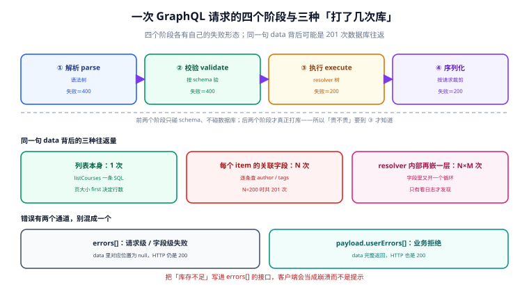

# 总览：一个端点、三个阶段与三个「打了几次库」

**GraphQL 服务端只有一条 URL。** 所有读、所有写、所有订阅都发到同一个 `/graphql`，客户端用它自己的查询决定要什么形状。这条设计把「接口数量」从几十个降到 1 个，同时把「一次请求到底要花多少代价」变成**客户端可以单方面决定**的事。

一句话定位：本页回答「一次请求经过哪几个阶段、每个阶段失败时会以什么形式出现、以及同一句 `data` 背后可能有几种不同的数据库往返量」。



本页判据族 `GQO-A` ~ `GQO-H`，共 8 条；整个专题十页共 80 条，定义在 `docs/Backend/GraphQL/` 各页的「本页判据」一节。

## 为什么单端点值得单独成册

REST 时代，「这个接口慢」可以定位到一条路由；GraphQL 时代，慢的是**某个客户端某一天写的一句查询**，而它在你的代码库里根本不存在——它在别人的仓库里。这带来三个与 REST 完全不同的性质：

::: danger 注意
**三个默认成立但在 GraphQL 里不成立的前提：**

1. **「接口数 = 攻击面」不成立。** 一个 `/graphql` 端点暴露的是**整个 schema**：60 个类型、几百个字段、以及它们之间的所有组合路径。REST 下你要为每个组合写一个 handler，GraphQL 下组合是免费的。
2. **「慢查询能在代码评审里看到」不成立。** resolver 都是十行的简单函数，慢的是它们被调用的**次数**。一次 `listCourses(first:100)` 下面挂三层列表，就是 100 万次子查询——代码里一行循环都没有。
3. **「HTTP 200 就是成功」不成立。** 解析失败、字段报错、业务拒绝，三种完全不同的东西可以都返回 200，`errors` 里躺着一段话，`data` 里一半是 null。
:::

于是本册的每一页都围绕同一个问题写：**这件事失败的时候，你怎么发现它。** 能给出「一条 SQL / 一条日志 / 一条阈值告警」答案的，才算写清楚。

## 四个阶段：前两个不碰库，后两个才碰

一次请求在服务端固定经过四步，每一步的失败形态不同：

| 阶段 | 做什么 | 失败时 | HTTP 状态 |
| --- | --- | --- | --- |
| ① 解析 parse | 把请求体里的 `query` 字符串解析成文档（AST） | 语法错、文档为空 | 400（请求错误） |
| ② 校验 validate | 按 schema 检查字段是否存在、参数类型对不对、变量是否都用上了 | 未知字段、类型不匹配、fragment 循环 | 400（请求错误） |
| ③ 执行 execute | 逐字段调用 resolver，可能打库、可能调下游 | resolver 抛错、非空字段返回 null | **200**（`errors[]` + 部分 `data`） |
| ④ 序列化 serialize | 按请求的选择集裁剪结果，写成 JSON | 极少失败（循环引用、序列化异常） | 200 |

前三步与第四步之间的差别值得记牢：**只有 ③ 会打库**。这意味着两件事：

- **能在 ② 拒掉的，绝不要留到 ③。** 复杂度超限、深度超限、缺少必填鉴权，全都可以在 `validate` 阶段算出来（schema 是静态的，查询也是静态的），不必先执行一遍再后悔。这是「成本闸门放在校验层」的全部理由，细节见[性能一页](../Performance/index.md)。
- **② 的报错是「你的查询写错了」，③ 的报错是「你的查询写对了但没跑通」。** 这两类在监控上必须分开统计：前者是客户端 bug，后者是服务端 bug 或数据问题。混在一个 `error_rate` 里，你会一直在修错的东西。

::: tip 一句话判断
把 `errors[].path` 打出来看一眼：有 `path` 的是 ③ 的字段级错误（执行期），没有 `path` 的是 ② 的请求级错误（校验期）。这一个字段就能把两类故障分开。
:::

## 三种操作：只有 mutation 的顶层字段是串行的

| 操作 | 语义 | 顶层字段执行顺序 | 典型用途 |
| --- | --- | --- | --- |
| `query` | 只读 | **可并行**（实现可任意调度） | 列表、详情、搜索 |
| `mutation` | 写 | **必须串行，按文档顺序** | 创建、更新、状态迁移 |
| `subscription` | 订阅 | 每个事件一次执行 | 消息推送、进度更新 |

`mutation` 的串行是**规范要求**，不是实现偏好：同一层里写 `a: createX` 与 `b: createY`，服务端必须先跑完 `a` 再跑 `b`。但串行**不等于原子**——

```graphql
mutation PlaceOrder {
  createOrder(input: { sku: "S-1", qty: 1 }) { id }   # ① 提交了
  reserveStock(orderId: "O-1") { ok }                 # ② 抛错，进 errors[]
  writeLedger(orderId: "O-1") { id }                  # ③ 仍然执行
}
```

上面这段执行完的真实状态是：订单存在、库存没扣、账已记。①③ 成功、② 失败，而 HTTP 是 200。**把多个写操作塞进一个 mutation 里换「原子性」是行不通的**，要原子就开数据库事务，或者干脆拆成三个请求、由业务补偿。

::: danger 注意
**别用「一个 mutation 里挂 100 个别名」做批量导入。** 那 100 个写是**串行**的：100 次往返的延迟、100 次独立提交、100 个可能失败的中间态。批量导入该走的是「一次请求带一个数组参数，服务端在一个事务里批处理」。
:::

## 三个「打了几次库」

同一句 `{ courses(first: 100) { title author { name } } }`，三种实现的往返量差两个数量级：

| 实现方式 | 往返次数 | 什么时候发生 |
| --- | --- | --- |
| 列表一次，关联字段逐条查 | 1 + N | 最常见：resolver 里直接 `db.author.findById()` |
| 列表一次，关联字段批量查 | 1 + 1 | 用 DataLoader 或手工 `IN` |
| resolver 内部再嵌一层循环 | 1 + N×M | 只有看慢日志才发现 |

N=200 时，第一种是 **201 次**，第二种是 **2 次**，相差 **100.5 倍**。这个数字是**数出来的**（1 + 200 对 1 + 1），不是测出来的；配上「0.35 ms/次往返」的建模，延迟从 72.35 ms 降到 2.70 ms，省 96.3%。换一个网络这些毫秒数就变，但 100.5 倍这个比例不变。

第三种最隐蔽：`Author.avatar` 这个字段的 resolver 里又要查一次 `user_profile`，于是每个 author 再多一次。**它的往返量是乘法，而每一层单独看都只有十行代码。**

## 错误有两个通道

这是 GraphQL 与 REST 差别最大、也最容易写错的地方：

| 通道 | 位置 | 谁的问题 | `data` 的状态 |
| --- | --- | --- | --- |
| 请求级 / 字段级错误 | 顶层 `errors[]` | 查询写错、resolver 崩、非空违约 | 对应位置为 `null`，其余照常返回 |
| 业务拒绝 | `payload.userErrors[]` | 库存不足、余额不足、状态冲突 | **完整返回**，被拒的字段为 `null` |

区分它们的判据只有一句：**这件事是不是「系统故障」？** 系统故障走 `errors[]`；业务上「本来就可能不成功」走 `userErrors[]`。

::: danger 注意
把「库存不足」写进 `errors[]` 是最常见的错误。后果是三重的：① 客户端的全局错误弹窗会把它当崩溃弹出来；② 监控的 `error_rate` 被业务拒绝污染，真正的故障率看不出来；③ 部分客户端在 `errors` 非空时**直接丢弃 `data`**，于是连「哪件商品没库存」都拿不到。
:::

## 版本基线（2026-11 核对）

本册所有版本结论都按下面这张表写，超出这张表的部分以官方发行说明为准：

| 组件 | 当前状态 | 对本册的影响 |
| --- | --- | --- |
| GraphQL 规范 | **September 2025 Edition**（2025-09-03 发布） | 新增 Schema Coordinates、`@oneOf`、Unicode 语法；`@defer`/`@stream` **仍只在草案** |
| graphql-js | **17.0.2**（2026-07-03）为主线，`latest-16` = **16.14.2** | 17 线要求 Node 22/24/25+，移除六个导出 |
| Apollo Server | **5.5.1**；4.x 自 **2026-01-26** 起 EOL | 5 的 `peerDependencies` 只接受 `graphql ^16.11.0` |
| graphql-yoga | **5.22.x** | peer 接受 15 / 16 / 17，是 17 线上少数现成的服务端 |
| GraphQL over HTTP | 工作草案（2026-05 版本） | 状态码与 `Content-Type` 语义的权威来源 |

三条结论直接来自这张表，也是本册为什么要开两个版本目录：

1. **`graphql@17` 与 `@apollo/server@5` 装不到一起**：`ERESOLVE`，且不锁版本时包管理器会静默把 `graphql` 降回 16.14.2。
2. **17 线的 `@defer` 要自己注册**：`GraphQLDeferDirective` 不在 `specifiedDirectives` 里（那个列表仍然只有 `include`、`skip`、`deprecated`、`specifiedBy`、`oneOf`）。
3. **4.x 停在未修的安全公告上**：CSRF 绕过的修复只在 5.5.0 及以后。用 cookie 鉴权的服务端没有「留在 4.x 打个补丁」这条路。

## 与其他专题的分工

| 这件事 | 本册负责 | 交给谁 |
| --- | --- | --- |
| REST 的版本号与兼容窗口 | 只到「schema 演进靠 `@deprecated`」 | [契约演进与版本治理](../../ContractEvolution/index.md) |
| 限流、路由、灰度发布 | 只到「单端点的请求级限流」 | [网关与东西向流量](../../GatewayDeep/index.md) |
| 幂等的通用语义与状态机 | 只到「幂等键写成 input 字段」 | [幂等与状态机](../../IdempotencyStateMachine/index.md) |
| SQL 索引与执行计划 | 只到「一次带 `IN` 的批量查询」 | [SQL 优化](../../../DB/Relational/SQLOptimization/index.md) |
| 客户端归一化缓存 | 只到「响应形状要可缓存」 | [状态管理与数据流](../../../Frontend/StateDataFlow/index.md) |
| 登录态与令牌签发 | 只到「context 里拿到 viewer」 | [认证与授权](../../Auth/index.md) |

## 本页判据

| 判据 | 看什么现象 | 判成什么 | 不满足时改哪里 |
| --- | --- | --- | --- |
| `GQO-A` | 请求四阶段的失败被分开统计（解析/校验 vs 执行） | 故障可归因 | 监控按 `errors[].path` 是否存在拆分两个指标 |
| `GQO-B` | 能在校验期拒的（深度、复杂度、鉴权）不进入执行期 | 省一次执行 | 把闸门挂到 `validate` 而不是 resolver |
| `GQO-C` | `query` 的顶层字段不被依赖执行顺序 | 实现可并行 | 去掉 resolver 之间的隐式顺序假设 |
| `GQO-D` | `mutation` 不靠「一个请求多个别名」换原子性 | 无半提交态 | 拆请求 + 补偿，或开数据库事务 |
| `GQO-E` | 关联字段的查询次数是 O(1) 而不是 O(N) | 往返量可控 | 接 DataLoader 或手工批量 |
| `GQO-F` | 业务拒绝走 `userErrors[]`，系统故障走 `errors[]` | 客户端可区分 | 定一份错误归属表并写进 schema 文档 |
| `GQO-G` | 版本基线（规范/实现/服务端）在页内写明并标日期 | 结论可复核 | 每个专题首页给一张版本表 |
| `GQO-H` | 每个「失败很安静」的点都有对应的一条验证方式 | 缺陷可发现 | 每页补「验证方式」一节，缺一个补一个 |

## 验证方式

三条 `curl` 足以把四个阶段与两个通道都走一遍。服务端起在 `http://localhost:4000/graphql`（骨架见[实战一页](../Practice/index.md)）。

```shell
# ① 校验期失败：未知字段 —— 期望 HTTP 400，errors 里没有 path
curl -s -o /tmp/r1.json -w "%{http_code}\n" http://localhost:4000/graphql \
  -H 'content-type: application/json' \
  -d '{"query":"{ courses { notAField } }"}'
cat /tmp/r1.json
```

预期输出：状态码 `400`，响应里 `errors[0].message` 形如 `Cannot query field "notAField" on type "Course".`，且**没有 `path` 字段**。有 `path` 说明它其实是在执行期才发现的，那你的校验层漏了一道。

```shell
# ② 执行期失败：非空字段违约 —— 期望 HTTP 200，errors 里有 path
curl -s -o /tmp/r2.json -w "%{http_code}\n" http://localhost:4000/graphql \
  -H 'content-type: application/json' \
  -d '{"query":"{ course(id: \"C-BROKEN\") { title durationSec } }"}'
cat /tmp/r2.json
```

预期输出：状态码 `200`，`data.course` 可能是 `null` 也可能是个对象，但 `errors[0].path` 一定是 `["course", "durationSec"]` 这样的数组。**这条是 `GQO-A` 的探针**：拿不到 `path` 就没法把两类故障分开。

```shell
# ③ 两个通道：业务拒绝必须留在 data 里
curl -s http://localhost:4000/graphql \
  -H 'content-type: application/json' \
  -d '{"query":"mutation { createEnrollment(input:{courseId:\"C-FULL\", studentId:\"S-1\"}) { enrollment { id } userErrors { code message } } }"}'
```

预期输出：`data.createEnrollment.enrollment` 为 `null`、`userErrors[0].code` 为 `COURSE_FULL`、**顶层没有 `errors` 字段**。若顶层出现了 `errors`，说明业务拒绝被写进了系统故障通道，`GQO-F` 不满足。

## 参考资料

- GraphQL 规范「Execution」一章（顶层字段解析顺序、错误传播）：<https://spec.graphql.org/September2025/#sec-Execution>
- GraphQL over HTTP 规范（`400` 与 `200` 的分界）：<https://graphql.github.io/graphql-over-http/draft/>
- graphql-js `17.0.2` 发行说明（Node 底盘与导出变更）：<https://github.com/graphql/graphql-js/releases>
- Apollo Server 变更日志（4.x EOL 与 5.x 安全修复）：<https://www.apollographql.com/docs/apollo-server/whats-new/>
