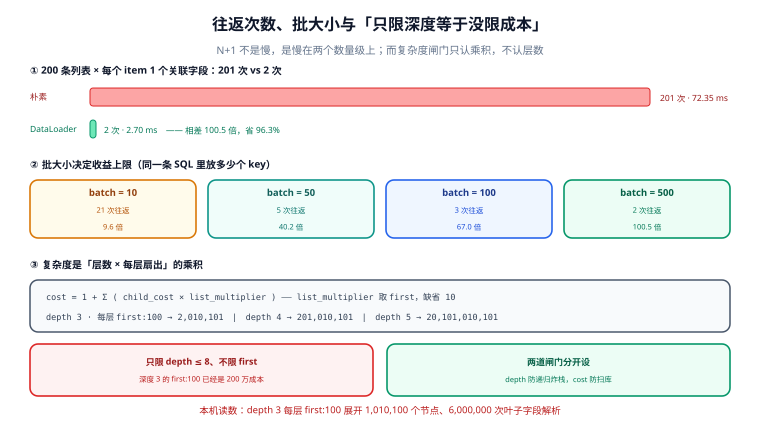

# 性能：N+1、DataLoader 与复杂度闸门

**GraphQL 的性能问题几乎都不是「某个 resolver 慢」，而是「某个 resolver 被调用了太多次」。** 这两件事在代码里看起来完全不同：前者是一段可以逐行优化的函数，后者每个函数都只有十行。

一句话定位：本页回答「往返次数怎么从 201 降到 2、批大小怎么影响收益、以及为什么只限查询深度等于没限成本」。



本页判据族 `GQP-A` ~ `GQP-H`，共 8 条。

## N+1：一次请求 201 次往返

```graphql
query { courses(first: 200) { id title author { name } } }
```

朴素实现（resolver 里直接查）：

```javascript
Course: {
  author: (c, _args, ctx) => ctx.db.user.findById(c.authorId),   // 每条课一次
}
```

往返次数 = 1（列表）+ 200（作者）= **201**。用批量：

```javascript
Course: {
  author: (c, _args, ctx) => ctx.loaders.userById.load(c.authorId),  // 批内合并
}
```

= 1 + 1 = **2**。

| 指标 | 朴素 | 批量 | 比值 |
| --- | --- | --- | --- |
| 往返次数（N=200，1 个关联字段） | 201 | 2 | **100.5 倍** |
| 建模延迟（0.35 ms/次 + 10 µs/次查找） | 72.35 ms | 2.70 ms | 省 **96.3%** |
| 往返次数（N=200，3 个关联字段） | 601 | 4 | **150.2 倍** |
| 往返次数（N=50，2 个关联字段） | 101 | 3 | 33.7 倍 |

**往返次数是数出来的**（`1 + N×F` 对 `1 + F`），这四行的左边都可以手算验证；右边那一列延迟是按「0.35 ms/次往返 + 10 µs/次索引查找」建模的，换网络就换数——引用时请只引次数比。

最后一行值得注意：N 变小，收益比也跟着变小（50 条时只有 33.7 倍）。**N+1 的收益与 N 成正比**，这也是为什么它总在数据量涨上来之后才被发现——测试库 20 条时看不出来。

## DataLoader 的三条语义

DataLoader 不是"缓存"，它同时做三件事，缺一件就会出错：

| 语义 | 做什么 | 缺了会怎样 |
| --- | --- | --- |
| 批（batching） | 同一个 tick 内的请求合并成一次调用 | 还是 N 次，只是代码好看了一点 |
| 缓存（per-request cache） | 同一个 key 只查一次 | 同一作者被 200 条课引用时，仍要 200 次 |
| 顺序还原（key → 结果映射） | 按 keys 顺序把结果排回去 | 结果与对象错位，页面张冠李戴 |

第三条最容易被忽略，也最严重：批量查询返回的行**不一定**按 `IN` 里的顺序。实现必须按 key 建 Map 再回填，而不是直接 `results[i]` 对应 `keys[i]`。

```javascript
const userLoader = new DataLoader(async (ids) => {
  const rows = await db.query('select id, name from app_user where id = any($1)', [ids]);
  const byId = new Map(rows.map(r => [r.id, r]));
  return ids.map(id => byId.get(id) ?? null);   // ← 必须按 ids 顺序回填
});
```

## 批大小：收益有上限

把 200 个 key 分成多少批，直接决定还剩多少次往返：

| `maxBatchSize` | 往返次数 | 相对朴素 |
| --- | --- | --- |
| 10 | 21 | 9.6 倍 |
| 50 | 5 | 40.2 倍 |
| 100 | 3 | 67.0 倍 |
| 500 | 2 | **100.5 倍** |

批越大越快，但不是越大越好——`IN (1000 个 id)` 会让执行计划退化（PG 的 `= any($1)` 还好，MySQL 的 `IN` 列表超过几千项会走全表扫）。工程上的折中是 **100~500**，并且给批量查询配一条单独的慢查询阈值。

::: danger 注意
**DataLoader 的四个必踩的坑：**

1. **跨请求复用 loader** = 脏读。loader 的缓存必须挂在 `context` 上，每个请求一份。挂在模块级变量上，A 用户能看到 B 用户刚写的行。
2. **key 没归一并存**：`'1'` 与 `1` 在 Map 里是两个 key，同一个对象查两次。字符串 id 一律 `String(id)`。
3. **批内重复 key 没去重**：200 条课只有 5 个作者时，`IN` 里 200 个 id 有 195 个重复。loader 自己会按 key 缓存，但自定义批量函数要自己 `new Set(keys)`。
4. **批内一个错误炸整批**：`Promise.all` 里一条失败会让整批 reject。正确做法是逐条 settle，把失败的那条回填成 `null`（或一个错误对象）。
:::

## 复杂度：成本是乘积，不是层数

大多数实现都有「深度限制」，然后又都被一条深度 3 的查询打穿：

```graphql
query {
  courses(first: 100) {
    chapters(first: 100) {
      lessons(first: 100) { id title }
    }
  }
}
```

深度只有 3。成本按 `cost = 1 + Σ(child_cost × list_multiplier)`（`list_multiplier` 取 `first`，缺省 10）算：

| 查询 | 成本 |
| --- | --- |
| 深度 3、每层 `first: 10`（缺省） | 2,111 |
| 三个并列 `list(first:100)`、深度 2 | 60,301 |
| 深度 3、每层 `first: 100` | **2,010,101** |
| 深度 4、每层 `first: 100` | **201,010,101** |
| 深度 5、每层 `first: 100` | **20,101,010,101** |

深度 3 的那一行，展开后是 **1,010,100 个节点**、**6,000,000 次叶子字段解析**（每个叶子 6 个字段）。而它的深度只比你设的 `depth <= 8` 小 5 层。

::: danger 注意
**只限深度、不限扇出，等于没限。** 深度限制防的是「递归炸栈」，成本限制防的是「扫库」——两个不同的问题，需要两道闸门。一个只写了 `depth <= 8` 的服务端，攻击者用深度 8 的 `first:1000` 就能造出 10^24 级的成本估算；反过来只限成本不限深度，一条 `first:1` 的 200 层自引用查询仍能把栈打爆。
:::

两道闸门的推荐值（供参考，按自己的库容量校准）：

| 闸门 | 建议值 | 不满足时 |
| --- | --- | --- |
| `maxDepth` | 8 | 校验期拒，`errors[].extensions.code = QUERY_TOO_DEEP` |
| `maxCost` | 10,000 | 校验期拒，`code = QUERY_TOO_COMPLEX` |
| `maxAliases` | 30 | 校验期拒，`code = TOO_MANY_ALIASES` |
| 默认 `first` | 20，上限 100 | schema 里 `Int! = 20`，参数校验里封顶 |

## 闸门放在校验层，不要放在 resolver

复杂度可以在**校验期**算出来：schema 是静态的，查询也是静态的，`first` 的值如果来自变量，变量在这一步也已经强制完成（coercion）。所以在 `validate` 之后、`execute` 之前算一次成本，超限直接返回错误——**不执行任何 resolver、不打一次库**。

放在 resolver 里算的版本有个致命问题：你必须先执行到那一层才知道成本，而执行到那一层时，上层该打的库已经打完了。

## 响应体积：不分页的代价

| 返回条数 | 响应体积 |
| --- | --- |
| 2,000 条（每条 8 个字段 + 2 个嵌套对象） | **490,304 B ≈ 0.47 MiB** |
| 100 条（同结构） | **24,312 B ≈ 0.02 MiB** |

差 **20 倍**，与条数成正比。0.47 MiB 听起来不大，但它是**单个请求**，而 GraphQL 的客户端习惯在一次页面加载里发 3~5 个请求；再叠上「列表里带详情字段」这种常见写法，单个响应上 5 MiB 是常态。

真正的问题不在带宽，在**序列化内存**：服务端要先把整个结果树建成对象再写 JSON，2,000 条 × 10 字段的对象树在 Node 里约 10~20 MB 堆。10 个并发的这类请求就能把一个小实例打满。分页不是"优化"，是把内存占用从「随数据量」变成「随页大小」。

## 本页判据

| 判据 | 看什么现象 | 判成什么 | 不满足时改哪里 |
| --- | --- | --- | --- |
| `GQP-A` | 关联字段的往返次数是 `1 + F` 而不是 `1 + N×F` | 往返量 O(1) | 接 DataLoader 或手工批量 |
| `GQP-B` | loader 挂在 `context` 上，每请求一份 | 无跨请求脏读 | 从模块级移到请求作用域 |
| `GQP-C` | 批量函数按 keys 顺序回填结果 | 无错位 | 建 Map 后 `ids.map()` |
| `GQP-D` | `maxBatchSize` 在 100~500 之间且配了慢查询阈值 | 收益与计划都可控 | 设上限，单独监控批量 SQL |
| `GQP-E` | 校验期计算复杂度，超限不执行 | 不白打一次库 | 闸门挂 `validate` 之后 |
| `GQP-F` | `maxDepth` 与 `maxCost` 两道闸门同时存在 | 递归与扫库都拦住 | 补另一道 |
| `GQP-G` | 每个列表参数都有默认值与上限 | 无「不限条数」入口 | `Int! = 20` + 上限校验 |
| `GQP-H` | 慢日志里有「单请求往返次数」这一列 | 慢查询可归因 | 在 context 里计数并落日志 |

## 验证方式

```javascript
// ① 复杂度计算器：喂一句查询，打印成本 —— 期望与上表一致
const { parse, validate } = require('graphql');
const { getComplexity, simpleEstimator, fieldExtensionsEstimator } = require('graphql-query-complexity');

const complexity = getComplexity({
  schema,
  query: parse(`
    query { courses(first: 100) { chapters(first: 100) { lessons(first: 100) { id title } } } }
  `),
  estimators: [
    fieldExtensionsEstimator(),
    simpleEstimator({ defaultComplexity: 1 }),
  ],
});
console.log('cost =', complexity);   // 期望 2,010,101（按本页公式）
```

预期输出：`cost = 2010101`。若明显小于这个数，说明 estimator 只按节点计数、没乘 `first`——那它对「扇出炸弹」完全免疫。

```sql
-- ② 单请求往返次数排行（GQP-H）：先有计数，才谈得上优化
select request_id,
       count(*) filter (where kind = 'db') as db_calls,
       max(duration_ms)                    as total_ms
from gql_resolver_span
where started_at > now() - interval '1 hour'
group by request_id
having count(*) filter (where kind = 'db') > 50
order by db_calls desc
limit 20;
```

预期输出：正常应为 **0 行**。有行就说明某个查询在打 N+1——`request_id` 能让你把这条查询从客户端日志里捞出来。

```shell
# ③ 闸门是否真的在校验期生效（GQP-E）
curl -s -o /dev/null -w "%{http_code}\n" http://localhost:4000/graphql \
  -H 'content-type: application/json' \
  -d '{"query":"{ courses(first:1000){ chapters(first:1000){ lessons(first:1000){ id } } } }"}'
```

预期输出：`400`（校验期拒）。若返回 `200` 且很慢，说明闸门在执行期才生效——它拦住了结果，但库已经被扫过了。

## 参考资料

- GraphQL 规范「Validation」（为什么复杂度可以在执行前算出来）：<https://spec.graphql.org/September2025/#sec-Validation>
- `graphql-query-complexity` 的估算器接口与 `simpleEstimator` 语义：<https://github.com/slicknode/graphql-query-complexity>
- DataLoader 官方文档（批处理、缓存、批大小）：<https://github.com/graphql/dataloader>
- GraphQL 基金会「Serving over HTTP」中的 GET/POST 与请求体上限：<https://graphql.org/learn/serving-over-http/>
