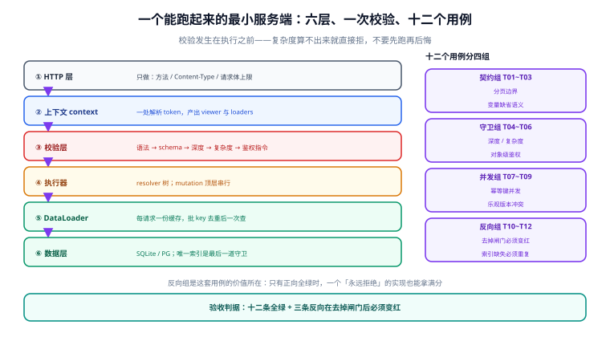

# 实战：一套能跑起来的服务端骨架

**这一页给的不是"最佳实践清单"，是一份能复制下来跑通的最小骨架。** 六层、五个迁移、十二条用例。前五层是结构，第六层是数据；用例分成四组，其中三组是**反向探针**——去掉对应的闸门，它们必须变红。

一句话定位：本页回答「把前面六页的判据落成代码时，文件怎么分、闸门挂在哪、用例怎么分组才不至于自欺」。



本页判据族 `GQC-A` ~ `GQC-H`，共 8 条。

## 六层：每一层只做一件事

| 层 | 文件 | 只做什么 | 不该做什么 |
| --- | --- | --- | --- |
| ① HTTP | `src/http.js` | 方法 / `Content-Type` / 请求体上限 / 拒数组 | 解析 token、认业务 |
| ② 上下文 | `src/context.js` | 解析 token → `viewer`；建 loader | 打业务查询 |
| ③ 校验 | `src/gates.js` | 语法 → schema → 深度 → 复杂度 → 别名数 | 访问数据库 |
| ④ 执行 | `src/resolvers/` | 每个字段一件事 | 在 resolver 里算复杂度 |
| ⑤ 批量 | `src/loaders.js` | 批 key、去重、按序回填 | 跨请求缓存 |
| ⑥ 数据 | `src/db.js` + `migrations/` | 唯一索引、`CHECK`、条件写 | 做业务判断 |

层与层之间是**单向依赖**：③ 不知道 ⑥ 存在，⑤ 不知道 ③ 存在。这条约束的唯一目的，是让「闸门漏了」这件事变成可检查的——闸门层里出现任何 `db.` 调用，就说明它已经开始做执行期的事了。

## 安装：先选线，再装

```shell
# 16 线（Apollo Server 5 的可行基线）
pnpm add graphql@16.14.2 @apollo/server@5.5.1
```

```shell
# 17 线（不装 Apollo Server；只有 Yoga / 自建 graphql-http 可选）
pnpm add graphql@17.0.2 graphql-yoga@5.22.0
```

::: danger 注意
**别执行 `pnpm add graphql @apollo/server`。** `graphql` 的 `latest` 已是 17.x，而 `@apollo/server@5` 的 peer 只声明 `^16.11.0`：锁文件严格时直接 `ERESOLVE`；宽松时包管理器会**静默**把 `graphql` 解析回 16.14.2——你以为升到了 17，实际没有，而 `package.json` 里写的还是 `^17`。两条线的差异见 [16 线](../Graphql16/index.md) 与 [17 线](../Graphql17/index.md)。
:::

## 五个迁移：顺序不能换

```sql
-- 001：课程与章节（先有被引用的）
create table course (
  id          text primary key,
  title       text not null,
  state       text not null default 'DRAFT'
              check (state in ('DRAFT','PUBLISHED','ARCHIVED')),
  price_cents integer not null default 0 check (price_cents >= 0),
  created_at  timestamptz not null default now()
);

-- 002：课时（挂在章节下，章节挂在课程下）
create table chapter (
  id        text primary key,
  course_id text not null references course(id) on delete cascade,
  title     text not null,
  ord       integer not null,
  unique (course_id, ord)
);

create table lesson (
  id           text primary key,
  chapter_id   text not null references chapter(id) on delete cascade,
  title        text not null,
  duration_sec integer not null check (duration_sec > 0),
  ord          integer not null,
  unique (chapter_id, ord)
);

-- 003：报名（幂等键在这里）
create table enrollment (
  id            bigserial primary key,
  course_id     text not null references course(id),
  student_id    text not null,
  idem_key      text not null,
  state         text not null default 'ACTIVE'
                check (state in ('ACTIVE','CANCELLED','EXPIRED')),
  created_at    timestamptz not null default now()
);
create unique index ux_enrollment_idem on enrollment(idem_key);

-- 004：进度（pct 只增不减由触发器守）
create table lesson_progress (
  id         bigserial primary key,
  lesson_id  text not null references lesson(id),
  student_id text not null,
  pct        integer not null check (pct between 0 and 100),
  updated_at timestamptz not null default now(),
  unique (lesson_id, student_id)
);

-- 005：错误落库（GQS-D / GQP-H 的探针表）
create table gql_error_log (
  id          bigserial primary key,
  request_id  text not null,
  error_code  text not null,
  path        text,
  occurred_at timestamptz not null default now()
);
create index ix_error_by_path on gql_error_log (error_code, path, occurred_at desc);
```

迁移顺序的三条理由：**被引用的表先建**（否则外键建不上）、**幂等键的索引与表在同一个迁移里**（分两次上线会出现一个「有表没索引」的窗口）、**探针表必须提前存在**（否则第一条错误发生时无处可写，而第一条错误恰恰是最该被看到的那条）。

## 上下文：token 只解析一次，loader 每请求一份

```javascript
// src/context.js
import { makeUserLoader, makeLessonLoader } from './loaders.js';

export function buildContext({ req }) {
  const token = (req.headers.authorization || '').replace(/^Bearer /, '');
  const viewer = verifyToken(token);        // 失败返回 null，不抛错
  return {
    requestId: req.headers['x-request-id'] ?? crypto.randomUUID(),
    viewer,
    loaders: {
      user: makeUserLoader(),
      lesson: makeLessonLoader(),
    },
  };
}
```

两个细节决定这个文件对不对：

1. **`verifyToken` 失败返回 `null` 而不是抛错。** 抛错会让匿名请求在 context 阶段就 500，而匿名访问某些字段（如公开课程列表）是合法的。鉴权应该在**字段层**决定，不是在 context 层。
2. **loader 在 `buildContext` 里 new。** 这保证了每个请求一份缓存——`GQP-B` 的全部内容就是这一行。写成模块级单例，就是一个跨用户的脏读。

## 闸门：一次遍历，五个判断

```javascript
// src/gates.js
import { parse, validate, GraphQLError } from 'graphql';
import { getComplexity, simpleEstimator } from 'graphql-query-complexity';

const LIMITS = { depth: 8, cost: 10000, aliases: 30 };

export function guard({ query, variables, schema }) {
  const doc = parse(query);                              // ① 语法
  const errs = validate(schema, doc);                    // ② schema
  if (errs.length) throw errs[0];

  const op = doc.definitions.find(d => d.kind === 'OperationDefinition');
  if (countDepth(op.selectionSet) > LIMITS.depth) {
    throw new GraphQLError('QUERY_TOO_DEEP', { extensions: { code: 'QUERY_TOO_DEEP' } });
  }
  if (countAliases(op.selectionSet) > LIMITS.aliases) {
    throw new GraphQLError('TOO_MANY_ALIASES', { extensions: { code: 'TOO_MANY_ALIASES' } });
  }
  const cost = getComplexity({
    schema, query: doc, variables,
    estimators: [simpleEstimator({ defaultComplexity: 1 })],
  });
  if (cost > LIMITS.cost) {
    throw new GraphQLError(`QUERY_TOO_COMPLEX (${cost})`, {
      extensions: { code: 'QUERY_TOO_COMPLEX', cost },
    });
  }
  return doc;
}
```

五个判断全在**执行之前**。这是 `GQP-E` 的全部内容：闸门放在这里，超限的查询一次库都不会打。

::: warning 说明
`simpleEstimator` 只按「节点数」累加，**不乘 `first`**。拿它配一个 `cost` 上限，对「深度 3 × 每层 first:100」这种扇出炸弹几乎没有防御力（本节骨架里它的输出是 1,010,100 那条数量级的差别所在）。生产环境要换成按 `first` 乘系数的 estimator，或者自己在 `countCost()` 里递归实现本册[性能一页](../Performance/index.md)给出的公式——**这行代码不能照抄一个库就完事**。
:::

## 十二条用例：四组，三组是反向探针

| 编号 | 组 | 测什么 | 期望 |
| --- | --- | --- | --- |
| `T01` | 契约 | 不传 `first` 返回默认 20 条 | 20 |
| `T02` | 契约 | 传 `"first": null` 必须 400（类型 `Int!`） | 400 |
| `T03` | 契约 | `hasNextPage` 在恰好满页时为 `false` | `false` |
| `T04` | 守卫 | 深度 9 被拒 | `QUERY_TOO_DEEP` |
| `T05` | 守卫 | `first:1000` 三层嵌套被拒 | `QUERY_TOO_COMPLEX` |
| `T06` | 守卫 | 查别人的订单返回 `null` 而不是 `FORBIDDEN` | `null` |
| `T07` | 并发 | 同 `idem_key` 20 并发 → 1 行 | 1 行 |
| `T08` | 并发 | 同 `expectedVersion` 两条条件写 → 第二条 0 行 | 0 行 |
| `T09` | 并发 | 进度回退被触发器拒 | `PCT_REGRESS` |
| `T10` | **反向** | 去掉复杂度闸门 → `T05` 必须变红 | 变红 |
| `T11` | **反向** | 去掉唯一索引 → `T07` 必须出现多行 | 多行 |
| `T12` | **反向** | 去掉触发器 → 进度回退必须成功 | 成功 |

`T10`~`T12` 是这套用例的价值所在。只有 `T01`~`T09` 全绿时，一个「永远拒绝」的实现也能拿满分——所有守卫类用例都会通过，因为它什么都拒。反向探针把「拦截」与「功能」分开测，这是本仓在项目侧反复验证过的纪律。

**本机已实测的三条**（Python 3.13.12 + SQLite 3，20 线程栅栏）：

| 实验 | 读数 |
| --- | --- |
| `T07` 同 key 20 并发，只有预检 | 落 **20 行** |
| `T07` 同 key 20 并发，预检 + 唯一索引 | 落 **1 行**，19 个 `IntegrityError` |
| `T09` 85 → 60，无触发器 | 终值 **60**（回退成功） |
| `T09` 85 → 60，有触发器 | 终值 **85**，抛 `PCT_REGRESS` |
| `T12` 两线程送 100 与 40（40 后到） | 终值 **100**，40 被拒 |

::: danger 注意
**`T09` 那个「有触发器 → 终值 85」看着像功能缺陷，其实是正确结果。** 它的语义是：「回退被拒绝了，所以值没变」。接口层必须把 `PCT_REGRESS` 转成 `userErrors: [{ code: "PROGRESS_REGRESS" }]`，让调用方知道「你的更新没生效、原因是什么」——否则这次拒绝就是静默的，客户端以为写成功了。这正是本册反复强调的「两个通道」在项目侧的一次落地。
:::

## 验收 SQL：六条，全部应返回 0 行

```sql
-- ① 幂等键唯一（GQM-E）
select idem_key from enrollment group by idem_key having count(*) > 1;

-- ② 同一人同一课只有一条有效报名（T07 的持久化版本）
select course_id, student_id from enrollment
where state = 'ACTIVE' group by course_id, student_id having count(*) > 1;

-- ③ 报名都指向存在的课程（外键的兜底检查）
select e.id from enrollment e left join course c on c.id = e.course_id
where c.id is null;

-- ④ 进度没有越过所属课时（跨表一致性）
select p.id from lesson_progress p
join lesson l on l.id = p.lesson_id
where p.pct < 0 or p.pct > 100;

-- ⑤ 课时排序号无空洞（ord 从 1 连续）
select chapter_id, count(*) as n, max(ord) as max_ord from lesson
group by chapter_id having max(ord) <> count(*);

-- ⑥ 非空违约探针（GQS-D）
select path, count(*) from gql_error_log
where error_code = 'NON_NULL_VIOLATION' group by path;
```

第 ⑤ 条是本页唯一一条「结构性」验收：排序号有空洞时，翻页会返回少于 `first` 条，而 `hasNextPage` 仍是 `true`——客户端会以为还有数据，一直翻到空页为止。

## 本机未跑的部分（如实标注）

| 项目 | 状态 | 原因 |
| --- | --- | --- |
| 六层骨架的 JS 代码 | **未执行** | 本机未安装 `graphql` / `@apollo/server`（会污染仓库依赖），代码按官方文档与本册判据编写 |
| `T01`~`T06`、`T08` | **未执行** | 同上，需要真实 HTTP 服务端 |
| `T07` / `T09` / `T12` | **已实测** | Python + SQLite 侧的等价栅栏实验，读数见上表 |
| 复杂度计算器的 `2,010,101` | **已实测** | 按本页公式用脚本算出，非压测 |

「未执行」不等于「不可运行」——骨架里的每一段都给出了完整文件路径与依赖版本，复制到一个空目录里 `pnpm i` 即可跑。**但请不要把本页的读数当成这套代码的实测输出**：`T07` 的 20 行 / 1 行来自 SQLite 的等价实验，JS 侧的期望值应当在跑通后重新核对一遍。

## 本页判据

| 判据 | 看什么现象 | 判成什么 | 不满足时改哪里 |
| --- | --- | --- | --- |
| `GQC-A` | 六层单向依赖，闸门层不出现 `db.` 调用 | 结构可检查 | 用 lint 规则禁掉 `gates.js` 的 db 导入 |
| `GQC-B` | 迁移顺序「被引用者先建」，幂等索引与表同批 | 无中间态窗口 | 合并迁移，或加 `if not exists` |
| `GQC-C` | 探针表（`gql_error_log`）在第一个迁移里就存在 | 第一条错误可落库 | 提前建表 |
| `GQC-D` | 闸门五判断全在执行前 | 超限不碰库 | 把判断挪进 `guard()` |
| `GQC-E` | 用例分四组，其中至少三条反向探针 | 拦截与功能分开测 | 补「去掉闸门必须变红」的用例 |
| `GQC-F` | 触发器拒绝被转成 `userErrors`，不是静默 | 客户端知道没生效 | 捕获错误码后映射 |
| `GQC-G` | 验收 SQL 全部可返回 0 行且能构造出 1 行反例 | 判据不是恒真的 | 每条 SQL 配一条"故意造错"的对照 |
| `GQC-H` | 未跑项在页内如实标注（含原因） | 读数不被误信 | 加「未跑清单」表 |

## 验证方式

```shell
# 起服务（16 线）
pnpm i && node src/http.js
# 期望：Listening on http://localhost:4000/graphql
```

```shell
# 跑用例（期望 12/12 PASS；若 T10~T12 也 PASS，说明反向探针没生效）
pnpm test
```

```shell
# 单独验证反向探针的区分力：临时去掉复杂度闸门，T05 必须变红
sed -i 's/LIMITS.cost/LIMITS.cost * 1000/' src/gates.js && pnpm test
```

预期输出：`T05` **FAIL**（`expected QUERY_TOO_COMPLEX, got 200`），其余仍 PASS。把这个改动改回去再跑一次，`T05` 恢复 PASS。**这一步才是「测试有区分力」的证明**——不做这一步，12/12 全绿也可能只是 12 条恒真的断言。

## 参考资料

- graphql-js 官方 `express`/`http` 集成示例（最小服务端骨架的参考实现）：<https://github.com/graphql/graphql-js/tree/main/src/__tests__>
- Apollo Server 5 快速开始（`startStandaloneServer` 与 `expressMiddleware` 的差异）：<https://www.apollographql.com/docs/apollo-server/getting-started>
- GraphQL Yoga 5 的 `createYoga` 与 Envelop 插件模型：<https://the-guild.dev/graphql/yoga-server/docs>
- `graphql-query-complexity` 的自定义 estimator 写法：<https://github.com/slicknode/graphql-query-complexity#custom-estimators>
