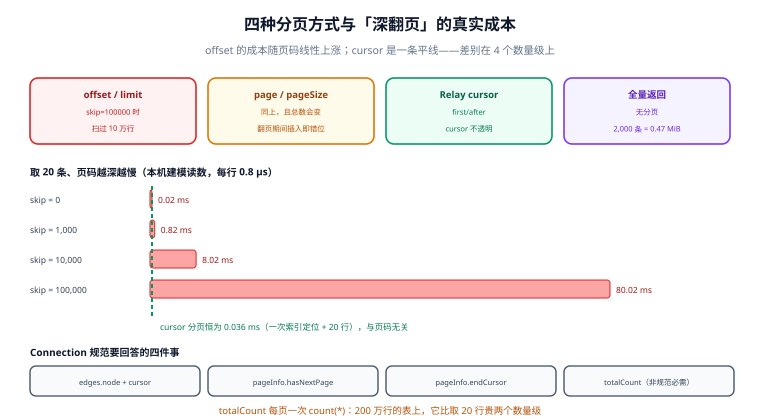

# Query：字段解析、分页四法与 Connection 契约

**Query 是「只读」的那一半，但它不等于「便宜」。** 一条 `query` 可以合法地要求 100 万次字段解析——规范允许，schema 允许，你的校验层如果不拦，数据库就会替它买单。

一句话定位：本页回答「字段是怎么被解析出来的、分页有哪四种写法以及它们的成本差在哪、`Connection` 那套 `edges/pageInfo` 到底要回答哪几件事」。



本页判据族 `GQQ-A` ~ `GQQ-H`，共 8 条。

## 字段解析：默认 resolver 只认同名属性

每个字段都要有一个 resolver（解析函数）。没写的话，服务端用默认 resolver：**从父对象上取同名属性**，取不到就返回 `undefined`。

```javascript
// 等价于默认 resolver
Course: {
  title: (parent) => parent.title,
}
```

这条规则解释了一整类 bug：页面渲染出来某个字段永远是 `null`，而 resolver 里"明明查到了"。原因是父对象上的属性名和 schema 字段名不一致：

| schema 字段 | 父对象实际属性 | 结果 |
| --- | --- | --- |
| `durationSec` | `duration_sec` | `null`（默认 resolver 取不到） |
| `author` | `authorId` | `null`（拿到的是数字，但类型是对象） |
| `lessons` | `lessonList` | `null` |

::: danger 注意
**`undefined` 与 `null` 在序列化上等价，在诊断上完全不同。** 默认 resolver 返回 `undefined`，GraphQL 序列化成 `null`——你在响应里看不出区别。排查这类问题的第一步永远是：在 resolver 里 `console.log(Object.keys(parent))`，看父对象到底有什么，而不是猜 schema。
:::

三个特殊字段值得单独记：

- `__typename`：任何对象都能查，返回类型名字符串。它是 `union` / `interface` 的**唯一**判型手段。
- `__schema` / `__type`：内省入口。生产环境是否开放见[安全一页](../Security/index.md)。
- 别名（alias）：`a: course(id:"C1") { title }` 与 `b: course(id:"C2") { title }` 可以在同一层取两次不同参数。这是 GraphQL 相对 REST 的一个真实便利，也是「宽度炸弹」的入口——见 `GQO` 与 `GQX`。

fragment 用来复用选择集，两种形态：命名 fragment（`fragment F on Course`）与 inline fragment（`... on Course { }`）。注意**fragment 不能循环引用**，规范把它判为校验错误——所以「递归取三层子节点」只能一层层手写，不能用 fragment 递归。

## 变量：默认值只在「没传」时生效

这是 GraphQL 变量语义里最容易写错的一条：

```graphql
query ListCourses($first: Int = 20, $state: State) {
  courses(first: $first, state: $state) { id title }
}
```

| 客户端传的 `variables` | `$first` 的值 | 说明 |
| --- | --- | --- |
| `{}` | `20` | 没传 → 用默认值 |
| `{"first": null}` | `null` | **传了 null → 默认值不生效** |
| `{"first": 50}` | `50` | 正常 |

第三行与第二行的区别，是「显式要求无」与「没意见」的区别——规范刻意保留了这个差别。后果是：如果 `first` 的类型是 `Int`（可空），客户端一句 `"first": null` 就能让你的分页退化成全量返回。

::: danger 注意
**分页参数的类型必须是 `Int!` 而不是 `Int`，且必须给默认值。** 写成 `Int` 时 `null` 是合法输入，`first: null` 意味着「不限条数」——这句话在不同实现里的行为不一致（有的当 0，有的当全量），两边都能构建成功，只有线上数据量涨上来才发现。
:::

## 分页四法：成本差两个数量级

| 方式 | 参数 | 深翻页成本 | 翻页期间数据变动 |
| --- | --- | --- | --- |
| `offset / limit` | `skip` + `take` | 随页码线性上涨 | 会错位（少一条或重复一条） |
| `page / pageSize` | 页码 + 页大小 | 同上 | 同上，且总页数会变 |
| Relay cursor | `first` + `after` | **恒定** | 稳定（游标锚在具体行上） |
| 全量返回 | 无 | — | — |

本机建模读数（取 20 条、每行 0.8 µs）：

| `skip` | `offset` 成本 | `cursor` 成本 |
| --- | --- | --- |
| 0 | 0.02 ms | 0.036 ms |
| 1,000 | 0.82 ms | 0.036 ms |
| 10,000 | 8.02 ms | 0.036 ms |
| 100,000 | **80.02 ms** | **0.036 ms** |

第 0 行值得注意：**第一页上 `offset` 反而更快**——`cursor` 多了一次索引定位。所以「用 cursor」不是无条件更优，它是**在深翻页上**更优。真实业务里第 0 页的流量占大头，但第 100 页的成本占大头的钱。

`offset` 的 `skip=100000` 意味着数据库要**扫过 10 万行再丢掉**，这 10 万行不是为了返回，纯粹是为了定位。而 `cursor` 是 `where (created_at, id) < (?, ?) order by created_at desc, id desc limit 20`——一次索引定位，成本与页码无关。

::: warning 说明
**`cursor` 的游标必须不透明。** 把游标记成 `"id=123"` 这种可读形式，客户端一定会开始自己拼游标（"既然就是 id，那我直接传 id 好了"），于是你失去改游标实现的能力。规范用 base64 编码不是为了好看，是为了让「客户端不该解析它」这件事在格式上成立。
:::

## Connection 契约：要回答的四件事

Relay 的 Connection 规范定义了 `edges` / `node` / `cursor` / `pageInfo` 这套形状，落地时真正要回答的是四个问题：

| 要素 | 回答什么 | 常见错误 |
| --- | --- | --- |
| `edges[].node` + `edges[].cursor` | 这一页有什么、下一页从哪开始 | cursor 与 node 混成一个字段 |
| `pageInfo.hasNextPage` | 还有没有下一页 | 用「本页条数 == first」判断（最后一页恰好满页时会多给一次空页） |
| `pageInfo.endCursor` | 下一页的起点 | 返回 null 但 `hasNextPage` 是 true |
| `totalCount`（非规范必需） | 一共多少条 | 每页都跑一次 `count(*)` |

第三行与第四行是两个真实的成本点：

- **`hasNextPage` 不能靠「本页满页」推断。** 正确做法是多取一条（`limit first + 1`），有第 `first+1` 条就说明还有下一页，然后丢掉它。多取一条的成本是 1 行，比多给客户端一次空页便宜。
- **`totalCount` 每页一次 `count(*)`。** 200 万行的表上它比取 20 行贵两个数量级，而且**它只在第一页有意义**。工程写法是：`totalCount` 只在 `after` 为空时计算，后续页返回 `null` 并在文档里写明。

## 排序与过滤：枚举 + input，不要字符串

```graphql
enum CourseOrder { CREATED_DESC TITLE_ASC PRICE_ASC }

input CourseFilter {
  state: State
  keyword: String
  priceGte: Int
  priceLte: Int
}

type Query {
  courses(first: Int! = 20, after: String, orderBy: CourseOrder = CREATED_DESC,
          filter: CourseFilter): CourseConnection!
}
```

三条纪律：

1. **`orderBy` 用枚举不用字符串**——字符串会被拼进 `order by`，是 SQL 注入的最短路径。
2. **`filter` 用 input 对象不用「一堆平铺参数」**——平铺参数没法整体可选，也没法在客户端复用。
3. **排序字段必须有对应的复合索引**，且 `order by` 的最后一项必须是唯一列（通常是 `id`），否则深翻页会在相同值上抖动。

第 3 条是 cursor 分页正确性的前提：`order by created_at desc` 而 `created_at` 有重复值时，两次查询的行序可能不同，游标就会跳过或重复。加上 `id` 作第二排序键（`order by created_at desc, id desc`）才稳定。

## 本页判据

| 判据 | 看什么现象 | 判成什么 | 不满足时改哪里 |
| --- | --- | --- | --- |
| `GQQ-A` | schema 字段名与父对象属性名的映射显式写在 resolver 里 | 不会静默 `null` | 给「名字不一致」的字段补 resolver |
| `GQQ-B` | 分页参数类型是 `Int!` 且有默认值 | `null` 不退化全量 | 改 schema，`Int` → `Int! = 20` |
| `GQQ-C` | 列表走 cursor 分页，游标不透明（base64） | 深翻页成本恒定 | 加 `edges/pageInfo`，游标编码 |
| `GQQ-D` | `hasNextPage` 用「多取一条」实现 | 不会多给空页 | `limit first + 1`，判断后截断 |
| `GQQ-E` | `totalCount` 只在首屏计算，后续页为 `null` | 省掉每页 `count(*)` | 按 `after` 是否为空分支 |
| `GQQ-F` | `orderBy` 是枚举、`filter` 是 input | 无注入面、可复用 | 收敛参数形状 |
| `GQQ-G` | 排序键末位是唯一列（`id`） | 游标不跳行 | 复合索引 `(sort_col, id)` |
| `GQQ-H` | 空集合返回 `[]` 而不是 `null` | 客户端少一路判空 | resolver 里 `?? []` |

## 验证方式

```graphql
# ① 变量缺省：不传 first（GQQ-B）
query { courses { edges { node { id } } } }
```

预期：返回 **20 条**（默认值生效）。若返回全部，说明 `first` 缺省值是 `null` 或没写。

```graphql
# ② hasNextPage 的满页边界（GQQ-D）
query { courses(first: 20) { edges { cursor } pageInfo { hasNextPage endCursor } } }
```

预期：当库里恰好 20 条时 `hasNextPage` 必须是 `false`。若为 `true`，实现用的是「满页推断」，客户端会多请求一次空页。

```sql
-- ③ 深翻页：两条 SQL 的执行计划对照（PostgreSQL）
explain (analyze, buffers)
select id, title from course order by created_at desc, id desc limit 20 offset 100000;
```

预期输出：`Buffers: shared hit=...` 的行数随 `offset` 增长（要扫过并丢弃 10 万行）。把同一条改成游标形式再跑：

```sql
explain (analyze, buffers)
select id, title from course
where (created_at, id) < ('2026-01-01'::timestamptz, 999999)
order by created_at desc, id desc limit 20;
```

预期输出：`Index Scan`，扫描行数从「10 万+」降到「20 上下」。**这两个读数就是 `GQQ-C` 的证据**：同样是第 5000 页，成本差几千倍。

## 参考资料

- Relay Cursor Connections 规范（`edges` / `pageInfo` / 游标语义）：<https://relay.dev/graphql/connections.htm>
- GraphQL 规范「Field Selection & Arguments」（别名与参数的语义）：<https://spec.graphql.org/September2025/#sec-Language.Fields>
- GraphQL 规范「Coercing Variables」（默认值只在变量未提供时生效）：<https://spec.graphql.org/September2025/#sec-Coercing-Variable-Values>
- PostgreSQL 文档「Row Comparison」（`(a,b) < (?,?)` 的索引利用）：<https://www.postgresql.org/docs/current/functions-comparisons.html>
