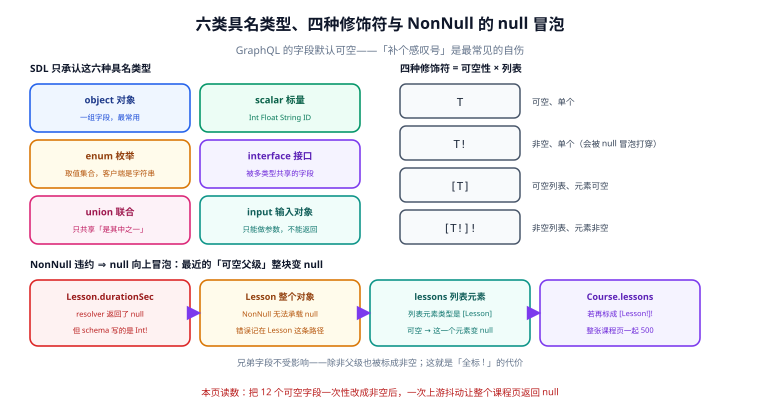

# Schema 与 SDL：六类类型、四种修饰符与 null 冒泡

**schema 是这个端点唯一的契约。** REST 里契约散在几十个 handler 的返回值里，GraphQL 里它集中在一份 SDL（Schema Definition Language，schema 定义语言）文件中——这份文件既是文档、又是校验依据、又是代码生成的输入，也是攻击者拿内省一眼看全的地图。

一句话定位：本页回答「六类具名类型怎么选、`!` 到底该不该加、以及一个字段返回 null 时为什么会把整块数据打掉」。



本页判据族 `GQS-A` ~ `GQS-H`，共 8 条。

## 六类具名类型：只能选这六个

SDL 只承认六种具名类型，没有第七种。选错类型的后果不是「不好看」，而是「表达不出来」：

| 类型 | 写法 | 能做什么 | 不能做什么 |
| --- | --- | --- | --- |
| `object` 对象 | `type Course { id: ID! }` | 有字段、可被查询返回 | 不能做参数类型 |
| `scalar` 标量 | `scalar DateTime` | 叶子值，序列化成 JSON 基础类型 | 不能有字段 |
| `enum` 枚举 | `enum State { DRAFT PUBLISHED }` | 取值集合受控 | 不能带值（没有 `= 1`） |
| `interface` 接口 | `interface Node { id: ID! }` | 多个类型共享字段，可用 fragment 取公共部分 | 不能直接实例化 |
| `union` 联合 | `union SearchResult = Course \| Teacher` | 「其中之一」，只能查 `__typename` 与 fragment | 不能有共享字段 |
| `input` 输入对象 | `input CourseFilter { state: State }` | 只能做参数 | **不能做返回值** |

::: danger 注意
**`input` 与 `object` 不能互换，也不能互相引用。** 一个常见的绕路是「为了复用字段，把 `input` 也当查询返回值」，这在 SDL 里直接校验不过。正确做法是两份：`type Course` 与 `input CourseInput`，字段重复就重复——**它们的变化理由不一样**（一个面向读者裁剪，一个面向写入校验），共用一个类型反而会把两边的演进绑死。
:::

`union` 与 `interface` 的分界也是同一个道理：`union` 只共享「是其中之一」，所以除了 `__typename` 什么都查不了；`interface` 共享字段，所以可以写 `{ node { id ... on Course { title } } }`。搜索结果用 `union`，领域实体用 `interface`。

## 四种修饰符：可空性 × 列表

`!` 加在类型后面表示非空，两处都能加，于是有四种组合：

| 写法 | 含义 | 什么时候用 |
| --- | --- | --- |
| `T` | 可空、单个 | 默认；业务上允许「没有」 |
| `T!` | 非空、单个 | 确实不会缺的字段（主键、状态） |
| `[T]` | 可空列表、元素可空 | 几乎不用（语义含糊） |
| `[T!]!` | 非空列表、元素非空 | 列表字段的推荐写法：`[]` 表示空，`null` 不存在 |

**GraphQL 的字段默认可空**，这和大多数强类型语言相反——你必须显式写 `!` 才得到非空。这个默认是对的：它让「这个字段可能没有」成为一个必须表态的设计决定，而不是悄悄继承语言默认。

但「全都加 `!` 更安全」是个危险的直觉。它安全的只是**读代码的人**，不安全的是**线上**。

## null 冒泡：一个字段把父级整块打掉

规范规定：一个声明为非空的字段，resolver 返回了 `null`，服务端必须记一条错误，并把该错误**向上传播**到最近的可空祖先。这条规则叫 null 冒泡（error propagation）。

```graphql
type Lesson {
  id: ID!
  title: String!
  durationSec: Int!      # ← resolver 返回了 null
}
type Course {
  id: ID!
  lessons: [Lesson]      # 元素可空 → 只有这一个元素变 null
}
```

执行结果不是「`durationSec` 变成 null」，而是 **`lessons[0]` 整个元素变成 null**：

```json
{
  "data": { "course": { "id": "C1", "lessons": [ null ] } },
  "errors": [ { "message": "Cannot return null for non-nullable field Lesson.durationSec.",
                "path": ["course", "lessons", 0, "durationSec"] } ]
}
```

注意 `path` 指向 `durationSec`，而**被置空的是它的父对象**。之所以只丢了一个元素而不是整张课程页，是因为 `lessons` 的元素类型 `[Lesson]` 是可空的——错误在「最近的可空祖先」停住了。

把 `lessons` 改成 `[Lesson!]!`，同样的违约会把 `course` 整块打掉；`course` 若是 `Course!`，`data` 直接变 `null`。**这就是「全标 `!`」的代价：越多的非空声明，意味着越多的单点故障可以连坐。**

::: danger 注意
**三条关于非空的实现纪律：**

1. **`!` 只加在「数据模型层面必然存在」的字段上**，不加在「这次查询恰好查到了」的字段上。`Course.id` 是前者，`Course.rating` 是后者（还没人评分）。
2. **列表字段写成 `[T!]!` 而不是 `[T]`**：空列表返回 `[]`，不要返回 `null` 让客户端两边都判。这一条能消掉一半的「客户端空指针」。
3. **非空字段的违约必须有监控。** 它是「静默」的：HTTP 200，`data` 里少了一块，只有 `errors` 里有一行。没有按 `errors[].path` 的计数，你永远不知道它发生过。
:::

## 契约演进：两件工具，不是版本号

REST 里改字段要开 `v2`，GraphQL 里不需要——schema 本身就带着演进工具：

| 工具 | 作用 | 注意 |
| --- | --- | --- |
| `@deprecated(reason: "…")` | 标记字段/枚举值弃用，内省会带 `isDeprecated` 与 `deprecationReason` | 只对**字段与枚举值**有效，不能标类型 |
| `@specifiedBy(url: "…")` | 自定义标量声明规格来源 | 自定义标量**必须**给，否则客户端不知道 `DateTime` 是什么格式 |

于是 GraphQL 的兼容策略是「只加不删」，三条规则：

1. **加字段、加可选参数、加枚举值** = 兼容。
2. **删字段、改类型、把可空改非空** = 破坏性，必须先 `@deprecated` 再观察调用量。
3. **改枚举值（重命名、删值）** = 破坏性，因为客户端拿到的就是字符串字面量。

::: warning 说明
**「加枚举值」在规范层面兼容，在客户端层面未必。** 一个用 `switch` 穷举枚举的客户端，遇到新值会走到 `default` 分支——如果那里写着 `throw`，这次「兼容的发布」就是一次线上故障。所以加枚举值之前，先确认客户端有 `default` 兜底。这一条是 GraphQL 里最容易被「规范说兼容」误导的地方。
:::

`@oneOf`（September 2025 Edition 新增）值得单独提一句：它让一个 input 对象变成「这些字段里必须有且只有一个有值」，正好对应「按 id 查或按 slug 查」这类参数。它比自己写校验可靠，因为违反时是**校验期**报错，不是执行期。

## 三个必踩的建模反模式

| 反模式 | 表现 | 后果 |
| --- | --- | --- |
| 直接暴露数据库表 | `user_id`、`created_at`、`deleted_at` 遍布 schema | 改表即改契约，且把内部实现泄漏给调用方 |
| 万能 `JSON` 标量 | `metadata: JSON`、`config: JSON` | 客户端失去类型，文档失去意义，校验完全失效 |
| 一个 `Mutation` 打天下 | `mutate(action: String, payload: JSON)` | 等于在 GraphQL 上又写了一遍 REST 的坏版本 |

第三条尤其常见，通常出现在「迁移期想省事」的团队里。它的代价是**所有** GraphQL 的优点一起失效：类型、校验、内省、代码生成、成本分析，一个都用不上。

## 本页判据

| 判据 | 看什么现象 | 判成什么 | 不满足时改哪里 |
| --- | --- | --- | --- |
| `GQS-A` | 输入用 `input`、输出用 `object`，两者不混用 | 校验与裁剪各司其职 | 拆成 `Xxx` 与 `XxxInput` 两份 |
| `GQS-B` | 列表字段写成 `[T!]!`，空集合返回 `[]` | 客户端少一路判空 | 改 schema，并在 resolver 里 `?? []` |
| `GQS-C` | `!` 只加在模型层面必然存在的字段上 | 连坐范围可控 | 逐字段复核，把「偶尔缺失」的去掉 `!` |
| `GQS-D` | 非空违约有按 `errors[].path` 的计数 | 静默失败可见 | 监控加一条 `path` 维度的计数器 |
| `GQS-E` | 破坏性变更前先 `@deprecated` 并观察调用量 | 演进可灰度 | 加 `@deprecated(reason:)` 与调用统计 |
| `GQS-F` | 自定义标量都带 `@specifiedBy` | 序列化格式无歧义 | 补 URL 或改用内置标量 |
| `GQS-G` | schema 里没有 `JSON` 万能字段与「动作字符串」式 mutation | 类型系统没被架空 | 收敛成具体类型与具名 mutation |
| `GQS-H` | 枚举新增值前确认客户端有 `default` 兜底 | 发布不惊群 | 先改客户端再改服务端 |

## 验证方式

schema 的正确性可以用三行命令自查，不需要跑任何业务查询。

```shell
# ① 打印最终 schema：内省与实际定义是否一致
node -e "
const { buildSchema, printSchema } = require('graphql');
const fs = require('fs');
const sdl = fs.readFileSync('schema.graphql', 'utf8');
const schema = buildSchema(sdl);
console.log(printSchema(schema));
"
```

预期输出：与你写的 SDL 语义等价（顺序与注释会变）。若打印出的类型比你写的多，说明有代码在运行时偷偷注入（例如 federation 或 code-first 混用）。

```shell
# ② 结构合法性：比「能不能 build」更严格
node -e "
const { buildSchema, validateSchema } = require('graphql');
const schema = buildSchema(require('fs').readFileSync('schema.graphql','utf8'));
const errs = validateSchema(schema);
console.log(errs.length === 0 ? 'OK' : errs.map(e => e.message).join('\n'));
"
```

预期输出：`OK`。`validateSchema` 会抓出 `buildSchema` 放过的两类问题：接口没被任何类型实现、联合类型成员重复。

```sql
-- ③ 探针：非空违约发生过几次（GQS-D）；错误落库表见实战一页
select path, count(*) as hits, max(occurred_at) as last_seen
from gql_error_log
where error_code = 'NON_NULL_VIOLATION'
  and occurred_at > now() - interval '7 day'
group by path
order by hits desc
limit 20;
```

预期输出：正常应 **0 行**。有行说明 schema 里有字段声明了非空但数据允许为空——按 `path` 逐个修，不要先改 schema 再查数据（改 schema 只是把错误藏起来）。

## 参考资料

- GraphQL 规范「Type System」一章（六类具名类型与修饰符的定义）：<https://spec.graphql.org/September2025/#sec-Type-System>
- GraphQL 规范「Errors and Non-Null Fields」（null 冒泡的原文规则）：<https://spec.graphql.org/September2025/#sec-Errors-and-Non-Null-Fields>
- GraphQL 规范「Built-in Directives」（`@deprecated` / `@specifiedBy` / `@oneOf`）：<https://spec.graphql.org/September2025/#sec-Type-System.Directives>
- graphql-js `validateSchema` 的类型检查清单：<https://github.com/graphql/graphql-js/blob/main/src/type/validate.ts>
