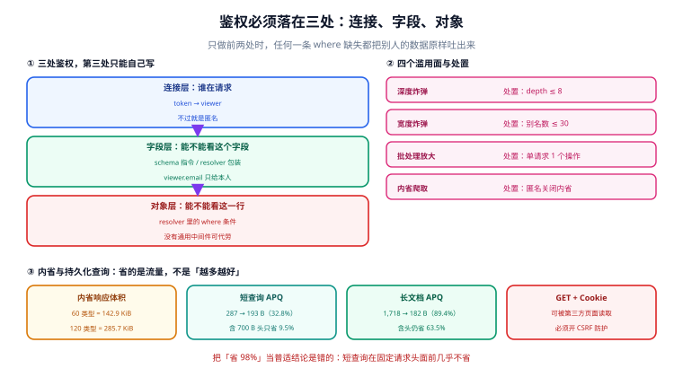

# 安全：三处鉴权、四个滥用面与内省开关

**GraphQL 的安全问题有一半来自「鉴权只做了两处」。** 连接层知道「谁在请求」，字段层知道「能不能看这个字段」，但「能不能看这一行」没有任何通用中间件能代劳——它只能写在每个 resolver 的 `where` 里，而漏写一个 `where` 就是一次数据泄漏，接口却照常返回 200。

一句话定位：本页回答「鉴权必须落在哪三处、内省到底该不该关、持久化查询能省多少（以及不能省多少）、四个滥用面各自怎么拦」。



本页判据族 `GQX-A` ~ `GQX-H`，共 8 条。

## 三处鉴权

| 层 | 回答什么 | 实现位置 | 漏了会怎样 |
| --- | --- | --- | --- |
| 连接层 | 谁在请求？匿名还是登录？ | HTTP 中间件解析 token → `context.viewer` | 匿名能读一切 |
| 字段层 | 这个字段能不能给这个角色看？ | schema 指令 / resolver 包装 | `viewer.email` 泄露给任何人 |
| 对象层 | 这一行数据是不是他的？ | **每个 resolver 的 `where` 条件** | 把别人的订单原样返回 |

前两处有通用解法，第三处没有。这是 GraphQL 与 REST 在安全上最大的实操差别：REST 的 `GET /orders/:id` 里那个 `:id` 天然带着「属于谁」的判断位置（因为一个 handler 只服务一种资源），而 GraphQL 的 `orders` 字段可能被任何查询在任意深度调用，归属判断必须写在**字段解析的那一行**。

```javascript
// 字段层：用指令做通用的可见性判定
const isOwner = (resolver) => (parent, args, ctx, info) => {
  if (!ctx.viewer) throw new GraphQLError('UNAUTHENTICATED', {
    extensions: { code: 'UNAUTHENTICATED' },
  });
  if (parent.ownerId !== ctx.viewer.id && ctx.viewer.role !== 'ADMIN') {
    return null;   // ← 注意：返回 null 而不是抛错
  }
  return resolver(parent, args, ctx, info);
};
```

::: danger 注意
**「返回 null」还是「抛错」，是一个安全决策，不是风格问题。** 返回 `null` 意味着「这里没有东西」——攻击者无法区分「不存在」与「无权访问」，也就无法用这一点做枚举。抛 `FORBIDDEN` 则明确告诉他「这个 id 存在但不属于你」，那是一份免费的 id 存在性探测接口。默认应该返回 `null`；只有在「用户确实应该知道自己无权」的场景（如后台操作）才抛错。
:::

## 对象层：漏一个 `where` 就是一次泄漏

```javascript
Query: {
  // ✗ 错：id 从参数来，归属没判
  order: (_, { id }, ctx) => ctx.db.order.findById(id),

  // ✓ 对：归属写进查询条件，不存在与无权返回同一个结果
  order: (_, { id }, ctx) =>
    ctx.db.order.findFirst({ where: { id, ownerId: ctx.viewer.id } }),
}
```

列表字段同理，而且更危险——它一次返回多行：

```javascript
orders: (_, args, ctx) =>
  ctx.db.order.findMany({
    where: { ownerId: ctx.viewer.id, ...buildFilter(args.filter) },   // ← 归属必须在前
    take: args.first + 1,
  }),
```

这类「拼 filter」的写法有个隐蔽的坑：如果 `buildFilter` 返回的对象里也有 `ownerId`（比如支持按 owner 过滤），展开顺序会让客户端的值**覆盖**服务端的归属条件。**归属条件必须在展开之后单独再赋一次**，或者用 `AND: [{ ownerId }, buildFilter(...)]`。

## 内省：关掉能省多少，以及代价

内省（introspection）让客户端能查 `__schema` 拿到全部类型、字段、参数、弃用原因。它对开发是必需的，对生产是「一份完整的地图」。

本机读数（按「对象类型 × 字段」生成的 `__schema` 响应）：

| schema 规模 | 内省响应体积 |
| --- | --- |
| 60 个对象类型 × 12 字段 | **146,282 B ≈ 142.9 KiB** |
| 120 个对象类型 × 12 字段 | **292,522 B ≈ 285.7 KiB** |

体积本身不是问题，问题是**它可被匿名批量拉取**：一次 143 KiB 的响应，1000 次请求就是 143 MB 流量，而每一次都在给你的攻击者画地图。

三种策略，按风险从高到低：

| 策略 | 谁能内省 | 代价 |
| --- | --- | --- |
| 全开（默认） | 所有人 | 地图公开，且可被当流量放大器 |
| 只对登录用户开 | 有 token 的请求 | 匿名攻击者拿不到；但一次注册就能拿到 |
| 只对白名单 IP / 内部服务开 | 构建机、代码生成流水线 | 客户端代码生成必须走 CI，不能「本地跑一下」 |

::: warning 说明
**关内省不是"安全措施"，是"降低暴露面"。** schema 的形状最终会通过错误信息、字段行为、文档泄漏出去。真正的安全靠上面三处鉴权。关内省的价值在于：它让「扫一遍就能找到所有可枚举的 id 字段」这件事变贵。
:::

## 持久化查询：省的是流量，别把「98%」当普适结论

持久化查询（含 Apollo 的 APQ 自动持久化）把查询文档换成哈希，请求体只剩变量。省幅**完全取决于文档长度**：

| 场景 | 原始请求体 | 持久化后 | 省幅 |
| --- | --- | --- | --- |
| 短查询（287 B 文档） | 287 B | 193 B | **32.8%** |
| 短查询 + 700 B 固定请求头 | 987 B | 893 B | **9.5%** |
| 长文档（12 个 fragment，1,631 字符） | 1,718 B | 182 B | **89.4%** |
| 长文档 + 700 B 固定请求头 | 2,418 B | 882 B | **63.5%** |

第三行与第一行的差别就是全部结论：**短查询在固定请求头面前几乎不省**（9.5%）。把「持久化查询省 98%」当普适结论，会在小查询为主的接口上换来一个「加了复杂度却几乎没收益」的结论。

它真正的价值不在带宽，在两点：

1. **可信文档（trusted documents）**：只允许执行白名单里的文档，任何临时拼的查询直接拒——这是把「客户端能执行任意查询」变成「客户端只能执行审核过的查询」，是滥用面收窄最彻底的一招。
2. **执行计划缓存**：文档一致就能缓存 `parse + validate` 的结果。在复杂度计算本身很贵（几千个字段的 schema）时，这一项比省流量值钱。

## 四个滥用面

| 滥用面 | 形态 | 拦截位置 | 判据 |
| --- | --- | --- | --- |
| 深度炸弹 | 自引用类型套 200 层 | 校验期 `maxDepth` | `GQP-F` |
| 宽度炸弹 | 一屏 1000 个别名字段 | 校验期 `maxAliases` | `GQX-C` |
| 批处理放大 | 一次 POST 一个数组，100 个查询 | 传输层：只接受单个操作 | `GQX-D` |
| 内省爬取 | 匿名狂拉 `__schema` | 内省白名单 + 请求级限流 | `GQX-E` |

第三条是最容易被忽略的：GraphQL 允许 `POST` 一个**数组**，服务端逐个执行。规范没有要求支持它，但很多框架默认支持——于是「单请求限流 100 QPS」瞬间变成「10000 次操作/秒」。

## CSRF 与「GET + Cookie」

GraphQL over HTTP 允许 `GET` 带 `?query=`，本意是让读操作可被 CDN 缓存。但只要你的鉴权走 **Cookie**，一个第三方页面就能用 `` 触发读取——即 XS-Search。

| 服务端 | 默认行为（2026-09 核对） |
| --- | --- |
| graphql-yoga 5.22 | 内省与 GraphiQL **默认开**（生产也是）；**CSRF 防护默认不开**，`GET /graphql?query={hello}` 直接执行 |
| Apollo Server 5 | 默认开 CSRF 防护；5.5.0 起拒绝带非 `application/json` `Content-Type` 的 GET |
| Apollo Server 4.x | 已 EOL（2026-01-26），CSRF 绕过公告的修复**只在 5.5.0**，4.x 没有补丁 |

三条落地结论：

1. **用 Cookie 鉴权就必须关 GET 执行**（或强制要求自定义头 + `Content-Type`）。
2. **用 Bearer token 的可以留 GET**——浏览器不会自动带上 `Authorization`，CSRF 不成立。这也是一种解法：把鉴权从头挪到 Cookie 之外。
3. **别指望「框架默认安全」。** Yoga 的默认值对开发友好、对生产不友好；Apollo 5 的默认值反过来。选型时把这一栏单独列出来看。

## 注入面：变量是唯一正确通道

| 写法 | 风险 |
| --- | --- |
| 把用户输入拼进 `query` 字符串 | 可注入任意字段、任意指令，绕过复杂度计算 |
| 把用户输入拼进 SDL | 可注入类型定义（极少见，但代码生成工具会吃） |
| `orderBy` 用字符串 | 直接拼进 `order by`，SQL 注入 |
| 变量 + 参数化查询 | 无注入面 |

第二条特别值得说：从「用户可编辑的 schema 片段」生成 schema 的功能（低代码平台常见）如果直接字符串拼接，攻击者能往 schema 里塞一个 `interface` 把已有类型改掉。这类代码一律走 AST 构造，不要拼字符串。

## 本页判据

| 判据 | 看什么现象 | 判成什么 | 不满足时改哪里 |
| --- | --- | --- | --- |
| `GQX-A` | 三处鉴权都有：连接、字段、对象 | 无越权读 | 对象层逐个 resolver 补归属条件 |
| `GQX-B` | 无权访问返回 `null` 而非 `FORBIDDEN` | 不可用于 id 枚举 | 改返回值为 `null`，只在确需时抛错 |
| `GQX-C` | 校验期有别名数上限（≤ 30） | 宽度炸弹被拒 | 加 `maxAliases` |
| `GQX-D` | 传输层只接受单个操作，不接受数组 | 不可放大 | 请求体为数组直接 400 |
| `GQX-E` | 生产环境内省按白名单开放 | 地图不公开 | 中间件按 IP/角色判定 |
| `GQX-F` | 持久化查询或可信文档白名单启用 | 只能执行审核过的查询 | 接 APQ / trusted documents |
| `GQX-G` | Cookie 鉴权时 GET 不执行查询 | 无 XS-Search | 关 GET 或强制自定义头 |
| `GQX-H` | 错误信息不泄漏 SQL 原文与堆栈 | 无内部信息外泄 | `formatError` 里按环境裁剪 |

## 验证方式

四条 `curl` 覆盖四个滥用面，全部应被拒：

```shell
# ① 深度炸弹：期望 400 + QUERY_TOO_DEEP
curl -s -o /dev/null -w "%{http_code}\n" http://localhost:4000/graphql \
  -H 'content-type: application/json' \
  -d '{"query":"{ course(id:\"C1\"){ lessons{ course{ lessons{ course{ lessons{ id } } } } } } }"}'
```

```shell
# ② 宽度炸弹：1000 个别名，期望 400 + TOO_MANY_ALIASES
python - <<'PY' > /tmp/wide.json
import json
q = "{ " + " ".join(f"a{i}: course(id:\"C{i}\"){{ id }}" for i in range(1000)) + " }"
print(json.dumps({"query": q}))
PY
curl -s -o /dev/null -w "%{http_code}\n" http://localhost:4000/graphql \
  -H 'content-type: application/json' --data-binary @/tmp/wide.json
```

```shell
# ③ 批处理放大：请求体是数组，期望 400（而不是逐个执行）
curl -s -o /dev/null -w "%{http_code}\n" http://localhost:4000/graphql \
  -H 'content-type: application/json' \
  -d '[{"query":"{ courses { edges { node { id } } } }"},{"query":"{ courses { edges { node { id } } } }"}]'
```

```shell
# ④ 匿名内省：期望 400 / 403，或返回 errors 而不是 data.__schema
curl -s http://localhost:4000/graphql \
  -H 'content-type: application/json' \
  -d '{"query":"{ __schema { types { name } } }"}'
```

预期输出：①④ 各 `400` 或 `403`；② `400`；③ `400`。**四条里任意一条返回 200 且带完整 `data`，对应的滥用面就是敞开的。** 注意 ③ 若返回一个长度 2 的数组，说明框架在逐个执行——那是比 `200` 更糟的形态，因为它看起来"成功"。

```sql
-- ⑤ 越权探针（GQX-A）：这个用户有没有读过不属于他的行
select actor_id, resource_type, count(*) as hits
from access_audit
where decision = 'DENIED_AS_NOT_FOUND'   -- 归属不匹配被当成「不存在」
  and occurred_at > now() - interval '1 day'
group by actor_id, resource_type
order by hits desc
limit 20;
```

预期输出：正常业务下应为个位数。突然出现某个 `actor_id` 上百次，先查它的 token 是不是被别人在用，而不是去改代码。

## 参考资料

- GraphQL 规范「Introspection」（内省可被关闭的实现依据）：<https://spec.graphql.org/September2025/#sec-Introspection>
- GraphQL over HTTP 规范（GET/POST 与 `Content-Type` 语义）：<https://graphql.github.io/graphql-over-http/draft/>
- graphql-yoga 安全默认值（批处理、内省、CSRF 三项的实测口径）：<https://the-guild.dev/graphql/yoga-server/docs/features/csrf-prevention>
- Apollo Server `whats-new`（5.5.0 的 CSRF 修复与 4.x EOL）：<https://www.apollographql.com/docs/apollo-server/whats-new/>
- OWASP「GraphQL Cheat Sheet」（滥用面清单的权威来源）：<https://cheatsheetseries.owasp.org/cheatsheets/GraphQL_Cheat_Sheet.html>
