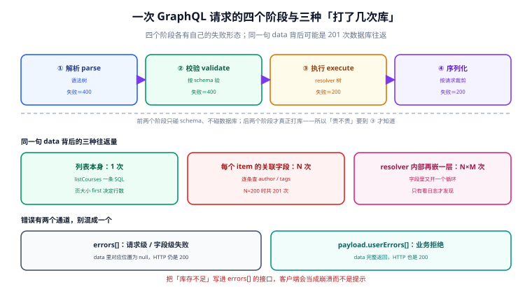

# GraphQL 服务端工程

**GraphQL 把「取什么形状」的决定权交给了调用方。** 这句话是它的全部价值，也是它的全部风险：客户端写一句嵌套三层的 `first: 100`，服务端就可能要跑 200 万次字段解析；客户端少写一个 `where`，服务端就可能把别人的数据原样吐出来——而这两种情况，`pnpm docs:build` 一样全绿、HTTP 一样 200。

这一册只写**服务端这一侧**要写死的东西：类型系统怎么定、三种操作各自的语义边界、错误走哪两个通道、N+1 怎么在框架之外解决、复杂度与深度在哪一步拒、鉴权为什么要落在三处。九页里有五页的主题是「失败很安静」——返回 200 但 `data` 是 null、列表少了几条、并发下多出一行、内省把整个 schema 交出去、账单式的宽查询把库拖垮。

## 章节

- [总览：一个端点、三个阶段与三个「打了几次库」](Overview/index.md) —— 请求生命周期、三种操作、错误两通道、版本基线
- [Schema 与 SDL：六类类型、四种修饰符与 null 冒泡](Schema/index.md) —— 非空违约如何打穿父级、契约演进的两件工具
- [Query：字段解析、分页四法与 Connection 契约](Query/index.md) —— 变量缺省语义、深翻页成本、`totalCount` 的代价
- [Mutation：串行、两通道与幂等键](Mutation/index.md) —— 顶层字段按序跑完、payload 形状、重复提交返回同一个结果
- [性能：N+1、DataLoader 与复杂度闸门](Performance/index.md) —— 201 次到 2 次、批大小收益、深度不等于成本
- [安全：三处鉴权、四个滥用面与内省开关](Security/index.md) —— 对象级过滤只能自己写、持久化查询省多少
- [实战：一套能跑起来的服务端骨架](Practice/index.md) —— 六层结构、五个迁移、十二条用例、六条验收 SQL
- [常见问题与分诊](FAQ/index.md) —— 六行分诊表、十二问、止血五步、术语表
- [graphql-js 16 线（维护中）](Graphql16/index.md) —— Apollo Server 5 的唯一可行基线
- [graphql-js 17 线（当前主线）](Graphql17/index.md) —— Node 22+、六个被删的导出、与 AS5 的硬冲突

## 判据族一览

十族共 80 条，每页八条（`-A` ~ `-H`），定义在各页「本页判据」一节：

| 页面 | 族 | 约定 | 条数 |
| --- | --- | --- | --- |
| 总览 | `GQO` | 四阶段失败形态、三处往返量、错误两通道、版本基线 | 8 |
| Schema | `GQS` | 六类类型、修饰符、非空违约、契约演进 | 8 |
| Query | `GQQ` | 变量缺省、分页四法、cursor 不透明、总量代价 | 8 |
| Mutation | `GQM` | 串行非原子、payload 形状、错误归属、幂等键 | 8 |
| 性能 | `GQP` | 往返量、批大小、复杂度乘积、两道闸门 | 8 |
| 安全 | `GQX` | 三处鉴权、滥用四面、内省策略、注入面 | 8 |
| 实战 | `GQC` | 分层依赖、迁移顺序、反向探针、验收容差 | 8 |
| 常见问题 | `GQF` | 分诊可定位、读数可回溯、止血顺序、术语易混点 | 8 |
| 16 线 | `GQV6` | 依赖可行域、兼容声明、状态标注、迁移触发条件 | 8 |
| 17 线 | `GQV7` | Node 底盘、移除导出、增量交付、安装冲突 | 8 |

## 大版本：为什么这一册有版本目录

本仓的判据是「同一份代码两套写法」才建版本目录——[Spring5](../Java/Frame/Spring/Spring5/index.md) / [Spring6](../Java/Frame/Spring/Spring6/index.md)、[Vue2](../../Frontend/Frame/Vue/Vue2/index.md) / [Vue3](../../Frontend/Frame/Vue/Vue3/index.md) 都是这个理由。GraphQL 这一册**恰好命中**这条判据，而且比大多数主题更硬：

1. **两条线的安装组合互斥。** `graphql@17` 与 `@apollo/server@5` 装不到一起——后者 `peerDependencies` 只声明 `graphql: ^16.11.0`，直接装会 `ERESOLVE`；不锁版本时包管理器会**静默**把 `graphql` 降到 16.14.2，你以为升了，其实没升。
2. **同一段代码要改。** 17 线移除了 `assertValidName`、`formatError`、`getOperationRootType`、`getVisitFn`、`isValidNameError`、`printError` 六个导出，还要求 Node 22 起。这不是「换个版本号」。
3. **差异不能收敛进一张表。** 装 16 还是 17，决定了你**能不能用** `@defer`、决定了你的 `Dockerfile` 基础镜像、决定了 `graphql-ws` 的可用区间——三件事都是链条级别的，不是参数级别的。

所以版本目录是 [Graphql16](Graphql16/index.md) 与 [Graphql17](Graphql17/index.md)，两条线各自完整、各自标注状态，**旧线不删、不覆盖**。

::: warning 说明
版本目录之外，其余八页写的都是**与版本无关**的工程判据。`GQP-B`（DataLoader 缓存必须按请求隔离）在 16 线和 17 线一个字都不用改——这正是把它们分开的原因：让「换版本要改什么」与「本来该怎么写」不要互相污染。
:::

## 与本册相邻的专题

GraphQL 横跨契约、网关、缓存、鉴权四个域，本册刻意只写「schema 定完之后，服务端怎么把它实现对」，其余交给相邻专题：

| 这件事 | 本册负责 | 隔壁专题负责 |
| --- | --- | --- |
| REST 契约的版本治理与兼容策略 | 只到「schema 演进用 `@deprecated`」 | [契约演进与版本治理](../ContractEvolution/index.md) |
| 限流、路由、灰度 | 只到「单端点的请求级限流」 | [网关与东西向流量](../GatewayDeep/index.md) |
| Mutation 的通用幂等语义 | 只到「幂等键作为 input 字段」 | [幂等与状态机](../IdempotencyStateMachine/index.md) |
| SQL 本身的索引与执行计划 | 只到「一次批量 `IN` 查询」 | [SQL 优化](../../DB/Relational/SQLOptimization/index.md) |
| 客户端归一化缓存与乐观更新 | 只到「响应形状要可缓存」 | [状态管理与数据流](../../Frontend/StateDataFlow/index.md) |
| 登录态、会话、令牌签发 | 只到「context 里拿到 viewer」 | [认证与授权](../Auth/index.md) |

一句话区分：**本册把 GraphQL 当「一棵要被执行完的字段树」，隔壁各册分别把它当「一份契约」「一次网关请求」「一次幂等写入」「一条 SQL」「一份客户端缓存」**。

## 阅读路径

| 你的角色 | 建议顺序 |
| --- | --- |
| 后端开发（第一次上 GraphQL） | 总览 → Schema → Query → 实战 |
| 负责性能与线上稳定 | 总览 → 性能 → 安全 → 常见问题 |
| 安全 / 合规评审 | 安全 → Schema（内省与字段暴露） → 17 线（新版默认值） |
| 技术负责人做选型 | 总览（版本基线） → 16 线 / 17 线 → 性能（成本闸门） |

## 本机读数的口径说明

本册所有数字都来自本机脚本（Python 3.13.12 标准库，脚本不入库、可复跑），**明标「建模读数」而非生产压测**。三处容易被误读的口径先写在这里：

- **往返次数与延迟是分开的。** 201 次 → 2 次是**次数**（确定性的计数）；72.35 ms → 2.70 ms 是按「0.35 ms/次往返 + 10 µs/次索引查找」**建模**出来的，换一个网络就换一个数。引用时请只引次数比（100.5 倍），延迟只作量级参考。
- **复杂度是函数算出来的，不是压测出来的。** `cost = 1 + Σ(child × list_multiplier)` 里的 `list_multiplier` 取 `first` 参数、缺省 10。换一个成本函数就换一套数——所以页面里把**公式**写出来了，读者可以自己代入。
- **持久化查询的省幅取决于文档长度。** 短查询只省 32.8%（含固定请求头只剩 9.5%），含 12 个 fragment 的长文档省 89.4%（含头 63.5%）。「省 98%」只在超长文档上成立，不能当普适结论。

## 参考资料

- GraphQL 规范（现行版本为 **September 2025 Edition**，工作草案仍不含 `@defer` / `@stream`）：<https://spec.graphql.org/>
- GraphQL over HTTP 规范（传输层语义：GET/POST、状态码、`Content-Type`）：<https://graphql.github.io/graphql-over-http/>
- graphql-js 仓库与发行说明（17.0.2 的 engine 与导出变更）：<https://github.com/graphql/graphql-js/releases>
- Apollo Server 变更日志（5.x 的安全修复与增量交付支持）：<https://www.apollographql.com/docs/apollo-server/whats-new/>
- Relay Cursor Connections 规范（`edges` / `pageInfo` / `cursor` 的原始定义）：<https://relay.dev/graphql/connections.htm>
